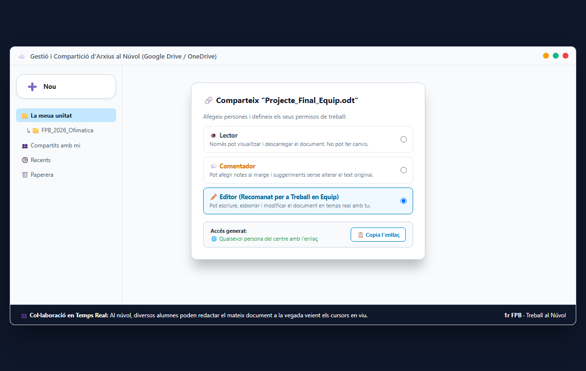

# ☁️ UT07: Dispositius Digitals, Sincronització i Treball al Núvol

Benvingut/da a la **Unitat Temàtica 7** d'**Ofimàtica i Arxiu de Documents (OAD)**. El treball administratiu modern ja no es limita a un ordinador aïllat a una taula: els documents viuen al núvol i s'hi accedeix de manera coordinada des d'ordinadors de sobretaula, portàtils corporatius, tauletes i telèfons intel·ligents. En aquesta unitat aprendràs a utilitzar plataformes d'emmagatzematge al núvol com Google Drive i Microsoft OneDrive, dominaràs la gestió de permisos (**Lector**, **Comentador** i **Editor**) per evitar esborrats accidentals, treballaràs en equip en documents col·laboratius en temps real i aprendràs a resoldre conflictes de sincronització entre equips.

<svg viewBox="0 0 860 260" xmlns="http://www.w3.org/2000/svg" style="max-width: 100%; height: auto; font-family: 'Segoe UI', system-ui, sans-serif; background: linear-gradient(135deg, #0f172a 0%, #1e293b 100%); border-radius: 12px; border: 1px solid #334155; box-shadow: 0 10px 25px -5px rgba(0, 0, 0, 0.4);">
  <defs>
    <linearGradient id="g-cl-dis" x1="0%" y1="0%" x2="100%" y2="100%">
      <stop offset="0%" stop-color="#38bdf8" stop-opacity="0.25"/>
      <stop offset="100%" stop-color="#0284c7" stop-opacity="0.05"/>
    </linearGradient>
    <linearGradient id="g-cl-emm" x1="0%" y1="0%" x2="100%" y2="100%">
      <stop offset="0%" stop-color="#818cf8" stop-opacity="0.25"/>
      <stop offset="100%" stop-color="#4f46e5" stop-opacity="0.05"/>
    </linearGradient>
    <linearGradient id="g-cl-per" x1="0%" y1="0%" x2="100%" y2="100%">
      <stop offset="0%" stop-color="#34d399" stop-opacity="0.25"/>
      <stop offset="100%" stop-color="#059669" stop-opacity="0.05"/>
    </linearGradient>
    <linearGradient id="g-cl-col" x1="0%" y1="0%" x2="100%" y2="100%">
      <stop offset="0%" stop-color="#f59e0b" stop-opacity="0.25"/>
      <stop offset="100%" stop-color="#d97706" stop-opacity="0.05"/>
    </linearGradient>
  </defs>

  <!-- Capçalera -->
  <text x="430" y="32" text-anchor="middle" fill="#f8fafc" font-size="16" font-weight="700" letter-spacing="1">ECOSISTEMA NÚVOL: DISPOSITIUS, EMMAGATZEMATGE, PERMISOS I SINCRONITZACIÓ</text>
  <text x="430" y="50" text-anchor="middle" fill="#94a3b8" font-size="12">Treball col·laboratiu en temps real, gestió de permisos d'accés i sincronització multiplataforma</text>

  <!-- Bloc 1: Dispositius Digitals -->
  <g transform="translate(25, 70)">
    <rect width="185" height="165" rx="10" fill="url(#g-cl-dis)" stroke="#38bdf8" stroke-width="1.5"/>
    <rect x="15" y="14" width="28" height="28" rx="6" fill="#38bdf8" fill-opacity="0.2"/>
    <text x="29" y="33" text-anchor="middle" fill="#38bdf8" font-size="14" font-weight="bold">📱</text>
    <text x="52" y="33" fill="#f8fafc" font-size="13" font-weight="bold">Dispositius Digitals</text>
    <text x="15" y="62" fill="#38bdf8" font-size="11" font-weight="600">Entorn Multiplataforma</text>
    <text x="15" y="84" fill="#cbd5e1" font-size="11">• PC sobretaula i portàtils</text>
    <text x="15" y="104" fill="#cbd5e1" font-size="11">• Mòbils i tauletes (Android/iOS)</text>
    <text x="15" y="124" fill="#cbd5e1" font-size="11">• Sistemes híbrids corporatius</text>
    <text x="15" y="144" fill="#cbd5e1" font-size="11">• Sincronització de fitxers</text>
  </g>

  <!-- Bloc 2: Plataformes Núvol -->
  <g transform="translate(230, 70)">
    <rect width="185" height="165" rx="10" fill="url(#g-cl-emm)" stroke="#818cf8" stroke-width="1.5"/>
    <rect x="15" y="14" width="28" height="28" rx="6" fill="#818cf8" fill-opacity="0.2"/>
    <text x="29" y="33" text-anchor="middle" fill="#818cf8" font-size="14" font-weight="bold">☁️</text>
    <text x="52" y="33" fill="#f8fafc" font-size="13" font-weight="bold">Emmagatzematge</text>
    <text x="15" y="62" fill="#818cf8" font-size="11" font-weight="600">Serveis al Núvol</text>
    <text x="15" y="84" fill="#cbd5e1" font-size="11">• Google Drive / Workspace</text>
    <text x="15" y="104" fill="#cbd5e1" font-size="11">• Microsoft OneDrive / 365</text>
    <text x="15" y="124" fill="#cbd5e1" font-size="11">• Nextcloud privat de taller</text>
    <text x="15" y="144" fill="#cbd5e1" font-size="11">• Historial de versions (Backup)</text>
  </g>

  <!-- Bloc 3: Gestió de Permisos -->
  <g transform="translate(435, 70)">
    <rect width="195" height="165" rx="10" fill="url(#g-cl-per)" stroke="#34d399" stroke-width="1.5"/>
    <rect x="15" y="14" width="28" height="28" rx="6" fill="#34d399" fill-opacity="0.2"/>
    <text x="29" y="33" text-anchor="middle" fill="#34d399" font-size="14" font-weight="bold">🔒</text>
    <text x="52" y="33" fill="#f8fafc" font-size="13" font-weight="bold">Gestió de Permisos</text>
    <text x="15" y="62" fill="#34d399" font-size="11" font-weight="600">Control d'Accés</text>
    <text x="15" y="84" fill="#cbd5e1" font-size="11">• Lector: Només visualització</text>
    <text x="15" y="104" fill="#cbd5e1" font-size="11">• Comentador: Afegeix notes</text>
    <text x="15" y="124" fill="#cbd5e1" font-size="11">• Editor: Modificació i esborrat</text>
    <text x="15" y="144" fill="#cbd5e1" font-size="11">• Enllaç restringit per domini</text>
  </g>

  <!-- Bloc 4: Treball Col·laboratiu -->
  <g transform="translate(650, 70)">
    <rect width="185" height="165" rx="10" fill="url(#g-cl-col)" stroke="#f59e0b" stroke-width="1.5"/>
    <rect x="15" y="14" width="28" height="28" rx="6" fill="#f59e0b" fill-opacity="0.2"/>
    <text x="29" y="33" text-anchor="middle" fill="#f59e0b" font-size="14" font-weight="bold">👥</text>
    <text x="52" y="33" fill="#f8fafc" font-size="13" font-weight="bold">Treball en Equip</text>
    <text x="15" y="62" fill="#f59e0b" font-size="11" font-weight="600">Coedició en Viu</text>
    <text x="15" y="84" fill="#cbd5e1" font-size="11">• Coautoria en temps real</text>
    <text x="15" y="104" fill="#cbd5e1" font-size="11">• Cursors de colors de companys</text>
    <text x="15" y="124" fill="#cbd5e1" font-size="11">• Mencions amb @usuari</text>
    <text x="15" y="144" fill="#cbd5e1" font-size="11">• Eliminació de duplicats locals</text>
  </g>
</svg>

---

## 📑 Apartats de la Unitat Didàctica

| Apartat | Títol de la Secció Didàctica | Enllaç Directe |
| :---: | :--- | :---: |
| **7.1** | Tipus de dispositius digitals i els seus sistemes operatius | [**📘 Llegir Apartat 7.1 →**](./ut0701.html) |
| **7.2** | Sistemes d'emmagatzematge al núvol: Google Drive i OneDrive | [**📘 Llegir Apartat 7.2 →**](./ut0702.html) |
| **7.3** | Compartició de fitxers i gestió de permisos | [**📘 Llegir Apartat 7.3 →**](./ut0703.html) |
| **7.4** | Treball col·laboratiu en temps real sobre documents | [**📘 Llegir Apartat 7.4 →**](./ut0704.html) |
| **7.5** | Sincronització de dispositius mòbils amb l'ordinador | [**📘 Llegir Apartat 7.5 →**](./ut0705.html) |

---

## 🎯 Resultats d'Aprenentatge Treballats

- **RA 5:** Utilitza serveis de comunicació telemàtica, emmagatzematge distribuït i eines de treball col·laboratiu en entorns de xarxa.
  - *CE a:* S'han descrit els dispositius digitals personals i corporatius i els seus mecanismes de connectivitat.
  - *CE b:* S'han organitzat arxius i carpetes en servidors d'emmagatzematge al núvol.
  - *CE c:* S'han assignat permisos d'accés (lectura, comentari i edició) protegint la integritat de la informació.
  - *CE d:* S'ha participat en tasques d'edició compartida en temps real resolent conflictes de versions.

---

## 📊 Matriu de Permisos al Núvol i Riscos de Seguretat de Dades

| Nivell de Permís | Què POT fer l'Usuari | Què NO POT fer l'Usuari | Risc de Seguretat si S'Assigna per Error | Àmbit Recomanat a l'Empresa |
| :--- | :--- | :--- | :--- | :--- |
| **Lector (*Viewer*)** | Veure el document, descarregar còpia i imprimir (si no s'ha bloquejat) | Modificar text, afegir comentaris o canviar el nom del document | **Risc mínim:** la informació original roman totalment inalterada | Clients, lliurament de catàlegs i pressupostos tancats |
| **Comentador (*Commenter*)** | Veure el document i afegir notes o suggeriments al marge | Modificar el text directament sense l'aprovació del propietari | **Risc molt baix:** només pot proposar canvis que cal acceptar | Revisions prèvies de contractes i correccions de projectes |
| **Editor (*Editor*)** | **Modificar tot el text, esborrar seccions senceres, canviar permisos i eliminar arxius** | No pot transferir la propietat final del document | **Risc MÀXIM:** un usuari maldestre o maliciós pot esborrar tota la feina | **Exclusivament membres de l'equip directe de treball** |
| **Propietari (*Owner*)** | Control absolut del fitxer, canvi de propietat i esborrat permanent | Cap restricció | Control exclusiu de l'arxiu | El creador del document o compte d'administració |

---

## 📌 Resum Didàctic i Idees Clau

1. **El Concepte de Núvol (*Cloud Computing*):** Els documents no estan guardats físicament al disc dur local de la nostra màquina, sinó en grans centres de processament de dades (CPD) connectats a Internet. Això permet que un canvi fet des d'un mòbil a les 9:00 estiga disponible a l'ordinador de la feina a les 9:01.
2. **Eliminació de Documents Duplicats:** En l'oficina antiga s'enviava un arxiu per correu com a `document_v1.docx`, el company responia amb `document_v1_revisat.docx` i el cap tornava a respondre amb `document_definitiu_OK.docx`, creant un caos de versions. Al núvol existeix **un únic arxiu mestre** sobre el qual tothom treballa alhora.
3. **Gestió de Permisos de Compartició:**
   - Mai s'ha de compartir un arxiu amb l'opció *"Qualsevol persona que tinga l'enllaç pot editar"*, ja que qualsevol desconegut a Internet podria esborrar el contingut.
   - La regla professional és compartir sempre mitjançant **adreces de correu electrònic nominatives** de l'organització.
4. **Historial de Versions:** Si un company esborra per error 5 pàgines d'un informe compartit, no cal patir: les plataformes com Google Docs o Word Online guarden un **historial complet de versions minut a minut** que permet viatjar enrere en el temps i restaurar qualsevol estat anterior amb un sol clic.
5. **Conflictes de Sincronització:** Quan dos usuaris modifiquen un mateix fitxer mentre treballaven sense connexió a Internet (en un avió o sense Wi-Fi), en recuperar la connexió el gestor de núvol (OneDrive/Drive) no sap quina modificació és la correcta i genera automàticament una còpia addicional amb el nom de l'equip (*Fitxer - Còpia en conflicte*), exigint la revisió manual.

---

## 📸 Guia Visual Pas a Pas d'Emmagatzematge i Col·laboració al Núvol

### Pujar Fitxers i Gestió de Permisos de Compartició (Drive / OneDrive)

---

## 📝 Quadern d'Activitats Pràctiques i Reptes de Laboratori

### Bloc A: Fonaments, Dimensionament i Diagnòstic Tècnic

#### Exercici 1: Dimensionament d'Emmagatzematge i Temps de Sincronització
Una empresa de disseny i serveis d'oficina té contractat un compte d'emmagatzematge al núvol amb una quota total d'**1 Terabyte (1.000 GB)**. L'estat actual d'ocupació és el següent:
- Carpeta de Factures i Documents PDF: $45\text{ GB}$.
- Còpia de seguretat de bases de dades: $120\text{ GB}$.
- Fotografies i vídeos corporatius de productes: $680\text{ GB}$.
1. Calcula quant espai lliure restant li queda a l'empresa tant en Gigabytes com en percentatge respecte al límit d'1 TB.
2. L'empresa necessita pujar un lot de noves imatges que ocupa **180 GB**. Hi cabrà a l'espai restant disponible? Quina acció d'estalvi o ampliació s'ha de planificar abans que el núvol es bloquege per excés de quota?
3. Si la connexió a Internet de l'oficina té una velocitat de pujada (*Upload*) simètrica de **300 Mbps** ($37,5\text{ MB/s}$), quant de temps trigarà a sincronitzar-se completament aquest lot de 180 GB ($184.320\text{ MB}$) des del primer ordinador fins al núvol? Aplica:
   $$\text{Temps (s)} = \frac{\text{Mida (MB)}}{\text{Velocitat (MB/s)}}$$
   Expressa el resultat en segons, minuts i hores.

#### Exercici 2: Matriu de Risc en la Compartició d'Arxius de Recursos Humans
El departament de personal disposa d'un full de càlcul anomenat `Sous_i_Bonus_2026.xlsx` que conté els sous privats de tots els empleats de l'empresa.
1. Analitza què passaria si l'administratiu genera un enllaç de compartició configurat com a:
   `"Tothom qui tinga l'enllaç - Editor"`
   Quins riscos de difusió massiva a Internet, filtració de dades personals i xantatge podrien produir-se?
2. Com s'ha de configurar correctament l'accés a aquest arxiu segons les bones pràctiques corporatives:
   - Quin tipus d'enllaç s'ha de seleccionar (Restringit només a persones afegides)?
   - Quins permisos ha de tenir la cap de comptabilitat (Editor)?
   - Quins permisos ha de tenir el director general (Lector o Comentador)?
3. Si un treballador de l'empresa deixa de formar part de la plantilla, quina acció immediata de revocació d'accés s'ha d'executar al panell de control del núvol?

#### Exercici 3: Diagnòstic de Fallades de Sincronització i Duplicats en Conflicte
Un tècnic d'oficina obre la seua carpeta local de OneDrive a l'Explorador d'arxius de Windows i observa dos problemes:
1. Al costat del nom de tres fitxers apareix una **icona de núvol blau**, mentre que al costat d'altres apareix un **cercle verd amb un xec blanc** i en un altre apareix una **creu roja**. Què significa cadascuna d'aquestes tres icones d'estat de sincronització?
2. Dins de la carpeta de projectes apareixen de sobte dos arxius: `Pressupost_Oficina.docx` i `Pressupost_Oficina-PC-MARTA-conflicte.docx`. Explica detalladament com s'ha originat aquest duplicat i com han de coordinar-se els dos usuaris per fusionar els canvis i esborrar la còpia redundant.

---

### Bloc B: Reptes Pràctics de Laboratori i Taller

#### Repte 1: Creació d'Estructura de Carpetes al Núvol i Gestió de Permisos
- **Objectiu:** Crear un espai compartit a Google Drive o Microsoft OneDrive, assignar permisos diferenciats i verificar que les restriccions funcionen.
- **Material de laboratori:** Dos ordinadors de taller amb comptes de correu corporatiu d'aula (Alumne A i Alumne B).
- **Passos d'execució:**
  1. L'Alumne A accedeix al seu espai de **Google Drive** o **OneDrive** i crea una carpeta principal anomenada `Projecte_Taller_OAD`.
  2. Dins de la carpeta, crea dues subcarpetes:
     - `01_Documentacio_Oficial`
     - `02_Borrador_i_Treball`
  3. Fes clic dret sobre la carpeta `01_Documentacio_Oficial` > **Comparteix**:
     - Afegeix l'adreça de correu de l'Alumne B.
     - Assigna-li exclusivament el rol de **Lector**.
     - Desactiva l'opció perquè els lectors puguen descarregar o imprimir si es desitja màxima protecció.
  4. Fes clic dret sobre la carpeta `02_Borrador_i_Treball` > **Comparteix**:
     - Afegeix l'adreça de correu de l'Alumne B amb el rol d'**Editor**.
  5. L'Alumne B accedeix des del seu ordinador a la secció *Compartit amb mi*:
     - Intenta crear un document nou a la carpeta `01_Documentacio_Oficial`: comprova que el sistema li ho impedeix per falta de permisos d'escriptura.
     - Intenta crear un document a `02_Borrador_i_Treball`: comprova que té accés complet per crear i editar.

#### Repte 2: Coedició d'un Document d'Acta de Reunió en Temps Real
- **Objectiu:** Experimentar el treball simultani de dos o més usuaris sobre el mateix document en línia sense bloquejos ni pèrdua d'informació.
- **Material de laboratori:** Document compartit de Google Docs o Word Online, dos alumnes treballant en equips diferents.
- **Passos d'execució:**
  1. L'Alumne A crea un document de text en línia anomenat `Acta_Reunio_Tecnica` i el comparteix com a Editor amb l'Alumne B.
  2. Tots dos alumnes obren el document simultàniament des dels seus navegadors web:
     - Observeu com a la cantonada superior dreta apareix la icona de perfil del company connectat en directe.
  3. L'Alumne A comença a redactar a la part superior l'apartat *1. Assistents i Ordre del dia*. L'Alumne B comença a redactar a la part inferior l'apartat *2. Acords adoptats*.
  4. Observeu com a la pantalla de cadascú es veu el cursor de color del company movent-se i escrivint caràcter a caràcter en temps real.
  5. L'Alumne B selecciona una frase escrita per l'Alumne A, fa clic al botó d'afegir comentari i escriu:
     `"@nom_de_l_alumne_A Si us plau, revisa si cal incloure el pressupost del proveïdor"`.
  6. L'Alumne A rep la notificació al document, respon al comentari i el marca com a *Resolt*.

#### Repte 3: Restauració d'Emergència d'una Versió Anterior (*Version History*)
- **Objectiu:** Recuperar informació eliminada accidentalment mitjançant l'eina d'historial de canvis del núvol.
- **Material de laboratori:** Document de text utilitzat al Repte 2.
- **Passos d'execució:**
  1. Sobre el document de l'acta de reunió que ja conté text, un dels alumnes selecciona a propòsit 3 paràgrafs importants i els esborra prement la tecla `Supr`, i a continuació escriu: "Text de prova accidental".
  2. Espereu 10 segons que el document desitge els canvis al núvol automàticament.
  3. Aneu al menú **Fitxer > Historial de versions > Mostra l'historial de versions** (o fes clic a l'enllaç superior "Última modificació fa uns segons").
  4. S'obrirà un panell lateral dret que mostra la llista cronològica de totes les versions desades del document amb el nom de qui va fer cada canvi i l'hora exacta:
     - Selecciona la versió anterior al moment de l'esborrat.
     - Comprova a la pantalla com reapareixen els 3 paràgrafs eliminats assenyalats en verd o lila.
  5. Fes clic al botó superior **Restaura aquesta versió**.
  6. Confirma la restauració i verifica que el document torna a estar intacte sense haver perdut cap dada.

---

### Bloc C: Llista de Verificació i Rúbrica d'Avaluació Competencial

#### Llista de Verificació de Treball al Núvol
- [ ] S'ha creat una estructura de carpetes ordenada al núvol sense barrejar fitxers solts a l'arrel.
- [ ] S'han assignat els permisos d'accés (Lector, Comentador, Editor) segons el principi del mínim privilegi.
- [ ] No s'han creat enllaços públics oberts per a documents d'empresa confidencials.
- [ ] S'ha participat activament en la coautoria en temps real sense sobreescriure el text dels companys.
- [ ] S'han utilitzat els comentaris amb mencions `@` per a comunicar-se dins del document de treball.
- [ ] Es comprèn el significat de les icones de sincronització local (al núvol, descarregat, en sincronització).
- [ ] S'ha utilitzat amb èxit l'historial de versions per recuperar informació danyada o esborrada.

#### Rúbrica d'Avaluació Tècnica (FP Bàsica OAD - UT07)

| Criteri d'Avaluació | Excel·lent (9-10) | Notable (7-8) | Aprovat (5-6) | No Assolit (0-4) |
| :--- | :--- | :--- | :--- | :--- |
| **Plataformes i Espai al Núvol** | Gestiona quotes d'emmagatzematge, calcula temps de transferència i domina les eines de Drive/OneDrive/Nextcloud. | Utilitza el servei de núvol amb soltesa i organitza carpetes i fitxers correctament. | Guarda i descarrega arxius del núvol seguint les instruccions del taller. | No sap accedir al seu compte de núvol o barreja arxius locals amb arxius en xarxa de manera desordenada. |
| **Gestió de Permisos (Lector / Editor)** | Assigna rols de Lector, Comentador i Editor de manera professional, evitant enllaços públics perillosos. | Configura permisos per adreça de correu i distingeix la diferència entre veure i editar. | Assigna permisos de lectura o edició amb suport de la llista de verificació. | Dona permisos d'Editor a tothom per defecte o comparteix enllaços oberts amb dades privades. |
| **Treball Col·laboratiu en Temps Real** | Coedita en viu amb coordinació impecable, respecta les àrees de treball dels companys i empra comentaris amb mencions. | Participa en l'edició simultània de documents i aporta contingut sense interferir en la feina aliena. | Escriu en un document compartit seguint les indicacions de l'equip. | Esborra el text dels companys sense mirar, provoca conflictes o no participa en la coautoria. |
| **Historial de Versions i Resolució de Conflictes** | Navega per l'historial de versions, restaura estats anteriors amb rapidesa i resol còpies en conflicte manualment. | Utilitza l'historial de versions per recuperar dades eliminades satisfactòriament. | Localitza l'opció d'historial de versions guiat pel professor. | Esborra documents i no sap com recuperar-los, donant la feina per perduda. |
