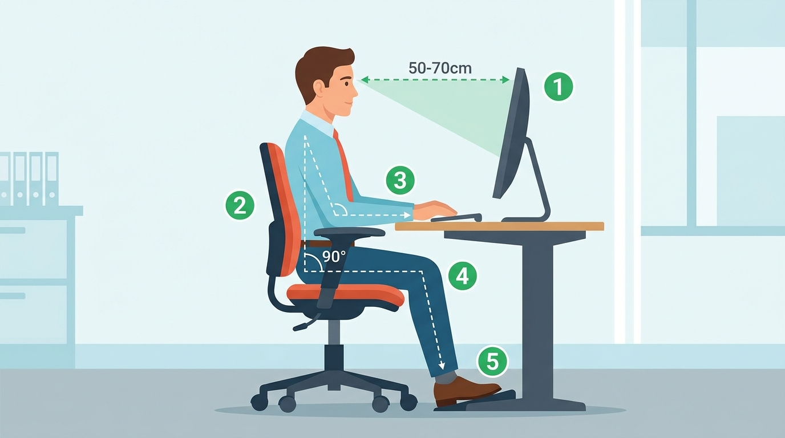

# 7.1 Tipus de dispositius digitals i els seus sistemes operatius

L'ecosistema digital actual combina múltiples aparells electrònics connectats a la xarxa:

### 1. Classificació de Dispositius:
- **Ordinadors de sobretaula i portàtils:** Sistemes complets de gran capacitat de processament (Windows, GNU/Linux, macOS).
- **Telèfons intel·ligents (*Smartphones*):** Dispositius de butxaca d'ús continu amb pantalles tàctils i càmeres d'alta resolució (Android, iOS).
- **Tauletes (*Tablets*):** Pantalles de 10 a 13 polzades ideals per a lectura, anotacions manuscrites i consum multimèdia.
- **Lectors de llibres electrònics (*E-readers*):** Disposen de pantalla de **tinta electrònica (*E-Ink*)** sense retroil·luminació que no cansa la vista i bateries que duren setmanes.

### 2. Sistemes Operatius Mòbils:
- **Android:** Basat en el nucli Linux, de codi obert i present en la gran majoria de fabricants mundials.
- **iOS:** Sistema operatiu propietari d'Apple per als iPhones, amb ecosistema tancat i alt nivell de seguretat integrat.

---

### 3. Salut Digital i Ergonomia en el Lloc de Treball amb Ordinador
Quan treballem diàriament davant d'una pantalla d'ordinador, adoptar una postura ergonòmica correcta és indispensable per evitar lesions musculars, fatiga visual i problemes a la columna vertebral:

*Figura 7.1: Guia d'hàbits posturals correctes al lloc de treball ofimàtic: **(1)** Monitor situat a l'alçada dels ulls i a una distància de 50 a 70 cm, **(2)** Esquena recta recolzada completament sobre el suport lumbar de la cadira (angle de 90° a 100°), **(3)** Avantbraços i canells alineats sobre la taula amb els colzes formant 90°, **(4)** Cuixes en posició horitzontal i genolls doblats a 90°, **(5)** Peus descansant plans a terra o sobre un reposapeus homologat.*
