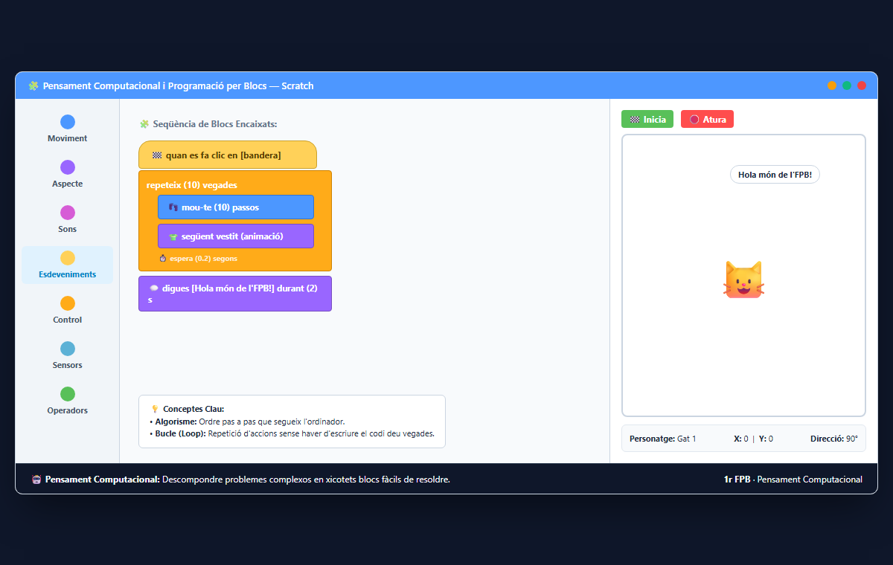

# 8.2 L'entorn de treball de Scratch: Personatges, escenaris i coordenades

**Scratch** és una plataforma educativa visual desenvolupada pel MIT que permet crear històries interactives, jocs i animacions sense escriure codi textual complex, acoblant blocs de colors com peces de LEGO.

### Elements de la Pantalla de Scratch:
- **L'Escenari (*Stage*):** La pantalla blanca (480 píxels d'amplada x 360 d'alçada) on es desenvolupa l'acció.
  - El centre de la pantalla és la coordenada $(X=0, Y=0)$.
  - L'eix **X** controla el moviment horitzontal (esquerra a dreta, de -240 a +240).
  - L'eix **Y** controla el moviment vertical (avall a amunt, de -180 a +180).
- **Els Personatges (*Sprites*):** Els objectes o personatges (com el gat de Scratch) que tenen codi, vestits (*costumes*) i sons associats.
- **La Paleta de Blocs:** Blocs organitzats per categories de colors (Moviment en blau, Aspecte en lila, So en rosa, Esdeveniments en groc, Control en taronja, Sensors en blau clar).

---

### Guia Pràctica Visual: L'Entorn de Treball de Scratch i la Programació per Blocs

#### 🧩 Com Funciona la Programació per Blocs:
1. **🏁 Esdeveniment d'Inici (Bloc Groc):** Tot programa a Scratch sol començar amb el bloc *quan es fa clic en la bandera verda*. És el disparador que posa en marxa l'algorisme.
2. **🔁 Bucles de Control (Bloc Taronja):** El bloc *repeteix (10)* permet executar una sèrie d'instruccions múltiples vegades sense haver de repetir el mateix codi línia per línia.
3. **👣 Moviment i Animació:**
   - *Mou-te (10) passos (Bloc Blau):* Desplaça el personatge en la direcció actual.
   - *Següent vestit (Bloc Lila):* Canvia la postura del personatge (de caminar a córrer) creant l'efecte d'animació fluida.
4. **📍 Coordenades de l'Escenari:** La posició exacta del personatge es controla amb els eixos cartesianes: **X: 0** i **Y: 0** situen el personatge exactament al centre de la pantalla.

