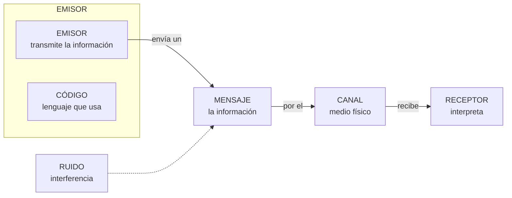

# **FICHA 1.1 · Elementos de un sistema de comunicación**

📥 Guardar como PDF
📄 Descargar Word

| Alumno/a | Grupo | Fecha |
| --- | --- | --- |
|  |  |  |

> **📌 ¿Qué repasamos?**
> 

> Todo sistema de comunicación necesita **cinco elementos**: un **emisor**, un **receptor**, un **mensaje**, un **canal** y un **código**. Además, el **ruido** intenta estropear la comunicación y el **protocolo** pone las normas.

## 1 · El proceso de comunicación

### Completa la tabla

| Elemento | ¿Qué es? | Ponlo con tus palabras |
| --- | --- | --- |
| **Emisor** | Entidad que transmite la información |  |
| **Receptor** | Entidad que recibe la información |  |
| **Mensaje** | Información que el emisor transmite al receptor |  |
| **Canal** | Medio por el que se transmite el mensaje |  |
| **Código** | Conjunto de signos, reglas y normas (lenguaje) |  |

## 2 · Identifica los elementos

Para cada situación, escribe el **emisor**, **receptor**, **mensaje**, **canal** y **código**:

| Situación | Emisor | Receptor | Mensaje | Canal | Código |
| --- | --- | --- | --- | --- | --- |
| Un conductor interpreta las señales de tráfico |  |  |  |  |  |
| Escuchas un podcast en Spotify |  |  |  |  |  |
| Haces una compra online |  |  |  |  |  |
| Un repartidor llama al cliente para avisarle de que llega su paquete |  |  |  |  |  |

## 3 · El ruido

El **ruido** es cualquier interferencia que contamina tanto el mensaje como el canal o el código.

1. Completa: "El ruido es cualquier ……………… que contamina el ………………, el ……………… o el ………………"

1. Pon un **ejemplo de ruido** para cada situación del ejercicio 2:

| Situación | ¿Qué ruido podría estropearla? |
| --- | --- |
| Conductor y señales de tráfico |  |
| Podcast en Spotify |  |
| Compra online |  |
| Llamada del repartidor |  |

## 4 · El protocolo de comunicación

1. 

Define con tus palabras qué es un **protocolo de comunicación**.

1. 

Marca **V** (verdadero) o **F** (falso):

| Afirmación | V/F |
| --- | --- |
| El protocolo determina cómo se inicia y finaliza la comunicación |  |
| El protocolo fija el idioma o nivel de lenguaje que se emplea |  |
| El protocolo tolera todo tipo de ruido sin importar su cantidad |  |
| El protocolo dice cómo actuar si la comunicación se interrumpe |  |

## 5 · Autoevaluación

Marca una casilla por fila para valorar cómo te sientes con cada idea:

| Concepto | Lo entiendo | Casi | Lo necesito repasar |
| --- | --- | --- | --- |
| Elementos de la comunicación |  |  |  |
| Identificar emisor, receptor, mensaje, canal y código |  |  |  |
| Ruido e interferencias |  |  |  |
| Protocolo de comunicación |  |  |  |

> **📌 Se valorará**
> 

> *La identificación correcta de los elementos de la comunicación en situaciones reales.
* La definición precisa de **ruido** y **protocolo**.
* La limpieza y claridad en las respuestas.

> Esta ficha te servirá para practicar el **CE5a** (describir los principios de funcionamiento de las redes locales) antes del **EXA101**.

---

### 💡 Solución y Criterios de Corrección (FICHA101)

🔍 Ver solución paso a paso de FICHA101

# **FICHA 1.1 · Elementos de un sistema de comunicación**

Ficha en blanco: FICHA 1.1

📥 Guardar como PDF

## **1 · Completa la tabla**

| Elemento | ¿Qué es? | Ponlo con tus palabras (ejemplo) |
| --- | --- | --- |
| **Emisor** | Entidad que transmite la información | La persona o equipo que **manda** el mensaje (quien habla o envía) |
| **Receptor** | Entidad que recibe la información | La persona o equipo que **recibe e interpreta** el mensaje |
| **Mensaje** | Información que el emisor transmite al receptor | **Lo que se dice**: la noticia, la orden, el saludo… |
| **Canal** | Medio por el que se transmite el mensaje | El medio físico: **aire, cable, wifi, luz**… |
| **Código** | Conjunto de signos, reglas y normas (lenguaje) | El lenguaje: **idioma, señales, colores, emojis**… |

## **2 · Identifica los elementos**

| Situación | Emisor | Receptor | Mensaje | Canal | Código |
| --- | --- | --- | --- | --- | --- |
| Un conductor interpreta las señales de tráfico | La señal (o el organismo de tráfico) | El conductor | La indicación (peligro, prohibición…) | La luz de la señal, que viaja por el aire | El lenguaje de las señales (formas y colores) |
| Escuchas un podcast en Spotify | El creador del podcast | Tú | El contenido del episodio | Internet + la app Spotify (y los altavoces) | El idioma (habla, música) |
| Haces una compra online | Tú (el comprador) | La tienda online (su servidor) | Los datos del pedido (artículo, dirección, pago) | Internet (la web de la tienda) | El idioma y el formato del formulario |
| Un repartidor llama al cliente para avisarle de que llega su paquete | El repartidor | El cliente | El aviso de llegada (dirección, hora) | La red telefónica (el teléfono) | El idioma (castellano) |

## **3 · El ruido**

1. 

"El ruido es cualquier **interferencia** que contamina el **mensaje**, el **canal** o el **código**".

1. 

Ejemplos de ruido:

| Situación | ¿Qué ruido podría estropearla? |
| --- | --- |
| Conductor y señales de tráfico | La señal **sucia o tapada**, niebla, deslumbramiento del sol |
| Podcast en Spotify | **Cortes de conexión**, ruido de fondo en la grabación, anuncios |
| Compra online | **Caída de Internet**, la web que no carga, página lenta |
| Llamada del repartidor | **Mala cobertura**, ruido ambiental, interferencias de la línea |

## **4 · El protocolo de comunicación**

1. 

*Respuesta personal*: **conjunto de normas que rigen la comunicación**: cómo iniciar y finalizarla, qué nivel de lenguaje usar, cuánto ruido tolera y cómo actuar si se interrumpe.

1. 

Marca **V** o **F**:

| Afirmación | V/F |
| --- | --- |
| El protocolo determina cómo se inicia y finaliza la comunicación | **V** |
| El protocolo fija el idioma o nivel de lenguaje que se emplea | **V** |
| El protocolo tolera todo tipo de ruido sin importar su cantidad | **F** (solo tolera hasta un umbral) |
| El protocolo dice cómo actuar si la comunicación se interrumpe | **V** |

