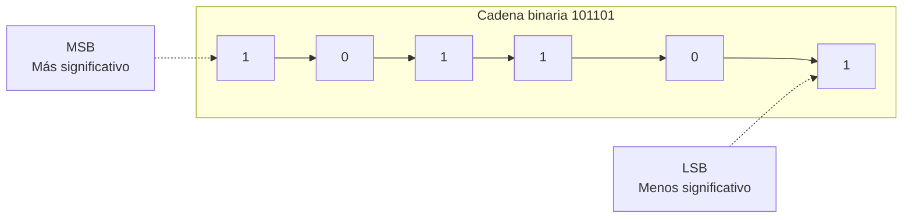
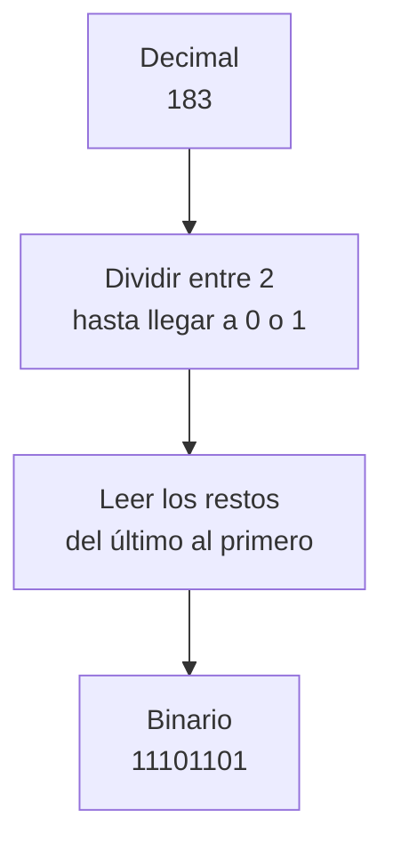
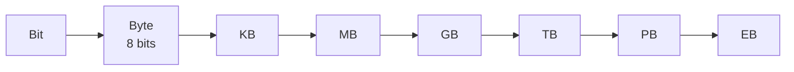

# **FICHA 1.2 · Representación de la información**

📥 Guardar como PDF
📄 Descargar Word

| Alumno/a | Grupo | Fecha |
| --- | --- | --- |
|  |  |  |

> **📌 ¿Qué repasamos?**
> 

> La información viaja **codificada**. Los tres sistemas de codificación que manejamos son el **decimal**, el **binario** (ceros y unos, los famosos **bits**) y el **hexadecimal**. Aprender a traducir entre ellos es el objetivo de esta ficha.

## 1 · Los tres sistemas de codificación

| Sistema | Símbolos | ¿Quién lo usa? | Ejemplo |
| --- | --- | --- | --- |
| **Decimal** | 0 1 2 3 4 5 6 7 8 9 | Las personas | 125 |
| **Binario** | 0 1 | Los ordenadores | 1111101 |
| **Hexadecimal** | 0-9, A B C D E F | Intermedio decimal-binario | 7D |

> **📌 Aprende**
> 

> Cada **bit** vale 0 o 1. Al bit de la izquierda (más valor) se le llama **MSB** y al de la derecha (menos valor), **LSB**.

## 2 · Traducción decimal ↔ binario

### 2.1 · Decimal → binario

| Decimal | Resolución (divisiones) | Resultado binario |
| --- | --- | --- |
| 10 |  |  |
| 25 |  |  |
| 183 |  |  |
| 200 |  |  |

### 2.2 · Binario → decimal

Recuerda: cada posición vale una potencia de 2: **1, 2, 4, 8, 16, 32, 64, 128…**

| Binario | Potencias que suman (ej.: 1010 = 8 + 2) | Decimal |
| --- | --- | --- |
| 1010 | 8 + 2 | 10 |
| 1101 |  |  |
| 100000 |  |  |
| 11111111 |  |  |

## 3 · Traducción hexadecimal ↔ binario

Cada cifra hexadecimal = **4 bits** (un cuarteto). Usa esta tabla como chuleta:

| Hex | Bin |  | Hex | Bin |
| --- | --- | --- | --- | --- |
| 0 | 0000 |  | 8 | 1000 |
| 1 | 0001 |  | 9 | 1001 |
| 2 | 0010 |  | A | 1010 |
| 3 | 0011 |  | B | 1011 |
| 4 | 0100 |  | C | 1100 |
| 5 | 0101 |  | D | 1101 |
| 6 | 0110 |  | E | 1110 |
| 7 | 0111 |  | F | 1111 |

### 3.1 · Hexadecimal → binario

| Hexadecimal | Cuartetos | Binario |
| --- | --- | --- |
| A5 | A=1010 · 5=0101 | 10100101 |
| 1F |  |  |
| B09 |  |  |

### 3.2 · Binario → hexadecimal

| Binario | Cuartetos (rellena ceros a la izquierda si falta) | Hexadecimal |
| --- | --- | --- |
| 10100101 | 1010 · 0101 | A5 |
| 1111011 |  |  |
| 10000001 |  |  |

## 4 · Medidas de información

Recuerda la escalera: para **bajar** una medida multiplica por 1024; para **subir**, divide entre 1024 (y entre 8 si vas a bits).

Completa las conversiones:

| Conversión | Resolución | Resultado |
| --- | --- | --- |
| 2 B → bits | 2 × 8 | 16 b |
| 1 GB → MB | 1 × 1024 |  |
| 60 KB → TB | 60 / 1024 / 1024 / 1024 |  |
| 4 MB → bits |  |  |

## 5 · Reto express

1. ¿Cuántos bits tiene que enciende la «forma» de escribir la letra **A** en binario `01000001`? Escribe su valor **decimal** y sus brillos en **hexadecimal**.

1. Ordena de menor a mayor: **1 GB**, **1024 KB**, **1024 MB**, **1 TB**.

> **📌 Se valorará**
> 

> - La correcta aplicación del algoritmo de **división sucesiva** (decimal → binario).

> - El uso de la **tabla de correspondencia** para los cuartetos hexadecimales.

> - La precisión en las conversiones de **medidas de información**.

> - La limpieza y el orden al resolver los ejercicios.

> Esta ficha te servirá para practicar el **CE5a** antes del **EXA101**.

---

### 💡 Solución y Criterios de Corrección (FICHA102)

🔍 Ver solución paso a paso de FICHA102

# **FICHA 1.2 · Representación de la información**

Ficha en blanco: FICHA 1.2

📥 Guardar como PDF

## **1 · Los tres sistemas de codificación**

| Sistema | Símbolos | ¿Quién lo usa? | Ejemplo |
| --- | --- | --- | --- |
| **Decimal** | 0 1 2 3 4 5 6 7 8 9 | Las personas | 125 |
| **Binario** | 0 1 | Los ordenadores | 1111101 |
| **Hexadecimal** | 0-9, A B C D E F | Intermedio decimal-binario | 7D |

**MSB** = bit de la izquierda (más valor) · **LSB** = bit de la derecha (menos valor).

## **2 · Traducción decimal ↔ binario**

### **2.1 · Decimal → binario**

| Decimal | Resolución (divisiones) | Resultado binario |
| --- | --- | --- |
| 10 | 10÷2=5·0 ; 5÷2=2·1 ; 2÷2=1·0 ; 1÷2=0·1 | **1010** |
| 25 | 25÷2=12·1 ; 12÷2=6·0 ; 6÷2=3·0 ; 3÷2=1·1 ; 1÷2=0·1 | **11001** |
| 183 | 183÷2=91·1 ; 91÷2=45·1 ; 45÷2=22·1 ; 22÷2=11·0 ; 11÷2=5·1 ; 5÷2=2·1 ; 2÷2=1·0 ; 1÷2=0·1 | **10110111** |
| 200 | 200÷2=100·0 ; 100÷2=50·0 ; 50÷2=25·0 ; 25÷2=12·1 ; 12÷2=6·0 ; 6÷2=3·0 ; 3÷2=1·1 ; 1÷2=0·1 | **11001000** |

*Se leen los restos del último al primero.*

### **2.2 · Binario → decimal**

| Binario | Potencias que suman | Decimal |
| --- | --- | --- |
| 1010 | 8 + 2 | 10 |
| 1101 | 8 + 4 + 1 | **13** |
| 100000 | 32 | **32** |
| 11111111 | 128 + 64 + 32 + 16 + 8 + 4 + 2 + 1 | **255** |

## **3 · Traducción hexadecimal ↔ binario**

### **3.1 · Hexadecimal → binario**

| Hexadecimal | Cuartetos | Binario |
| --- | --- | --- |
| A5 | A=1010 · 5=0101 | 10100101 |
| 1F | 1=0001 · F=1111 | **00011111** |
| B09 | B=1011 · 0=0000 · 9=1001 | **101100001001** |

### **3.2 · Binario → hexadecimal**

| Binario | Cuartetos (rellena ceros a la izquierda si falta) | Hexadecimal |
| --- | --- | --- |
| 10100101 | 1010 · 0101 | A5 |
| 1111011 | 0001 · 1011 | **1B** |
| 10000001 | 1000 · 0001 | **81** |

## **4 · Medidas de información**

| Conversión | Resolución | Resultado |
| --- | --- | --- |
| 2 B → bits | 2 × 8 | 16 b |
| 1 GB → MB | 1 × 1024 | **1024 MB** |
| 60 KB → TB | 60 / 1024 / 1024 / 1024 | **≈ 0,0000000559 TB** |
| 4 MB → bits | 4 × 1024 × 1024 × 8 | **33 554 432 bits** |

## **5 · Reto express**

1. `01000001` tiene **8 bits** (un byte); en decimal es **65** y en hexadecimal **41**.

1. De menor a mayor: **1024 KB = 1 MB < 1024 MB = 1 GB < 1 TB** (los dos primeros son iguales, y los dos siguientes también).

