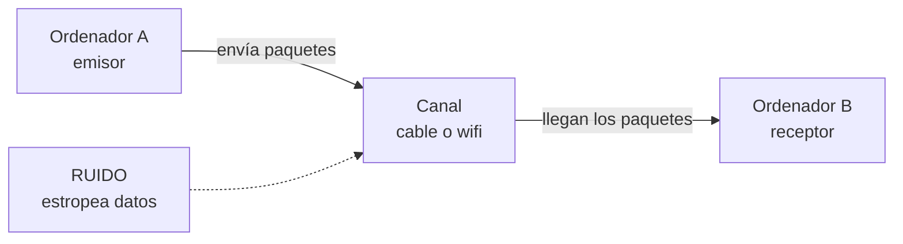
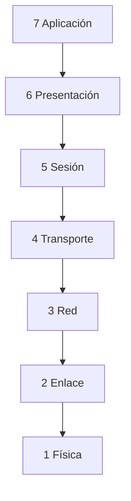
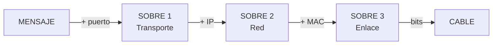

# **FICHA 1.3 · Redes de comunicaciones: modelos OSI y TCP/IP**

📥 Guardar como PDF
📄 Descargar Word

| Alumno/a | Grupo | Fecha |
| --- | --- | --- |
|  |  |  |

> **📌 ¿Qué repasamos?**
> 

> Una **red de comunicaciones** es un grupo de **dos o más equipos** que intercambian información. Esa información viaja troceada en **paquetes de datos** hechos de ceros y unos (los **bits**). Para que todos los equipos se entiendan, usamos unas normas llamadas **protocolos**. Y para organizarlos, existen dos modelos: **OSI** y **TCP/IP**.

## 1 · ¿Qué es una red de comunicaciones?

Una red de comunicaciones sirve para que los equipos se **intercambien información**. El equipo que envía es el **emisor**, el que recibe es el **receptor**, y entre ellos hay un **canal** (el cable o el wifi). Si algo estropea los datos, hay **ruido**.

Completa las frases:

| Frase | Completa |
| --- | --- |
| Una red de comunicaciones sirve para ………… información entre varios equipos. |  |
| La información viaja troceada en ………… de datos. |  |
| Los paquetes están hechos de ceros y unos, llamados ………… |  |
| Las normas para que los equipos se entiendan se llaman ………… |  |
| El equipo que envía es el ………… y el que recibe es el ………… |  |

## 2 · El modelo OSI: las 7 capas

El modelo **OSI** organiza la comunicación en **7 capas** (como un edificio de 7 pisos). La información **sale** por la capa 7 (la de arriba) y **baja** hasta la capa 1 (la física); al llegar al otro equipo, hace el camino **inverso** (sube de la 1 a la 7).

Completa la tabla con la función de cada capa:

| Capa | Nombre | ¿Qué hace? |
| --- | --- | --- |
| 7 | Aplicación | Los programas que usas (web, correo, juegos). |
| 6 | Presentación | Traduce y comprime la información. |
| 5 | Sesión | Mantiene abierta la conversación. |
| 4 | Transporte | Trocea el mensaje y controla los errores (**TCP** y **UDP**). |
| 3 | Red | Pone la **dirección IP** y elige la mejor ruta. |
| 2 | Enlace de datos | Pone la **dirección MAC** de cada equipo. |
| 1 | Física | Envía los **bits** por el cable. |

> **📌 Aprende**
> 

> Para memorizar las 7 capas de arriba abajo usa esta frase:
**«A**las **P**ersonas **S**iempre **T**raen **R**opa **E**n **F**lores»** → **A**plicación, **P**resentación, **S**esión, **T**ransporte, **R**ed, **E**nlace, **F**ísica.

## 3 · El encapsulamiento: los sobres

Al **enviar**, cada capa **añade una pegatina** con información (como cuando metes un mensaje en varios sobres). Al **recibir**, se quitan los sobres uno a uno. A esto se le llama **encapsular** (poner sobres) y **desencapsular** (quitarlos).

Completa: ¿qué sobre (pegatina) añade cada capa?

| Capa | Pegatina que añade |
| --- | --- |
| Transporte | Un número llamado ………… |
| Red | La dirección ………… (IP) |
| Enlace de datos | La dirección ………… (MAC) |
| Física | Todo se convierte en ………… que viajan por el cable |

## 4 · El modelo TCP/IP: 4 capas

El modelo **TCP/IP** es el que **se usa de verdad en Internet**. Tiene solo **4 capas**. Relaciona cada capa con las capas del modelo OSI que le corresponden (complétalo con números):

| Capa TCP/IP | ¿Qué hace? | Capa/s OSI que le corresponden |
| --- | --- | --- |
| 4 Aplicación | Los programas que usas (web, correo, WhatsApp). | Capa ………… (y 6 y 5) |
| 3 Transporte | Envía los trozos de punta a punta y controla errores (**TCP** y **UDP**). | Capa ………… |
| 2 Internet | Pone la **dirección IP** y elige la ruta. | Capa ………… |
| 1 Acceso a red | Usa el cable o el wifi (**Ethernet**). | Capas ………… y ………… |

> **📌 Aprende**
> 

> - **OSI** tiene **7 capas** y sirve para **aprender** cómo funciona la comunicación.

> - **TCP/IP** tiene **4 capas** y es el modelo que **utiliza Internet** en la práctica.

## 5 · Los protocolos que usas a diario

Los **protocolos** son las normas de cada capa. Cuando usas el móvil o el ordenador, están trabajando sin que te des cuenta. Escribe un ejemplo de uso cotidiano para cada uno:

| Protocolo | ¿Para qué sirve? | Ejemplo cotidiano |
| --- | --- | --- |
| HTTP / HTTPS | Ver páginas web. |  |
| DNS | Traduce los nombres (www.google.es) a direcciones IP. |  |
| SMTP / POP3 | Enviar y recibir correo electrónico. |  |
| FTP | Transferir archivos entre equipos. |  |
| IP | Le da una dirección única a cada equipo. |  |
| TCP | Envía los datos en orden y sin errores. |  |
| UDP | Envío rápido, muy usado para vídeo y llamadas. |  |

## 6 · Reto express

1. ¿Cuántas capas tiene el modelo **OSI**? ¿Y el modelo **TCP/IP**? ¿Cuál de los dos usa Internet de verdad?

1. Cuando un amigo te envía un **WhatsApp** y tú lo recibes, el mensaje ha bajado las 7 capas en el emisor y ha subido en el receptor. ¿Qué proceso es ese?

1. Une cada protocolo con su función:

  - **DNS** → Ver páginas web

  - **HTTP** → Traducir nombres a direcciones IP

  - **IP** → Enviar datos en orden y sin errores

  - **TCP** → Dar una dirección única a cada equipo

1. La **dirección MAC** está formada por **48 bits** separados en seis bloques. Escribe un ejemplo: `..:..:..:..:..:..`

> **📌 Se valorará**
> 

> - La comprensión de los modelos **OSI y TCP/IP** y de sus capas.

> - La correcta asociación entre **capas, protocolos y su función**.

> - La interpretación del **encapsulamiento** como el viaje del mensaje en sobres.

> - La limpieza y el orden al resolver los ejercicios.

> Esta ficha te servirá para practicar el **CE5a** antes del **EXA101**.

---

### 💡 Solución y Criterios de Corrección (FICHA103)

🔍 Ver solución paso a paso de FICHA103

# **FICHA 1.3 · Redes de comunicaciones: modelos OSI y TCP/IP**

Ficha en blanco: FICHA 1.3

📥 Guardar como PDF

## **1 · ¿Qué es una red de comunicaciones?**

| Frase | Completa |
| --- | --- |
| Una red de comunicaciones sirve para **intercambiar** información entre varios equipos. |  |
| La información viaja troceada en **paquetes** de datos. |  |
| Los paquetes están hechos de ceros y unos, llamados **bits**. |  |
| Las normas para que los equipos se entiendan se llaman **protocolos**. |  |
| El equipo que envía es el **emisor** y el que recibe es el **receptor**. |  |

## **2 · El modelo OSI: las 7 capas**

| Capa | Nombre | ¿Qué hace? |
| --- | --- | --- |
| 7 | **Aplicación** | Los programas que usas (web, correo, juegos). |
| 6 | **Presentación** | Traduce y comprime la información. |
| 5 | **Sesión** | Mantiene abierta la conversación. |
| 4 | **Transporte** | Trocea el mensaje y controla errores (TCP y UDP). |
| 3 | **Red** | Pone la dirección IP y elige la mejor ruta. |
| 2 | **Enlace de datos** | Pone la dirección MAC de cada equipo. |
| 1 | **Física** | Envía los bits por el cable. |

Mnemotecnia: **«A**las **P**ersonas **S**iempre **T**raen **R**opa **E**n **F**lores».

## **3 · El encapsulamiento: los sobres**

| Capa | Pegatina que añade |
| --- | --- |
| Transporte | Un número llamado **puerto** |
| Red | La dirección **IP** |
| Enlace de datos | La dirección **MAC** |
| Física | Todo se convierte en **bits** que viajan por el cable |

## **4 · El modelo TCP/IP: 4 capas**

| Capa TCP/IP | ¿Qué hace? | Capa/s OSI que le corresponden |
| --- | --- | --- |
| 4 Aplicación | Los programas que usas (web, correo, WhatsApp). | Capa **7** (y 6 y 5) |
| 3 Transporte | Envía los trozos de punta a punta y controla errores (TCP y UDP). | Capa **4** |
| 2 Internet | Pone la dirección IP y elige la ruta. | Capa **3** |
| 1 Acceso a red | Usa el cable o el wifi (Ethernet). | Capas **2** y **1** |

## **5 · Los protocolos que usas a diario**

| Protocolo | ¿Para qué sirve? | Ejemplo cotidiano |
| --- | --- | --- |
| HTTP / HTTPS | Ver páginas web. | Abrir google.es o YouTube (HTTPS cifra los datos) |
| DNS | Traduce los nombres a direcciones IP. | Escribes www.google.es y el DNS la convierte en IP |
| SMTP / POP3 | Enviar y recibir correo electrónico. | Enviar un correo y recibirlo en el móvil |
| FTP | Transferir archivos entre equipos. | Subir los apuntes al servidor del instituto |
| IP | Le da una dirección única a cada equipo. | Tu equipo con 192.168.1.25 dentro de la red |
| TCP | Envía los datos en orden y sin errores. | Descargar un archivo completo y sin fallos |
| UDP | Envío rápido, muy usado para vídeo y llamadas. | Una videollamada o streaming de vídeo |

## **6 · Reto express**

1. **OSI** tiene **7** capas; **TCP/IP** tiene **4**; Internet usa de verdad **TCP/IP**.

1. El proceso se llama **encapsulamiento** (al enviar) y **desencapsulamiento** (al recibir).

1. Correcciones de las parejas:

  - **DNS** → Traducir nombres a direcciones IP

  - **HTTP** → Ver páginas web

  - **IP** → Dar una dirección única a cada equipo y elegir la ruta

  - **TCP** → Enviar datos en orden y sin errores

1. Ejemplo de dirección MAC (6 bloques hexadecimales): `00:E0:7D:F9:EA:6D` *(cualquier ejemplo de 48 bits vale)*.

