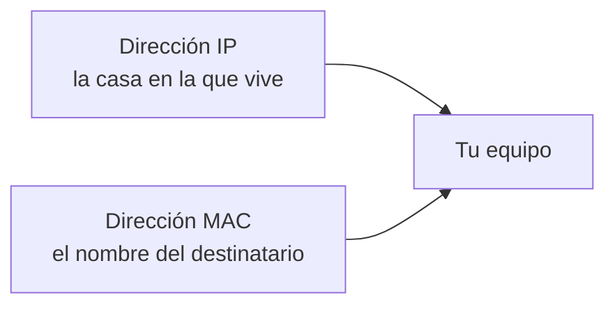
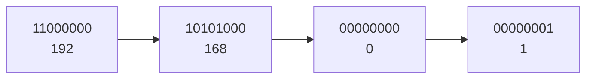
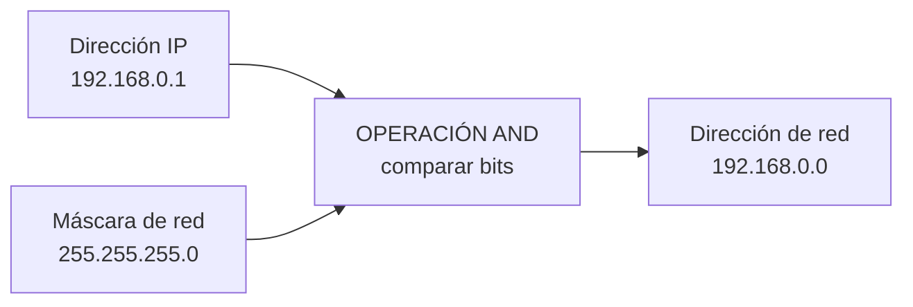
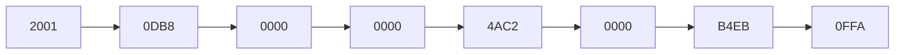

# **FICHA 1.4 · La dirección IP: IPv4 e IPv6**

📥 Guardar como PDF
📄 Descargar Word

| Alumno/a | Grupo | Fecha |
| --- | --- | --- |
|  |  |  |

> **📌 ¿Qué repasamos?**
> 

> Cada equipo de una red tiene **dos direcciones**: la **MAC** (física, no cambia) y la **IP** (lógica, puede cambiar). Existen dos versiones del protocolo IP: **IPv4** (32 bits) e **IPv6** (128 bits). En esta ficha aprenderás a distinguirlas y a leerlas.

## 1 · Dos direcciones: ¿cuál es cuál?

Cuando enviamos una carta por correo, necesitamos saber **dónde vive** la persona y **quién es**. En una red pasa igual: la **dirección IP** es la dirección de la casa y la **dirección MAC** es el nombre del destinatario.

| Dirección IP | Dirección MAC |
| --- | --- |
| Como la **dirección de una casa** | Como el **nombre del destinatario** |
| Es **lógica**: cambia según la red | Es **física**: viene en la tarjeta |
| Puede ser **estática** (fija) o **dinámica** (cambia) | Nunca cambia |

Completa la tabla escribiendo **IP** o **MAC**:

| Frase | ¿IP o MAC? |
| --- | --- |
| Es fija y no cambia nunca. |  |
| Es lógica y la asigna la red en cada momento. |  |
| Tiene **48 bits** separados en seis bloques. |  |
| Puede ser estática o dinámica. |  |
| Identifica la tarjeta de red de forma unívoca. |  |

## 2 · La dirección IPv4

La dirección **IPv4** tiene **32 bits** y se escribe en **4 bloques de 8 bits** (un byte cada uno) en formato **decimal**, separados por puntos. Cada bloque puede valer de **0 a 255**.

Completa:

| Pregunta | Completa |
| --- | --- |
| ¿Cuántos bits tiene una dirección IPv4? | ………… bits |
| ¿En cuántos bloques se escriben? | ………… bloques |
| ¿Con qué signo se separan los bloques? | Con ………… |
| ¿En qué formato se escribe cada bloque? | ………… (decimal o binario) |
| ¿Cuánto vale el bloque más alto? | Hasta el ………… |

Hay direcciones IP que **no se pueden usar en Internet** porque son **privadas** (solo valen dentro de casa o del instituto). Escribe si cada dirección es **pública** o **privada**:

| Dirección | ¿Pública o privada? |
| --- | --- |
| 192.168.1.10 |  |
| 10.0.0.25 |  |
| 8.8.8.8 |  |
| 172.20.3.5 |  |
| 150.214.12.8 |  |

> **📌 Aprende**
> 

> Las tres redes **privadas** más típicas son las que empiezan por **10.**, por **172.16.** a **172.31.** y por **192.168.**

## 3 · La máscara de red

La **máscara de red** acompaña a la dirección IP y sirve para saber qué parte de la dirección identifica a la **red** y qué parte al **equipo** (host). La más común es `255.255.255.0`.

> **📌 Aprende**
> 

> La operación **AND** compara los bits de la IP con los de la máscara:
**1 AND 1 = 1** · **1 AND 0 = 0** · **0 AND 0 = 0**

Dentro de una red, **dos direcciones no se pueden asignar a equipos**. Une cada una con su nombre:

| Dirección | Nombre |
| --- | --- |
| 192.168.0.0 | Dirección de ………… (red) |
| 192.168.0.255 | Dirección de ………… (broadcast) |
| De 192.168.0.1 a 192.168.0.254 | Direcciones para los ………… (hosts) |

## 4 · La dirección IPv6

La dirección **IPv6** tiene **128 bits** y se escribe en **8 grupos de 2 bytes**, separados por dos puntos (**:**), en formato **hexadecimal**.

Para abreviarla se siguen estas reglas:
1. Se pueden quitar los **ceros a la izquierda** de cada grupo: `00D1` → `D1`.
2. Un grupo `0000` se puede escribir como `0`.
3. Si hay **dos o más grupos con ceros seguidos**, se sustituyen por `::` (solo **una vez** por dirección).

Completa:

| Pregunta | Completa |
| --- | --- |
| ¿Cuántos bits tiene una dirección IPv6? | ………… bits |
| ¿En cuántos grupos de 2 bytes se escribe? | ………… grupos |
| ¿Con qué carácter se separan los grupos? | Con ………… |
| ¿En qué formato se escriben? | ………… (hexadecimal) |

Abrevia estas direcciones IPv6:

- `2000:0011:3D4A:0055:0000:0000:2F01:5432` → `2000:11:3D4A:55:…:2F01:5432` (escribe el `::`)

- `7144:0000:A101:0000:0000:0000:31BB:4A23` → `…`

## 5 · Reto express

1. ¿Cuántos bits tiene **IPv4**? ¿Y **IPv6**? ¿Cuál de las dos ofrece más direcciones?

1. La IP de la impresora del instituto **no cambia nunca**: es ……… (estática o dinámica). La IP del móvil en casa **cambia cada día**: es ………

1. Marca **V** (verdadero) o **F** (falso):

| Afirmación | V/F |
| --- | --- |
| La dirección MAC es fija e identifica la tarjeta de red. |  |
| La dirección IP puede cambiar según la red en la que esté el equipo. |  |
| `192.168.1.10` es una dirección pública. |  |
| La máscara de red separa la parte de red de la parte del host. |  |
| En IPv4 cada bloque se escribe en hexadecimal. |  |

1. Escribe tu dirección IPv4 y tu dirección MAC en este hueco (puedes usar `ipconfig /all` en el símbolo del sistema):

1. IPv4: `…`

1. MAC: `…`

> **📌 Se valorará**
> 

> - La distinción correcta entre **dirección IP** y **dirección MAC**.

> - La correcta lectura de las direcciones **IPv4 e IPv6**.

> - La aplicación de la **máscara de red** y la operación **AND**.

> - La limpieza y el orden al resolver los ejercicios.

> Esta ficha te servirá para practicar el **CE5a** antes del **EXA101**.

---

### 💡 Solución y Criterios de Corrección (FICHA104)

🔍 Ver solución paso a paso de FICHA104

# **FICHA 1.4 · La dirección IP: IPv4 e IPv6**

Ficha en blanco: FICHA 1.4

📥 Guardar como PDF

## **1 · Dos direcciones: ¿cuál es cuál?**

| Frase | ¿IP o MAC? |
| --- | --- |
| Es fija y no cambia nunca. | **MAC** |
| Es lógica y la asigna la red en cada momento. | **IP** |
| Tiene 48 bits separados en seis bloques. | **MAC** |
| Puede ser estática (fija) o dinámica (cambia). | **IP** |
| Identifica la tarjeta de red de forma unívoca. | **MAC** |

## **2 · La dirección IPv4**

| Pregunta | Completa |
| --- | --- |
| ¿Cuántos bits tiene una dirección IPv4? | **32** bits |
| ¿En cuántos bloques se escriben? | **4** bloques |
| ¿Con qué signo se separan los bloques? | Con **puntos (.)** |
| ¿En qué formato se escribe cada bloque? | **decimal** |
| ¿Cuánto vale el bloque más alto? | Hasta el **255** |

| Dirección | ¿Pública o privada? |
| --- | --- |
| 192.168.1.10 | **Privada** |
| 10.0.0.25 | **Privada** |
| 8.8.8.8 | **Pública** |
| 172.20.3.5 | **Privada** (entre 172.16 y 172.31) |
| 150.214.12.8 | **Pública** |

## **3 · La máscara de red**

| Dirección | Nombre |
| --- | --- |
| 192.168.0.0 | Dirección de **red** |
| 192.168.0.255 | Dirección de **broadcast** |
| De 192.168.0.1 a 192.168.0.254 | Direcciones para los **hosts** |

## **4 · La dirección IPv6**

| Pregunta | Completa |
| --- | --- |
| ¿Cuántos bits tiene una dirección IPv6? | **128** bits |
| ¿En cuántos grupos de 2 bytes se escribe? | **8** grupos |
| ¿Con qué carácter se separan los grupos? | Con **dos puntos (:)** |
| ¿En qué formato se escriben? | **hexadecimal** |

Abreviaciones:

- `2000:0011:3D4A:0055:0000:0000:2F01:5432` → `2000:11:3D4A:55:…:2F01:5432` → **`2000:11:3D4A:55::2F01:5432`**

- `7144:0000:A101:0000:0000:0000:31BB:4A23` → **`7144:0:A101::31BB:4A23`**

## **5 · Reto express**

1. **IPv4** tiene **32 bits**; **IPv6** tiene **128 bits**; ofrece más direcciones **IPv6**.

1. 

La IP de la impresora es **estática**; la IP del móvil en casa es **dinámica**.

1. 

Marca **V** o **F**:

| Afirmación | V/F |
| --- | --- |
| La dirección MAC es fija e identifica la tarjeta de red. | **V** |
| La dirección IP puede cambiar según la red en la que esté el equipo. | **V** |
| `192.168.1.10` es una dirección pública. | **F** (es privada) |
| La máscara de red separa la parte de red de la parte del host. | **V** |
| En IPv4 cada bloque se escribe en hexadecimal. | **F** (en decimal) |

1. *Respuesta personal*: usa `ipconfig /all` (Windows) o `ifconfig` / `ip a` (Linux/macOS) para copiar tu **IPv4** y tu **MAC**.

