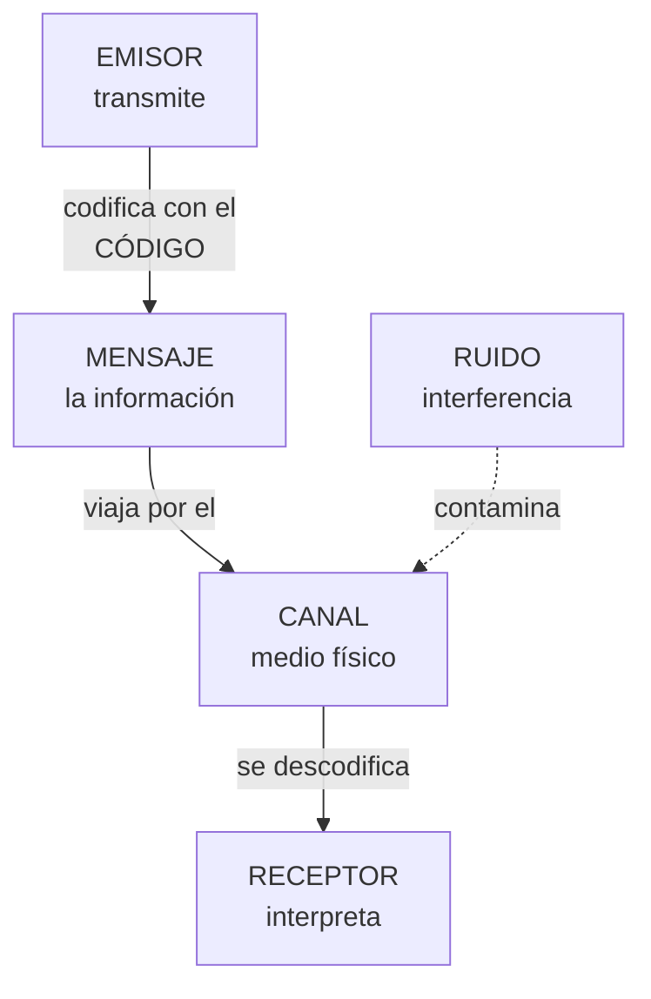

# **FICHA REPASO 1.1 · Elementos de un sistema de comunicación**

📥 Guardar como PDF
📄 Descargar Word

| Alumno/a | Grupo | Fecha |
| --- | --- | --- |
|  |  |  |

> **📌 ¿Qué repasamos?**
> 

> Repaso de la **FICHA 1.1**: todo sistema de comunicación necesita **cinco elementos** (**emisor**, **receptor**, **mensaje**, **canal** y **código**); el **ruido** intenta estropearla, el **protocolo** la ordena con normas y el **intérprete** traduce cuando los códigos no coinciden.

## 1 · Lo esencial, en una tabla

Completa la columna derecha:

| Concepto | Completa con tus palabras |
| --- | --- |
| **Emisor** | Entidad que ………… la información |
| **Receptor** | Entidad que ………… la información |
| **Mensaje** | ………… que el emisor transmite al receptor |
| **Canal** | ………… por el que viaja el mensaje |
| **Código** | Conjunto de signos, reglas y ………… (lenguaje) |
| **Ruido** | Cualquier ………… que contamina el mensaje, el canal o el código |
| **Protocolo** | Conjunto de ………… que rigen la comunicación |
| **Intérprete** | Elemento que ………… entre códigos distintos (módem, router…) |

## 2 · El proceso de comunicación

Completa el recorrido del mensaje:

| Pasos del proceso | Completa |
| --- | --- |
| El ………… codifica y envía el mensaje |  |
| El mensaje viaja por el ………… |  |
| El ………… recibe e interpreta el mensaje |  |
| Si los códigos no coinciden, actúa el ………… |  |
| Si hay interferencias, decimos que hay ………… |  |

## 3 · Identifica los elementos

Para cada situación, escribe el **emisor**, **receptor**, **mensaje**, **canal** y **código**:

| Situación | Emisor | Receptor | Mensaje | Canal | Código |
| --- | --- | --- | --- | --- | --- |
| Tu profesor explica en la pizarra y tú tomas apuntes |  |  |  |  |  |
| Ves las noticias en la televisión |  |  |  |  |  |
| Mandas un mensaje de voz por WhatsApp a un amigo |  |  |  |  |  |
| El semáforo se pone en rojo y los coches se detienen |  |  |  |  |  |

## 4 · Ruido y protocolo

1. Marca **V** (verdadero) o **F** (falso):

| Afirmación | V/F |
| --- | --- |
| El ruido puede contaminar el mensaje, el canal o el código |  |
| Si el ruido supera un umbral, la información puede no llegar completa |  |
| El protocolo indica cómo iniciar y finalizar la comunicación |  |
| El protocolo fija el nivel de lenguaje y la tolerancia a los fallos |  |
| El intérprete hace falta cuando emisor y receptor usan el mismo código |  |

1. Escribe un **ejemplo de ruido** para cada situación:

| Situación | ¿Qué ruido podría estropearla? |
| --- | --- |
| Explicación del profesor |  |
| Noticias en la televisión |  |
| Mensaje de voz por WhatsApp |  |
| Semáforo en rojo |  |

## 5 · Autoevaluación

Marca una casilla por fila para valorar cómo te sientes con cada idea:

| Concepto | Lo entiendo | Casi | Lo necesito repasar |
| --- | --- | --- | --- |
| Los 5 elementos de la comunicación |  |  |  |
| Ruido, protocolo e intérprete |  |  |  |
| Identificar los elementos en situaciones reales |  |  |  |
| El proceso de comunicación completo |  |  |  |

> **📌 Se valorará**
> 

> - La identificación correcta de los elementos de la comunicación en situaciones nuevas.

> - La definición precisa de **ruido**, **protocolo** e **intérprete**.

> - La limpieza y claridad en las respuestas.

> Esta ficha te servirá para repasar el **CE5a** antes del **EXA101**.

---

### 💡 Solución y Criterios de Corrección (REP101)

🔍 Ver solución paso a paso de REP101

# **REPASO 1.1 · Elementos de un sistema de comunicación**

Ficha en blanco: Repaso 1.1

📥 Guardar como PDF

## **1 · Lo esencial, en una tabla**

| Concepto | Completa con tus palabras |
| --- | --- |
| **Emisor** | Entidad que **transmite** la información |
| **Receptor** | Entidad que **recibe** la información |
| **Mensaje** | **La información** que el emisor transmite al receptor |
| **Canal** | **El medio físico** por el que viaja el mensaje |
| **Código** | Conjunto de signos, reglas y **normas** (lenguaje) |
| **Ruido** | Cualquier **interferencia** que contamina el mensaje, el canal o el código |
| **Protocolo** | Conjunto de **normas** que rigen la comunicación |
| **Intérprete** | Elemento que **traduce** entre códigos distintos (módem, router…) |

## **2 · El proceso de comunicación**

| Pasos del proceso | Completa |
| --- | --- |
| El **emisor** codifica y envía el mensaje |  |
| El mensaje viaja por el **canal** |  |
| El **receptor** recibe e interpreta el mensaje |  |
| Si los códigos no coinciden, actúa el **intérprete** |  |
| Si hay interferencias, decimos que hay **ruido** |  |

## **3 · Identifica los elementos**

| Situación | Emisor | Receptor | Mensaje | Canal | Código |
| --- | --- | --- | --- | --- | --- |
| Tu profesor explica en la pizarra y tú tomas apuntes | El profesor | Los alumnos (tú) | La explicación | El aire (el sonido) y la pizarra | El idioma y la grafía |
| Ves las noticias en la televisión | Los periodistas / la cadena | Tú (espectador) | La información de actualidad | La señal de TV hasta tu tele | El idioma, imágenes y gráficos |
| Mandas un mensaje de voz por WhatsApp a un amigo | Tú | Tu amigo | Lo que dices en el audio | Internet + la app WhatsApp | El idioma (habla) |
| El semáforo se pone en rojo y los coches se detienen | El semáforo | Los conductores | «Detente» | La luz | El convenio de colores (rojo = parar) |

## **4 · Ruido y protocolo**

1. Marca **V** o **F**:

| Afirmación | V/F |
| --- | --- |
| El ruido puede contaminar el mensaje, el canal o el código | **V** |
| Si el ruido supera un umbral, la información puede no llegar completa | **V** |
| El protocolo indica cómo iniciar y finalizar la comunicación | **V** |
| El protocolo fija el nivel de lenguaje y la tolerancia a los fallos | **V** |
| El intérprete hace falta cuando emisor y receptor usan el mismo código | **F** (solo hace falta si los códigos son distintos) |

1. Ejemplos de ruido:

| Situación | ¿Qué ruido podría estropearla? |
| --- | --- |
| Explicación del profesor | Ruido de la clase: conversaciones, pasillos, móviles sonando |
| Noticias en la televisión | Imagen pixelada, cortes de señal, estática |
| Mensaje de voz por WhatsApp | Mala conexión, viento, ruido de la calle |
| Semáforo en rojo | Suciedad o niebla que tapa la luz, bombilla fundida |

## **5 · Autoevaluación**

Es una **valoración personal**: marca la casilla honestamente según cómo te haya ido al resolverla.

