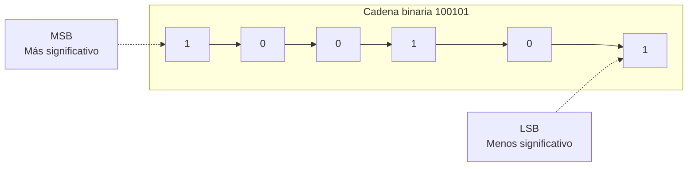
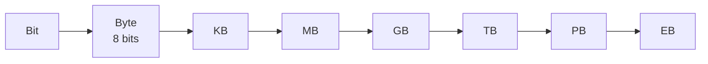

# **FICHA REPASO 1.2 · Representación de la información**

📥 Guardar como PDF
📄 Descargar Word

| Alumno/a | Grupo | Fecha |
| --- | --- | --- |
|  |  |  |

> **📌 ¿Qué repasamos?**
> 

> Repaso de la **FICHA 1.2**: la información viaja **codificada** en **decimal**, **binario** (ceros y unos, **bits**) o **hexadecimal**. Saber traducir entre ellos y moverte por la escalera de **medidas de información** es el objetivo de esta ficha.

## 1 · Los tres sistemas de codificación

Completa la tabla:

| Sistema | Símbolos | ¿Quién lo usa? | Ejemplo |
| --- | --- | --- | --- |
| **Decimal** | ………… | Las personas | 125 |
| **Binario** | ………… | ………… | 1111101 |
| **Hexadecimal** | 0-9 y ………… | Intermedio decimal-binario | 7D |

> **📌 Aprende**
> 

> Cada **bit** vale 0 o 1. Al bit de la **izquierda** (más valor) se le llama **MSB** y al de la **derecha** (menos valor), **LSB**. Cada posición vale el doble que la anterior: **1, 2, 4, 8, 16, 32, 64, 128…**

## 2 · Traducción decimal ↔ binario

### 2.1 · Decimal → binario (divisiones entre 2)

| Decimal | Resolución (divisiones) | Resultado binario |
| --- | --- | --- |
| 45 |  |  |
| 100 |  |  |
| 128 |  |  |
| 255 |  |  |

### 2.2 · Binario → decimal (sumas de potencias de 2)

| Binario | Potencias que suman | Decimal |
| --- | --- | --- |
| 110010 | 32 + 16 + 2 | 50 |
| 10111111 |  |  |
| 11100000 |  |  |
| 10101010 |  |  |

## 3 · Traducción hexadecimal ↔ binario

Recuerda: cada cifra hexadecimal = **4 bits** (un cuarteto) y dentro del cuarteto los bits valen **8 · 4 · 2 · 1**.

### 3.1 · Hexadecimal → binario

| Hexadecimal | Cuartetos | Binario |
| --- | --- | --- |
| 3C | 3=0011 · C=1100 | 00111100 |
| 9E |  |  |
| 2A |  |  |

### 3.2 · Binario → hexadecimal

| Binario | Cuartetos (rellena ceros a la izquierda si falta) | Hexadecimal |
| --- | --- | --- |
| 01011010 | 0101 · 1010 | 5A |
| 11110000 |  |  |
| 110111 |  |  |

## 4 · Medidas de información

Recuerda la escalera: para **bajar** de unidad divide entre 1024; para **subir**, multiplica por 1024 (y por 8 si vas a bits).

Completa las conversiones:

| Conversión | Resolución | Resultado |
| --- | --- | --- |
| 8 B → bits | 8 × 8 | 64 b |
| 3 GB → MB | 3 × 1024 |  |
| 512 MB → KB | 512 × 1024 |  |
| 1 TB → GB | 1 × 1024 |  |

## 5 · Reto express

1. El byte `01000010` codifica una letra: escribe su valor **decimal** y su valor en **hexadecimal**.

1. Ordena de menor a mayor: **1 GB**, **512 KB**, **2 MB**, **1 MB**.

1. Marca **V** (verdadero) o **F** (falso):

| Afirmación | V/F |
| --- | --- |
| El bit de la derecha es el LSB |  |
| 1 KB = 1024 B |  |
| El hexadecimal usa las letras de la A a la G |  |
| 4 MB = 4 × 1024 bits |  |

> **📌 Se valorará**
> 

> - La correcta aplicación del algoritmo de **división sucesiva** (decimal → binario).

> - El uso de los **cuartetos** (8-4-2-1) para el hexadecimal.

> - La precisión en las conversiones de **medidas de información**.

> - La limpieza y el orden al resolver los ejercicios.

> Esta ficha te servirá para repasar el **CE5a** antes del **EXA101**.

---

### 💡 Solución y Criterios de Corrección (REP102)

🔍 Ver solución paso a paso de REP102

# Repaso 1.02 Resuelta

## REPASO 1.2 · Representación de la información

Ficha en blanco: Repaso 1.2

📥 Guardar como PDF

## **1 · Los tres sistemas de codificación**

| Sistema | Símbolos | ¿Quién lo usa? | Ejemplo |
| --- | --- | --- | --- |
| **Decimal** | **0 1 2 3 4 5 6 7 8 9** | Las personas | 125 |
| **Binario** | **0 1** | **Los ordenadores** | 1111101 |
| **Hexadecimal** | 0-9 y **A B C D E F** | Intermedio decimal-binario | 7D |

## **2 · Traducción decimal ↔ binario**

### **2.1 · Decimal → binario**

| Decimal | Resolución (divisiones) | Resultado binario |
| --- | --- | --- |
| 45 | 45÷2=22·1 ; 22÷2=11·0 ; 11÷2=5·1 ; 5÷2=2·1 ; 2÷2=1·0 ; 1÷2=0·1 | **101101** |
| 100 | 100÷2=50·0 ; 50÷2=25·0 ; 25÷2=12·1 ; 12÷2=6·0 ; 6÷2=3·0 ; 3÷2=1·1 ; 1÷2=0·1 | **1100100** |
| 128 | 128÷2=64·0 ; 64÷2=32·0 ; 32÷2=16·0 ; 16÷2=8·0 ; 8÷2=4·0 ; 4÷2=2·0 ; 2÷2=1·0 ; 1÷2=0·1 | **10000000** |
| 255 | 255÷2=127·1 ; 127÷2=63·1 ; 63÷2=31·1 ; 31÷2=15·1 ; 15÷2=7·1 ; 7÷2=3·1 ; 3÷2=1·1 ; 1÷2=0·1 | **11111111** |

### **2.2 · Binario → decimal**

| Binario | Potencias que suman | Decimal |
| --- | --- | --- |
| 110010 | 32 + 16 + 2 | 50 |
| 10111111 | 128 + 32 + 16 + 8 + 4 + 2 + 1 | **191** |
| 11100000 | 128 + 64 + 32 | **224** |
| 10101010 | 128 + 32 + 8 + 2 | **170** |

## **3 · Traducción hexadecimal ↔ binario**

### **3.1 · Hexadecimal → binario**

| Hexadecimal | Cuartetos | Binario |
| --- | --- | --- |
| 3C | 3=0011 · C=1100 | 00111100 |
| 9E | 9=1001 · E=1110 | **10011110** |
| 2A | 2=0010 · A=1010 | **00101010** |

### **3.2 · Binario → hexadecimal**

| Binario | Cuartetos (rellena ceros a la izquierda si falta) | Hexadecimal |
| --- | --- | --- |
| 01011010 | 0101 · 1010 | 5A |
| 11110000 | 1111 · 0000 | **F0** |
| 110111 | 0011 · 0111 | **37** |

## **4 · Medidas de información**

| Conversión | Resolución | Resultado |
| --- | --- | --- |
| 8 B → bits | 8 × 8 | 64 b |
| 3 GB → MB | 3 × 1024 | **3072 MB** |
| 512 MB → KB | 512 × 1024 | **524 288 KB** |
| 1 TB → GB | 1 × 1024 | **1024 GB** |

## **5 · Reto express**

1. `01000010` → decimal **66** (64 + 2) y hexadecimal **42**.

1. De menor a mayor: **512 KB < 1 MB < 2 MB < 1 GB**.

1. Marca **V** o **F**:

| Afirmación | V/F |
| --- | --- |
| El bit de la derecha es el LSB | **V** |
| 1 KB = 1024 B | **V** |
| El hexadecimal usa las letras de la A a la G | **F** (usa de la **A a la F**) |
| 4 MB = 4 × 1024 bits | **F** (4 MB = 4 × 1024 × 1024 × 8 bits) |

