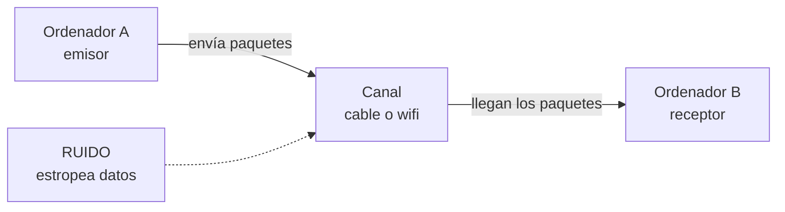
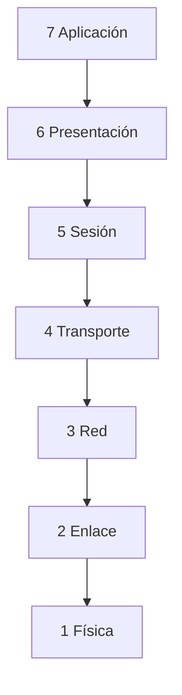
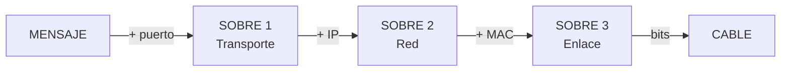

# **FICHA REPASO 1.3 · Redes de comunicaciones: modelos OSI y TCP/IP**

📥 Guardar como PDF
📄 Descargar Word

| Alumno/a | Grupo | Fecha |
| --- | --- | --- |
|  |  |  |

> **📌 ¿Qué repasamos?**
> 

> Repaso de la **FICHA 1.3**: una **red** son **dos o más equipos** intercambiando información en **paquetes** de **bits**, regidos por **protocolos**. El modelo **OSI** la organiza en **7 capas** y el modelo **TCP/IP** (el de Internet) en **4**.

## 1 · ¿Qué es una red de comunicaciones?

Completa las frases:

| Frase | Completa |
| --- | --- |
| Una red de comunicaciones sirve para ………… información entre varios equipos. |  |
| La información viaja troceada en ………… de datos. |  |
| Los paquetes están hechos de ceros y unos, llamados ………… |  |
| Las normas para que los equipos se entiendan se llaman ………… |  |
| El equipo que envía es el ………… y el que recibe es el ………… |  |

## 2 · El modelo OSI: las 7 capas

La información **sale** por la capa 7 y **baja** hasta la capa 1; al llegar al otro equipo hace el camino **inverso** (sube de la 1 a la 7).

Escribe el **nombre** de cada capa a partir de lo que hace:

| Capa | ¿Qué hace? | Nombre |
| --- | --- | --- |
| 7 | Los programas que usas (web, correo, juegos). | ………… |
| 6 | Traduce y comprime la información. | ………… |
| 5 | Mantiene abierta la conversación. | ………… |
| 4 | Trocea el mensaje y controla errores (TCP y UDP). | ………… |
| 3 | Pone la dirección IP y elige la mejor ruta. | ………… |
| 2 | Pone la dirección MAC de cada equipo. | ………… |
| 1 | Envía los bits por el cable. | ………… |

> **📌 Aprende**
> 

> Para memorizarlas de arriba abajo: **«A**las **P**ersonas **S**iempre **T**raen **R**opa **E**n **F**lores» → **A**plicación, **P**resentación, **S**esión, **T**ransporte, **R**ed, **E**nlace, **F**ísica.

## 3 · El encapsulamiento: los sobres

Al **enviar**, cada capa añade una pegatina (**encapsular**); al **recibir**, se quitan los sobres (**desencapsular**).

Escribe el recorrido de fuera hacia dentro (de la capa más alta a la física):

| Orden | Sobre (pegatina) que se añade |
| --- | --- |
| 1.er sobre | ………… (Transporte) → añade un número llamado ………… |
| 2.º sobre | ………… (Red) → añade la dirección ………… |
| 3.er sobre | ………… (Enlace) → añade la dirección ………… |
| Último paso | La capa ………… convierte todo en ………… que viajan por el cable |

## 4 · El modelo TCP/IP: 4 capas

El modelo **TCP/IP** es el que **se usa de verdad en Internet**. Relaciona cada capa con las capas OSI que le corresponden (completa con números):

| Capa TCP/IP | ¿Qué hace? | Capa/s OSI que le corresponden |
| --- | --- | --- |
| 4 Aplicación | Los programas que usas (web, correo, WhatsApp). | Capa ………… (y 6 y 5) |
| 3 Transporte | Envía los trozos de punta a punta y controla errores (TCP y UDP). | Capa ………… |
| 2 Internet | Pone la dirección IP y elige la ruta. | Capa ………… |
| 1 Acceso a red | Usa el cable o el wifi (Ethernet). | Capas ………… y ………… |

> **📌 Aprende**
> 

> - **OSI** tiene **7 capas** y sirve para **aprender** cómo funciona la comunicación.

> - **TCP/IP** tiene **4 capas** y es el modelo que **utiliza Internet** en la práctica.

## 5 · Los protocolos que usas a diario

Escribe el **protocolo** que corresponde a cada función:

| Función | Protocolo |
| --- | --- |
| Ver páginas web (y cifrarlas). | ………… / HTTPS |
| Traduce los nombres (www.google.es) a direcciones IP. | ………… |
| Enviar y recibir correo electrónico. | SMTP / ………… |
| Transferir archivos entre equipos. | ………… |
| Le da una dirección única a cada equipo. | ………… |
| Envía los datos en orden y sin errores. | ………… |
| Envío rápido, muy usado para vídeo y llamadas. | ………… |

## 6 · Reto express

1. ¿Cuántas capas tiene el modelo **OSI**? ¿Y el modelo **TCP/IP**? ¿Cuál de los dos usa Internet de verdad?

1. Cuando un amigo te envía un **WhatsApp** y tú lo recibes, el mensaje ha bajado las 7 capas en el emisor y ha subido en el receptor. ¿Qué proceso es ese?

1. ¿Qué capa OSI se ocupa de cada cosa?

  - De la dirección IP y de elegir la ruta → capa …………

  - De la dirección MAC → capa …………

  - De los bits por el cable → capa …………

  - De TCP y UDP → capa …………

1. La **dirección MAC** está formada por **48 bits** separados en seis bloques. Escribe un ejemplo: `..:..:..:..:..:..`

> **📌 Se valorará**
> 

> - La comprensión de los modelos **OSI y TCP/IP** y de sus capas.

> - La correcta asociación entre **capas, protocolos y su función**.

> - La interpretación del **encapsulamiento** como el viaje del mensaje en sobres.

> - La limpieza y el orden al resolver los ejercicios.

> Esta ficha te servirá para repasar el **CE5a** antes del **EXA101**.

---

### 💡 Solución y Criterios de Corrección (REP103)

🔍 Ver solución paso a paso de REP103

# Repaso 1.03 Resuelta

## REPASO 1.3 · Redes de comunicaciones: modelos OSI y TCP/IP

Ficha en blanco: Repaso 1.3

📥 Guardar como PDF

## **1 · ¿Qué es una red de comunicaciones?**

| Frase | Completa |
| --- | --- |
| Una red de comunicaciones sirve para **intercambiar** información entre varios equipos. |  |
| La información viaja troceada en **paquetes** de datos. |  |
| Los paquetes están hechos de ceros y unos, llamados **bits**. |  |
| Las normas para que los equipos se entiendan se llaman **protocolos**. |  |
| El equipo que envía es el **emisor** y el que recibe es el **receptor**. |  |

## **2 · El modelo OSI: las 7 capas**

| Capa | ¿Qué hace? | Nombre |
| --- | --- | --- |
| 7 | Los programas que usas (web, correo, juegos). | **Aplicación** |
| 6 | Traduce y comprime la información. | **Presentación** |
| 5 | Mantiene abierta la conversación. | **Sesión** |
| 4 | Trocea el mensaje y controla errores (TCP y UDP). | **Transporte** |
| 3 | Pone la dirección IP y elige la mejor ruta. | **Red** |
| 2 | Pone la dirección MAC de cada equipo. | **Enlace de datos** |
| 1 | Envía los bits por el cable. | **Física** |

## **3 · El encapsulamiento: los sobres**

| Orden | Sobre (pegatina) que se añade |
| --- | --- |
| 1.er sobre | **Transporte** → añade un número llamado **puerto** |
| 2.º sobre | **Red** → añade la dirección **IP** |
| 3.er sobre | **Enlace** → añade la dirección **MAC** |
| Último paso | La capa **Física** convierte todo en **bits** que viajan por el cable |

## **4 · El modelo TCP/IP: 4 capas**

| Capa TCP/IP | ¿Qué hace? | Capa/s OSI que le corresponden |
| --- | --- | --- |
| 4 Aplicación | Los programas que usas (web, correo, WhatsApp). | Capa **7** (y 6 y 5) |
| 3 Transporte | Envía los trozos de punta a punta y controla errores (TCP y UDP). | Capa **4** |
| 2 Internet | Pone la dirección IP y elige la ruta. | Capa **3** |
| 1 Acceso a red | Usa el cable o el wifi (Ethernet). | Capas **2** y **1** |

## **5 · Los protocolos que usas a diario**

| Función | Protocolo |
| --- | --- |
| Ver páginas web (y cifrarlas). | **HTTP** / HTTPS |
| Traduce los nombres (www.google.es) a direcciones IP. | **DNS** |
| Enviar y recibir correo electrónico. | SMTP / **POP3** |
| Transferir archivos entre equipos. | **FTP** |
| Le da una dirección única a cada equipo. | **IP** |
| Envía los datos en orden y sin errores. | **TCP** |
| Envío rápido, muy usado para vídeo y llamadas. | **UDP** |

## **6 · Reto express**

1. **OSI** = **7** capas; **TCP/IP** = **4** capas; Internet usa **TCP/IP**.

1. El proceso se llama **encapsulamiento** (al bajar las capas en el emisor) y **desencapsulamiento** (al subir en el receptor).

1. Capas que se ocupan de cada cosa:

  - Dirección IP y ruta → capa **3 (Red)**

  - Dirección MAC → capa **2 (Enlace de datos)**

  - Bits por el cable → capa **1 (Física)**

  - TCP y UDP → capa **4 (Transporte)**

1. Ejemplo de dirección MAC (48 bits, seis bloques): `00:E0:7D:F9:EA:6D`.

