# Cuaderno Práctico de Actividades — UD1: Fonaments de les Comunicacions, Representació Binària, Models OSI/TCP-IP i IP

<div class="interactive-progress-tracker">
  <div class="tracker-header">
    <span>🏆 <strong>Progreso de esta sección:</strong> <span class="tracker-count">0 de 4 superados (0%)</span></span>
    <span class="tracker-pts">⭐ <strong>0 puntos</strong></span>
  </div>
  <div class="tracker-bar">
    <div class="tracker-fill" style="width: 0%;"></div>
  </div>
</div>

En esta sección tienes acceso directo a todas las actividades prácticas, fichas de trabajo y retos evaluables de esta unidad didáctica. Puedes acceder a cada actividad individualmente o consultar la recopilación completa a continuación:

## 🗂️ Índice de Actividades de la Unidad

- **[🛠️ FICHA 1.1 · Elementos de un sistema de comunicación](ficha101.html)**
- **[🛠️ FICHA 1.2 · Representación de la información](ficha102.html)**
- **[🛠️ FICHA 1.3 · Redes de comunicaciones: modelos OSI y TCP/IP](ficha103.html)**
- **[🛠️ FICHA 1.4 · La dirección IP: IPv4 e IPv6](ficha104.html)**
- **[🔄 FICHA REPASO 1.1 · Elementos de un sistema de comunicación](rep101.html)**
- **[🔄 FICHA REPASO 1.2 · Representación de la información](rep102.html)**
- **[🔄 FICHA REPASO 1.3 · Redes de comunicaciones: modelos OSI y TCP/IP](rep103.html)**
- **[🔄 FICHA REPASO 1.4 · La dirección IP: IPv4 e IPv6](rep104.html)**

---

## FICHA 1.1 · Elementos de un sistema de comunicación

👉 *[Obrir aquesta activitat en pàgina individual](ficha101.html)*

# **FICHA 1.1 · Elementos de un sistema de comunicación**

📥 
📄 

| Alumne/a | Grup | Data |
| --- | --- | --- |
|  |  |  |

> **📌 ¿Qué repasamos?**
> 

> Tot sistema de comunicació necessita **cinc elements**: un **emisor**, un **receptor**, un **mensaje**, un **canal** i un **código**. A més, el **soroll** intenta espatlar la comunicació i el **protocol** posa les normes.

## 1 · El procés de comunicació

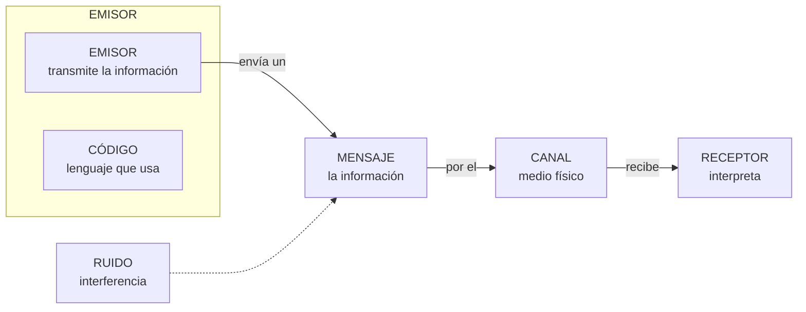

### Completa la taula

| Element | Què és? | Explica-ho amb les teues paraules |
| --- | --- | --- |
| **Emissor** | Entitat que transmet la informació |  |
| **Receptor** | Entitat que rep la informació |  |
| **Missatge** | Informació que l'emisor transmet al receptor |  |
| **Canal** | Mitjà pel que es transmet el mensaje |  |
| **Codi** | Conjunt de signes, regles i normes (llenguatge) |  |

## 2 · Identifica els elements

Per a cada situació, escriu el **emisor**, **receptor**, **mensaje**, **canal** i **código**:

| Situació | Emissor | Receptor | Missatge | Canal | Codi |
| --- | --- | --- | --- | --- | --- |
| Un conductor interpreta els senyals de trànsit |  |  |  |  |  |
| Escoltes un podcast en Spotify |  |  |  |  |  |
| Fas una compra online |  |  |  |  |  |
| Un repartidor telefona al client per a avisar-lo de que arriba el seu paquet |  |  |  |  |  |

## 3 · El soroll

El **soroll** és qualsevol interferència que contamina tant el mensaje com el canal o el código.

1. Completa: "El soroll és qualsevol ……………… que contamina el ………………, el ……………… o el ………………"

1. Posa un **exemple de soroll** per a cada situació de l'exercici 2:

| Situació | Quin soroll podria espatlar-la? |
| --- | --- |
| Conductor i senyals de trànsit |  |
| Podcast en Spotify |  |
| Compra online |  |
| Telefonada del repartidor |  |

## 4 · El protocol de comunicació

1. 

Defineix amb les teues paraules què és un **protocol de comunicació**.

1. 

Marca **V** (vertader) o **F** (fals):

| Afirmació | V/F |
| --- | --- |
| El protocol determina com s'inicia i finalitza la comunicació |  |
| El protocol fixa l'idioma o nivell de llenguatge que s'empra |  |
| El protocol tolera tot tipus de soroll sense importar la seua quantitat |  |
| El protocol diu com actuar si la comunicació s'interromp |  |

## 5 · Autoavaluació

Marca una casella per fila per a valorar com et sents amb cada idea:

| Concepte | L'entenc | Quasi | El necessite repassar |
| --- | --- | --- | --- |
| Elements de la comunicació |  |  |  |
| Identificar emisor, receptor, mensaje, canal i código |  |  |  |
| Soroll i interferències |  |  |  |
| Protocol de comunicació |  |  |  |

> **📌 Es valorarà**
> 

> *La identificació correcta dels elements de la comunicació en situacions reals.
* La definició precisa de **soroll** i **protocol**.
* La neteja i claredat en les respostes.

> Aquesta fitxa et servirà per a practicar el **CE5a** (descriure els principis de funcionament de les xarxes locals) abans del **EXA101**.

---

<details markdown="1">
<summary>💡 Mostrar / Amagar el Solucionari Oficial complet (FICHA 1.1 · Elementos de un sistema de comunicación)</summary>

# **FICHA 1.1 · Elementos de un sistema de comunicación**

Fitxa en blanc: FICHA 1.1

📥 

## **1 · Completa la taula**

| Element | Què és? | Explica-ho amb les teues paraules (exemple) |
| --- | --- | --- |
| **Emissor** | Entitat que transmet la informació | La persona o equip que **envia** el mensaje (qui parla o envia) |
| **Receptor** | Entitat que rep la informació | La persona o equip que **rep i interpreta** el mensaje |
| **Missatge** | Informació que l'emisor transmet al receptor | **El que es diu**: la notícia, l'ordre, la salutació… |
| **Canal** | Mitjà pel que es transmet el mensaje | El mitjà físic: **aire, cable, wifi, llum**… |
| **Codi** | Conjunt de signes, regles i normes (llenguatge) | El llenguatge: **idioma, senyals, colors, emojis**… |

## **2 · Identifica els elements**

| Situació | Emissor | Receptor | Missatge | Canal | Codi |
| --- | --- | --- | --- | --- | --- |
| Un conductor interpreta els senyals de trànsit | El senyal (o l'organisme de trànsit) | El conductor | La indicació (perill, prohibició…) | La llum del senyal, que viatja pel aire | El llenguatge dels senyals (formes i colors) |
| Escoltes un podcast en Spotify | El creador del podcast | Tu | El contingut de l'episodi | Internet + l'app Spotify (i els altaveus) | L'idioma (parla, música) |
| Fas una compra online | Tu (el comprador) | La botiga online (el seu servidor) | Les dades de la comanda (article, adreça, pagament) | Internet (la web de la botiga) | L'idioma i el format del formulari |
| Un repartidor telefona al client per a avisar-lo de que arriba el seu paquet | El repartidor | El client | L'avís d'arribada (adreça, hora) | La xarxa telefònica (el telèfon) | L'idioma (castellà) |

## **3 · El soroll**

1. 

"El soroll és qualsevol **interferència** que contamina el **mensaje**, el **canal** o el **código**".

1. 

Exemples de soroll:

| Situació | Quin soroll podria espatlar-la? |
| --- | --- |
| Conductor i senyals de trànsit | El senyal **bruta o tapada**, boira, deslumbrament del sol |
| Podcast en Spotify | **Talls de connexió**, soroll de fons en la gravació, anuncis |
| Compra online | **Caiguda de Internet**, la web que no carrega, pàgina lenta |
| Telefonada del repartidor | **Mala cobertura**, soroll ambiental, interferències de la línia |

## **4 · El protocol de comunicació**

1. 

*Resposta personal*: **conjunt de normes que regeixen la comunicació**: com iniciar i finalizar-la, quin nivell de llenguatge usar, quant soroll tolera i com actuar si s'interromp.

1. 

Marca **V** o **F**:

| Afirmació | V/F |
| --- | --- |
| El protocol determina com s'inicia i finalitza la comunicació | **V** |
| El protocol fixa l'idioma o nivell de llenguatge que s'empra | **V** |
| El protocol tolera tot tipus de soroll sense importar la seua quantitat | **F** (només tolera fins a un llindar) |
| El protocol diu com actuar si la comunicació s'interromp | **V** |

</details>


---

## FICHA 1.2 · Representación de la información

👉 *[Obrir aquesta activitat en pàgina individual](ficha102.html)*

# **FICHA 1.2 · Representación de la información**

📥 
📄 

| Alumne/a | Grup | Data |
| --- | --- | --- |
|  |  |  |

> **📌 ¿Qué repasamos?**
> 

> La informació viatja **codificada**. Els tres sistemes de codificació que manejamos són el **decimal**, el **binari** (zeros i uns, els famosos **bits**) i el **hexadecimal**. Aprendre a traduir entre ells és l'objectiu d'aquesta fitxa.

## 1 · Els tres sistemes de codificació

| Sistema | Símbols | Qui l'usa? | Exemple |
| --- | --- | --- | --- |
| **Decimal** | 0 1 2 3 4 5 6 7 8 9 | Les persones | 125 |
| **Binari** | 0 1 | Els ordinadors | 1111101 |
| **Hexadecimal** | 0-9, A B C D E F | Intermedi decimal-binari | 7D |

> **📌 Aprèn**
> 

> Cada **bit** val 0 o 1. Al bit de l'esquerra (més valor) es li anomena **MSB** i al de la dreta (menys valor), **LSB**.


## 2 · Traducció decimal ↔ binari

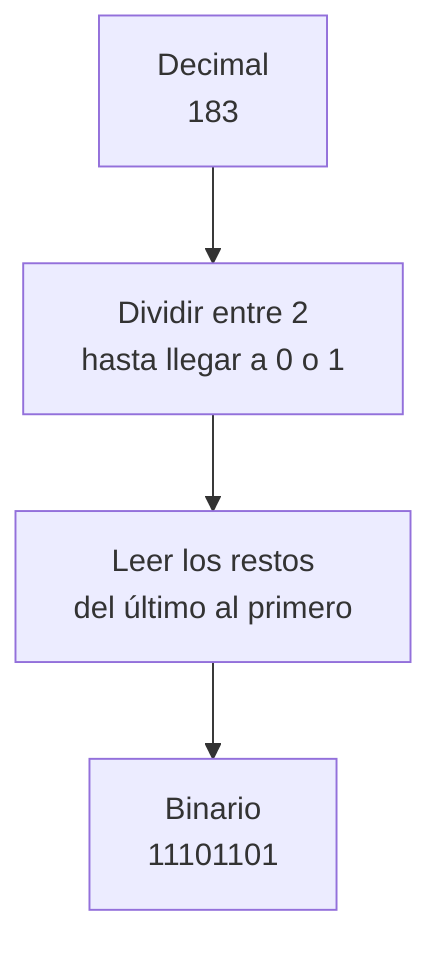

### 2.1 · Decimal → binari

| Decimal | Resolució (divisions) | Resultat binari |
| --- | --- | --- |
| 10 |  |  |
| 25 |  |  |
| 183 |  |  |
| 200 |  |  |

### 2.2 · Binari → decimal

Recorda: cada posició val una potència de 2: **1, 2, 4, 8, 16, 32, 64, 128…**

| Binari | Potències que suman (ej.: 1010 = 8 + 2) | Decimal |
| --- | --- | --- |
| 1010 | 8 + 2 | 10 |
| 1101 |  |  |
| 100000 |  |  |
| 11111111 |  |  |

## 3 · Traducció hexadecimal ↔ binari

Cada xifra hexadecimal = **4 bits** (un quartet). Usa aquesta taula com chuleta:

| Hex | Bin |  | Hex | Bin |
| --- | --- | --- | --- | --- |
| 0 | 0000 |  | 8 | 1000 |
| 1 | 0001 |  | 9 | 1001 |
| 2 | 0010 |  | A | 1010 |
| 3 | 0011 |  | B | 1011 |
| 4 | 0100 |  | C | 1100 |
| 5 | 0101 |  | D | 1101 |
| 6 | 0110 |  | E | 1110 |
| 7 | 0111 |  | F | 1111 |

### 3.1 · Hexadecimal → binari

| Hexadecimal | Quartets | Binari |
| --- | --- | --- |
| A5 | A=1010 · 5=0101 | 10100101 |
| 1F |  |  |
| B09 |  |  |

### 3.2 · Binari → hexadecimal

| Binari | Quartets (emplena zeros a l'esquerra si falta) | Hexadecimal |
| --- | --- | --- |
| 10100101 | 1010 · 0101 | A5 |
| 1111011 |  |  |
| 10000001 |  |  |

## 4 · Mesures d'informació

Recorda l'escala: per a **baixar** una mesura multiplica per 1024; per a **pujar**, divideix entre 1024 (i entre 8 si vas a bits).

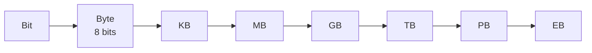

Completa les conversions:

| Conversió | Resolució | Resultat |
| --- | --- | --- |
| 2 B → bits | 2 × 8 | 16 b |
| 1 GB → MB | 1 × 1024 |  |
| 60 KB → TB | 60 / 1024 / 1024 / 1024 |  |
| 4 MB → bits |  |  |

## 5 · Repte express

1. Quants bits ha d'enciende la «forma» d'escriure la lletra **A** en binari `01000001`? Escriu el seu valor **decimal** i els seus brillos en **hexadecimal**.

1. Ordena de menor a major: **1 GB**, **1024 KB**, **1024 MB**, **1 TB**.

> **📌 Es valorarà**
> 

> - La correcta aplicació de l'algoritmo de **divisió sucesiva** (decimal → binari).

> - L'ús de la **taula de correspondència** per als quartets hexadecimals.

> - La precisió en les conversions de **mesures d'informació**.

> - La neteja i l'ordre al resoldre els exercicis.

> Aquesta fitxa et servirà per a practicar el **CE5a** abans del **EXA101**.

---

<details markdown="1">
<summary>💡 Mostrar / Amagar el Solucionari Oficial complet (FICHA 1.2 · Representación de la información)</summary>

# **FICHA 1.2 · Representación de la información**

Fitxa en blanc: FICHA 1.2

📥 

## **1 · Els tres sistemes de codificació**

| Sistema | Símbols | Qui l'usa? | Exemple |
| --- | --- | --- | --- |
| **Decimal** | 0 1 2 3 4 5 6 7 8 9 | Les persones | 125 |
| **Binari** | 0 1 | Els ordinadors | 1111101 |
| **Hexadecimal** | 0-9, A B C D E F | Intermedi decimal-binari | 7D |

**MSB** = bit de l'esquerra (més valor) · **LSB** = bit de la dreta (menys valor).

## **2 · Traducció decimal ↔ binari**

### **2.1 · Decimal → binari**

| Decimal | Resolució (divisions) | Resultat binari |
| --- | --- | --- |
| 10 | 10÷2=5·0 ; 5÷2=2·1 ; 2÷2=1·0 ; 1÷2=0·1 | **1010** |
| 25 | 25÷2=12·1 ; 12÷2=6·0 ; 6÷2=3·0 ; 3÷2=1·1 ; 1÷2=0·1 | **11001** |
| 183 | 183÷2=91·1 ; 91÷2=45·1 ; 45÷2=22·1 ; 22÷2=11·0 ; 11÷2=5·1 ; 5÷2=2·1 ; 2÷2=1·0 ; 1÷2=0·1 | **10110111** |
| 200 | 200÷2=100·0 ; 100÷2=50·0 ; 50÷2=25·0 ; 25÷2=12·1 ; 12÷2=6·0 ; 6÷2=3·0 ; 3÷2=1·1 ; 1÷2=0·1 | **11001000** |

*Es llegixen els restos de l'últim al primer.*

### **2.2 · Binari → decimal**

| Binari | Potències que suman | Decimal |
| --- | --- | --- |
| 1010 | 8 + 2 | 10 |
| 1101 | 8 + 4 + 1 | **13** |
| 100000 | 32 | **32** |
| 11111111 | 128 + 64 + 32 + 16 + 8 + 4 + 2 + 1 | **255** |

## **3 · Traducció hexadecimal ↔ binari**

### **3.1 · Hexadecimal → binari**

| Hexadecimal | Quartets | Binari |
| --- | --- | --- |
| A5 | A=1010 · 5=0101 | 10100101 |
| 1F | 1=0001 · F=1111 | **00011111** |
| B09 | B=1011 · 0=0000 · 9=1001 | **101100001001** |

### **3.2 · Binari → hexadecimal**

| Binari | Quartets (emplena zeros a l'esquerra si falta) | Hexadecimal |
| --- | --- | --- |
| 10100101 | 1010 · 0101 | A5 |
| 1111011 | 0001 · 1011 | **1B** |
| 10000001 | 1000 · 0001 | **81** |

## **4 · Mesures d'informació**

| Conversió | Resolució | Resultat |
| --- | --- | --- |
| 2 B → bits | 2 × 8 | 16 b |
| 1 GB → MB | 1 × 1024 | **1024 MB** |
| 60 KB → TB | 60 / 1024 / 1024 / 1024 | **≈ 0,0000000559 TB** |
| 4 MB → bits | 4 × 1024 × 1024 × 8 | **33 554 432 bits** |

## **5 · Repte express**

1. `01000001` té **8 bits** (un byte); en decimal és **65** i en hexadecimal **41**.

1. De menor a major: **1024 KB = 1 MB < 1024 MB = 1 GB < 1 TB** (els dos primers són iguals, i els dos següents també).

</details>


---

## FICHA 1.3 · Redes de comunicaciones: modelos OSI y TCP/IP

👉 *[Obrir aquesta activitat en pàgina individual](ficha103.html)*

# **FICHA 1.3 · Redes de comunicaciones: modelos OSI y TCP/IP**

📥 
📄 

| Alumne/a | Grup | Data |
| --- | --- | --- |
|  |  |  |

> **📌 ¿Qué repasamos?**
> 

> Una **xarxa de comunicacions** és un grup de **dos o més equips** que intercambian informació. Eixa informació viatja trossejada en **paquets de dades** fets de zeros i uns (els **bits**). Perquè tots els equips es entenguen, usem unes normes anomenades **protocols**. I per a organitzar-los, existeixen dos models: **OSI** i **TCP/IP**.

## 1 · Què és una xarxa de comunicacions?

Una xarxa de comunicacions serveix per a que els equips es **intercanvien informació**. L'equip que envia és el **emisor**, el que rep és el **receptor**, i entre ells hi ha un **canal** (el cable o el wifi). Si alguna cosa espatla les dades, hi ha **soroll**.

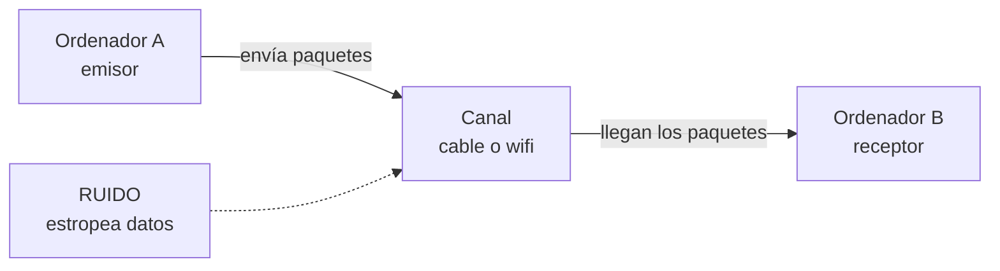

Completa les frases:

| Frase | Completa |
| --- | --- |
| Una xarxa de comunicacions serveix per a ………… informació entre diversos equips. |  |
| La informació viatja trossejada en ………… de dades. |  |
| Els paquets estan fets de zeros i uns, anomenats ………… |  |
| Les normes perquè els equips es entenguen es anomenen ………… |  |
| L'equip que envia és el ………… i el que rep és el ………… |  |

## 2 · El model OSI: les 7 capes

El model **OSI** organitza la comunicació en **7 capes** (com un edifici de 7 pisos). La informació **ix** per la capa 7 (la d'adalt) i **baixa** fins a la capa 1 (la física); a l'arribar a l'un altre equip, fa el camino **invers** (puja de la 1 a la 7).

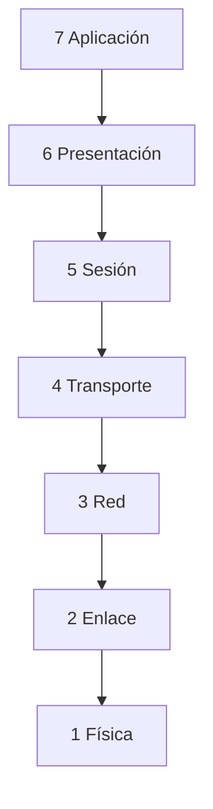

Completa la taula amb la funció de cada capa:

| Capa | Nom | Què fa? |
| --- | --- | --- |
| 7 | Aplicació | Els programes que uses (web, correu, jocs). |
| 6 | Presentació | Tradueix i comprime la informació. |
| 5 | Sessió | Manté oberta la conversa. |
| 4 | Transport | Trocea el mensaje i controla els errors (**TCP** i **UDP**). |
| 3 | Xarxa | Posa la **adreça IP** i tria la millor ruta. |
| 2 | Enllaç de dades | Posa la **adreça MAC** de cada equip. |
| 1 | Física | Envia els **bits** pel cable. |

> **📌 Aprèn**
> 

> Per a memoritzar les 7 capes d'adalt abaix usa aquesta frase:
**«A**les **P**ersonas **S**iempre **T**raen **R**opa **E**n **F**lores»** → **A**plicació, **P**resentació, **S**esió, **T**ransporte, **R**ed, **E**nlace, **F**ísica.

## 3 · L'encapsulament: els sobres

Al **enviar**, cada capa **afegeix una adhesiu** amb informació (com quan metes un mensaje en diversos sobres). Al **rebre**, es quitan els sobres un a un. A açò es li anomena **encapsular** (posar sobres) i **desencapsular** (quitar-los).

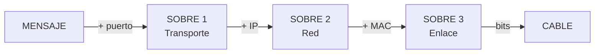

Completa: què sobre (adhesiu) afegeix cada capa?

| Capa | Adhesiu que afegeix |
| --- | --- |
| Transport | Un número anomenat ………… |
| Xarxa | L'adreça ………… (IP) |
| Enllaç de dades | L'adreça ………… (MAC) |
| Física | Tot es converteix en ………… que viatgen pel cable |

## 4 · El model TCP/IP: 4 capes

El model **TCP/IP** és el que **s'usa de veritat en Internet**. Té només **4 capes**. Relaciona cada capa amb les capes del model OSI que li corresponen (complétalo amb números):

| Capa TCP/IP | Què fa? | Capa/s OSI que li corresponen |
| --- | --- | --- |
| 4 Aplicació | Els programes que uses (web, correu, WhatsApp). | Capa ………… (i 6 i 5) |
| 3 Transport | Envia els trossos de punta a punta i controla errors (**TCP** i **UDP**). | Capa ………… |
| 2 Internet | Posa la **adreça IP** i tria la ruta. | Capa ………… |
| 1 Accés a xarxa | Usa el cable o el wifi (**Ethernet**). | Capes ………… i ………… |

> **📌 Aprèn**
> 

> - **OSI** té **7 capes** i serveix per a **aprendre** com funciona la comunicació.

> - **TCP/IP** té **4 capes** i és el model que **utilitza Internet** en la pràctica.

## 5 · Els protocols que uses a diario

Els **protocols** són les normes de cada capa. Quan uses el mòbil o l'ordinador, estan treballant sense que et des compta. Escriu un exemple d'ús cotidiano per a cada un:

| Protocol | Per a què serveix? | Exemple cotidiano |
| --- | --- | --- |
| HTTP / HTTPS | Veure pàgines web. |  |
| DNS | Tradueix els noms (www.google.és) a adreces IP. |  |
| SMTP / POP3 | Enviar i rebre correu electrònic. |  |
| FTP | Transferir arxius entre equips. |  |
| IP | Li dóna una adreça única a cada equip. |  |
| TCP | Envia les dades en ordre i sense errors. |  |
| UDP | Enviament ràpid, molt usat per a vídeo i anomenades. |  |

## 6 · Repte express

1. Quantes capes té el model **OSI**? I el model **TCP/IP**? Quin dels dos usa Internet de veritat?

1. Quan un amigo et envia un **WhatsApp** i tu el recibes, el mensaje ha bajado les 7 capes en l'emisor i ha subido en el receptor. Què procés és eixe?

1. Uneix cada protocol amb la seua funció:

  - **DNS** → Veure pàgines web

  - **HTTP** → Traduir noms a adreces IP

  - **IP** → Enviar dades en ordre i sense errors

  - **TCP** → Donar una adreça única a cada equip

1. La **adreça MAC** està formada per **48 bits** separats en sis blocs. Escriu un exemple: `..:..:..:..:..:..`

> **📌 Es valorarà**
> 

> - La comprensió dels models **OSI i TCP/IP** i de les seues capes.

> - La correcta associació entre **capes, protocols i la seua funció**.

> - La interpretació del **encapsulament** com el viatge del mensaje en sobres.

> - La neteja i l'ordre al resoldre els exercicis.

> Aquesta fitxa et servirà per a practicar el **CE5a** abans del **EXA101**.

---

<details markdown="1">
<summary>💡 Mostrar / Amagar el Solucionari Oficial complet (FICHA 1.3 · Redes de comunicaciones: modelos OSI y TCP/IP)</summary>

# **FICHA 1.3 · Redes de comunicaciones: modelos OSI y TCP/IP**

Fitxa en blanc: FICHA 1.3

📥 

## **1 · Què és una xarxa de comunicacions?**

| Frase | Completa |
| --- | --- |
| Una xarxa de comunicacions serveix per a **intercanviar** informació entre diversos equips. |  |
| La informació viatja trossejada en **paquets** de dades. |  |
| Els paquets estan fets de zeros i uns, anomenats **bits**. |  |
| Les normes perquè els equips es entenguen es anomenen **protocols**. |  |
| L'equip que envia és el **emisor** i el que rep és el **receptor**. |  |

## **2 · El model OSI: les 7 capes**

| Capa | Nom | Què fa? |
| --- | --- | --- |
| 7 | **Aplicació** | Els programes que uses (web, correu, jocs). |
| 6 | **Presentació** | Tradueix i comprime la informació. |
| 5 | **Sessió** | Manté oberta la conversa. |
| 4 | **Transport** | Trocea el mensaje i controla errors (TCP i UDP). |
| 3 | **Xarxa** | Posa l'adreça IP i tria la millor ruta. |
| 2 | **Enllaç de dades** | Posa l'adreça MAC de cada equip. |
| 1 | **Física** | Envia els bits pel cable. |

Mnemotecnia: **«A**les **P**ersonas **S**iempre **T**raen **R**opa **E**n **F**lores».

## **3 · L'encapsulament: els sobres**

| Capa | Adhesiu que afegeix |
| --- | --- |
| Transport | Un número anomenat **port** |
| Xarxa | L'adreça **IP** |
| Enllaç de dades | L'adreça **MAC** |
| Física | Tot es converteix en **bits** que viatgen pel cable |

## **4 · El model TCP/IP: 4 capes**

| Capa TCP/IP | Què fa? | Capa/s OSI que li corresponen |
| --- | --- | --- |
| 4 Aplicació | Els programes que uses (web, correu, WhatsApp). | Capa **7** (i 6 i 5) |
| 3 Transport | Envia els trossos de punta a punta i controla errors (TCP i UDP). | Capa **4** |
| 2 Internet | Posa l'adreça IP i tria la ruta. | Capa **3** |
| 1 Accés a xarxa | Usa el cable o el wifi (Ethernet). | Capes **2** i **1** |

## **5 · Els protocols que uses a diario**

| Protocol | Per a què serveix? | Exemple cotidiano |
| --- | --- | --- |
| HTTP / HTTPS | Veure pàgines web. | Obrir google.és o YouTube (HTTPS xifra les dades) |
| DNS | Tradueix els noms a adreces IP. | Escribes www.google.és i el DNS la converteix en IP |
| SMTP / POP3 | Enviar i rebre correu electrònic. | Enviar un correu i recibir-lo en el mòbil |
| FTP | Transferir arxius entre equips. | Pujar els apuntes al servidor de l'institut |
| IP | Li dóna una adreça única a cada equip. | El teu equip amb 192.168.1.25 dins de la xarxa |
| TCP | Envia les dades en ordre i sense errors. | Descarregar un arxiu complet i sense fallades |
| UDP | Enviament ràpid, molt usat per a vídeo i anomenades. | Una videollamada o streaming de vídeo |

## **6 · Repte express**

1. **OSI** té **7** capes; **TCP/IP** té **4**; Internet usa de veritat **TCP/IP**.

1. El procés es anomena **encapsulament** (a l'enviar) i **desencapsulament** (al rebre).

1. Correccions de les parelles:

  - **DNS** → Traduir noms a adreces IP

  - **HTTP** → Veure pàgines web

  - **IP** → Donar una adreça única a cada equip i triar la ruta

  - **TCP** → Enviar dades en ordre i sense errors

1. Exemple d'adreça MAC (6 blocs hexadecimals): `00:E0:7D:F9:EA:6D` *(qualsevol exemple de 48 bits val)*.

</details>


---

## FICHA 1.4 · La dirección IP: IPv4 e IPv6

👉 *[Obrir aquesta activitat en pàgina individual](ficha104.html)*

# **FICHA 1.4 · La dirección IP: IPv4 e IPv6**

📥 
📄 

| Alumne/a | Grup | Data |
| --- | --- | --- |
|  |  |  |

> **📌 ¿Qué repasamos?**
> 

> Cada equip d'una xarxa té **dos adreces**: la **MAC** (física, no canvia) i la **IP** (lògica, pot canviar). Existeixen dos versions del protocol IP: **IPv4** (32 bits) e **IPv6** (128 bits). En aquesta fitxa aprenderás a distinguirlas i a leerlas.

## 1 · Dos adreces: quin és quin?

Quan enviem una carta per correu, necessitem saber **on viu** la persona i **qui és**. En una xarxa passa igual: la **adreça IP** és l'adreça de la casa i la **adreça MAC** és el nom del destinatari.

| Adreça IP | Adreça MAC |
| --- | --- |
| Com la **adreça d'una casa** | Com el **nom del destinatari** |
| És **lògica**: canvia segons la xarxa | És **física**: ve en la targeta |
| Pot ser **estàtica** (fixa) o **dinàmica** (canvia) | Mai canvia |

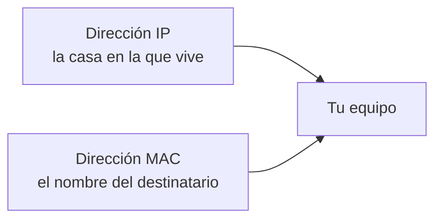

Completa la taula escrivint **IP** o **MAC**:

| Frase | IP o MAC? |
| --- | --- |
| És fixa i no canvia mai. |  |
| És lògica i l'assigna la xarxa en cada moment. |  |
| Té **48 bits** separats en sis blocs. |  |
| Pot ser estàtica o dinàmica. |  |
| Identifica la targeta de xarxa de forma unívoca. |  |

## 2 · L'adreça IPv4

L'adreça **IPv4** té **32 bits** i es escriu en **4 blocs de 8 bits** (un byte cada un) en format **decimal**, separats per puntos. Cada bloc pot valdre de **0 a 255**.

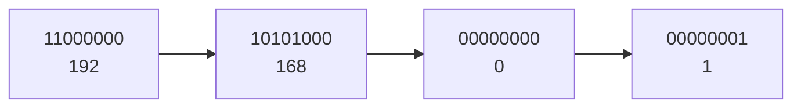

Completa:

| Pregunta | Completa |
| --- | --- |
| Quants bits té una adreça IPv4? | ………… bits |
| En quants blocs es escriuen? | ………… blocs |
| Amb què signe es separen els blocs? | Amb ………… |
| En què format es escriu cada bloc? | ………… (decimal o binari) |
| Quant val el bloc més alt? | Fins al ………… |

Hi ha adreces IP que **no es poden usar en Internet** perquè són **privades** (només valen dins de casa o de l'institut). Escriu si cada adreça és **pública** o **privada**:

| Adreça | Pública o privada? |
| --- | --- |
| 192.168.1.10 |  |
| 10.0.0.25 |  |
| 8.8.8.8 |  |
| 172.20.3.5 |  |
| 150.214.12.8 |  |

> **📌 Aprèn**
> 

> Les tres xarxes **privades** més típiques són les que comencen per **10.**, per **172.16.** a **172.31.** i per **192.168.**

## 3 · La màscara de xarxa

La **màscara de xarxa** acompanya a l'adreça IP i serveix per a saber què part de l'adreça identifica a la **xarxa** i què part al **equip** (host). La més comú és `255.255.255.0`.

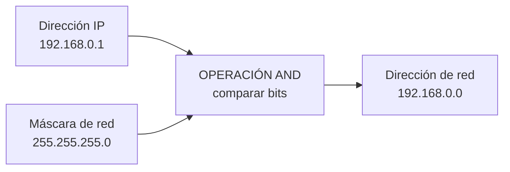

> **📌 Aprèn**
> 

> L'operació **AND** compara els bits de la IP amb els de la màscara:
**1 AND 1 = 1** · **1 AND 0 = 0** · **0 AND 0 = 0**

Dins d'una xarxa, **dos adreces no es poden assignar a equips**. Uneix cada una amb el seu nom:

| Adreça | Nom |
| --- | --- |
| 192.168.0.0 | Adreça de ………… (xarxa) |
| 192.168.0.255 | Adreça de ………… (broadcast) |
| De 192.168.0.1 a 192.168.0.254 | Adreces per als ………… (hosts) |

## 4 · L'adreça IPv6

L'adreça **IPv6** té **128 bits** i es escriu en **8 grups de 2 bytes**, separats per dos puntos (**:**), en format **hexadecimal**.

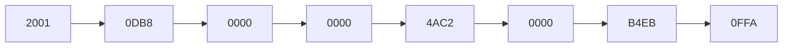

Per a abreviar-l'es segueixen aquestes regles:
1. Es poden quitar els **zeros a l'esquerra** de cada grup: `00D1` → `D1`.
2. Un grup `0000` es pot escriure com `0`.
3. Si hi ha **dos o més grups amb zeros seguits**, es sustituyen per `::` (només **una vegada** per adreça).

Completa:

| Pregunta | Completa |
| --- | --- |
| Quants bits té una adreça IPv6? | ………… bits |
| En quants grups de 2 bytes es escriu? | ………… grups |
| Amb què caràcter es separen els grups? | Amb ………… |
| En què format es escriuen? | ………… (hexadecimal) |

Abrevia aquestes adreces IPv6:

- `2000:0011:3D4A:0055:0000:0000:2F01:5432` → `2000:11:3D4A:55:…:2F01:5432` (escriu el `::`)

- `7144:0000:A101:0000:0000:0000:31BB:4A23` → `…`

## 5 · Repte express

1. Quants bits té **IPv4**? I **IPv6**? Quin de les dos ofereix més adreces?

1. La IP de la impressora de l'institut **no canvia mai**: és ……… (estàtica o dinàmica). La IP del mòbil en casa **canvia cada dia**: és ………

1. Marca **V** (vertader) o **F** (fals):

| Afirmació | V/F |
| --- | --- |
| L'adreça MAC és fixa i identifica la targeta de xarxa. |  |
| L'adreça IP pot canviar segons la xarxa en la que estiga l'equip. |  |
| `192.168.1.10` és una adreça pública. |  |
| La màscara de xarxa separa la part de xarxa de la part de l'host. |  |
| En IPv4 cada bloc es escriu en hexadecimal. |  |

1. Escriu la teua adreça IPv4 i la teua adreça MAC en aquest buit (pots usar `ipconfig /all` en el símbol del sistema):

1. IPv4: `…`

1. MAC: `…`

> **📌 Es valorarà**
> 

> - La distinció correcta entre **adreça IP** i **adreça MAC**.

> - La correcta lectura de les adreces **IPv4 i IPv6**.

> - L'aplicació de la **màscara de xarxa** i l'operació **AND**.

> - La neteja i l'ordre al resoldre els exercicis.

> Aquesta fitxa et servirà per a practicar el **CE5a** abans del **EXA101**.

---

<details markdown="1">
<summary>💡 Mostrar / Amagar el Solucionari Oficial complet (FICHA 1.4 · La dirección IP: IPv4 e IPv6)</summary>

# **FICHA 1.4 · La dirección IP: IPv4 e IPv6**

Fitxa en blanc: FICHA 1.4

📥 

## **1 · Dos adreces: quin és quin?**

| Frase | IP o MAC? |
| --- | --- |
| És fixa i no canvia mai. | **MAC** |
| És lògica i l'assigna la xarxa en cada moment. | **IP** |
| Té 48 bits separats en sis blocs. | **MAC** |
| Pot ser estàtica (fixa) o dinàmica (canvia). | **IP** |
| Identifica la targeta de xarxa de forma unívoca. | **MAC** |

## **2 · L'adreça IPv4**

| Pregunta | Completa |
| --- | --- |
| Quants bits té una adreça IPv4? | **32** bits |
| En quants blocs es escriuen? | **4** blocs |
| Amb què signe es separen els blocs? | Amb **puntos (.)** |
| En què format es escriu cada bloc? | **decimal** |
| Quant val el bloc més alt? | Fins al **255** |

| Adreça | Pública o privada? |
| --- | --- |
| 192.168.1.10 | **Privada** |
| 10.0.0.25 | **Privada** |
| 8.8.8.8 | **Pública** |
| 172.20.3.5 | **Privada** (entre 172.16 i 172.31) |
| 150.214.12.8 | **Pública** |

## **3 · La màscara de xarxa**

| Adreça | Nom |
| --- | --- |
| 192.168.0.0 | Adreça de **xarxa** |
| 192.168.0.255 | Adreça de **broadcast** |
| De 192.168.0.1 a 192.168.0.254 | Adreces per als **hosts** |

## **4 · L'adreça IPv6**

| Pregunta | Completa |
| --- | --- |
| Quants bits té una adreça IPv6? | **128** bits |
| En quants grups de 2 bytes es escriu? | **8** grups |
| Amb què caràcter es separen els grups? | Amb **dos puntos (:)** |
| En què format es escriuen? | **hexadecimal** |

Abreviacions:

- `2000:0011:3D4A:0055:0000:0000:2F01:5432` → `2000:11:3D4A:55:…:2F01:5432` → **`2000:11:3D4A:55::2F01:5432`**

- `7144:0000:A101:0000:0000:0000:31BB:4A23` → **`7144:0:A101::31BB:4A23`**

## **5 · Repte express**

1. **IPv4** té **32 bits**; **IPv6** té **128 bits**; ofereix més adreces **IPv6**.

1. 

La IP de la impressora és **estàtica**; la IP del mòbil en casa és **dinàmica**.

1. 

Marca **V** o **F**:

| Afirmació | V/F |
| --- | --- |
| L'adreça MAC és fixa i identifica la targeta de xarxa. | **V** |
| L'adreça IP pot canviar segons la xarxa en la que estiga l'equip. | **V** |
| `192.168.1.10` és una adreça pública. | **F** (és privada) |
| La màscara de xarxa separa la part de xarxa de la part de l'host. | **V** |
| En IPv4 cada bloc es escriu en hexadecimal. | **F** (en decimal) |

1. *Resposta personal*: usa `ipconfig /all` (Windows) o `ifconfig` / `ip a` (Linux/macOS) per a copiar el teu **IPv4** i el teu **MAC**.

</details>


---

## FICHA REPASO 1.1 · Elementos de un sistema de comunicación

👉 *[Obrir aquesta activitat en pàgina individual](rep101.html)*

# **FICHA REPASO 1.1 · Elementos de un sistema de comunicación**

📥 
📄 

| Alumne/a | Grup | Data |
| --- | --- | --- |
|  |  |  |

> **📌 ¿Qué repasamos?**
> 

> Repàs de la **FICHA 1.1**: todo sistema de comunicación necesita **cinco elementos** (**emisor**, **receptor**, **mensaje**, **canal** i **código**); el **ruido** intenta estropearla, el **protocolo** la ordena con normas y el **intérprete** traduce cuando los códigos no coinciden.

## 1 · L'essencial, en una taula

Completa la columna dreta:

| Concepte | Completa amb les teues paraules |
| --- | --- |
| **Emissor** | Entitat que ………… la informació |
| **Receptor** | Entitat que ………… la informació |
| **Missatge** | ………… que l'emisor transmet al receptor |
| **Canal** | ………… pel que viatja el mensaje |
| **Codi** | Conjunt de signes, regles i ………… (llenguatge) |
| **Soroll** | Qualsevol ………… que contamina el mensaje, el canal o el código |
| **Protocol** | Conjunt de ………… que regeixen la comunicació |
| **Intèrpret** | Element que ………… entre codis distints (módem, router…) |

## 2 · El procés de comunicació

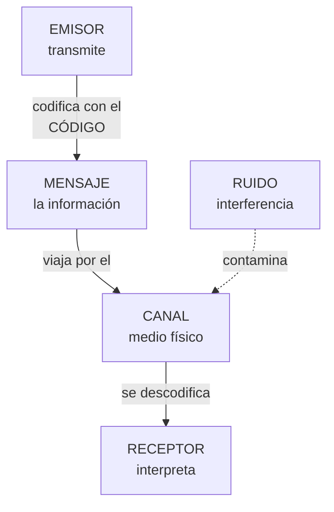

Completa el recorregut del mensaje:

| Passos del procés | Completa |
| --- | --- |
| El ………… codifica i envia el mensaje |  |
| El mensaje viatja pel ………… |  |
| El ………… rep i interpreta el mensaje |  |
| Si els codis no coincideixen, actua el ………… |  |
| Si hi ha interferències, diem que hi ha ………… |  |

## 3 · Identifica els elements

Per a cada situació, escriu el **emisor**, **receptor**, **mensaje**, **canal** i **código**:

| Situació | Emissor | Receptor | Missatge | Canal | Codi |
| --- | --- | --- | --- | --- | --- |
| El teu professor explica en la pissarra i tu preses apuntes |  |  |  |  |  |
| Veus les notícies en la televisió |  |  |  |  |  |
| Mandas un mensaje de veu per WhatsApp a un amigo |  |  |  |  |  |
| El semáforo es posa en roig i els cotxes es detienen |  |  |  |  |  |

## 4 · Soroll i protocol

1. Marca **V** (vertader) o **F** (fals):

| Afirmació | V/F |
| --- | --- |
| El soroll pot contaminar el mensaje, el canal o el código |  |
| Si el soroll supera un llindar, la informació pot no arribar completa |  |
| El protocol indica com iniciar i finalitzar la comunicació |  |
| El protocol fixa el nivell de llenguatge i la tolerància als fallades |  |
| L'intèrpret fa falta quan emisor i receptor usen el mateix código |  |

1. Escriu un **exemple de soroll** per a cada situació:

| Situació | Quin soroll podria espatlar-la? |
| --- | --- |
| Explicació del professor |  |
| Notícies en la televisió |  |
| Missatge de veu per WhatsApp |  |
| Semáforo en roig |  |

## 5 · Autoavaluació

Marca una casella per fila per a valorar com et sents amb cada idea:

| Concepte | L'entenc | Quasi | El necessite repassar |
| --- | --- | --- | --- |
| Els 5 elements de la comunicació |  |  |  |
| Soroll, protocol i intèrpret |  |  |  |
| Identificar els elements en situacions reals |  |  |  |
| El procés de comunicació complet |  |  |  |

> **📌 Es valorarà**
> 

> - La identificació correcta dels elements de la comunicació en situacions noves.

> - La definició precisa de **soroll**, **protocol** e **intèrpret**.

> - La neteja i claredat en les respostes.

> Aquesta fitxa et servirà per a repassar el **CE5a** abans del **EXA101**.

---

<details markdown="1">
<summary>💡 Mostrar / Amagar el Solucionari Oficial complet (FICHA REPASO 1.1 · Elementos de un sistema de comunicación)</summary>

# **REPÀS 1.1 · Elementos de un sistema de comunicación**

Fitxa en blanc: Repàs 1.1

📥 

## **1 · L'essencial, en una taula**

| Concepte | Completa amb les teues paraules |
| --- | --- |
| **Emissor** | Entitat que **transmet** la informació |
| **Receptor** | Entitat que **rep** la informació |
| **Missatge** | **La informació** que l'emisor transmet al receptor |
| **Canal** | **El mitjà físic** pel que viatja el mensaje |
| **Codi** | Conjunt de signes, regles i **normes** (llenguatge) |
| **Soroll** | Qualsevol **interferència** que contamina el mensaje, el canal o el código |
| **Protocol** | Conjunt de **normes** que regeixen la comunicació |
| **Intèrpret** | Element que **tradueix** entre codis distints (módem, router…) |

## **2 · El procés de comunicació**

| Passos del procés | Completa |
| --- | --- |
| El **emisor** codifica i envia el mensaje |  |
| El mensaje viatja pel **canal** |  |
| El **receptor** rep i interpreta el mensaje |  |
| Si els codis no coincideixen, actua el **intèrpret** |  |
| Si hi ha interferències, diem que hi ha **soroll** |  |

## **3 · Identifica els elements**

| Situació | Emissor | Receptor | Missatge | Canal | Codi |
| --- | --- | --- | --- | --- | --- |
| El teu professor explica en la pissarra i tu preses apuntes | El professor | Els alumnes (tu) | L'explicació | L'aire (el sonido) i la pissarra | L'idioma i la grafía |
| Veus les notícies en la televisió | Els periodistas / la cadena | Tu (espectador) | La informació d'actualitat | El senyal de TV fins al teu tele | L'idioma, imatges i gràfics |
| Mandas un mensaje de veu per WhatsApp a un amigo | Tu | El teu amigo | El que dices en l'àudio | Internet + l'app WhatsApp | L'idioma (parla) |
| El semáforo es posa en roig i els cotxes es detienen | El semáforo | Els conductors | «Detente» | La llum | El convenio de colors (roig = parar) |

## **4 · Soroll i protocol**

1. Marca **V** o **F**:

| Afirmació | V/F |
| --- | --- |
| El soroll pot contaminar el mensaje, el canal o el código | **V** |
| Si el soroll supera un llindar, la informació pot no arribar completa | **V** |
| El protocol indica com iniciar i finalitzar la comunicació | **V** |
| El protocol fixa el nivell de llenguatge i la tolerància als fallades | **V** |
| L'intèrpret fa falta quan emisor i receptor usen el mateix código | **F** (només fa falta si els codis són distints) |

1. Exemples de soroll:

| Situació | Quin soroll podria espatlar-la? |
| --- | --- |
| Explicació del professor | Soroll de la classe: conversacions, pasillos, mòbils sonant |
| Notícies en la televisió | Imatge pixelada, talls de senyal, estàtica |
| Missatge de veu per WhatsApp | Mala connexió, vent, soroll de la carrer |
| Semáforo en roig | Sucietat o boira que tapa la llum, bombilla fundida |

## **5 · Autoavaluació**

És una **valoració personal**: marca la casella honestament segons com et haja anat al resolverla.

</details>


---

## FICHA REPASO 1.2 · Representación de la información

👉 *[Obrir aquesta activitat en pàgina individual](rep102.html)*

# **FICHA REPASO 1.2 · Representación de la información**

📥 
📄 

| Alumne/a | Grup | Data |
| --- | --- | --- |
|  |  |  |

> **📌 ¿Qué repasamos?**
> 

> Repàs de la **FICHA 1.2**: la informació viatja **codificada** en **decimal**, **binari** (zeros i uns, **bits**) o **hexadecimal**. Saber traduir entre ells i moverte per l'escala de **mesures d'informació** és l'objectiu d'aquesta fitxa.

## 1 · Els tres sistemes de codificació

Completa la taula:

| Sistema | Símbols | Qui l'usa? | Exemple |
| --- | --- | --- | --- |
| **Decimal** | ………… | Les persones | 125 |
| **Binari** | ………… | ………… | 1111101 |
| **Hexadecimal** | 0-9 i ………… | Intermedi decimal-binari | 7D |

> **📌 Aprèn**
> 

> Cada **bit** val 0 o 1. Al bit de la **esquerra** (més valor) es li anomena **MSB** i al de la **dreta** (menys valor), **LSB**. Cada posició val el doble que l'anterior: **1, 2, 4, 8, 16, 32, 64, 128…**

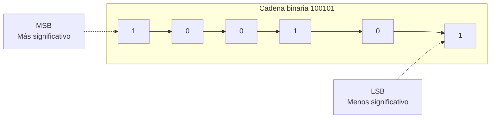

## 2 · Traducció decimal ↔ binari

### 2.1 · Decimal → binari (divisions entre 2)

| Decimal | Resolució (divisions) | Resultat binari |
| --- | --- | --- |
| 45 |  |  |
| 100 |  |  |
| 128 |  |  |
| 255 |  |  |

### 2.2 · Binari → decimal (sumas de potències de 2)

| Binari | Potències que suman | Decimal |
| --- | --- | --- |
| 110010 | 32 + 16 + 2 | 50 |
| 10111111 |  |  |
| 11100000 |  |  |
| 10101010 |  |  |

## 3 · Traducció hexadecimal ↔ binari

Recorda: cada xifra hexadecimal = **4 bits** (un quartet) i dins del quartet els bits valen **8 · 4 · 2 · 1**.

### 3.1 · Hexadecimal → binari

| Hexadecimal | Quartets | Binari |
| --- | --- | --- |
| 3C | 3=0011 · C=1100 | 00111100 |
| 9E |  |  |
| 2A |  |  |

### 3.2 · Binari → hexadecimal

| Binari | Quartets (emplena zeros a l'esquerra si falta) | Hexadecimal |
| --- | --- | --- |
| 01011010 | 0101 · 1010 | 5A |
| 11110000 |  |  |
| 110111 |  |  |

## 4 · Mesures d'informació

Recorda l'escala: per a **baixar** d'unitat divideix entre 1024; per a **pujar**, multiplica per 1024 (i per 8 si vas a bits).


Completa les conversions:

| Conversió | Resolució | Resultat |
| --- | --- | --- |
| 8 B → bits | 8 × 8 | 64 b |
| 3 GB → MB | 3 × 1024 |  |
| 512 MB → KB | 512 × 1024 |  |
| 1 TB → GB | 1 × 1024 |  |

## 5 · Repte express

1. El byte `01000010` codifica una lletra: escriu el seu valor **decimal** i el seu valor en **hexadecimal**.

1. Ordena de menor a major: **1 GB**, **512 KB**, **2 MB**, **1 MB**.

1. Marca **V** (vertader) o **F** (fals):

| Afirmació | V/F |
| --- | --- |
| El bit de la dreta és el LSB |  |
| 1 KB = 1024 B |  |
| L'hexadecimal usa les lletres de la A a la G |  |
| 4 MB = 4 × 1024 bits |  |

> **📌 Es valorarà**
> 

> - La correcta aplicació de l'algoritmo de **divisió sucesiva** (decimal → binari).

> - L'ús dels **quartets** (8-4-2-1) per a l'hexadecimal.

> - La precisió en les conversions de **mesures d'informació**.

> - La neteja i l'ordre al resoldre els exercicis.

> Aquesta fitxa et servirà per a repassar el **CE5a** abans del **EXA101**.

---

<details markdown="1">
<summary>💡 Mostrar / Amagar el Solucionari Oficial complet (FICHA REPASO 1.2 · Representación de la información)</summary>

# Repàs 1.02 Resolta

## REPÀS 1.2 · Representación de la información

Fitxa en blanc: Repàs 1.2

📥 

## **1 · Els tres sistemes de codificació**

| Sistema | Símbols | Qui l'usa? | Exemple |
| --- | --- | --- | --- |
| **Decimal** | **0 1 2 3 4 5 6 7 8 9** | Les persones | 125 |
| **Binari** | **0 1** | **Els ordinadors** | 1111101 |
| **Hexadecimal** | 0-9 i **A B C D E F** | Intermedi decimal-binari | 7D |

## **2 · Traducció decimal ↔ binari**

### **2.1 · Decimal → binari**

| Decimal | Resolució (divisions) | Resultat binari |
| --- | --- | --- |
| 45 | 45÷2=22·1 ; 22÷2=11·0 ; 11÷2=5·1 ; 5÷2=2·1 ; 2÷2=1·0 ; 1÷2=0·1 | **101101** |
| 100 | 100÷2=50·0 ; 50÷2=25·0 ; 25÷2=12·1 ; 12÷2=6·0 ; 6÷2=3·0 ; 3÷2=1·1 ; 1÷2=0·1 | **1100100** |
| 128 | 128÷2=64·0 ; 64÷2=32·0 ; 32÷2=16·0 ; 16÷2=8·0 ; 8÷2=4·0 ; 4÷2=2·0 ; 2÷2=1·0 ; 1÷2=0·1 | **10000000** |
| 255 | 255÷2=127·1 ; 127÷2=63·1 ; 63÷2=31·1 ; 31÷2=15·1 ; 15÷2=7·1 ; 7÷2=3·1 ; 3÷2=1·1 ; 1÷2=0·1 | **11111111** |

### **2.2 · Binari → decimal**

| Binari | Potències que suman | Decimal |
| --- | --- | --- |
| 110010 | 32 + 16 + 2 | 50 |
| 10111111 | 128 + 32 + 16 + 8 + 4 + 2 + 1 | **191** |
| 11100000 | 128 + 64 + 32 | **224** |
| 10101010 | 128 + 32 + 8 + 2 | **170** |

## **3 · Traducció hexadecimal ↔ binari**

### **3.1 · Hexadecimal → binari**

| Hexadecimal | Quartets | Binari |
| --- | --- | --- |
| 3C | 3=0011 · C=1100 | 00111100 |
| 9E | 9=1001 · E=1110 | **10011110** |
| 2A | 2=0010 · A=1010 | **00101010** |

### **3.2 · Binari → hexadecimal**

| Binari | Quartets (emplena zeros a l'esquerra si falta) | Hexadecimal |
| --- | --- | --- |
| 01011010 | 0101 · 1010 | 5A |
| 11110000 | 1111 · 0000 | **F0** |
| 110111 | 0011 · 0111 | **37** |

## **4 · Mesures d'informació**

| Conversió | Resolució | Resultat |
| --- | --- | --- |
| 8 B → bits | 8 × 8 | 64 b |
| 3 GB → MB | 3 × 1024 | **3072 MB** |
| 512 MB → KB | 512 × 1024 | **524 288 KB** |
| 1 TB → GB | 1 × 1024 | **1024 GB** |

## **5 · Repte express**

1. `01000010` → decimal **66** (64 + 2) i hexadecimal **42**.

1. De menor a major: **512 KB < 1 MB < 2 MB < 1 GB**.

1. Marca **V** o **F**:

| Afirmació | V/F |
| --- | --- |
| El bit de la dreta és el LSB | **V** |
| 1 KB = 1024 B | **V** |
| L'hexadecimal usa les lletres de la A a la G | **F** (usa de la **A a la F**) |
| 4 MB = 4 × 1024 bits | **F** (4 MB = 4 × 1024 × 1024 × 8 bits) |

</details>


---

## FICHA REPASO 1.3 · Redes de comunicaciones: modelos OSI y TCP/IP

👉 *[Obrir aquesta activitat en pàgina individual](rep103.html)*

# **FICHA REPASO 1.3 · Redes de comunicaciones: modelos OSI y TCP/IP**

📥 
📄 

| Alumne/a | Grup | Data |
| --- | --- | --- |
|  |  |  |

> **📌 ¿Qué repasamos?**
> 

> Repàs de la **FICHA 1.3**: una **xarxa** són **dos o més equips** intercambiant informació en **paquets** de **bits**, regits per **protocols**. El model **OSI** l'organitza en **7 capes** i el model **TCP/IP** (el de Internet) en **4**.

## 1 · Què és una xarxa de comunicacions?


Completa les frases:

| Frase | Completa |
| --- | --- |
| Una xarxa de comunicacions serveix per a ………… informació entre diversos equips. |  |
| La informació viatja trossejada en ………… de dades. |  |
| Els paquets estan fets de zeros i uns, anomenats ………… |  |
| Les normes perquè els equips es entenguen es anomenen ………… |  |
| L'equip que envia és el ………… i el que rep és el ………… |  |

## 2 · El model OSI: les 7 capes

La informació **ix** per la capa 7 i **baixa** fins a la capa 1; a l'arribar a l'un altre equip fa el camino **invers** (puja de la 1 a la 7).


Escriu el **nom** de cada capa a partir del que fa:

| Capa | Què fa? | Nom |
| --- | --- | --- |
| 7 | Els programes que uses (web, correu, jocs). | ………… |
| 6 | Tradueix i comprime la informació. | ………… |
| 5 | Manté oberta la conversa. | ………… |
| 4 | Trocea el mensaje i controla errors (TCP i UDP). | ………… |
| 3 | Posa l'adreça IP i tria la millor ruta. | ………… |
| 2 | Posa l'adreça MAC de cada equip. | ………… |
| 1 | Envia els bits pel cable. | ………… |

> **📌 Aprèn**
> 

> Per a memorizar-les d'adalt abaix: **«A**les **P**ersonas **S**iempre **T**raen **R**opa **E**n **F**lores» → **A**plicació, **P**resentació, **S**esió, **T**ransporte, **R**ed, **E**nlace, **F**ísica.

## 3 · L'encapsulament: els sobres

Al **enviar**, cada capa afegeix una adhesiu (**encapsular**); al **rebre**, es quitan els sobres (**desencapsular**).


Escriu el recorregut de fóra cap a dins (de la capa més alta a la física):

| Ordre | Sobre (adhesiu) que es afegeix |
| --- | --- |
| 1.er sobre | ………… (Transport) → afegeix un número anomenat ………… |
| 2.º sobre | ………… (Xarxa) → afegeix l'adreça ………… |
| 3.er sobre | ………… (Enllaç) → afegeix l'adreça ………… |
| Últim pas | La capa ………… converteix tot en ………… que viatgen pel cable |

## 4 · El model TCP/IP: 4 capes

El model **TCP/IP** és el que **s'usa de veritat en Internet**. Relaciona cada capa amb les capes OSI que li corresponen (completa amb números):

| Capa TCP/IP | Què fa? | Capa/s OSI que li corresponen |
| --- | --- | --- |
| 4 Aplicació | Els programes que uses (web, correu, WhatsApp). | Capa ………… (i 6 i 5) |
| 3 Transport | Envia els trossos de punta a punta i controla errors (TCP i UDP). | Capa ………… |
| 2 Internet | Posa l'adreça IP i tria la ruta. | Capa ………… |
| 1 Accés a xarxa | Usa el cable o el wifi (Ethernet). | Capes ………… i ………… |

> **📌 Aprèn**
> 

> - **OSI** té **7 capes** i serveix per a **aprendre** com funciona la comunicació.

> - **TCP/IP** té **4 capes** i és el model que **utilitza Internet** en la pràctica.

## 5 · Els protocols que uses a diario

Escriu el **protocol** que correspon a cada funció:

| Funció | Protocol |
| --- | --- |
| Veure pàgines web (i cifrar-les). | ………… / HTTPS |
| Tradueix els noms (www.google.és) a adreces IP. | ………… |
| Enviar i rebre correu electrònic. | SMTP / ………… |
| Transferir arxius entre equips. | ………… |
| Li dóna una adreça única a cada equip. | ………… |
| Envia les dades en ordre i sense errors. | ………… |
| Enviament ràpid, molt usat per a vídeo i anomenades. | ………… |

## 6 · Repte express

1. Quantes capes té el model **OSI**? I el model **TCP/IP**? Quin dels dos usa Internet de veritat?

1. Quan un amigo et envia un **WhatsApp** i tu el recibes, el mensaje ha bajado les 7 capes en l'emisor i ha subido en el receptor. Què procés és eixe?

1. Què capa OSI es ocupa de cada cosa?

  - De l'adreça IP i de triar la ruta → capa …………

  - De l'adreça MAC → capa …………

  - Dels bits pel cable → capa …………

  - De TCP i UDP → capa …………

1. La **adreça MAC** està formada per **48 bits** separats en sis blocs. Escriu un exemple: `..:..:..:..:..:..`

> **📌 Es valorarà**
> 

> - La comprensió dels models **OSI i TCP/IP** i de les seues capes.

> - La correcta associació entre **capes, protocols i la seua funció**.

> - La interpretació del **encapsulament** com el viatge del mensaje en sobres.

> - La neteja i l'ordre al resoldre els exercicis.

> Aquesta fitxa et servirà per a repassar el **CE5a** abans del **EXA101**.

---

<details markdown="1">
<summary>💡 Mostrar / Amagar el Solucionari Oficial complet (FICHA REPASO 1.3 · Redes de comunicaciones: modelos OSI y TCP/IP)</summary>

# Repàs 1.03 Resolta

## REPÀS 1.3 · Redes de comunicaciones: modelos OSI y TCP/IP

Fitxa en blanc: Repàs 1.3

📥 

## **1 · Què és una xarxa de comunicacions?**

| Frase | Completa |
| --- | --- |
| Una xarxa de comunicacions serveix per a **intercanviar** informació entre diversos equips. |  |
| La informació viatja trossejada en **paquets** de dades. |  |
| Els paquets estan fets de zeros i uns, anomenats **bits**. |  |
| Les normes perquè els equips es entenguen es anomenen **protocols**. |  |
| L'equip que envia és el **emisor** i el que rep és el **receptor**. |  |

## **2 · El model OSI: les 7 capes**

| Capa | Què fa? | Nom |
| --- | --- | --- |
| 7 | Els programes que uses (web, correu, jocs). | **Aplicació** |
| 6 | Tradueix i comprime la informació. | **Presentació** |
| 5 | Manté oberta la conversa. | **Sessió** |
| 4 | Trocea el mensaje i controla errors (TCP i UDP). | **Transport** |
| 3 | Posa l'adreça IP i tria la millor ruta. | **Xarxa** |
| 2 | Posa l'adreça MAC de cada equip. | **Enllaç de dades** |
| 1 | Envia els bits pel cable. | **Física** |

## **3 · L'encapsulament: els sobres**

| Ordre | Sobre (adhesiu) que es afegeix |
| --- | --- |
| 1.er sobre | **Transport** → afegeix un número anomenat **port** |
| 2.º sobre | **Xarxa** → afegeix l'adreça **IP** |
| 3.er sobre | **Enllaç** → afegeix l'adreça **MAC** |
| Últim pas | La capa **Física** converteix tot en **bits** que viatgen pel cable |

## **4 · El model TCP/IP: 4 capes**

| Capa TCP/IP | Què fa? | Capa/s OSI que li corresponen |
| --- | --- | --- |
| 4 Aplicació | Els programes que uses (web, correu, WhatsApp). | Capa **7** (i 6 i 5) |
| 3 Transport | Envia els trossos de punta a punta i controla errors (TCP i UDP). | Capa **4** |
| 2 Internet | Posa l'adreça IP i tria la ruta. | Capa **3** |
| 1 Accés a xarxa | Usa el cable o el wifi (Ethernet). | Capes **2** i **1** |

## **5 · Els protocols que uses a diario**

| Funció | Protocol |
| --- | --- |
| Veure pàgines web (i cifrar-les). | **HTTP** / HTTPS |
| Tradueix els noms (www.google.és) a adreces IP. | **DNS** |
| Enviar i rebre correu electrònic. | SMTP / **POP3** |
| Transferir arxius entre equips. | **FTP** |
| Li dóna una adreça única a cada equip. | **IP** |
| Envia les dades en ordre i sense errors. | **TCP** |
| Enviament ràpid, molt usat per a vídeo i anomenades. | **UDP** |

## **6 · Repte express**

1. **OSI** = **7** capes; **TCP/IP** = **4** capes; Internet usa **TCP/IP**.

1. El procés es anomena **encapsulament** (al baixar les capes en l'emisor) i **desencapsulament** (al pujar en el receptor).

1. Capes que es ocupen de cada cosa:

  - Adreça IP i ruta → capa **3 (Xarxa)**

  - Adreça MAC → capa **2 (Enllaç de dades)**

  - Bits pel cable → capa **1 (Física)**

  - TCP i UDP → capa **4 (Transport)**

1. Exemple d'adreça MAC (48 bits, sis blocs): `00:E0:7D:F9:EA:6D`.

</details>


---

## FICHA REPASO 1.4 · La dirección IP: IPv4 e IPv6

👉 *[Obrir aquesta activitat en pàgina individual](rep104.html)*

# **FICHA REPASO 1.4 · La dirección IP: IPv4 e IPv6**

📥 
📄 

| Alumne/a | Grup | Data |
| --- | --- | --- |
|  |  |  |

> **📌 ¿Qué repasamos?**
> 

> Repàs de la **FICHA 1.4**: cada equip té la **MAC** (física, no canvia) i la **IP** (lògica, pot canviar). Existeixen dos versions del protocol IP: **IPv4** (32 bits) e **IPv6** (128 bits), juntament amb la **màscara de xarxa** i l'operació **AND**.

## 1 · Dos adreces: quin és quin?


Completa cada frase amb **IP** o **MAC**:

| Frase | IP o MAC? |
| --- | --- |
| És fixa i no canvia mai. |  |
| És lògica i l'assigna la xarxa en cada moment. |  |
| Té 48 bits separats en sis blocs. |  |
| Pot ser estàtica (fixa) o dinàmica (canvia). |  |
| Identifica la targeta de xarxa de forma unívoca. |  |
| Com l'adreça d'una casa. |  |

## 2 · L'adreça IPv4

L'adreça **IPv4** té **32 bits** i es escriu en **4 blocs de 8 bits** en format **decimal**, separats per **puntos**. Cada bloc val de **0 a 255**.


Completa:

| Pregunta | Completa |
| --- | --- |
| Quants bits té una adreça IPv4? | ………… bits |
| En quants blocs es escriuen? | ………… blocs |
| Amb què signe es separen els blocs? | Amb ………… |
| En què format es escriu cada bloc? | ………… (decimal o binari) |
| Quant val el bloc més alt? | Fins al ………… |

Escriu si cada adreça és **pública** o **privada**:

| Adreça | Pública o privada? |
| --- | --- |
| 192.168.1.20 |  |
| 10.1.2.3 |  |
| 172.16.4.9 |  |
| 8.8.4.4 |  |
| 185.60.216.35 |  |

> **📌 Aprèn**
> 

> Les tres xarxes **privades** més típiques són les que comencen per **10.**, per **172.16.** a **172.31.** i per **192.168.**

## 3 · La màscara de xarxa

La **màscara de xarxa** acompanya a l'adreça IP i serveix per a saber què part identifica a la **xarxa** i què part al **equip** (host). La més comú és `255.255.255.0`.

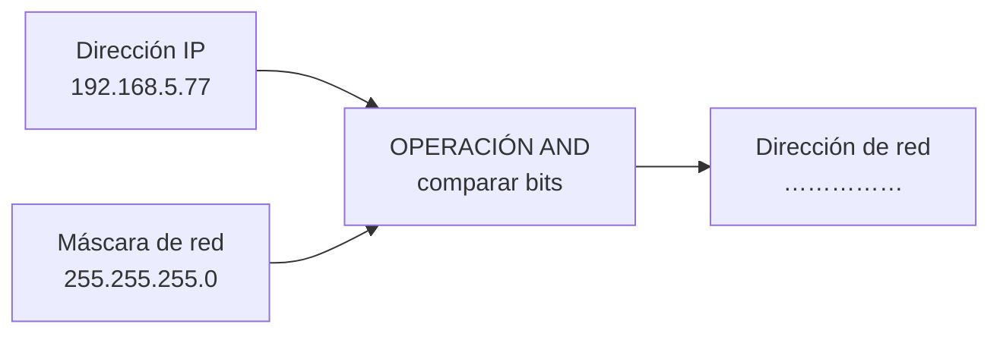

> **📌 Aprèn**
> 

> L'operació **AND** compara els bits de la IP amb els de la màscara:
**1 AND 1 = 1** · **1 AND 0 = 0** · **0 AND 0 = 0**

1. Aplica l'operació **AND** i escriu l'adreça de xarxa:

| Adreça IP | Màscara | Adreça de xarxa |
| --- | --- | --- |
| 192.168.5.77 | 255.255.255.0 |  |
| 10.20.30.40 | 255.0.0.0 |  |
| 172.96.0.22 | 255.255.255.0 |  |

1. Completa amb **xarxa**, **broadcast** o **hosts**:

| Adreça | Nom |
| --- | --- |
| 192.168.5.0 | Adreça de ………… |
| 192.168.5.255 | Adreça de ………… |
| De 192.168.5.1 a 192.168.5.254 | Adreces per als ………… |

## 4 · L'adreça IPv6

L'adreça **IPv6** té **128 bits** i es escriu en **8 grups de 2 bytes**, separats per dos puntos (**:**), en format **hexadecimal**.

```mermaid
flowchart LR
    A["2001"] --> B["0DB8"] --> C["0000"] --> D["0000"] --> E["4AC2"] --> F["0000"] --> G["B4EB"] --> H["0FFA"]
```

Recorda les regles d'abreviació:
1. Es poden quitar els **zeros a l'esquerra** de cada grup: `00D1` → `D1`.
2. Un grup `0000` es pot escriure com `0`.
3. Si hi ha **dos o més grups amb zeros seguits**, es sustituyen per `::` (només **una vegada** per adreça).

Completa:

| Pregunta | Completa |
| --- | --- |
| Quants bits té una adreça IPv6? | ………… bits |
| En quants grups de 2 bytes es escriu? | ………… grups |
| Amb què caràcter es separen els grups? | Amb ………… |
| En què format es escriuen? | ………… (hexadecimal) |

Abrevia aquestes adreces IPv6:

- `2001:0DB8:0000:0000:0000:0000:0000:0001` → `…`

- `FE80:0000:0000:0000:0202:B3FF:FE1E:8329` → `…`

- `0000:0000:0000:0000:0000:0000:0000:0001` → `…`

## 5 · Repte express

1. Quants bits té **IPv4**? I **IPv6**? Quin de les dos ofereix més adreces?

1. La IP de la impressora de l'institut **no canvia mai**: és ……… (estàtica o dinàmica). La IP del mòbil en casa **canvia cada dia**: és ………

1. Marca **V** (vertader) o **F** (fals):

| Afirmació | V/F |
| --- | --- |
| L'adreça MAC és fixa i identifica la targeta de xarxa. |  |
| L'adreça IP pot canviar segons la xarxa en la que estiga l'equip. |  |
| `192.168.1.10` és una adreça pública. |  |
| La màscara de xarxa separa la part de xarxa de la part de l'host. |  |
| En IPv4 cada bloc es escriu en hexadecimal. |  |

1. Escriu la teua adreça IPv4 i la teua adreça MAC en aquest buit (pots usar `ipconfig /all` en el símbol del sistema):

1. IPv4: `…`

1. MAC: `…`

> **📌 Es valorarà**
> 

> - La distinció correcta entre **adreça IP** i **adreça MAC**.

> - La correcta lectura de les adreces **IPv4 i IPv6** i del seu **abreviació**.

> - L'aplicació de la **màscara de xarxa** i l'operació **AND**.

> - La neteja i l'ordre al resoldre els exercicis.

> Aquesta fitxa et servirà per a repassar el **CE5a** abans del **EXA101**.

---

<details markdown="1">
<summary>💡 Mostrar / Amagar el Solucionari Oficial complet (FICHA REPASO 1.4 · La dirección IP: IPv4 e IPv6)</summary>

# **REPÀS 1.4 · La dirección IP: IPv4 e IPv6**

Fitxa en blanc: Repàs 1.4

📥 

## **1 · Dos adreces: quin és quin?**

| Frase | IP o MAC? |
| --- | --- |
| És fixa i no canvia mai. | **MAC** |
| És lògica i l'assigna la xarxa en cada moment. | **IP** |
| Té 48 bits separats en sis blocs. | **MAC** |
| Pot ser estàtica (fixa) o dinàmica (canvia). | **IP** |
| Identifica la targeta de xarxa de forma unívoca. | **MAC** |
| Com l'adreça d'una casa. | **IP** |

## **2 · L'adreça IPv4**

| Pregunta | Completa |
| --- | --- |
| Quants bits té una adreça IPv4? | **32** bits |
| En quants blocs es escriuen? | **4** blocs |
| Amb què signe es separen els blocs? | Amb **puntos (.)** |
| En què format es escriu cada bloc? | **decimal** |
| Quant val el bloc més alt? | Fins al **255** |

| Adreça | Pública o privada? |
| --- | --- |
| 192.168.1.20 | **Privada** |
| 10.1.2.3 | **Privada** |
| 172.16.4.9 | **Privada** |
| 8.8.4.4 | **Pública** |
| 185.60.216.35 | **Pública** |

## **3 · La màscara de xarxa**

Operació **AND** amb `192.168.5.77` i `255.255.255.0` → adreça de xarxa **192.168.5.0**.

| Adreça IP | Màscara | Adreça de xarxa |
| --- | --- | --- |
| 192.168.5.77 | 255.255.255.0 | **192.168.5.0** |
| 10.20.30.40 | 255.0.0.0 | **10.0.0.0** |
| 172.96.0.22 | 255.255.255.0 | **172.96.0.0** |

| Adreça | Nom |
| --- | --- |
| 192.168.5.0 | Adreça de **xarxa** |
| 192.168.5.255 | Adreça de **broadcast** |
| De 192.168.5.1 a 192.168.5.254 | Adreces per als **hosts** |

## **4 · L'adreça IPv6**

| Pregunta | Completa |
| --- | --- |
| Quants bits té una adreça IPv6? | **128** bits |
| En quants grups de 2 bytes es escriu? | **8** grups |
| Amb què caràcter es separen els grups? | Amb **dos puntos (:)** |
| En què format es escriuen? | **hexadecimal** |

Abreviacions (pas a pas):

- `2001:0DB8:0000:0000:0000:0000:0000:0001` → `2001:DB8:0:0:0:0:0:1` → **`2001:DB8::1`**

- `FE80:0000:0000:0000:0202:B3FF:FE1E:8329` → `FE80:0:0:0:202:B3FF:FE1E:8329` → **`FE80::202:B3FF:FE1E:8329`**

- `0000:0000:0000:0000:0000:0000:0000:0001` → **`::1`**

## **5 · Repte express**

1. **IPv4** = **32 bits**; **IPv6** = **128 bits**; ofereix més adreces **IPv6**.

1. 

La impressora és **estàtica**; el mòbil en casa és **dinàmic**.

1. 

Marca **V** o **F**:

| Afirmació | V/F |
| --- | --- |
| L'adreça MAC és fixa i identifica la targeta de xarxa. | **V** |
| L'adreça IP pot canviar segons la xarxa en la que estiga l'equip. | **V** |
| `192.168.1.10` és una adreça pública. | **F** (és privada) |
| La màscara de xarxa separa la part de xarxa de la part de l'host. | **V** |
| En IPv4 cada bloc es escriu en hexadecimal. | **F** (en decimal) |

1. *Resposta personal*: usa `ipconfig /all` (Windows) o `ifconfig` / `ip a` (Linux/macOS) per a copiar el teu **IPv4** i el teu **MAC**.

</details>


---


---

## 🎮 Reptes Interactius d'Autoavaluació (+100 XP)

Comprova el teu domini sobre **Cuaderno Completo de Actividades — UD1** superant aquests 4 reptes gamificats (+25 puntos cadascun):

<div class="interactive-mcq" data-answer="A" data-hint="L'emisor envia el mensaje al receptor a través d'un canal utilitzant un código comú.">
  <div class="mcq-question">🎯 <strong>Repte 1 (+25 pts):</strong> Quins són els cinc elements fonamentals que intervenen en tot sistema de comunicació?</div>
  <div class="mcq-options">
    <button type="button" class="btn-mcq-opt" data-opt="A">A) Emissor, receptor, mensaje, canal i código.</button>
    <button type="button" class="btn-mcq-opt" data-opt="B">B) Teclat, ratolí, impressora, altaveu i taula.</button>
    <button type="button" class="btn-mcq-opt" data-opt="C">C) Paret, sostre, porta, finestra i armari.</button>
    <button type="button" class="btn-mcq-opt" data-opt="D">D) Cobre, plàstic, vidre, paper i fusta.</button>
  </div>
  <div class="quiz-feedback"></div>
</div>

<div class="interactive-mcq" data-answer="B" data-hint="La Capa 1 del model OSI és la Capa Física.">
  <div class="mcq-question">🎯 <strong>Repte 2 (+25 pts):</strong> En el model de referència OSI de 7 capes, quina és la capa 1 encarregada de transmetre els bits com a senyals elèctrics, òptics o d'ones per el mitjà?</div>
  <div class="mcq-options">
    <button type="button" class="btn-mcq-opt" data-opt="A">A) Capa d'Aplicació (Capa 7).</button>
    <button type="button" class="btn-mcq-opt" data-opt="B">B) Capa Física (Capa 1).</button>
    <button type="button" class="btn-mcq-opt" data-opt="C">C) Capa de Sessió (Capa 5).</button>
    <button type="button" class="btn-mcq-opt" data-opt="D">D) Capa de Presentació (Capa 6).</button>
  </div>
  <div class="quiz-feedback"></div>
</div>

<div class="interactive-vf" data-answer="V" data-hint="4 octets × 8 bits = 32 bits en total per a una adreça IPv4.">
  <div class="vf-statement">✅ <strong>Repte 3 (Vertader o Fals · +25 pts):</strong> Una adreça IPv4 està formada per 32 bits dividits en 4 octets (4 números decimals entre 0 i 255 separats per puntos, com <code>192.168.1.10</code>).</div>
  <div class="vf-buttons">
    <button type="button" class="btn-vf" data-opt="V">Vertader (V)</button>
    <button type="button" class="btn-vf" data-opt="F">Fals (F)</button>
  </div>
  <div class="quiz-feedback" style="width: 100%;"></div>
</div>

<div class="interactive-quiz" data-answer="8|vuit|8 bits" data-hint="Un byte o octet equival a 8 bits.">
  <div class="quiz-question">⌨️ <strong>Repte 4 (+25 pts):</strong> Quants bits formen un byte (o octet) en els sistemes digitals i de comunicacions?</div>
  <div class="quiz-controls">
    <input type="text" class="quiz-input" placeholder="Escriu la resposta..." />
    <button type="button" class="btn-quiz-check">Comprovar</button>
  </div>
  <div class="quiz-feedback"></div>
</div>

### 📋 Llista de Comprovació i Rúbrica d'Assoliment

Marca cada criteri a mesura que completes l'estudi o la resolució pràctica d'aquesta pàgina (**Cuaderno Completo de Actividades — UD1**):

- [ ] He llegit detingudament la teoria o l'enunciat d'aquesta secció i he anotat els conceptes clau.
- [ ] He revisat els esquemes, taules o blocs de código i he verificat que sé aplicar-los a l'entorn de treball.
- [ ] He resolt correctament els **4 reptes interactius** superiors obtenint els **100 puntos XP**.
- [ ] He descarregat el comprovant oficial en PDF per a adjuntar-lo a la tasca d'**Aules**.

<div class="aules-delivery-card">
  <h3>📤 Comprovant de Lliurament per a Aules</h3>
  <p>Quan hages completat els reptes interactius i la llista d'autoavaluació d'aquesta pàgina, introdueix el teu nom i descarrega el teu certificat oficial en PDF per a adjuntar-lo a la tasca d'<strong>Aules</strong>.</p>
  <div class="aules-student-field">
    <label for="aules-student-name">👤 Nom i Cognoms de l'Alumne/a:</label>
    <input type="text" id="aules-student-name" class="aules-student-name" placeholder="Ex: Joan Garcia Pérez" />
  </div>
  <div class="aules-score-badge">
    <span class="aules-score-count">0/4 reptes completats (0%) · 0 puntos · 0/4 criteris d'autoavaluació</span>
  </div>
  <div class="aules-actions">
    <button type="button" class="btn-aules-dl" data-module="IMX" data-unit="UD01" data-activity="activitats">📥 Descarregar Comprovant PDF</button>
    <button type="button" class="btn-aules-copy">📋 Copiar Resum al Porta-retalls</button>
  </div>
  <div class="aules-toast"></div>
</div>
