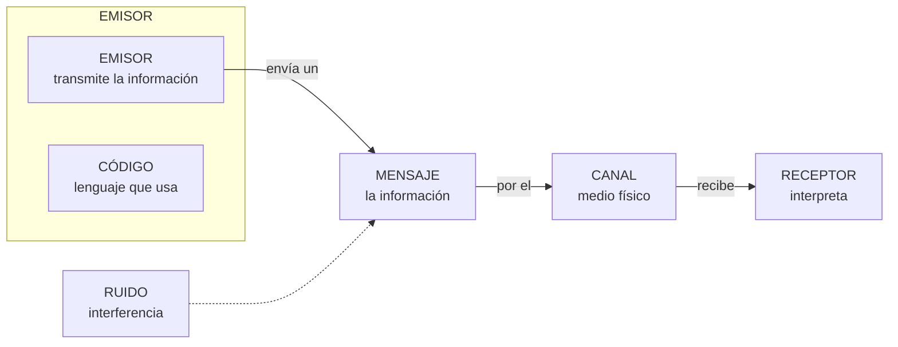

# **FITXA 1.1 · Elements d'un sistema de comunicació**

  

    🏆 <strong>Progrés d'aquesta secció:</strong> 0 de 4 superats (0%)
    ⭐ <strong>0 punts</strong>
  

  

    

  

📥 
📄 

| Alumne/a | Grup | Data |
| --- | --- | --- |
|  |  |  |

> **📌 Què repassem?**
> 

> Tot sistema de comunicació necessita **cinc elements**: un **emissor**, un **receptor**, un **missatge**, un **canal** i un **codi**. A més, el **soroll** intenta espatlar la comunicació i el **protocol** posa les normes.

## 1 · El procés de comunicació

### Completa la taula

| Element | Què és? | Explica-ho amb les teues paraules |
| --- | --- | --- |
| **Emissor** | Entitat que transmet la informació |  |
| **Receptor** | Entitat que rep la informació |  |
| **Missatge** | Informació que l'emissor transmet al receptor |  |
| **Canal** | Mitjà pel que es transmet el missatge |  |
| **Codi** | Conjunt de signes, regles i normes (llenguatge) |  |

## 2 · Identifica els elements

Per a cada situació, escriu el **emissor**, **receptor**, **missatge**, **canal** i **codi**:

| Situació | Emissor | Receptor | Missatge | Canal | Codi |
| --- | --- | --- | --- | --- | --- |
| Un conductor interpreta els senyals de trànsit |  |  |  |  |  |
| Escoltes un podcast en Spotify |  |  |  |  |  |
| Fas una compra online |  |  |  |  |  |
| Un repartidor telefona al client per a avisar-lo de que arriba el seu paquet |  |  |  |  |  |

## 3 · El soroll

El **soroll** és qualsevol interferència que contamina tant el missatge com el canal o el codi.

1. Completa: "El soroll és qualsevol ……………… que contamina el ………………, el ……………… o el ………………"

1. Posa un **exemple de soroll** per a cada situació de l'exercici 2:

| Situació | Quin soroll podria espatlar-la? |
| --- | --- |
| Conductor i senyals de trànsit |  |
| Podcast en Spotify |  |
| Compra online |  |
| Telefonada del repartidor |  |

## 4 · El protocol de comunicació

1. 

Defineix amb les teues paraules què és un **protocol de comunicació**.

1. 

Marca **V** (vertader) o **F** (fals):

| Afirmació | V/F |
| --- | --- |
| El protocol determina com s'inicia i finalitza la comunicació |  |
| El protocol fixa l'idioma o nivell de llenguatge que s'empra |  |
| El protocol tolera tot tipus de soroll sense importar la seua quantitat |  |
| El protocol diu com actuar si la comunicació s'interromp |  |

## 5 · Autoavaluació

Marca una casella per fila per a valorar com et sents amb cada idea:

| Concepte | L'entenc | Quasi | El necessite repassar |
| --- | --- | --- | --- |
| Elements de la comunicació |  |  |  |
| Identificar emissor, receptor, missatge, canal i codi |  |  |  |
| Soroll i interferències |  |  |  |
| Protocol de comunicació |  |  |  |

> **📌 Es valorarà**
> 

> *La identificació correcta dels elements de la comunicació en situacions reals.
* La definició precisa de **soroll** i **protocol**.
* La neteja i claredat en les respostes.

> Aquesta fitxa et servirà per a practicar el **CE5a** (descriure els principis de funcionament de les xarxes locals) abans del **EXA101**.

---

💡 Mostrar / Amagar el Solucionari Oficial complet (FITXA 1.1 · Elements d'un sistema de comunicació)

# **FITXA 1.1 · Elements d'un sistema de comunicació**

Fitxa en blanc: FITXA 1.1

📥 

## **1 · Completa la taula**

| Element | Què és? | Explica-ho amb les teues paraules (exemple) |
| --- | --- | --- |
| **Emissor** | Entitat que transmet la informació | La persona o equip que **envia** el missatge (qui parla o envia) |
| **Receptor** | Entitat que rep la informació | La persona o equip que **rep i interpreta** el missatge |
| **Missatge** | Informació que l'emissor transmet al receptor | **El que es diu**: la notícia, l'ordre, la salutació… |
| **Canal** | Mitjà pel que es transmet el missatge | El mitjà físic: **aire, cable, wifi, llum**… |
| **Codi** | Conjunt de signes, regles i normes (llenguatge) | El llenguatge: **idioma, senyals, colors, emojis**… |

## **2 · Identifica els elements**

| Situació | Emissor | Receptor | Missatge | Canal | Codi |
| --- | --- | --- | --- | --- | --- |
| Un conductor interpreta els senyals de trànsit | El senyal (o l'organisme de trànsit) | El conductor | La indicació (perill, prohibició…) | La llum del senyal, que viatja pel aire | El llenguatge dels senyals (formes i colors) |
| Escoltes un podcast en Spotify | El creador del podcast | Tu | El contingut de l'episodi | Internet + l'app Spotify (i els altaveus) | L'idioma (parla, música) |
| Fas una compra online | Tu (el comprador) | La botiga online (el seu servidor) | Les dades de la comanda (article, adreça, pagament) | Internet (la web de la botiga) | L'idioma i el format del formulari |
| Un repartidor telefona al client per a avisar-lo de que arriba el seu paquet | El repartidor | El client | L'avís d'arribada (adreça, hora) | La xarxa telefònica (el telèfon) | L'idioma (castellà) |

## **3 · El soroll**

1. 

"El soroll és qualsevol **interferència** que contamina el **missatge**, el **canal** o el **codi**".

1. 

Exemples de soroll:

| Situació | Quin soroll podria espatlar-la? |
| --- | --- |
| Conductor i senyals de trànsit | El senyal **bruta o tapada**, boira, deslumbrament del sol |
| Podcast en Spotify | **Talls de connexió**, soroll de fons en la gravació, anuncis |
| Compra online | **Caiguda de Internet**, la web que no carrega, pàgina lenta |
| Telefonada del repartidor | **Mala cobertura**, soroll ambiental, interferències de la línia |

## **4 · El protocol de comunicació**

1. 

*Resposta personal*: **conjunt de normes que regeixen la comunicació**: com iniciar i finalizar-la, quin nivell de llenguatge usar, quant soroll tolera i com actuar si s'interromp.

1. 

Marca **V** o **F**:

| Afirmació | V/F |
| --- | --- |
| El protocol determina com s'inicia i finalitza la comunicació | **V** |
| El protocol fixa l'idioma o nivell de llenguatge que s'empra | **V** |
| El protocol tolera tot tipus de soroll sense importar la seua quantitat | **F** (només tolera fins a un llindar) |
| El protocol diu com actuar si la comunicació s'interromp | **V** |

---

## 🎮 Reptes Interactius d'Autoavaluació (+100 XP)

Comprova el teu domini sobre **FITXA 1.1 · Elements d'un sistema de comunicació** superant aquests 4 reptes gamificats (+25 punts cadascun):

  
🎯 <strong>Repte 1 (+25 pts):</strong> Quins són els cinc elements fonamentals que intervenen en tot sistema de comunicació?

  

    <button type="button" class="btn-mcq-opt" data-opt="A">A) Emissor, receptor, missatge, canal i codi.</button>
    <button type="button" class="btn-mcq-opt" data-opt="B">B) Teclat, ratolí, impressora, altaveu i taula.</button>
    <button type="button" class="btn-mcq-opt" data-opt="C">C) Paret, sostre, porta, finestra i armari.</button>
    <button type="button" class="btn-mcq-opt" data-opt="D">D) Cobre, plàstic, vidre, paper i fusta.</button>
  

  

  
🎯 <strong>Repte 2 (+25 pts):</strong> En el model de referència OSI de 7 capes, quina és la capa 1 encarregada de transmetre els bits com a senyals elèctrics, òptics o d'ones per el mitjà?

  

    <button type="button" class="btn-mcq-opt" data-opt="A">A) Capa d'Aplicació (Capa 7).</button>
    <button type="button" class="btn-mcq-opt" data-opt="B">B) Capa Física (Capa 1).</button>
    <button type="button" class="btn-mcq-opt" data-opt="C">C) Capa de Sessió (Capa 5).</button>
    <button type="button" class="btn-mcq-opt" data-opt="D">D) Capa de Presentació (Capa 6).</button>
  

  

  
✅ <strong>Repte 3 (Vertader o Fals · +25 pts):</strong> Una adreça IPv4 està formada per 32 bits dividits en 4 octets (4 números decimals entre 0 i 255 separats per punts, com <code>192.168.1.10</code>).

  

    <button type="button" class="btn-vf" data-opt="V">Vertader (V)</button>
    <button type="button" class="btn-vf" data-opt="F">Fals (F)</button>
  

  

  
⌨️ <strong>Repte 4 (+25 pts):</strong> Quants bits formen un byte (o octet) en els sistemes digitals i de comunicacions?

  

    <input type="text" class="quiz-input" placeholder="Escriu la resposta..." />
    <button type="button" class="btn-quiz-check">Comprovar</button>
  

  

### 📋 Llista de Comprovació i Rúbrica d'Assoliment

Marca cada criteri a mesura que completes l'estudi o la resolució pràctica d'aquesta pàgina (**FITXA 1.1 · Elements d'un sistema de comunicació**):

- [ ] He llegit detingudament la teoria o l'enunciat d'aquesta secció i he anotat els conceptes clau.
- [ ] He revisat els esquemes, taules o blocs de codi i he verificat que sé aplicar-los a l'entorn de treball.
- [ ] He resolt correctament els **4 reptes interactius** superiors obtenint els **100 punts XP**.
- [ ] He descarregat el comprovant oficial en PDF per a adjuntar-lo a la tasca d'**Aules**.

  <h3>📤 Comprovant de Lliurament per a Aules</h3>
  
Quan hages completat els reptes interactius i la llista d'autoavaluació d'aquesta pàgina, introdueix el teu nom i descarrega el teu certificat oficial en PDF per a adjuntar-lo a la tasca d'<strong>Aules</strong>.

  

    <label for="aules-student-name">👤 Nom i Cognoms de l'Alumne/a:</label>
    <input type="text" id="aules-student-name" class="aules-student-name" placeholder="Ex: Joan Garcia Pérez" />
  

  

    0/4 reptes completats (0%) · 0 punts · 0/4 criteris d'autoavaluació
  

  

    <button type="button" class="btn-aules-dl" data-module="IMX" data-unit="UD01" data-activity="ficha101">📥 Descarregar Comprovant PDF</button>
    <button type="button" class="btn-aules-copy">📋 Copiar Resum al Porta-retalls</button>
  

  

