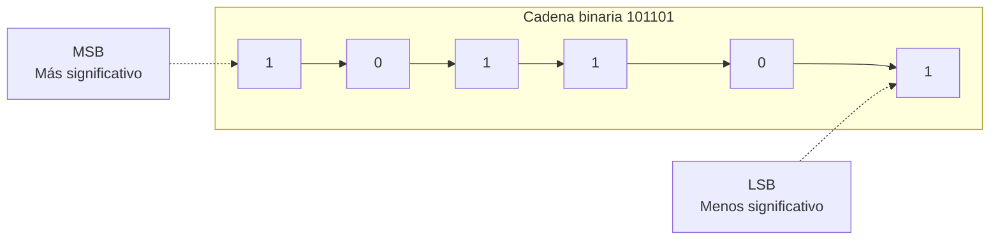
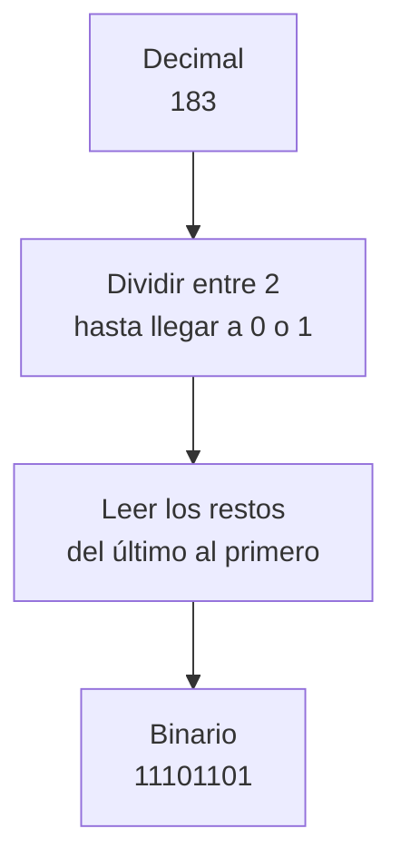
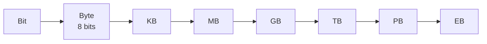

# **FICHA 1.2 · Representación de la información**

  

    🏆 <strong>Progreso de esta sección:</strong> 0 de 4 superados (0%)
    ⭐ <strong>0 puntos</strong>
  

  

    

  

📥 
📄 

| Alumne/a | Grup | Data |
| --- | --- | --- |
|  |  |  |

> **📌 ¿Qué repasamos?**
> 

> La informació viatja **codificada**. Els tres sistemes de codificació que manejamos són el **decimal**, el **binari** (zeros i uns, els famosos **bits**) i el **hexadecimal**. Aprendre a traduir entre ells és l'objectiu d'aquesta fitxa.

## 1 · Els tres sistemes de codificació

| Sistema | Símbols | Qui l'usa? | Exemple |
| --- | --- | --- | --- |
| **Decimal** | 0 1 2 3 4 5 6 7 8 9 | Les persones | 125 |
| **Binari** | 0 1 | Els ordinadors | 1111101 |
| **Hexadecimal** | 0-9, A B C D E F | Intermedi decimal-binari | 7D |

> **📌 Aprèn**
> 

> Cada **bit** val 0 o 1. Al bit de l'esquerra (més valor) es li anomena **MSB** i al de la dreta (menys valor), **LSB**.

## 2 · Traducció decimal ↔ binari

### 2.1 · Decimal → binari

| Decimal | Resolució (divisions) | Resultat binari |
| --- | --- | --- |
| 10 |  |  |
| 25 |  |  |
| 183 |  |  |
| 200 |  |  |

### 2.2 · Binari → decimal

Recorda: cada posició val una potència de 2: **1, 2, 4, 8, 16, 32, 64, 128…**

| Binari | Potències que suman (ej.: 1010 = 8 + 2) | Decimal |
| --- | --- | --- |
| 1010 | 8 + 2 | 10 |
| 1101 |  |  |
| 100000 |  |  |
| 11111111 |  |  |

## 3 · Traducció hexadecimal ↔ binari

Cada xifra hexadecimal = **4 bits** (un quartet). Usa aquesta taula com chuleta:

| Hex | Bin |  | Hex | Bin |
| --- | --- | --- | --- | --- |
| 0 | 0000 |  | 8 | 1000 |
| 1 | 0001 |  | 9 | 1001 |
| 2 | 0010 |  | A | 1010 |
| 3 | 0011 |  | B | 1011 |
| 4 | 0100 |  | C | 1100 |
| 5 | 0101 |  | D | 1101 |
| 6 | 0110 |  | E | 1110 |
| 7 | 0111 |  | F | 1111 |

### 3.1 · Hexadecimal → binari

| Hexadecimal | Quartets | Binari |
| --- | --- | --- |
| A5 | A=1010 · 5=0101 | 10100101 |
| 1F |  |  |
| B09 |  |  |

### 3.2 · Binari → hexadecimal

| Binari | Quartets (emplena zeros a l'esquerra si falta) | Hexadecimal |
| --- | --- | --- |
| 10100101 | 1010 · 0101 | A5 |
| 1111011 |  |  |
| 10000001 |  |  |

## 4 · Mesures d'informació

Recorda l'escala: per a **baixar** una mesura multiplica per 1024; per a **pujar**, divideix entre 1024 (i entre 8 si vas a bits).

Completa les conversions:

| Conversió | Resolució | Resultat |
| --- | --- | --- |
| 2 B → bits | 2 × 8 | 16 b |
| 1 GB → MB | 1 × 1024 |  |
| 60 KB → TB | 60 / 1024 / 1024 / 1024 |  |
| 4 MB → bits |  |  |

## 5 · Repte express

1. Quants bits ha d'enciende la «forma» d'escriure la lletra **A** en binari `01000001`? Escriu el seu valor **decimal** i els seus brillos en **hexadecimal**.

1. Ordena de menor a major: **1 GB**, **1024 KB**, **1024 MB**, **1 TB**.

> **📌 Es valorarà**
> 

> - La correcta aplicació de l'algoritmo de **divisió sucesiva** (decimal → binari).

> - L'ús de la **taula de correspondència** per als quartets hexadecimals.

> - La precisió en les conversions de **mesures d'informació**.

> - La neteja i l'ordre al resoldre els exercicis.

> Aquesta fitxa et servirà per a practicar el **CE5a** abans del **EXA101**.

---

💡 Mostrar / Amagar el Solucionari Oficial complet (FICHA 1.2 · Representación de la información)

# **FICHA 1.2 · Representación de la información**

Fitxa en blanc: FICHA 1.2

📥 

## **1 · Els tres sistemes de codificació**

| Sistema | Símbols | Qui l'usa? | Exemple |
| --- | --- | --- | --- |
| **Decimal** | 0 1 2 3 4 5 6 7 8 9 | Les persones | 125 |
| **Binari** | 0 1 | Els ordinadors | 1111101 |
| **Hexadecimal** | 0-9, A B C D E F | Intermedi decimal-binari | 7D |

**MSB** = bit de l'esquerra (més valor) · **LSB** = bit de la dreta (menys valor).

## **2 · Traducció decimal ↔ binari**

### **2.1 · Decimal → binari**

| Decimal | Resolució (divisions) | Resultat binari |
| --- | --- | --- |
| 10 | 10÷2=5·0 ; 5÷2=2·1 ; 2÷2=1·0 ; 1÷2=0·1 | **1010** |
| 25 | 25÷2=12·1 ; 12÷2=6·0 ; 6÷2=3·0 ; 3÷2=1·1 ; 1÷2=0·1 | **11001** |
| 183 | 183÷2=91·1 ; 91÷2=45·1 ; 45÷2=22·1 ; 22÷2=11·0 ; 11÷2=5·1 ; 5÷2=2·1 ; 2÷2=1·0 ; 1÷2=0·1 | **10110111** |
| 200 | 200÷2=100·0 ; 100÷2=50·0 ; 50÷2=25·0 ; 25÷2=12·1 ; 12÷2=6·0 ; 6÷2=3·0 ; 3÷2=1·1 ; 1÷2=0·1 | **11001000** |

*Es llegixen els restos de l'últim al primer.*

### **2.2 · Binari → decimal**

| Binari | Potències que suman | Decimal |
| --- | --- | --- |
| 1010 | 8 + 2 | 10 |
| 1101 | 8 + 4 + 1 | **13** |
| 100000 | 32 | **32** |
| 11111111 | 128 + 64 + 32 + 16 + 8 + 4 + 2 + 1 | **255** |

## **3 · Traducció hexadecimal ↔ binari**

### **3.1 · Hexadecimal → binari**

| Hexadecimal | Quartets | Binari |
| --- | --- | --- |
| A5 | A=1010 · 5=0101 | 10100101 |
| 1F | 1=0001 · F=1111 | **00011111** |
| B09 | B=1011 · 0=0000 · 9=1001 | **101100001001** |

### **3.2 · Binari → hexadecimal**

| Binari | Quartets (emplena zeros a l'esquerra si falta) | Hexadecimal |
| --- | --- | --- |
| 10100101 | 1010 · 0101 | A5 |
| 1111011 | 0001 · 1011 | **1B** |
| 10000001 | 1000 · 0001 | **81** |

## **4 · Mesures d'informació**

| Conversió | Resolució | Resultat |
| --- | --- | --- |
| 2 B → bits | 2 × 8 | 16 b |
| 1 GB → MB | 1 × 1024 | **1024 MB** |
| 60 KB → TB | 60 / 1024 / 1024 / 1024 | **≈ 0,0000000559 TB** |
| 4 MB → bits | 4 × 1024 × 1024 × 8 | **33 554 432 bits** |

## **5 · Repte express**

1. `01000001` té **8 bits** (un byte); en decimal és **65** i en hexadecimal **41**.

1. De menor a major: **1024 KB = 1 MB < 1024 MB = 1 GB < 1 TB** (els dos primers són iguals, i els dos següents també).

---

## 🎮 Reptes Interactius d'Autoavaluació (+100 XP)

Comprova el teu domini sobre **FICHA 1.2 · Representación de la información** superant aquests 4 reptes gamificats (+25 puntos cadascun):

  
🎯 <strong>Repte 1 (+25 pts):</strong> Quins són els cinc elements fonamentals que intervenen en tot sistema de comunicació?

  

    <button type="button" class="btn-mcq-opt" data-opt="A">A) Emissor, receptor, mensaje, canal i código.</button>
    <button type="button" class="btn-mcq-opt" data-opt="B">B) Teclat, ratolí, impressora, altaveu i taula.</button>
    <button type="button" class="btn-mcq-opt" data-opt="C">C) Paret, sostre, porta, finestra i armari.</button>
    <button type="button" class="btn-mcq-opt" data-opt="D">D) Cobre, plàstic, vidre, paper i fusta.</button>
  

  

  
🎯 <strong>Repte 2 (+25 pts):</strong> En el model de referència OSI de 7 capes, quina és la capa 1 encarregada de transmetre els bits com a senyals elèctrics, òptics o d'ones per el mitjà?

  

    <button type="button" class="btn-mcq-opt" data-opt="A">A) Capa d'Aplicació (Capa 7).</button>
    <button type="button" class="btn-mcq-opt" data-opt="B">B) Capa Física (Capa 1).</button>
    <button type="button" class="btn-mcq-opt" data-opt="C">C) Capa de Sessió (Capa 5).</button>
    <button type="button" class="btn-mcq-opt" data-opt="D">D) Capa de Presentació (Capa 6).</button>
  

  

  
✅ <strong>Repte 3 (Vertader o Fals · +25 pts):</strong> Una adreça IPv4 està formada per 32 bits dividits en 4 octets (4 números decimals entre 0 i 255 separats per puntos, com <code>192.168.1.10</code>).

  

    <button type="button" class="btn-vf" data-opt="V">Vertader (V)</button>
    <button type="button" class="btn-vf" data-opt="F">Fals (F)</button>
  

  

  
⌨️ <strong>Repte 4 (+25 pts):</strong> Quants bits formen un byte (o octet) en els sistemes digitals i de comunicacions?

  

    <input type="text" class="quiz-input" placeholder="Escriu la resposta..." />
    <button type="button" class="btn-quiz-check">Comprovar</button>
  

  

### 📋 Llista de Comprovació i Rúbrica d'Assoliment

Marca cada criteri a mesura que completes l'estudi o la resolució pràctica d'aquesta pàgina (**FICHA 1.2 · Representación de la información**):

- [ ] He llegit detingudament la teoria o l'enunciat d'aquesta secció i he anotat els conceptes clau.
- [ ] He revisat els esquemes, taules o blocs de código i he verificat que sé aplicar-los a l'entorn de treball.
- [ ] He resolt correctament els **4 reptes interactius** superiors obtenint els **100 puntos XP**.
- [ ] He descarregat el comprovant oficial en PDF per a adjuntar-lo a la tasca d'**Aules**.

  <h3>📤 Comprovant de Lliurament per a Aules</h3>
  
Quan hages completat els reptes interactius i la llista d'autoavaluació d'aquesta pàgina, introdueix el teu nom i descarrega el teu certificat oficial en PDF per a adjuntar-lo a la tasca d'<strong>Aules</strong>.

  

    <label for="aules-student-name">👤 Nom i Cognoms de l'Alumne/a:</label>
    <input type="text" id="aules-student-name" class="aules-student-name" placeholder="Ex: Joan Garcia Pérez" />
  

  

    0/4 reptes completats (0%) · 0 puntos · 0/4 criteris d'autoavaluació
  

  

    <button type="button" class="btn-aules-dl" data-module="IMX" data-unit="UD01" data-activity="ficha102">📥 Descarregar Comprovant PDF</button>
    <button type="button" class="btn-aules-copy">📋 Copiar Resum al Porta-retalls</button>
  

  

