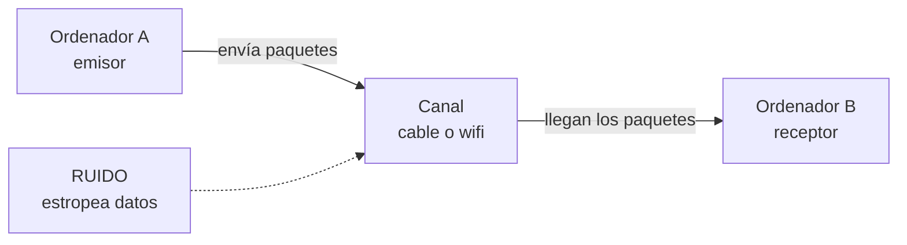
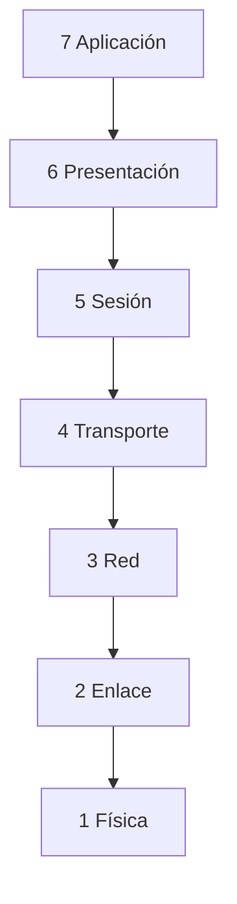
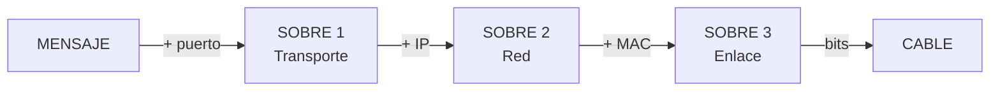

# **FITXA 1.3 · Xarxes de comunicacions: models OSI i TCP/IP**

  

    🏆 <strong>Progrés d'aquesta secció:</strong> 0 de 4 superats (0%)
    ⭐ <strong>0 punts</strong>
  

  

    

  

📥 
📄 

| Alumne/a | Grup | Data |
| --- | --- | --- |
|  |  |  |

> **📌 Què repassem?**
> 

> Una **xarxa de comunicacions** és un grup de **dos o més equips** que intercambian informació. Eixa informació viatja trossejada en **paquets de dades** fets de zeros i uns (els **bits**). Perquè tots els equips es entenguen, usem unes normes anomenades **protocols**. I per a organitzar-los, existeixen dos models: **OSI** i **TCP/IP**.

## 1 · Què és una xarxa de comunicacions?

Una xarxa de comunicacions serveix per a que els equips es **intercanvien informació**. L'equip que envia és el **emissor**, el que rep és el **receptor**, i entre ells hi ha un **canal** (el cable o el wifi). Si alguna cosa espatla les dades, hi ha **soroll**.

Completa les frases:

| Frase | Completa |
| --- | --- |
| Una xarxa de comunicacions serveix per a ………… informació entre diversos equips. |  |
| La informació viatja trossejada en ………… de dades. |  |
| Els paquets estan fets de zeros i uns, anomenats ………… |  |
| Les normes perquè els equips es entenguen es anomenen ………… |  |
| L'equip que envia és el ………… i el que rep és el ………… |  |

## 2 · El model OSI: les 7 capes

El model **OSI** organitza la comunicació en **7 capes** (com un edifici de 7 pisos). La informació **ix** per la capa 7 (la d'adalt) i **baixa** fins a la capa 1 (la física); a l'arribar a l'un altre equip, fa el camino **invers** (puja de la 1 a la 7).

Completa la taula amb la funció de cada capa:

| Capa | Nom | Què fa? |
| --- | --- | --- |
| 7 | Aplicació | Els programes que uses (web, correu, jocs). |
| 6 | Presentació | Tradueix i comprime la informació. |
| 5 | Sessió | Manté oberta la conversa. |
| 4 | Transport | Trocea el missatge i controla els errors (**TCP** i **UDP**). |
| 3 | Xarxa | Posa la **adreça IP** i tria la millor ruta. |
| 2 | Enllaç de dades | Posa la **adreça MAC** de cada equip. |
| 1 | Física | Envia els **bits** pel cable. |

> **📌 Aprèn**
> 

> Per a memoritzar les 7 capes d'adalt abaix usa aquesta frase:
**«A**les **P**ersonas **S**iempre **T**raen **R**opa **E**n **F**lores»** → **A**plicació, **P**resentació, **S**esió, **T**ransporte, **R**ed, **E**nlace, **F**ísica.

## 3 · L'encapsulament: els sobres

Al **enviar**, cada capa **afegeix una adhesiu** amb informació (com quan metes un missatge en diversos sobres). Al **rebre**, es quitan els sobres un a un. A açò es li anomena **encapsular** (posar sobres) i **desencapsular** (quitar-los).

Completa: què sobre (adhesiu) afegeix cada capa?

| Capa | Adhesiu que afegeix |
| --- | --- |
| Transport | Un número anomenat ………… |
| Xarxa | L'adreça ………… (IP) |
| Enllaç de dades | L'adreça ………… (MAC) |
| Física | Tot es converteix en ………… que viatgen pel cable |

## 4 · El model TCP/IP: 4 capes

El model **TCP/IP** és el que **s'usa de veritat en Internet**. Té només **4 capes**. Relaciona cada capa amb les capes del model OSI que li corresponen (complétalo amb números):

| Capa TCP/IP | Què fa? | Capa/s OSI que li corresponen |
| --- | --- | --- |
| 4 Aplicació | Els programes que uses (web, correu, WhatsApp). | Capa ………… (i 6 i 5) |
| 3 Transport | Envia els trossos de punta a punta i controla errors (**TCP** i **UDP**). | Capa ………… |
| 2 Internet | Posa la **adreça IP** i tria la ruta. | Capa ………… |
| 1 Accés a xarxa | Usa el cable o el wifi (**Ethernet**). | Capes ………… i ………… |

> **📌 Aprèn**
> 

> - **OSI** té **7 capes** i serveix per a **aprendre** com funciona la comunicació.

> - **TCP/IP** té **4 capes** i és el model que **utilitza Internet** en la pràctica.

## 5 · Els protocols que uses a diario

Els **protocols** són les normes de cada capa. Quan uses el mòbil o l'ordinador, estan treballant sense que et des compta. Escriu un exemple d'ús cotidiano per a cada un:

| Protocol | Per a què serveix? | Exemple cotidiano |
| --- | --- | --- |
| HTTP / HTTPS | Veure pàgines web. |  |
| DNS | Tradueix els noms (www.google.és) a adreces IP. |  |
| SMTP / POP3 | Enviar i rebre correu electrònic. |  |
| FTP | Transferir arxius entre equips. |  |
| IP | Li dóna una adreça única a cada equip. |  |
| TCP | Envia les dades en ordre i sense errors. |  |
| UDP | Enviament ràpid, molt usat per a vídeo i anomenades. |  |

## 6 · Repte express

1. Quantes capes té el model **OSI**? I el model **TCP/IP**? Quin dels dos usa Internet de veritat?

1. Quan un amigo et envia un **WhatsApp** i tu el recibes, el missatge ha bajado les 7 capes en l'emissor i ha subido en el receptor. Què procés és eixe?

1. Uneix cada protocol amb la seua funció:

  - **DNS** → Veure pàgines web

  - **HTTP** → Traduir noms a adreces IP

  - **IP** → Enviar dades en ordre i sense errors

  - **TCP** → Donar una adreça única a cada equip

1. La **adreça MAC** està formada per **48 bits** separats en sis blocs. Escriu un exemple: `..:..:..:..:..:..`

> **📌 Es valorarà**
> 

> - La comprensió dels models **OSI i TCP/IP** i de les seues capes.

> - La correcta associació entre **capes, protocols i la seua funció**.

> - La interpretació del **encapsulament** com el viatge del missatge en sobres.

> - La neteja i l'ordre al resoldre els exercicis.

> Aquesta fitxa et servirà per a practicar el **CE5a** abans del **EXA101**.

---

💡 Mostrar / Amagar el Solucionari Oficial complet (FITXA 1.3 · Xarxes de comunicacions: models OSI i TCP/IP)

# **FITXA 1.3 · Xarxes de comunicacions: models OSI i TCP/IP**

Fitxa en blanc: FITXA 1.3

📥 

## **1 · Què és una xarxa de comunicacions?**

| Frase | Completa |
| --- | --- |
| Una xarxa de comunicacions serveix per a **intercanviar** informació entre diversos equips. |  |
| La informació viatja trossejada en **paquets** de dades. |  |
| Els paquets estan fets de zeros i uns, anomenats **bits**. |  |
| Les normes perquè els equips es entenguen es anomenen **protocols**. |  |
| L'equip que envia és el **emissor** i el que rep és el **receptor**. |  |

## **2 · El model OSI: les 7 capes**

| Capa | Nom | Què fa? |
| --- | --- | --- |
| 7 | **Aplicació** | Els programes que uses (web, correu, jocs). |
| 6 | **Presentació** | Tradueix i comprime la informació. |
| 5 | **Sessió** | Manté oberta la conversa. |
| 4 | **Transport** | Trocea el missatge i controla errors (TCP i UDP). |
| 3 | **Xarxa** | Posa l'adreça IP i tria la millor ruta. |
| 2 | **Enllaç de dades** | Posa l'adreça MAC de cada equip. |
| 1 | **Física** | Envia els bits pel cable. |

Mnemotecnia: **«A**les **P**ersonas **S**iempre **T**raen **R**opa **E**n **F**lores».

## **3 · L'encapsulament: els sobres**

| Capa | Adhesiu que afegeix |
| --- | --- |
| Transport | Un número anomenat **port** |
| Xarxa | L'adreça **IP** |
| Enllaç de dades | L'adreça **MAC** |
| Física | Tot es converteix en **bits** que viatgen pel cable |

## **4 · El model TCP/IP: 4 capes**

| Capa TCP/IP | Què fa? | Capa/s OSI que li corresponen |
| --- | --- | --- |
| 4 Aplicació | Els programes que uses (web, correu, WhatsApp). | Capa **7** (i 6 i 5) |
| 3 Transport | Envia els trossos de punta a punta i controla errors (TCP i UDP). | Capa **4** |
| 2 Internet | Posa l'adreça IP i tria la ruta. | Capa **3** |
| 1 Accés a xarxa | Usa el cable o el wifi (Ethernet). | Capes **2** i **1** |

## **5 · Els protocols que uses a diario**

| Protocol | Per a què serveix? | Exemple cotidiano |
| --- | --- | --- |
| HTTP / HTTPS | Veure pàgines web. | Obrir google.és o YouTube (HTTPS xifra les dades) |
| DNS | Tradueix els noms a adreces IP. | Escribes www.google.és i el DNS la converteix en IP |
| SMTP / POP3 | Enviar i rebre correu electrònic. | Enviar un correu i recibir-lo en el mòbil |
| FTP | Transferir arxius entre equips. | Pujar els apuntes al servidor de l'institut |
| IP | Li dóna una adreça única a cada equip. | El teu equip amb 192.168.1.25 dins de la xarxa |
| TCP | Envia les dades en ordre i sense errors. | Descarregar un arxiu complet i sense fallades |
| UDP | Enviament ràpid, molt usat per a vídeo i anomenades. | Una videollamada o streaming de vídeo |

## **6 · Repte express**

1. **OSI** té **7** capes; **TCP/IP** té **4**; Internet usa de veritat **TCP/IP**.

1. El procés es anomena **encapsulament** (a l'enviar) i **desencapsulament** (al rebre).

1. Correccions de les parelles:

  - **DNS** → Traduir noms a adreces IP

  - **HTTP** → Veure pàgines web

  - **IP** → Donar una adreça única a cada equip i triar la ruta

  - **TCP** → Enviar dades en ordre i sense errors

1. Exemple d'adreça MAC (6 blocs hexadecimals): `00:E0:7D:F9:EA:6D` *(qualsevol exemple de 48 bits val)*.

---

## 🎮 Reptes Interactius d'Autoavaluació (+100 XP)

Comprova el teu domini sobre **FITXA 1.3 · Xarxes de comunicacions: models OSI i TCP/IP** superant aquests 4 reptes gamificats (+25 punts cadascun):

  
🎯 <strong>Repte 1 (+25 pts):</strong> Quins són els cinc elements fonamentals que intervenen en tot sistema de comunicació?

  

    <button type="button" class="btn-mcq-opt" data-opt="A">A) Emissor, receptor, missatge, canal i codi.</button>
    <button type="button" class="btn-mcq-opt" data-opt="B">B) Teclat, ratolí, impressora, altaveu i taula.</button>
    <button type="button" class="btn-mcq-opt" data-opt="C">C) Paret, sostre, porta, finestra i armari.</button>
    <button type="button" class="btn-mcq-opt" data-opt="D">D) Cobre, plàstic, vidre, paper i fusta.</button>
  

  

  
🎯 <strong>Repte 2 (+25 pts):</strong> En el model de referència OSI de 7 capes, quina és la capa 1 encarregada de transmetre els bits com a senyals elèctrics, òptics o d'ones per el mitjà?

  

    <button type="button" class="btn-mcq-opt" data-opt="A">A) Capa d'Aplicació (Capa 7).</button>
    <button type="button" class="btn-mcq-opt" data-opt="B">B) Capa Física (Capa 1).</button>
    <button type="button" class="btn-mcq-opt" data-opt="C">C) Capa de Sessió (Capa 5).</button>
    <button type="button" class="btn-mcq-opt" data-opt="D">D) Capa de Presentació (Capa 6).</button>
  

  

  
✅ <strong>Repte 3 (Vertader o Fals · +25 pts):</strong> Una adreça IPv4 està formada per 32 bits dividits en 4 octets (4 números decimals entre 0 i 255 separats per punts, com <code>192.168.1.10</code>).

  

    <button type="button" class="btn-vf" data-opt="V">Vertader (V)</button>
    <button type="button" class="btn-vf" data-opt="F">Fals (F)</button>
  

  

  
⌨️ <strong>Repte 4 (+25 pts):</strong> Quants bits formen un byte (o octet) en els sistemes digitals i de comunicacions?

  

    <input type="text" class="quiz-input" placeholder="Escriu la resposta..." />
    <button type="button" class="btn-quiz-check">Comprovar</button>
  

  

### 📋 Llista de Comprovació i Rúbrica d'Assoliment

Marca cada criteri a mesura que completes l'estudi o la resolució pràctica d'aquesta pàgina (**FITXA 1.3 · Xarxes de comunicacions: models OSI i TCP/IP**):

- [ ] He llegit detingudament la teoria o l'enunciat d'aquesta secció i he anotat els conceptes clau.
- [ ] He revisat els esquemes, taules o blocs de codi i he verificat que sé aplicar-los a l'entorn de treball.
- [ ] He resolt correctament els **4 reptes interactius** superiors obtenint els **100 punts XP**.
- [ ] He descarregat el comprovant oficial en PDF per a adjuntar-lo a la tasca d'**Aules**.

  <h3>📤 Comprovant de Lliurament per a Aules</h3>
  
Quan hages completat els reptes interactius i la llista d'autoavaluació d'aquesta pàgina, introdueix el teu nom i descarrega el teu certificat oficial en PDF per a adjuntar-lo a la tasca d'<strong>Aules</strong>.

  

    <label for="aules-student-name">👤 Nom i Cognoms de l'Alumne/a:</label>
    <input type="text" id="aules-student-name" class="aules-student-name" placeholder="Ex: Joan Garcia Pérez" />
  

  

    0/4 reptes completats (0%) · 0 punts · 0/4 criteris d'autoavaluació
  

  

    <button type="button" class="btn-aules-dl" data-module="IMX" data-unit="UD01" data-activity="ficha103">📥 Descarregar Comprovant PDF</button>
    <button type="button" class="btn-aules-copy">📋 Copiar Resum al Porta-retalls</button>
  

  

