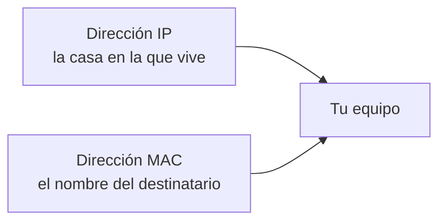
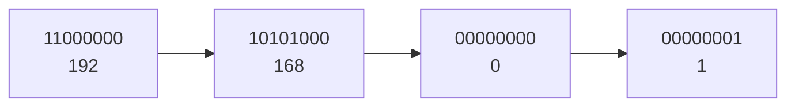
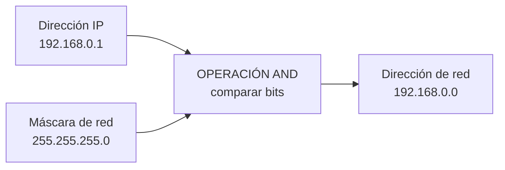
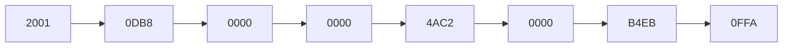

# **FICHA 1.4 · La dirección IP: IPv4 e IPv6**

  

    🏆 <strong>Progreso de esta sección:</strong> 0 de 4 superados (0%)
    ⭐ <strong>0 puntos</strong>
  

  

    

  

📥 
📄 

| Alumne/a | Grup | Data |
| --- | --- | --- |
|  |  |  |

> **📌 ¿Qué repasamos?**
> 

> Cada equip d'una xarxa té **dos adreces**: la **MAC** (física, no canvia) i la **IP** (lògica, pot canviar). Existeixen dos versions del protocol IP: **IPv4** (32 bits) e **IPv6** (128 bits). En aquesta fitxa aprenderás a distinguirlas i a leerlas.

## 1 · Dos adreces: quin és quin?

Quan enviem una carta per correu, necessitem saber **on viu** la persona i **qui és**. En una xarxa passa igual: la **adreça IP** és l'adreça de la casa i la **adreça MAC** és el nom del destinatari.

| Adreça IP | Adreça MAC |
| --- | --- |
| Com la **adreça d'una casa** | Com el **nom del destinatari** |
| És **lògica**: canvia segons la xarxa | És **física**: ve en la targeta |
| Pot ser **estàtica** (fixa) o **dinàmica** (canvia) | Mai canvia |

Completa la taula escrivint **IP** o **MAC**:

| Frase | IP o MAC? |
| --- | --- |
| És fixa i no canvia mai. |  |
| És lògica i l'assigna la xarxa en cada moment. |  |
| Té **48 bits** separats en sis blocs. |  |
| Pot ser estàtica o dinàmica. |  |
| Identifica la targeta de xarxa de forma unívoca. |  |

## 2 · L'adreça IPv4

L'adreça **IPv4** té **32 bits** i es escriu en **4 blocs de 8 bits** (un byte cada un) en format **decimal**, separats per puntos. Cada bloc pot valdre de **0 a 255**.

Completa:

| Pregunta | Completa |
| --- | --- |
| Quants bits té una adreça IPv4? | ………… bits |
| En quants blocs es escriuen? | ………… blocs |
| Amb què signe es separen els blocs? | Amb ………… |
| En què format es escriu cada bloc? | ………… (decimal o binari) |
| Quant val el bloc més alt? | Fins al ………… |

Hi ha adreces IP que **no es poden usar en Internet** perquè són **privades** (només valen dins de casa o de l'institut). Escriu si cada adreça és **pública** o **privada**:

| Adreça | Pública o privada? |
| --- | --- |
| 192.168.1.10 |  |
| 10.0.0.25 |  |
| 8.8.8.8 |  |
| 172.20.3.5 |  |
| 150.214.12.8 |  |

> **📌 Aprèn**
> 

> Les tres xarxes **privades** més típiques són les que comencen per **10.**, per **172.16.** a **172.31.** i per **192.168.**

## 3 · La màscara de xarxa

La **màscara de xarxa** acompanya a l'adreça IP i serveix per a saber què part de l'adreça identifica a la **xarxa** i què part al **equip** (host). La més comú és `255.255.255.0`.

> **📌 Aprèn**
> 

> L'operació **AND** compara els bits de la IP amb els de la màscara:
**1 AND 1 = 1** · **1 AND 0 = 0** · **0 AND 0 = 0**

Dins d'una xarxa, **dos adreces no es poden assignar a equips**. Uneix cada una amb el seu nom:

| Adreça | Nom |
| --- | --- |
| 192.168.0.0 | Adreça de ………… (xarxa) |
| 192.168.0.255 | Adreça de ………… (broadcast) |
| De 192.168.0.1 a 192.168.0.254 | Adreces per als ………… (hosts) |

## 4 · L'adreça IPv6

L'adreça **IPv6** té **128 bits** i es escriu en **8 grups de 2 bytes**, separats per dos puntos (**:**), en format **hexadecimal**.

Per a abreviar-l'es segueixen aquestes regles:
1. Es poden quitar els **zeros a l'esquerra** de cada grup: `00D1` → `D1`.
2. Un grup `0000` es pot escriure com `0`.
3. Si hi ha **dos o més grups amb zeros seguits**, es sustituyen per `::` (només **una vegada** per adreça).

Completa:

| Pregunta | Completa |
| --- | --- |
| Quants bits té una adreça IPv6? | ………… bits |
| En quants grups de 2 bytes es escriu? | ………… grups |
| Amb què caràcter es separen els grups? | Amb ………… |
| En què format es escriuen? | ………… (hexadecimal) |

Abrevia aquestes adreces IPv6:

- `2000:0011:3D4A:0055:0000:0000:2F01:5432` → `2000:11:3D4A:55:…:2F01:5432` (escriu el `::`)

- `7144:0000:A101:0000:0000:0000:31BB:4A23` → `…`

## 5 · Repte express

1. Quants bits té **IPv4**? I **IPv6**? Quin de les dos ofereix més adreces?

1. La IP de la impressora de l'institut **no canvia mai**: és ……… (estàtica o dinàmica). La IP del mòbil en casa **canvia cada dia**: és ………

1. Marca **V** (vertader) o **F** (fals):

| Afirmació | V/F |
| --- | --- |
| L'adreça MAC és fixa i identifica la targeta de xarxa. |  |
| L'adreça IP pot canviar segons la xarxa en la que estiga l'equip. |  |
| `192.168.1.10` és una adreça pública. |  |
| La màscara de xarxa separa la part de xarxa de la part de l'host. |  |
| En IPv4 cada bloc es escriu en hexadecimal. |  |

1. Escriu la teua adreça IPv4 i la teua adreça MAC en aquest buit (pots usar `ipconfig /all` en el símbol del sistema):

1. IPv4: `…`

1. MAC: `…`

> **📌 Es valorarà**
> 

> - La distinció correcta entre **adreça IP** i **adreça MAC**.

> - La correcta lectura de les adreces **IPv4 i IPv6**.

> - L'aplicació de la **màscara de xarxa** i l'operació **AND**.

> - La neteja i l'ordre al resoldre els exercicis.

> Aquesta fitxa et servirà per a practicar el **CE5a** abans del **EXA101**.

---

💡 Mostrar / Amagar el Solucionari Oficial complet (FICHA 1.4 · La dirección IP: IPv4 e IPv6)

# **FICHA 1.4 · La dirección IP: IPv4 e IPv6**

Fitxa en blanc: FICHA 1.4

📥 

## **1 · Dos adreces: quin és quin?**

| Frase | IP o MAC? |
| --- | --- |
| És fixa i no canvia mai. | **MAC** |
| És lògica i l'assigna la xarxa en cada moment. | **IP** |
| Té 48 bits separats en sis blocs. | **MAC** |
| Pot ser estàtica (fixa) o dinàmica (canvia). | **IP** |
| Identifica la targeta de xarxa de forma unívoca. | **MAC** |

## **2 · L'adreça IPv4**

| Pregunta | Completa |
| --- | --- |
| Quants bits té una adreça IPv4? | **32** bits |
| En quants blocs es escriuen? | **4** blocs |
| Amb què signe es separen els blocs? | Amb **puntos (.)** |
| En què format es escriu cada bloc? | **decimal** |
| Quant val el bloc més alt? | Fins al **255** |

| Adreça | Pública o privada? |
| --- | --- |
| 192.168.1.10 | **Privada** |
| 10.0.0.25 | **Privada** |
| 8.8.8.8 | **Pública** |
| 172.20.3.5 | **Privada** (entre 172.16 i 172.31) |
| 150.214.12.8 | **Pública** |

## **3 · La màscara de xarxa**

| Adreça | Nom |
| --- | --- |
| 192.168.0.0 | Adreça de **xarxa** |
| 192.168.0.255 | Adreça de **broadcast** |
| De 192.168.0.1 a 192.168.0.254 | Adreces per als **hosts** |

## **4 · L'adreça IPv6**

| Pregunta | Completa |
| --- | --- |
| Quants bits té una adreça IPv6? | **128** bits |
| En quants grups de 2 bytes es escriu? | **8** grups |
| Amb què caràcter es separen els grups? | Amb **dos puntos (:)** |
| En què format es escriuen? | **hexadecimal** |

Abreviacions:

- `2000:0011:3D4A:0055:0000:0000:2F01:5432` → `2000:11:3D4A:55:…:2F01:5432` → **`2000:11:3D4A:55::2F01:5432`**

- `7144:0000:A101:0000:0000:0000:31BB:4A23` → **`7144:0:A101::31BB:4A23`**

## **5 · Repte express**

1. **IPv4** té **32 bits**; **IPv6** té **128 bits**; ofereix més adreces **IPv6**.

1. 

La IP de la impressora és **estàtica**; la IP del mòbil en casa és **dinàmica**.

1. 

Marca **V** o **F**:

| Afirmació | V/F |
| --- | --- |
| L'adreça MAC és fixa i identifica la targeta de xarxa. | **V** |
| L'adreça IP pot canviar segons la xarxa en la que estiga l'equip. | **V** |
| `192.168.1.10` és una adreça pública. | **F** (és privada) |
| La màscara de xarxa separa la part de xarxa de la part de l'host. | **V** |
| En IPv4 cada bloc es escriu en hexadecimal. | **F** (en decimal) |

1. *Resposta personal*: usa `ipconfig /all` (Windows) o `ifconfig` / `ip a` (Linux/macOS) per a copiar el teu **IPv4** i el teu **MAC**.

---

## 🎮 Reptes Interactius d'Autoavaluació (+100 XP)

Comprova el teu domini sobre **FICHA 1.4 · La dirección IP: IPv4 e IPv6** superant aquests 4 reptes gamificats (+25 puntos cadascun):

  
🎯 <strong>Repte 1 (+25 pts):</strong> Quins són els cinc elements fonamentals que intervenen en tot sistema de comunicació?

  

    <button type="button" class="btn-mcq-opt" data-opt="A">A) Emissor, receptor, mensaje, canal i código.</button>
    <button type="button" class="btn-mcq-opt" data-opt="B">B) Teclat, ratolí, impressora, altaveu i taula.</button>
    <button type="button" class="btn-mcq-opt" data-opt="C">C) Paret, sostre, porta, finestra i armari.</button>
    <button type="button" class="btn-mcq-opt" data-opt="D">D) Cobre, plàstic, vidre, paper i fusta.</button>
  

  

  
🎯 <strong>Repte 2 (+25 pts):</strong> En el model de referència OSI de 7 capes, quina és la capa 1 encarregada de transmetre els bits com a senyals elèctrics, òptics o d'ones per el mitjà?

  

    <button type="button" class="btn-mcq-opt" data-opt="A">A) Capa d'Aplicació (Capa 7).</button>
    <button type="button" class="btn-mcq-opt" data-opt="B">B) Capa Física (Capa 1).</button>
    <button type="button" class="btn-mcq-opt" data-opt="C">C) Capa de Sessió (Capa 5).</button>
    <button type="button" class="btn-mcq-opt" data-opt="D">D) Capa de Presentació (Capa 6).</button>
  

  

  
✅ <strong>Repte 3 (Vertader o Fals · +25 pts):</strong> Una adreça IPv4 està formada per 32 bits dividits en 4 octets (4 números decimals entre 0 i 255 separats per puntos, com <code>192.168.1.10</code>).

  

    <button type="button" class="btn-vf" data-opt="V">Vertader (V)</button>
    <button type="button" class="btn-vf" data-opt="F">Fals (F)</button>
  

  

  
⌨️ <strong>Repte 4 (+25 pts):</strong> Quants bits formen un byte (o octet) en els sistemes digitals i de comunicacions?

  

    <input type="text" class="quiz-input" placeholder="Escriu la resposta..." />
    <button type="button" class="btn-quiz-check">Comprovar</button>
  

  

### 📋 Llista de Comprovació i Rúbrica d'Assoliment

Marca cada criteri a mesura que completes l'estudi o la resolució pràctica d'aquesta pàgina (**FICHA 1.4 · La dirección IP: IPv4 e IPv6**):

- [ ] He llegit detingudament la teoria o l'enunciat d'aquesta secció i he anotat els conceptes clau.
- [ ] He revisat els esquemes, taules o blocs de código i he verificat que sé aplicar-los a l'entorn de treball.
- [ ] He resolt correctament els **4 reptes interactius** superiors obtenint els **100 puntos XP**.
- [ ] He descarregat el comprovant oficial en PDF per a adjuntar-lo a la tasca d'**Aules**.

  <h3>📤 Comprovant de Lliurament per a Aules</h3>
  
Quan hages completat els reptes interactius i la llista d'autoavaluació d'aquesta pàgina, introdueix el teu nom i descarrega el teu certificat oficial en PDF per a adjuntar-lo a la tasca d'<strong>Aules</strong>.

  

    <label for="aules-student-name">👤 Nom i Cognoms de l'Alumne/a:</label>
    <input type="text" id="aules-student-name" class="aules-student-name" placeholder="Ex: Joan Garcia Pérez" />
  

  

    0/4 reptes completats (0%) · 0 puntos · 0/4 criteris d'autoavaluació
  

  

    <button type="button" class="btn-aules-dl" data-module="IMX" data-unit="UD01" data-activity="ficha104">📥 Descarregar Comprovant PDF</button>
    <button type="button" class="btn-aules-copy">📋 Copiar Resum al Porta-retalls</button>
  

  

