# UD1: Fundamentos de las Comunicaciones, Representación Binaria, Modelos OSI/TCP-IP e IP

Bienvenido/a a la **UD1: Fundamentos de las Comunicaciones, Representación Binaria, Modelos OSI/TCP-IP e IP** del módulo profesional de **Instalación y Mantenimiento de Redes para Transmisión de Datos (Networking Essentials)** (2º FPB · Instalación y Mantenimiento de Redes (IMX / NE)).

En esta unidad encontrarás los contenidos teóricos, ejemplos prácticos, ejercicios resueltos y actividades de evaluación curricular desarrollados por el profesor **Manuel Alonso Argente**.

---

### 📑 Índice de Apartados y Actividades de la Unidad

- [**📋 1.0 Propuesta Didáctica: Comunicación y representación de la información**](./ut0100.html)
- [**1.1 Elementos de un sistema de comunicación**](./ut0101.html)
- [**1.2 Representación de la información**](./ut0102.html)
- [**1.3 Redes de comunicaciones**](./ut0103.html)
- [**1.4 Dirección IP**](./ut0104.html)
- [**🖼️ 1.R2 Resumen Visual**](./resumen_imagen.html)
- [**📝 1.R1 Resumen en Texto**](./resumen_texto.html)

**Actividades Prácticas y Fichas de Trabajo:**

- [**🛠️ Ficha FICHA101: 1.1 · Elementos de un sistema de comunicación**](./act_ficha101.html)
- [**🛠️ Ficha FICHA102: 1.2 · Representación de la información**](./act_ficha102.html)
- [**🛠️ Ficha FICHA103: 1.3 · Redes de comunicaciones: modelos OSI y TCP/IP**](./act_ficha103.html)
- [**🛠️ Ficha FICHA104: 1.4 · La dirección IP: IPv4 e IPv6**](./act_ficha104.html)
- [**🔄 Repaso REP101: REPASO 1.1 · Elementos de un sistema de comunicación**](./act_rep101.html)
- [**🔄 Repaso REP102: REPASO 1.2 · Representación de la información**](./act_rep102.html)
- [**🔄 Repaso REP103: REPASO 1.3 · Redes de comunicaciones: modelos OSI y TCP/IP**](./act_rep103.html)
- [**🔄 Repaso REP104: REPASO 1.4 · La dirección IP: IPv4 e IPv6**](./act_rep104.html)

---

# 📖 Vista Completa de la Unidad

## 1.0 Propuesta Didáctica — Comunicación y representación de la información

# **Comunicación y representación de la información**

## **Propuesta didáctica**

En esta unidad vamos a trabajar el RA5: **Realiza operaciones básicas de configuración en redes locales cableadas relacionándolas con sus aplicaciones**.

## **Criterios de evaluación**

### **Respecto al RA5:**

| Código | Descripción | Peso (%) | Herramientas Evaluación |
| --- | --- | --- | --- |
| **CE5a** | Se han descrito los principios de funcionamiento de las redes locales | 100% | FICHA101 (7,5%) + FICHA102 (7,5%) + FICHA103 (7,5%) + FICHA104 (7,5%) -- EXA101 (70%) |

## **Contenidos**

### **Elementos de un sistema de comunicación:**

- Concepto de comunicación y proceso de transmisión de información.

- Elementos del proceso comunicativo: emisor, receptor, mensaje, canal, código.

- Ruido en la comunicación: interferencias y su influencia en la transmisión.

- Protocolos de comunicación: definición y función.

### **Representación de la información:**

- Sistemas de codificación: sistema decimal, sistema binario y sistema hexadecimal.

- Conceptos de MSB (bit más significativo) y LSB (bit menos significativo).

- Conversiones entre sistemas: decimal a binario, binario a decimal, hexadecimal a binario, binario a hexadecimal, decimal a hexadecimal y viceversa.

- Medida de la información: bit, byte, kilobyte, megabyte, gigabyte, terabyte, petabyte, exabyte.

- Velocidad de transferencia de datos (Mbps).

### **Redes de comunicaciones:**

- Modelo de referencia OSI: 7 capas y funciones de cada una.

- Modelo TCP/IP: 4 capas, correspondencia con el modelo OSI.

- Protocolos de comunicación por capas: HTTP, HTTPS, SMTP, POP3, IMAP, DNS, DHCP, FTP, FTPS, RPC, SSL/TLS, TCP, UDP, IP, NAT, ARP, Ethernet, WLAN.

### **Dirección IP:**

- Dirección IP (lógica) y dirección MAC (física). IP estática y dinámica.

- Protocolo IPv4: notación decimal con puntos (32 bits) y clases de direcciones.

- Máscara de red, operación lógica AND, dirección de red, broadcast y rango de hosts.

- Rangos de direcciones públicas, privadas y reservadas. Notación CIDR.

- Protocolo IPv6: notación hexadecimal con dos puntos (128 bits) y reglas de abreviación.

- Sistema hexadecimal y conversiones.

> **📌 Cuestionario inicial**
> 

> 1. ¿Qué es la comunicación y qué elementos intervienen en ella?

> 1. ¿Qué es un sistema de codificación y para qué sirve?

> 1. ¿Cuántas capas tiene el modelo OSI y cuál es la función de cada una?

> 1. ¿En qué se diferencia el modelo OSI del modelo TCP/IP?

> 1. ¿Cuántos bits tiene una dirección IPv4 y cuántos una IPv6?

## **Programación de Aula (14 h)**

Esta unidad se imparte en la primera evaluación, con una duración estimada de **7 sesiones lectivas de 2 h** (14 h), durante los días que se indican en el calendario.

### **Distribución de horas por contenido**

| Contenido | Sesiones | Horas |
| --- | --- | --- |
| 1.1 Elementos de un sistema de comunicación: UP1.1 | 1 | 2 |
| 1.2 Representación de la información: UP1.2 | 2 | 4 |
| 1.3 Redes de comunicaciones: UP1.3 | 2 | 4 |
| 1.4 Dirección IP: UP1.4 | 1 | 2 |
| **Total** | **6 + 1 eval** | **12 + 2 eval** |

### **Sesiones**

| Sesión | Contenidos | Actividades | Criterios trabajados |
| --- | --- | --- | --- |
| 1 | Elementos de un sistema de comunicación | FICHA101 | CE5a |
| 2 | Representación de la información |  | CE5a |
| 3 | Representación de la información | FICHA102 | CE5a |
| 4 | Redes de comunicaciones |  | CE5a |
| 5 | Redes de comunicaciones | FICHA103 | CE5a |
| 6 | Dirección IP | FICHA104 | CE5a |
| 7 | Actividades de refuerzo y evaluación | **EXA101** | CE5a |

---

## 1.1 Elementos de un sistema de comunicación

# **Elementos de un sistema de comunicación**

Entendemos por **comunicación** el proceso mediante el cual una entidad transmite información a otra con el objeto de ponerla en su conocimiento. En este proceso intervienen los siguientes elementos:

- **Emisor**: es la entidad que transmite la información.

- **Receptor**: es la entidad que recibe la información.

- **Mensaje**: es la información que el emisor transmite al receptor.

- **Canal**: es el medio por el que se transmite el mensaje.

- **Código**: es el conjunto de signos, reglas y normas (lenguaje) que se emplean para construir el mensaje.

La naturaleza de las entidades que intervienen en la comunicación es muy diversa. El ejemplo típico de comunicación es el de dos personas hablando, pero también hay comunicación cuando una persona interactúa con una máquina, cuando dos máquinas interactúan entre sí o, incluso ahora, mientras lees este libro.

> **📌 Ejemplo**
> 

> Estás viendo un vídeo en una red social sobre las últimas tendencias en tecnología. ¿Cuáles son los elementos de la comunicación?

> - **Emisor**: la persona que ha creado y subido el vídeo.

> - **Receptor**: tú, que ves el vídeo en tu móvil.

> - **Mensaje**: la información que transmite el vídeo.

> - **Código**: el idioma y los recursos visuales que usa el creador del contenido (habla, subtítulos, emojis, efectos).

> - **Canal**: la red social, que utiliza Internet para transmitir el vídeo a tu dispositivo.

> - **Posibles interferencias (ruido)**: si la conexión a Internet es lenta, el vídeo puede cargarse con cortes. También puede haber ruido si el audio del vídeo no es claro o si hay distracciones alrededor mientras lo ves.

Cuando el **emisor y el receptor emplean diferentes códigos**, entra en acción el **intérprete**, que traduce entre ambos elementos. En las telecomunicaciones existen multitud de ejemplos: el módem, los routers de nuestras casas, etc.

## **El ruido en la comunicación**

En el proceso de comunicación, además de estos elementos, habitualmente interviene un factor adicional denominado **ruido**. Se considera ruido cualquier interferencia que contamine tanto el mensaje como el canal o el código. Por ejemplo, cuando hablamos con otra persona, el sonido ambiental (coches, televisión, música, conversaciones de otras personas, etc.) es el ruido de la comunicación.

Cuando el ruido supera un determinado umbral, el proceso de comunicación peligra, de forma que la información que se transmite puede no llegar por completo al receptor.

## **Protocolos de comunicación**

Todo proceso de comunicación debe estar regido por una serie de normas, conocidas por el nombre de **protocolo de comunicación**, que determinen, entre otros aspectos:

- Cómo se debe iniciar y finalizar la comunicación.

- Qué nivel de lenguaje se va a utilizar o, si se permiten varios, cuáles son y cómo pueden emplearse.

- La tolerancia al ruido y a los fallos en la comunicación.

- Cómo actuar en el caso de que la comunicación se interrumpa de forma involuntaria o de que no haya podido llevarse a cabo adecuadamente.

No todos los procesos de comunicación pueden llevarse a cabo con un 100 % de fiabilidad; a veces se producen fallos en los diferentes elementos del sistema. Por regla general, cualquier sistema de comunicación está preparado para trabajar con fallos: en algunos casos podemos subsanarlos, mientras que en otros simplemente completamos los fragmentos de información erróneos por el contexto.

## **En resumen**

- La **comunicación** es el proceso mediante el cual una entidad transmite información a otra para ponerla en su conocimiento.

- Los **elementos** de todo sistema de comunicación son: **emisor**, **receptor**, **mensaje**, **canal** y **código**.

- El **ruido** es cualquier interferencia que contamine el mensaje, el canal o el código.

- El **protocolo de comunicación** es el conjunto de normas que rigen el proceso de comunicación.

- Cuando el emisor y el receptor emplean códigos distintos, interviene un **intérprete**.

---

## 1.2 Representación de la información

# **Representación de la información**

En cualquier medio de comunicación la información que forma parte del mensaje debe ser representada de forma que el receptor pueda posteriormente interpretarla. No siempre el emisor y el receptor utilizan el mismo código. Cuando eso ocurre, hay un elemento intermediario que se encarga de traducir los lenguajes de ambos.

En cualquier caso, la información debe codificarse en un determinado lenguaje para poder transmitirla.

## **Los sistemas de codificación**

Para codificar un mensaje es necesario emplear un **sistema de codificación**. El sistema de codificación está compuesto por un **conjunto de símbolos** y una serie de **normas** que definen cómo utilizarlos. Por tanto, un mensaje estará formado por ambos elementos.

Por regla general, la **posición del símbolo en la cadena define el valor** de este en la misma.

|  | Decimal | Binario | Hexadecimal |
| --- | --- | --- | --- |
| **Símbolos o elementos** | 0, 1, 2, 3, 4, 5, 6, 7, 8, 9 | 0, 1 | 0, 1, 2, 3, 4, 5, 6, 7, 8, 9, A, B, C, D, E, F |
| **Uso** | Es el sistema que utilizamos normalmente las personas para interpretar números. | Los ordenadores utilizan como base este sistema de codificación. Representa el paso de corriente (1) y su ausencia (0). | Sistema de codificación intermedio (entre decimal y binario) que se emplea para representar cifras decimales o binarias muy grandes. |
| **Cifras** | Cifras decimales | Cifras binarias o **bits** | Cifras hexadecimales |
| **Ejemplo** | 125 | 1111101 | 7D |

### **MSB y LSB**

En las cadenas binarias, cada elemento recibe el nombre de **bit**. En el sistema binario, al bit que se encuentra en la **posición con mayor valor** de la cadena se le llama **MSB** (*Most Significant Bit*, bit más significativo). Al bit con menor valor se le llama **LSB** (*Least Significant Bit*, bit menos significativo).

> **📌 Ejemplo**
> 

> Para la cadena `101101`, la posición de cada bit y los bits MSB y LSB son los siguientes:

| Posición | 5 | 4 | 3 | 2 | 1 | 0 |
| --- | --- | --- | --- | --- | --- | --- |
| Bit | 1 | 0 | 1 | 1 | 0 | 1 |
|  | **MSB** |  |  |  |  | **LSB** |

> **📌 Saber más**
> 

> El lenguaje con el que las computadoras se comunican es el **sistema de codificación binario**, es decir, aquel compuesto por 0 y 1.

## **Conversión del sistema decimal al binario**

El procedimiento para convertir una cadena de sistema decimal al sistema binario es el siguiente:

1. Dividimos el número decimal entre dos y hacemos divisiones sucesivas de los cocientes resultantes hasta que el cociente sea cero o uno.

1. El último cociente lo asignamos como **MSB** de la cadena binaria. Vamos cogiendo los restos, en el sentido del último al primero, y completamos la cadena. El primer resto será el **LSB**.

> **📌 Ejemplo**
> 

> Convertimos el número decimal `183` a binario. Realizamos las divisiones sucesivas entre 2:

```bash
183 ÷ 2 = 91, resto 1
 91 ÷ 2 = 45, resto 1
 45 ÷ 2 = 22, resto 1
 22 ÷ 2 = 11, resto 0
 11 ÷ 2 =  5, resto 1
  5 ÷ 2 =  2, resto 1
  2 ÷ 2 =  1, resto 0
  1 ÷ 2 =  0, resto 1
```

El último cociente (1) es el MSB y los restos se leen del último al primero. Resultado: **183₁₀ = 10110111₂**.

## **Conversión del sistema binario al decimal**

Para convertir una cadena binaria al sistema decimal seguimos el siguiente procedimiento:

1. Empezando por el **LSB**, vamos colocando encima de cada uno de los elementos un número de posición, empezando por el 0.

1. Aplicamos la fórmula:

$$D = b_0·2^0 + b_1·2^1 + b_2·2^2 + b_3·2^3 + b_4·2^4 + \ldots + b_n·2^n$$

Donde b₀, b₁, …, bₙ son los bits que componen la cadena en las posiciones 0, 1, …, n respectivamente.

> **📌 Ejemplo**
> 

> Para la cadena `10110111`:

| Posición | 7 | 6 | 5 | 4 | 3 | 2 | 1 | 0 |
| --- | --- | --- | --- | --- | --- | --- | --- | --- |
| Bit | 1 | 0 | 1 | 1 | 0 | 1 | 1 | 1 |

> D = 1·128 + 0·64 + 1·32 + 1·16 + 0·8 + 1·4 + 1·2 + 1·1 = **183₁₀**

## **Conversión del sistema hexadecimal al binario**

Para convertir una cadena hexadecimal al sistema binario seguimos el siguiente procedimiento:

1. Para cada **cifra hexadecimal** ponemos su correspondiente traducción binaria, siguiendo la tabla de correspondencia.

1. Se disponen los cuartetos binarios en el mismo orden de traducción. El bit más significativo de la cadena será el primero del primer cuarteto.

> **📌 Ejemplo**
> 

> `A59₁₆` se traduce cuarteto a cuarteto:

> - A = 1010

> - 5 = 0101

> - 9 = 1001

> Resultado: **A59₁₆ = 1010 0101 1001₂**.

## **Conversión del sistema binario al hexadecimal**

1. Se toman **grupos de cuatro** cifras binarias, de derecha a izquierda. Si el último grupo no tiene 4 bits, **se rellena con ceros a la izquierda**.

1. Cada cuarteto se traduce a hexadecimal con la tabla de correspondencia hexadecimal y binario.

> **📌 Ejemplo**
> 

> Para la cadena `101001011001`:

> - 1010 = A

> - 0101 = 5

> - 1001 = 9

> Resultado: **1010 0101 1001₂ = A59₁₆**.

## **Conversión del sistema decimal al hexadecimal, o viceversa**

La manera más cómoda de convertir cadenas decimales a hexadecimales es **traduciendo primero la cadena decimal a binario y, posteriormente, de binario a hexadecimal**. Si queremos pasar de hexadecimal a decimal, igualmente pasamos a binario la cadena hexadecimal y después a decimal.

### **Tabla de correspondencia hexadecimal y binario**

| Hexadecimal | Binario |  | Hexadecimal | Binario |
| --- | --- | --- | --- | --- |
| 0 | 0000 |  | 8 | 1000 |
| 1 | 0001 |  | 9 | 1001 |
| 2 | 0010 |  | A | 1010 |
| 3 | 0011 |  | B | 1011 |
| 4 | 0100 |  | C | 1100 |
| 5 | 0101 |  | D | 1101 |
| 6 | 0110 |  | E | 1110 |
| 7 | 0111 |  | F | 1111 |

> **📌 Debes conocer**
> 

> Fíjate en el patrón que siguen los números de cuatro cifras en binario: el bit menos significativo cambia en cada fila, el siguiente cada dos filas, el siguiente cada cuatro y el siguiente cada ocho.

## **Almacenamiento y medidas de información**

La unidad mínima de almacenamiento de información en un sistema informático se denomina **bit**. En general, las memorias (del tipo que sean) disponen de cientos de miles de celdas de memoria y en cada celda se guarda un estado: 0 o 1.

El hecho de agrupar los bits nos facilita su tratamiento, y existen diferentes magnitudes:

| Magnitud | Símbolo | Equivalencia |
| --- | --- | --- |
| Bit | b | 1 bit |
| Byte | B | 8 bits |
| Kilobyte | KB | 1024 bytes |
| Megabyte | MB | 1024 KB |
| Gigabyte | GB | 1024 MB |
| Terabyte | TB | 1024 GB |
| Petabyte | PB | 1024 TB |
| Exabyte | EB | 1024 PB |

Para pasar de unas magnitudes a otras, lo hacemos multiplicando o dividiendo por **1024** (o por 8 si hablamos de bits):

- Para **subir** (de una unidad mayor a una menor), multiplicamos.

- Para **bajar** (de una unidad menor a una mayor), dividimos.

> **📌 Casos prácticos**
> 

> - **Pasa 4 MB a bits**: 4 MB = 4 × 1024 × 1024 × 8 b = **33 554 432 bits**.

> - **Pasa 60 kilobytes a terabytes**: 60 KB = 60 / 1024 / 1024 / 1024 TB ≈ **0,00000006 terabytes**.

> **📌 Debes conocer**
> 

> Si a las magnitudes anteriores añadimos el **tiempo**, obtenemos la **velocidad de transferencia de información**, que se mide normalmente en **Mb/s** (megabits por segundo) o **Mbps**. Por ejemplo: 50 Mb/s o 50 Mbps.

## **En resumen**

- Para transmitir información esta debe **codificarse** en un lenguaje determinado.

- Los sistemas de codificación principales son el **decimal**, el **binario** y el **hexadecimal**; el símbolo cambia de valor según su **posición** en la cadena.

- El **bit** es la unidad mínima de información. El **MSB** es el bit con más valor y el **LSB** el que menos valor tiene.

- La conversión entre sistemas se realiza mediante divisiones sucesivas (decimal → binario) y con la suma de potencias de 2 (binario → decimal). La **hexadecimal** usa la tabla de correspondencia de **4 bits**.

- Las magnitudes sucesivas de información multiplican o dividen por **1024** (y por **8** si hablamos de bits): bit → byte → … → exabyte.

---

## 1.3 Redes de comunicaciones

# **Redes de comunicaciones**

Podemos considerar una **red de comunicaciones** la compuesta por **dos o más entidades** cuya finalidad es intercambiar información. Esta información, cuando se trata de equipos informáticos, viaja en forma de **paquetes de datos**, que contienen secuencias de ceros y unos.

La forma en la que se conectan las entidades, el medio que utilizan, el protocolo que fijan para sus comunicaciones, etc. puede ser muy variable. De hecho, las **primeras redes de comunicaciones** tenían su propio planteamiento. Sin embargo, esto originaba grandes esfuerzos a la hora de interconectarlas, por lo que se decidió fijar un **estándar** que estableciera todos los parámetros que caracterizan una red.

A continuación vamos a tratar con detalle dos de los modelos más característicos y utilizados en redes de datos y telecomunicaciones:

## **El modelo de referencia OSI**

El modelo OSI (*Open System Interconnection*, interconexión de sistemas abiertos) es un modelo diseñado por la **ISO** (*International Organization for Standardization*, organización internacional para la normalización).

Este modelo **divide las funciones de la comunicación en siete capas**, de manera que cada una se comunica con la anterior y con la siguiente:

| Capa | Nombre | Función |
| --- | --- | --- |
| 1 | **Física** | Define las especificaciones eléctricas, mecánicas y funcionales de todos los equipos que intervienen en el proceso de comunicación. |
| 2 | **Enlace de datos** | Se ocupa de la transferencia de las cadenas de datos (en este nivel llamadas **tramas**) de una entidad a otra, así como de detectar y corregir errores en este proceso. Aquí tiene importancia el código que identifica a la interfaz de comunicación del equipo (**dirección MAC**). |
| 3 | **Red** | Su misión es enrutar las cadenas de datos (en este nivel llamadas **paquetes**) entre entidades de la misma red o incluso de distintas redes, estén o no conectadas directamente. En este nivel a cada entidad se le asigna un código lógico llamado **dirección IP**. |
| 4 | **Transporte** | Se encarga de segmentar las cadenas de datos a transmitir (en este nivel llamadas **segmentos**) y transportarlas de una entidad a otra, con independencia del tipo de red que se utilice. |
| 5 | **Sesión** | Tiene como misión controlar el enlace que se ha establecido en la capa anterior entre las dos entidades que se comunican, así como mantenerlo o reestablecerlo en el caso de que la transmisión de datos se interrumpa. |
| 6 | **Presentación** | Su objetivo es representar la información que se ha transmitido, con independencia del código empleado. En esta capa empieza a prestarse más atención a la información que se transmite que al proceso de comunicación en sí. |
| 7 | **Aplicación** | Se encarga de proporcionar el acceso a los servicios propios de cada una de las capas anteriores, así como de establecer los diferentes protocolos que se utilizarán para intercambiar información. |

> **📌 Debes conocer**
> 

> La **dirección MAC** es un código de **48 bits** separados en seis bloques que identifica de forma unívoca una tarjeta o dispositivo de red.

> Ejemplo: `00:E0:7D:F9:EA:6D`

### **¿Cómo funciona el modelo OSI?**

La base del sistema de capas del modelo OSI es el **encapsulamiento**. Mediante este proceso, todo lo que concierne a una capa se encapsula, ofreciendo a las capas colindantes solo la información que necesitan para comunicarse.

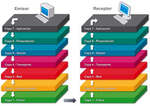

Por regla general, cuando la información se va a transmitir desde una entidad A (**emisor**) a otra entidad B (**receptor**):

1. El emisor parte de la **capa más alta** del modelo OSI (la de aplicación).

1. Va **descendiendo** por las capas, añadiendo en cada una de ellas unas **trazas de información** propias de la capa que, entre otras cosas, sirven para pasar información relevante de unas capas a otras.

1. Cuando llega a la **capa 1**, se produce el **enlace físico** con el receptor y, en ese momento, la información se recibe en la capa 1 de la entidad receptora.

1. Se sigue el proceso inverso: va **ascendiendo** por las capas, liberando las trazas correspondientes en cada una.

1. Finalmente llegará a la capa más alta y el receptor dará por recibida la información que se transmitió.

En realidad, las comunicaciones también pueden hacerse entre capas del mismo nivel a partir de la capa 3, gracias al uso de protocolos específicos de capa. En cualquier caso, el flujo descendente en el emisor y ascendente en el receptor siempre se produce.

## **El modelo TCP/IP**

El modelo TCP/IP es **anterior al modelo OSI**. En realidad es un modelo que surge a partir de la investigación de diferentes protocolos, y el nombre del modelo lo toma de sus dos principales protocolos: **TCP** e **IP**.

Es un modelo que puede aplicarse a cualquier soporte, tanto hardware como software. Además, tiene la capacidad de operar en cualquier tipo de red, lo que le permite ser la base de un gran número de aplicaciones.

A diferencia del modelo de referencia OSI, el modelo TCP/IP **no tiene una división clara de sus capas**. Es más, sus protocolos pueden llegar a actuar en más de una. Las capas en las que se podría organizar son las siguientes:

| Capa | Nombre | Correspondencia con OSI | Función |
| --- | --- | --- | --- |
| 1 | **Acceso a red** | Capas 1 y 2 | Su función es permitir que los paquetes de información que entren y viajen a través de la red lleguen a su destino. El protocolo para conseguirlo dependerá de la red de que se trate. |
| 2 | **Internet** | Capa 3 | Al igual que sucedía con la capa de red del modelo OSI, su misión es conseguir que todas las entidades puedan conectarse con independencia de la red en la que se encuentren. |
| 3 | **Transporte** | Capas 4, 5 y 6 | Se encarga de gestionar el envío de información entre las dos entidades que se comunican, de un extremo al otro de la línea de comunicación, con la posibilidad de detectar y reparar errores durante el proceso. |
| 4 | **Aplicación** | Capa 7 | Es la capa más alta del modelo TCP/IP e incluye las aplicaciones y los procesos con los que se produce el intercambio de datos. |

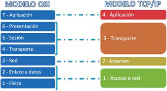

## **Protocolos de comunicación**

Como recordarás, los **protocolos** son un conjunto de normas que, aplicadas a un proceso de comunicación, permiten que dos entidades intercambien información.

Existe una gama bastante amplia de protocolos de comunicación. De todos ellos destacamos los siguientes, tomando como referencia el **modelo OSI**, donde la distribución de protocolos por capas es mucho más clara que en el modelo TCP/IP.

### **Protocolos de capa 1**

Hacen alusión al tipo de **medio** que se utilizará para establecer la conexión, mediante cableado o inalámbrica, así como a las características de dicho medio. Los más representativos son:

- **Cable coaxial**: utilizado en las primeras redes. Lo hay de distintos grosores, con diferentes características. En la actualidad este cable se utiliza en algunos tramos de distribuciones de redes extensas.

- **Cable UTP**: es el cable más utilizado en redes de área local. Existen
  distintos tipos, cada uno con características diferentes.

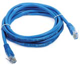

- **Fibra óptica**: empleado mayoritariamente en redes de gran longitud. Es el medio que resulta más veloz para transmitir.
- **Ondas**: infrarrojas, microondas, de radio, etc.

### **Protocolos de capa 2**

Aquí destacamos los protocolos específicos de la **interfaz** que se utiliza para conectar la entidad a la red de comunicaciones. Entre los más característicos están:

- **Ethernet**: orientado a redes de área local. Permite operar hasta a **10 Mbps**.

- **Fast Ethernet**: es una mejora de Ethernet, donde la velocidad puede llegar hasta los **100 Mbps**.

- **Gigabit Ethernet**: mejora de Fast Ethernet hasta **1000 Mbps**.

- **10-Gigabit Ethernet**: revisión del estándar Gigabit Ethernet que prevé una mejora en la velocidad de hasta **10 Gbps**.


Un protocolo muy típico en esta capa es **ARP**. Este protocolo se encarga de localizar la **dirección MAC** de una entidad a partir de su **dirección IP**. El protocolo que hace la operación inversa es **RARP**.

### **Protocolos de capa 3**

El protocolo más característico de esta capa es el protocolo **IP**. Su finalidad es conseguir que la información viaje del origen al destino a través de la mejor ruta posible. Para ello, a cada entidad de la red le asigna un valor llamado **dirección IP**. El trazado de la ruta desde el origen al destino se hace a través de un mecanismo llamado **encaminamiento** o **enrutamiento**.

Otro protocolo destacable de esta capa es **NAT** (*Network Address Translation*): traduce las direcciones IP privadas en direcciones IP públicas, de forma que varios dispositivos puedan compartir la misma conexión a Internet con una única dirección pública.

Este protocolo es una de las bases del funcionamiento de las redes y lo trataremos con detalle más adelante.

### **Protocolos de capa 4**

Los principales protocolos en esta capa son:

- 

**UDP**: se basa en el envío de paquetes al destino **sin necesidad de una conexión previa** con este. Cada paquete contiene información suficiente como para llegar al destino por su cuenta. Es un protocolo donde **no existe sincronización ni confirmación de llegada**, por lo que algunos paquetes pueden adelantar a otros o incluso no llegar nunca. Se utiliza cuando es más importante la velocidad de la transmisión que la integridad de lo que se transmite (por ejemplo, audio o vídeo).

- 

**TCP**: junto con IP, es uno de los principales protocolos de Internet. Al contrario que UDP, TCP **establece una conexión** entre emisor y receptor, garantizando que los datos que se transmiten llegan en el **mismo orden** en que se transmiten y **sin errores**. Este protocolo es la base de gran parte de las aplicaciones que trabajan sobre Internet, así como de muchos de los protocolos de capas superiores.

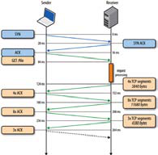

### **Protocolos de capa 5**

Los protocolos que destacamos en esta capa son los siguientes:

- 

**RPC**: es un protocolo utilizado para establecer conexiones remotas, de forma que un equipo pueda trabajar sobre otro sin necesidad de preocuparse por sus comunicaciones. Hoy en día, es la base para la asistencia remota, así como para la ejecución remota de aplicaciones y de los denominados servicios web.

- 

**SSL y TLS**: tanto SSL como su sucesor, TLS, son protocolos cuya finalidad es **encriptar la información** que se transmite para que solo pueda ser descifrada por el receptor. Se utilizan en capas superiores para dar seguridad a otros protocolos, como puedan ser los de correo electrónico o los de interpretación de páginas web.

> **📌 Saber más**
> 

> Un **servicio web** es una tecnología que permite que varias aplicaciones intercambien información entre sí mediante una configuración previa muy simple para interconectarlas.

### **Protocolos de capa 6**

No hay protocolos a destacar en esta capa.

### **Protocolos de capa 7**

Esta capa es la que más protocolos representativos tiene, ya que es con la que interactúa el usuario. Los más representativos son:

| Protocolo | Descripción |
| --- | --- |
| **HTTP** | Quizás es el protocolo más conocido por los usuarios de Internet. Se encarga de publicar e interpretar páginas web. La versión de HTTP con SSL/TLS se llama **HTTPS**. |
| **SMTP** | Protocolo empleado para **remitir** correo electrónico. |
| **POP3 e IMAP** | Protocolos empleados para **recibir** el correo electrónico. IMAP es una mejora de POP3. |
| **FTP** | Protocolo orientado a la **transferencia de archivos** haciendo uso del protocolo TCP. Como en HTTP, la versión segura de FTP se denomina **FTPS**. |

### **Resumen: protocolos más utilizados**

En la siguiente tabla se presentan los protocolos de comunicación más utilizados, agrupados por capas del modelo OSI:

| Capa | Protocolo | Descripción |
| --- | --- | --- |
| **Aplicación** | HTTP, HTTPS | Publicar e interpretar texto, imágenes, sonido, vídeo, etc. en Internet. |
|  | SMTP, POP3, IMAP | Enviar y recibir correo electrónico. |
|  | DHCP | Configurar el equipo para obtener automáticamente una dirección IP. |
|  | DNS | Traducir nombres de dominio a direcciones IP. |
|  | FTP, FTPS | Transferir archivos. |
|  | RPC | Establecer conexiones remotas para trabajar sobre otro equipo. |
|  | SSL, TLS | Encriptar la información en el emisor para que solo el receptor pueda descifrarla. |
| **Transporte** | TCP, UDP | Enviar paquetes por la mejor ruta posible para que lleguen a su destino. |
| **Red** | IP | Asigna direcciones únicas a los dispositivos de la red y enruta los paquetes (*encaminamiento* o *enrutamiento*). |
|  | NAT | Traduce direcciones IP privadas en direcciones IP públicas. |
| **Enlace de datos** | Ethernet, WLAN | Definir cómo se comunican los dispositivos dentro de una red cableada (Ethernet) o inalámbrica (WLAN). |

> **📌 Ficha de trabajo · Protocolos de comunicación**
> 

> En la Ficha de trabajo protocolos del módulo completaréis la tabla de los protocolos **HTTP, FTP, NNTP, TELNET y SMTP**, indicando la capa del modelo OSI en la que opera cada uno, su función y un ejemplo de uso.

## **Actividades**

> **📌 Actividad 7**
> 

> Completa los espacios vacíos del siguiente esquema, correspondiente a los modelos de sistemas de comunicaciones:

| Modelo OSI | Modelo TCP/IP |
| --- | --- |
| Capa 7: ………… | Capa 4: ………… |
| Capa 6: ………… |  |
| Capa 5: ………… |  |
| Capa 4: ………… | Capa 3: ………… |
| Capa 3: ………… | Capa 2: ………… |
| Capa 2: ………… |  |
| Capa 1: ………… | Capa 1: ………… |

> **📌 Actividad 8 · Utiliza las TIC**
> 

> En equipos de dos a cuatro personas:

> 1. 

> Completad una tabla como la siguiente con los protocolos HTTP, FTP, NNTP, TELNET y SMTP:

| Protocolo | Capa/s del modelo OSI en la que opera | Función | Ejemplo de uso |
| --- | --- | --- | --- |
| HTTP | 6 y 7 | Accede a un servidor de hipertexto, mostrando el contenido del fichero o guardándolo en el equipo. | [http://todofp.es](http://todofp.es) |
| FTP |  |  |  |
| NNTP |  |  |  |
| TELNET |  |  |  |
| SMTP |  |  |  |

> 1. 

> Añadid al menos dos protocolos más, a vuestra elección, con su capa, función y ejemplo de uso.

> **📌 Actividad 9**
> 

> El modelo OSI ha contribuido a impulsar la comunicación. Individualmente o en pequeños grupos, haced una lista de al menos **diez aplicaciones** que permitan la comunicación en móviles, portátiles u ordenadores (ejemplos: WhatsApp, Zoom, correo electrónico). Para cada una, indicad qué capas del modelo OSI intervienen en su funcionamiento.

## **En resumen**

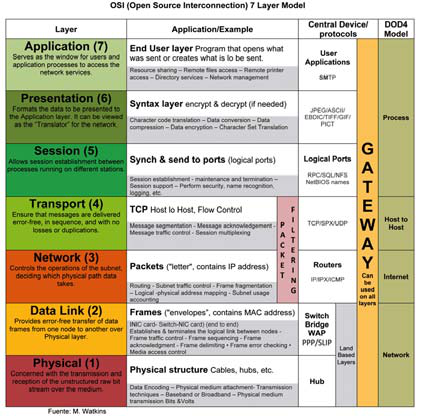

---

## 1.4 Dirección IP

# **Dirección IP**

Uno de los elementos clave a la hora de trabajar con redes de datos y telecomunicaciones es el concepto de **IP**.

Como hemos visto, cada una de las entidades con capacidad para emitir y recibir información recibe una **dirección IP**. Esa dirección IP, al contrario que la **dirección MAC**, **no es específica del dispositivo**, pudiendo darse el caso de que una entidad reciba direcciones IP diferentes en un determinado momento en la red, en función de qué papel tome en la misma.

Puesto que cada elemento de la red estará identificado por una dirección IP, es imprescindible conocer qué son, cómo se asignan y cómo se gestionan.

> **📌 Recuerda**
> 

> - **Dirección MAC**: código fijo de **48 bits** (seis bloques) que identifica de forma unívoca la tarjeta o dispositivo de red. Ejemplo: `00:E0:7D:F9:EA:6D`.

> - **Dirección IP**: código lógico que se asigna a cada entidad de la red. Puede cambiar según el papel que tome el dispositivo en la red.

> **📌 Ejemplo**
> 

> Las direcciones IP y MAC son el equivalente a la manera en la que enviamos una carta por correo postal: la **dirección IP** se corresponde con la **dirección de una casa** y la **dirección MAC** con el **destinatario**.

Cualquier dispositivo conectado a una red informática debe disponer de **dos direcciones** necesariamente:

- **Dirección IP**: es la dirección **lógica** que se necesita para acceder a un equipo. Puede ser:

- **Estática**: es fija para el dispositivo y no cambia, como la de los servidores de Internet.

- **Dinámica**: puede cambiar con el paso del tiempo, como la de nuestros equipos en casa.

- **Dirección MAC**: es la dirección **física** necesaria para identificar unívocamente la tarjeta de red. Un dispositivo de red puede tener varias tarjetas de red, pero cada una con su propia dirección MAC.

La dirección IP va acompañada de la **máscara de red**. Entre las dos se identifica la red en la que se trabaja. La máscara de red hace que se enruten los paquetes de datos de la mejor forma posible para llegar a su destino según la dirección de origen y de destino.

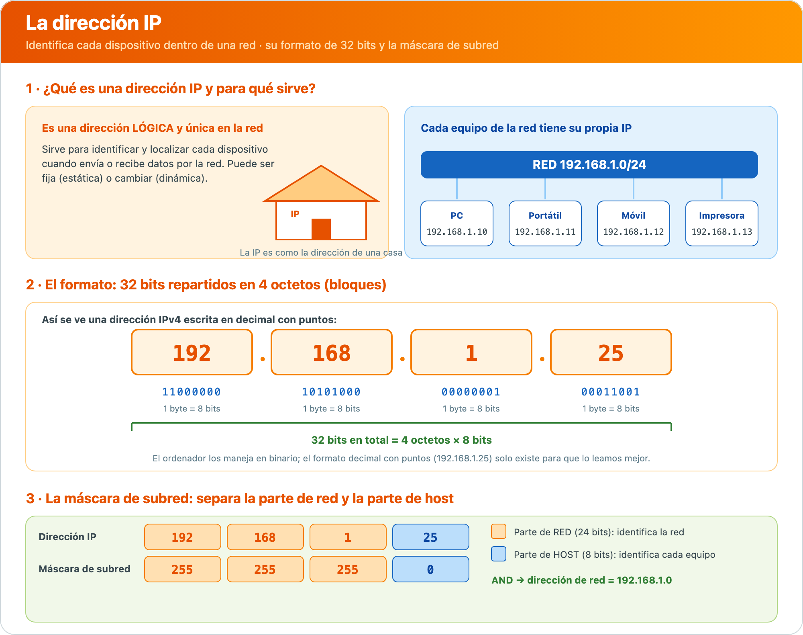

## **Las versiones del protocolo IP**

De todas las versiones del protocolo IP, las dos más características son las que veremos a continuación.

### **Protocolo IPv4**

Es la **cuarta versión** del protocolo IP y la primera que se implantó a gran escala. Hace uso de **32 bits** separados por puntos en bloques de **un byte**, siguiendo una estructura como esta:

```bash
192.168.0.1
```

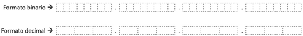

Así, existen **2³² direcciones posibles** (más de cuatro millones), que se estructuran inicialmente en **cinco clases**:

| Clase | Rango | Uso |
| --- | --- | --- |
| **Clase A** | 0.0.0.0 – 0.255.255.255 | Reservado |
|  | 1.0.0.0 – 9.255.255.255 | Público |
|  | 10.0.0.0 – 10.255.255.255 | Privado |
|  | 11.0.0.0 – 126.255.255.255 | Público |
|  | 127.0.0.0 – 127.255.255.255 | Reservado |
| **Clase B** | 128.0.0.0 – 172.15.255.255 | Público |
|  | 172.16.0.0 – 172.31.255.255 | Privado |
|  | 172.32.0.0 – 191.255.255.255 | Público |
| **Clase C** | 192.0.0.0 – 192.167.255.255 | Público |
|  | 192.168.0.0 – 192.168.255.255 | Privado |
|  | 192.169.0.0 – 223.255.255.255 | Público |
| **Clase D** | 224.0.0.0 – 239.255.255.255 | Reservado |
| **Clase E** | 240.0.0.0 – 255.255.255.255 | Reservado |

En el formato decimal, la dirección IPv4 va desde `0.0.0.0` hasta `255.255.255.255`. Los equipos trabajan con las direcciones IP en **formato binario** pero, lógicamente, para nosotros es más manejable el formato decimal, motivo por el que conviene manejar adecuadamente la conversión binario-decimal-binario.

La forma en que se secuencian las direcciones IP es muy simple: cada bloque podría considerarse un elemento en un contador. El bloque situado más a la derecha va creciendo hasta llegar a 255. Al crecer uno más, el elemento volvería a empezar en el 0 y aumentaría en 1 el bloque de la izquierda, y así con el resto de bloques.

El continuo crecimiento de Internet, unido al desperdicio de direcciones a la hora de crear subredes, ha hecho que la oferta de direcciones IP disponibles a través de IPv4 se quede corta y haya que recurrir a otro protocolo.

#### **La máscara de red**

La **máscara de red** es un código que acompaña a la dirección IP y que determina qué parte de la dirección identifica la **red** y qué parte identifica al **host** (equipo). Tiene la misma estructura que la dirección IPv4: 32 bits separados por puntos en bloques de un byte.

```bash
Dirección IP:   192.168.0.1
Máscara de red: 255.255.255.0
```

En binario, la máscara de red está formada por **unos consecutivos** (parte de red) seguidos de **ceros consecutivos** (parte de host). Los ceros de la máscara de red indican las direcciones, dentro de la dirección de red, que se pueden asignar a equipos de red u **hosts**.

#### **Operación lógica AND**

Al hacer una **operación lógica AND** entre la dirección IP y la máscara de red, obtenemos la **dirección de red**.

| Operación AND |
| --- |
| 1 AND 1 = 1 |
| 1 AND 0 = 0 |
| 0 AND 0 = 0 |
| 0 AND 1 = 0 |

> **📌 Ejemplo**
> 

> Dirección IP `192.168.0.1` y máscara de red `255.255.255.0`:

> - IP en binario: `11000000.10101000.00000000.00000001`

> - Máscara en binario: `11111111.11111111.11111111.00000000`

> - Resultado AND: `11000000.10101000.00000000.00000000`

> La dirección de red obtenida es **192.168.0.0**.

#### **Dirección de red, broadcast y rango de hosts**

Dentro de las direcciones de host, **dos de ellas no se pueden asignar**:

- **Dirección de red**: identifica la red en sí. En el ejemplo es `192.168.0.0`.

- **Dirección de broadcast**: empleada para enviar paquetes a todos los hosts de la red al mismo tiempo. Es la dirección de red más alta dentro del rango de la red. En el ejemplo es `192.168.0.255`.

El **resto de direcciones IP** entre las dos anteriores se pueden asignar a hosts. En el ejemplo: desde `192.168.0.1` hasta `192.168.0.254`.

#### **Direcciones IP privadas y notación CIDR**

Existen direcciones IP **privadas** que no se pueden asignar públicamente en Internet, reservadas solo para **redes privadas** como las de nuestras casas u oficinas:

| Red privada | Rango |
| --- | --- |
| 10.0.0.0/8 | 10.0.0.0 – 10.255.255.255 |
| 172.16.0.0/12 | 172.16.0.0 – 172.31.255.255 |
| 192.168.0.0/16 | 192.168.0.0 – 192.168.255.255 |

La **notación IP/máscara (o notación CIDR)** es una forma compacta de representar una dirección IP junto con su máscara de red. Por ejemplo, en `192.168.1.0/24`:

- `192.168.1.0` es la dirección base de la red.

- `/24` indica que los primeros **24 bits** se utilizan para definir la parte de red. Por tanto, su máscara de red es `255.255.255.0`.

#### **Varias redes en un mismo centro**

Un mismo centro de estudios puede tener **varias redes IP distintas**. Es habitual separar por zonas (aula de informática, administración, Wi-Fi del alumnado, sala de profesores…) porque cada una tiene sus propias necesidades de **seguridad, rendimiento y organización**.

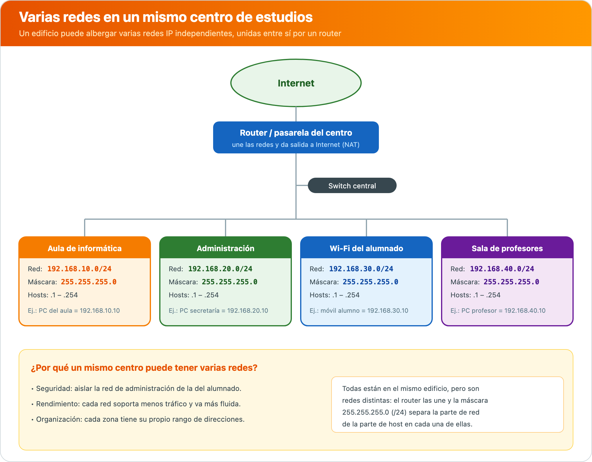

Aunque todas las zonas estén en el mismo edificio, son **redes independientes**: cada una usa su propio rango de direcciones (por ejemplo `192.168.10.0/24`, `192.168.20.0/24`…) y su máscara `255.255.255.0`. El **router** se encarga de unirlas y de darles salida a Internet.

#### **Caso práctico resuelto**

Disponemos de una tarjeta de red con IP `172.96.0.22` y máscara de red `255.255.0.0`. Debemos calcular la dirección de red, el número de bits que se pueden asignar a hosts, la primera dirección de host, la última dirección de host y la dirección de broadcast:

1. Pasamos la dirección IP `172.96.0.22` a binario: `10101100.01100000.00000000.00010110`.

1. Pasamos la máscara de red `255.255.0.0` a binario: `11111111.11111111.00000000.00000000`.

1. Hacemos la **operación AND** entre ambas para obtener la dirección de red: `10101100.01100000.00000000.00000000`, que se corresponde con la dirección decimal **172.96.0.0**.

1. Los **bits a cero** de la máscara de red son los que se pueden utilizar para componer direcciones de hosts. Por tanto, son los **últimos 16 bits**.

1. Si `172.96.0.0` es la dirección de red, la siguiente, `172.96.0.1`, es la **primera dirección de host**.

1. La **dirección de broadcast** es la última dirección de host reservada para ello y, por tanto, es la `172.96.255.255`.

1. La dirección anterior a la de broadcast es la **última dirección asignable a hosts**: `172.96.255.254`.

### **Protocolo IPv6**

El protocolo IPv6 viene a cubrir las necesidades del protocolo IPv4. Emplea **128 bits** en lugar de 32, por lo que ofrece un total de **2¹²⁸ direcciones IP diferentes** (unos 340 sextillones).

Las direcciones IPv6 se representan como **8 grupos de 2 bytes**, separados por dos puntos («:»). No se representa con el sistema decimal sino con el **hexadecimal**:

```bash
3FFA:00D1:AF29:1001:34D1:0000:B4EB:0FFA
```

#### **Sistema hexadecimal**

$$H = {0, 1, 2, 3, 4, 5, 6, 7, 8, 9, A, B, C, D, E, F}$$

- Cada número hexadecimal puede considerarse una representación de un número binario de **4 bits**.

- Los valores de `A` a `F` se corresponden en decimal a los valores 10 a 15, respectivamente.

| Hexadecimal | Binario | Decimal |
| --- | --- | --- |
| 0 | 0000 | 0 |
| 1 | 0001 | 1 |
| 2 | 0010 | 2 |
| 3 | 0011 | 3 |
| 4 | 0100 | 4 |
| 5 | 0101 | 5 |
| 6 | 0110 | 6 |
| 7 | 0111 | 7 |
| 8 | 1000 | 8 |
| 9 | 1001 | 9 |
| A | 1010 | 10 |
| B | 1011 | 11 |
| C | 1100 | 12 |
| D | 1101 | 13 |
| E | 1110 | 14 |
| F | 1111 | 15 |

#### **Conversión hexadecimal – binario**

Se convierte a **binario** cada uno de los elementos hexadecimales, en el mismo orden en que se encuentran, teniendo en cuenta que `A = 10`, `B = 11`, `C = 12`, `D = 13`, `E = 14` y `F = 15` en la notación decimal.

#### **Conversión hexadecimal – decimal**

La conversión de hexadecimal a decimal, o viceversa, pasa por traducir el valor a **binario** y, de ahí, al sistema correspondiente, aplicando las técnicas que hemos visto.

#### **Notación abreviada**

La notación permite abreviar los bloques de la siguiente manera:

- Los **ceros a la izquierda** pueden descartarse. Por ejemplo, es lo mismo `003E` que `3E`.

- El bloque `0000` puede reducirse a `0`.

- Si hay **dos o más grupos consecutivos con valor 0**, puede reducirse a `::`, pero **solo en una ocasión** en la misma dirección IP.

> **📌 Ejemplo**
> 

> - `2000:0011:3D4A:0055:0000:0000:2F01:5432` equivale a `2000:11:3D4A:55::2F01:5432`.

> - `7144:0000:A101:0000:0000:0000:31BB:4A23` equivale a `7144:0:A101::31BB:4A23`.

#### **Direcciones IPv4 compatibles**

Las direcciones IPv6 permiten adaptar direcciones IPv4 a su notación. La forma habitual de hacerlo es poner los **dos primeros bloques a cero** y los dos últimos representarlos como una **IPv4**. Esto es lo que se conoce como **dirección IPv4 compatible**.

> **📌 Ejemplo**
> 

> La dirección IPv4 `192.168.0.1` podría escribirse en notación de IPv6 como `0:0:192.168.0.1`, o también como `::192.168.0.1`.

## **Actividades**

> **📌 Actividad 10**
> 

> 1. Un adaptador de red tiene la dirección IP `10.0.0.25` y la máscara de red `255.255.255.0`. ¿Cuál es la dirección de red? ¿Y la de broadcast?

> 1. Un equipo tiene la dirección IP `172.16.5.200` y la máscara de red `255.255.255.0`. ¿Cuál es la dirección de broadcast?

> 1. Obtén la dirección de red, la dirección de broadcast y el rango de las IP direccionables del siguiente equipo con dirección IP `192.168.3.6` y máscara de subred `255.255.255.0`.

> **📌 Actividad 11**
> 

> 1. ¿Cuántos bits tiene una dirección IPv6? ¿Y una IPv4? ¿Cuántas direcciones diferentes ofrece cada una?

> 1. Escribe la dirección `2001:0DB8:1:2::3:4` con todos sus bloques completos y sin abreviar. Indica si la dirección `2001:::1:2:3` está bien escrita y explicad por qué.

> 1. Convierte la dirección IPv4 `10.0.0.1` a notación IPv4 compatible en IPv6.

> **📌 Actividad 12**
> 

> Accede a [https://whatismyipaddress.com/](https://whatismyipaddress.com/) y comprueba cuál es tu IP pública en Internet. Después, en Windows, escribe `ipconfig /all` en el símbolo del sistema (cmd) y anota tu **dirección IPv4** y tu **dirección física (MAC)**, comparándolas con las del resto del aula.

> **📌 Actividad 13**
> 

> Completa cada frase con el protocolo correcto entre **FTP, UDP, SMTP, DHCP, NAT, HTTPS y ARP**:

> 1. Cuando un ordenador quiere saber qué dirección física (MAC) tiene otro ordenador en la red, usa el protocolo ………

> 1. Para que varios dispositivos compartan la misma conexión a Internet con una única dirección pública, se usa ………

> 1. Cuando enviamos un correo electrónico, este viaja a través de ………

> 1. Los videojuegos online y las videollamadas funcionan mejor con ……… porque envía datos más rápido, aunque a veces se pierdan.

> 1. Cuando entramos a una página web segura, como un banco o una tienda online, el navegador usa ……… para cifrar la información.

> 1. Para descargar o subir archivos a un servidor, usamos ……….

## **En resumen**

- La **dirección IP** es la dirección lógica que se asigna a cada entidad de la red; puede ser **estática** (fija) o **dinámica** (cambia con el tiempo).

- La **dirección MAC** es el código físico de **48 bits** que identifica unívocamente la tarjeta de red.

- Las direcciones IP van acompañadas de la **máscara de red**; la **operación lógica AND** entre ambas da la **dirección de red**.

- Dos direcciones dentro de una red no se pueden asignar a hosts: la **dirección de red** y la **dirección de broadcast** (la más alta del rango).

- **IPv4** usa 32 bits (4 bloques de 1 byte, decimal), con **5 clases** (A–E) y **rangos públicos, privados y reservados**. Se expresa en **notación CIDR** (ej.: `/24`).

- **IPv6** usa 128 bits (8 bloques de 2 bytes, hexadecimal), con reglas de **abreviación** y **IPv4 compatible**.

---

## UP01 · Resumen en Imagenes

# **UP01 · Resumen en Imagenes**

📥 Guardar como PDF

## **1.1 · La comunicación y sus elementos**

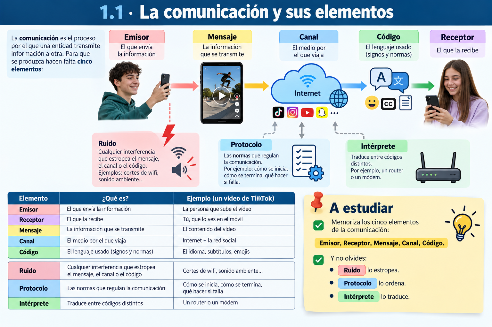

## **1.2 · La representación de la información**

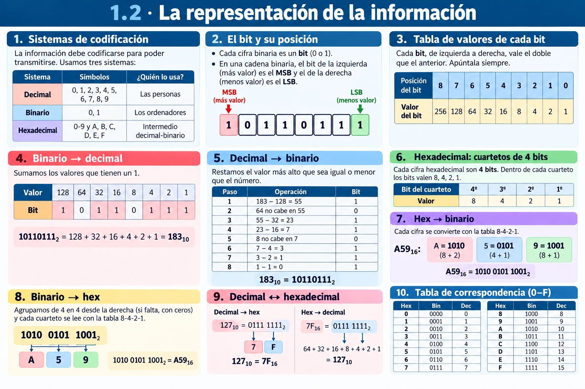

### **Medidas de información**

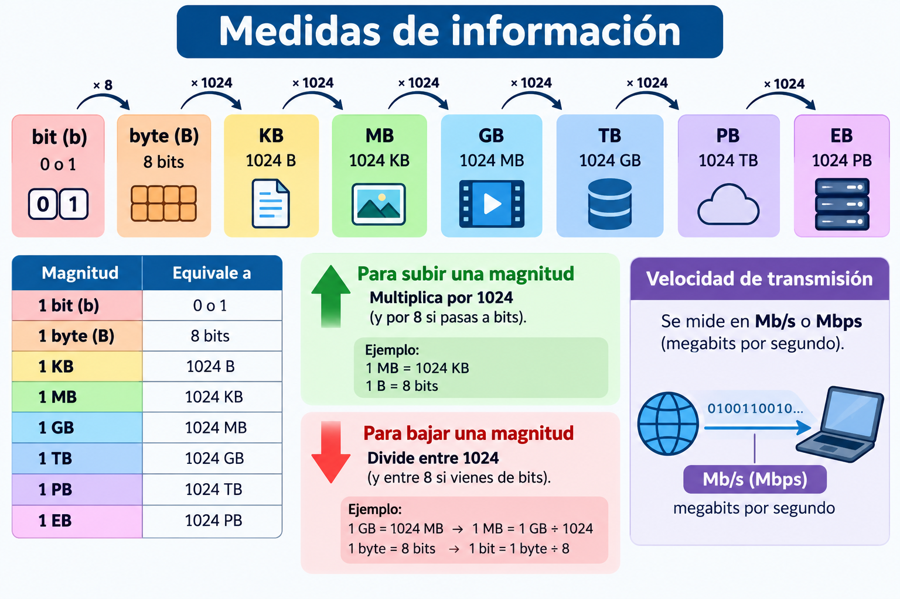

## **1.3 · Las redes de comunicaciones: modelos OSI y TCP/IP**

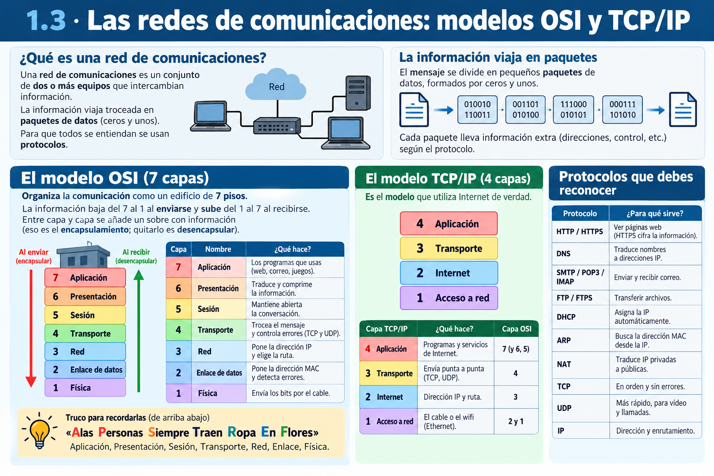

## **1.4 · La dirección IP (IPv4 e IPv6)**

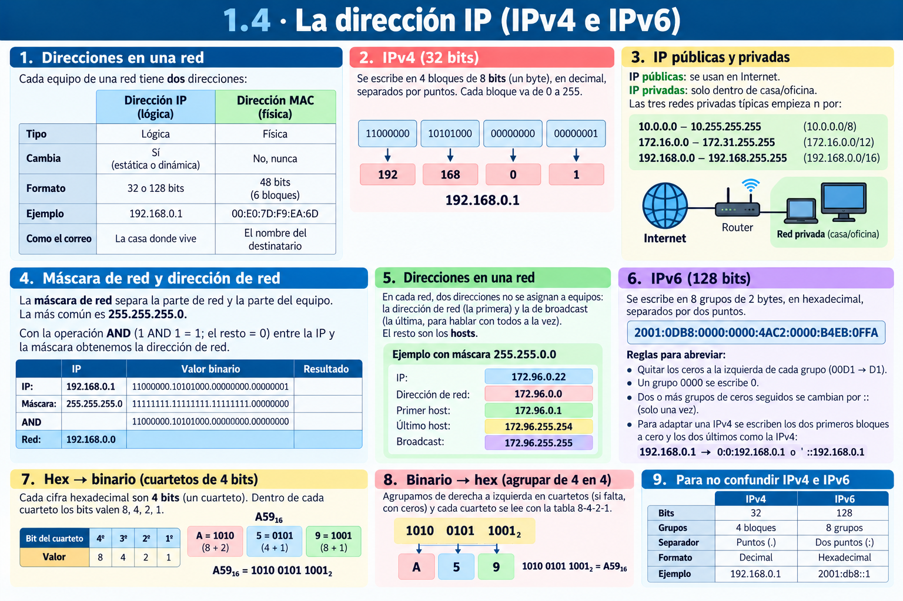

---

## UP01 · Resumen en Texto

# **UP01 · Resumen en Texto**

📥 Guardar como PDF

## **1.1 · La comunicación y sus elementos**

La **comunicación** es el proceso por el que una entidad **transmite información** a otra. Para que se produzca hacen falta **cinco elementos**:

| Elemento | ¿Qué es? | Ejemplo (un vídeo de TikTok) |
| --- | --- | --- |
| **Emisor** | El que envía la información | La persona que sube el vídeo |
| **Receptor** | El que la recibe | Tú, que lo ves en el móvil |
| **Mensaje** | La información que se transmite | El contenido del vídeo |
| **Canal** | El medio por el que viaja | Internet + la red social |
| **Código** | El lenguaje usado (signos y normas) | El idioma, subtítulos, emojis |

Además, intervienen tres elementos más:

- **Ruido**: cualquier interferencia que estropea el mensaje, el canal o el código (cortes de wifi, sonido ambiente…).

- **Protocolo**: las normas que regulan la comunicación (cómo se inicia, cómo se termina, qué hacer si falla).

- **Intérprete**: traduce entre códigos distintos (por ejemplo, un router o un módem).

> **📌 A estudiar**
> 

> Memoriza los cinco: **Emisor, Receptor, Mensaje, Canal, Código**. Y no olvides: **ruido** lo estropea, **protocolo** lo ordena, **intérprete** lo traduce.

## **1.2 · La representación de la información**

La información **debe codificarse** para poder transmitirse. Los tres sistemas de codificación que usamos son:

| Sistema | Símbolos | ¿Quién lo usa? |
| --- | --- | --- |
| **Decimal** | 0, 1, 2, 3, 4, 5, 6, 7, 8, 9 | Las personas |
| **Binario** | 0, 1 | Los ordenadores |
| **Hexadecimal** | 0-9 y A, B, C, D, E, F | Intermedio decimal-binario |

- Cada cifra binaria es un **bit** (0 o 1).

- En una cadena binaria, el bit de la **izquierda** (más valor) es el **MSB** y el de la **derecha** (menos valor) es el **LSB**.

### **La tabla de valores de cada bit (método de la tabla)**

Para convertir usamos siempre esta tabla. Cada bit, de izquierda a derecha, vale **el doble** que el anterior: **1, 2, 4, 8, 16, 32, 64, 128 y 256**. Apúntala siempre.

| Posición del bit | 8 | 7 | 6 | 5 | 4 | 3 | 2 | 1 | 0 |
| --- | --- | --- | --- | --- | --- | --- | --- | --- | --- |
| **Valor del bit** | **256** | **128** | **64** | **32** | **16** | **8** | **4** | **2** | **1** |

#### **Binario → decimal (sumar los valores con un 1)**

Colocamos cada bit debajo de su valor y **sumamos** solo los valores que tienen un **1**.

| Valor | 128 | 64 | 32 | 16 | 8 | 4 | 2 | 1 |
| --- | --- | --- | --- | --- | --- | --- | --- | --- |
| Bit | 1 | 0 | 1 | 1 | 0 | 1 | 1 | 1 |

10110111₂ = 128 + 32 + 16 + 4 + 2 + 1 = **183₁₀**

#### **Decimal → binario (restar los valores de la tabla)**

Buscamos el valor **más alto** de la tabla que sea igual o menor que el número, ponemos un **1**, restamos y repetimos con lo que quede (si no cabe, ponemos un **0**).

Ejemplo con **183₁₀**:

| Paso | Operación | Bit |
| --- | --- | --- |
| 1 | 183 − 128 = 55 | **1** |
| 2 | 64 no cabe en 55 | **0** |
| 3 | 55 − 32 = 23 | **1** |
| 4 | 23 − 16 = 7 | **1** |
| 5 | 8 no cabe en 7 | **0** |
| 6 | 7 − 4 = 3 | **1** |
| 7 | 3 − 2 = 1 | **1** |
| 8 | 1 − 1 = 0 | **1** |

Resultado: **183₁₀ = 10110111₂** (comprueba que es el mismo ejemplo anterior)

#### **Hexadecimal: los cuartetos valen 8 · 4 · 2 · 1**

Cada cifra hexadecimal son **4 bits** (un cuarteto). Dentro de cada cuarteto los bits valen **8, 4, 2, 1**.

| Bit del cuarteto | 4º | 3º | 2º | 1º |
| --- | --- | --- | --- | --- |
| **Valor** | **8** | **4** | **2** | **1** |

#### **Hex → binario (cada cifra hex vale 4 bits)**

**A59₁₆**: cada cifra se convierte con la tabla 8-4-2-1:

- A = 1010 (8 + 2)

- 5 = 0101 (4 + 1)

- 9 = 1001 (8 + 1)

Resultado: **A59₁₆ = 1010 0101 1001₂**

#### **Binario → hex (agrupar de 4 en 4)**

Agrupamos de derecha a izquierda en **cuartetos** (si falta, rellenamos con ceros a la izquierda) y cada cuarteto se lee con la tabla 8-4-2-1.

**1010 0101 1001₂** → 1010 = A · 0101 = 5 · 1001 = 9 → **1010 0101 1001₂ = A59₁₆**

#### ** Decimal ↔ hexadecimal (pasando por la tabla grande)**

**Decimal → hex**: primero pasamos el número a binario con la tabla grande y luego agrupamos en cuartetos.

- 127₁₀ = 0111 1111₂ → 0111 = 7 · 1111 = F → **127₁₀ = 7F₁₆**

**Hex → decimal**: pasamos cada cifra a 4 bits y sumamos los valores de los **1** con la tabla grande.

- 7F₁₆ = 0111 1111₂ → 64 + 32 + 16 + 8 + 4 + 2 + 1 = **127₁₀**

> **📌 Tabla de correspondencia (10 valores que debes reconocer)**
> 

| Hex | Bin | Dec |  | Hex | Bin | Dec |
| --- | --- | --- | --- | --- | --- | --- |
| 0 | 0000 | 0 |  | 8 | 1000 | 8 |
| 1 | 0001 | 1 |  | 9 | 1001 | 9 |
| 2 | 0010 | 2 |  | A | 1010 | 10 |
| 3 | 0011 | 3 |  | B | 1011 | 11 |
| 4 | 0100 | 4 |  | C | 1100 | 12 |
| 5 | 0101 | 5 |  | D | 1101 | 13 |
| 6 | 0110 | 6 |  | E | 1110 | 14 |
| 7 | 0111 | 7 |  | F | 1111 | 15 |

### **Medidas de información**

| Magnitud | Equivale a |
| --- | --- |
| 1 **bit** (b) | 0 o 1 |
| 1 **byte** (B) | 8 bits |
| 1 **KB** | 1024 B |
| 1 **MB** | 1024 KB |
| 1 **GB** | 1024 MB |
| 1 **TB** | 1024 GB |
| 1 **PB** | 1024 TB |
| 1 **EB** | 1024 PB |

- Para **subir** una magnitud: multiplica por 1024 (y por 8 si pasas a bits).

- Para **bajar**: divide entre 1024 (y entre 8 si vienes de bits).

- La **velocidad** de transmisión se mide en **Mb/s** o **Mbps** (megabits por segundo).

> **📌 Repaso rápido**
> 

> - 2 B = 2 × 8 = **16 b**

> - 4 MB = 4 × 1024 × 1024 × 8 = **33 554 432 bits**

> - 60 KB = 60 / 1024 / 1024 / 1024 ≈ **0,00000006 TB**

## **1.3 · Las redes de comunicaciones: modelos OSI y TCP/IP**

Una **red de comunicaciones** es un conjunto de **dos o más equipos** que intercambian información. Esta viaja troceada en **paquetes de datos** (ceros y unos). Para que todos se entiendan se usan **protocolos**.

### **El modelo OSI (7 capas)**

Organiza la comunicación como un **edificio de 7 pisos**. La información **baja** del 7 al 1 al enviarse y **sube** del 1 al 7 al recibirse. Entre capa y capa se añade un **sobre** con información (eso es el **encapsulamiento**; quitarlo es **desencapsular**).

| Capa | Nombre | ¿Qué hace? |
| --- | --- | --- |
| 7 | **Aplicación** | Los programas que usas (web, correo, juegos) |
| 6 | **Presentación** | Traduce y comprime la información |
| 5 | **Sesión** | Mantiene abierta la conversación |
| 4 | **Transporte** | Trocea el mensaje y controla errores (**TCP** y **UDP**) |
| 3 | **Red** | Pone la **dirección IP** y elige la ruta |
| 2 | **Enlace de datos** | Pone la **dirección MAC** y detecta errores |
| 1 | **Física** | Envía los **bits** por el cable |

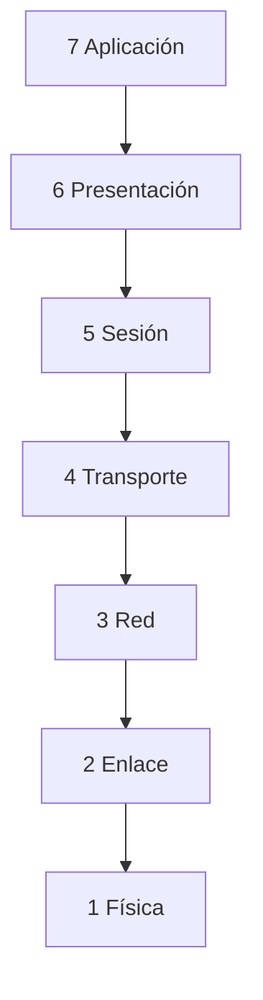

> **📌 Truco para recordarlas (de arriba abajo)**
> 

> **«A**las **P**ersonas **S**iempre **T**raen **R**opa **E**n **F**lores»** → Aplicación, Presentación, Sesión, Transporte, Red, Enlace, Física.

### **El modelo TCP/IP (4 capas)**

Es el modelo que **utiliza Internet de verdad**.

| Capa TCP/IP | ¿Qué hace? | Capa OSI |
| --- | --- | --- |
| 4 Aplicación | Programas y servicios de Internet | 7 (y 6, 5) |
| 3 Transporte | Envía punta a punta (**TCP**, **UDP**) | 4 |
| 2 Internet | Dirección **IP** y ruta | 3 |
| 1 Acceso a red | El cable o el wifi (**Ethernet**) | 2 y 1 |

### **Protocolos que debes reconocer**

| Protocolo | ¿Para qué sirve? |
| --- | --- |
| **HTTP / HTTPS** | Ver páginas web (HTTPS cifra la información) |
| **DNS** | Traduce nombres () a direcciones IP |
| **SMTP / POP3 / IMAP** | Enviar y recibir correo |
| **FTP / FTPS** | Transferir archivos |
| **DHCP** | Asigna la IP automáticamente |
| **ARP** | Busca la dirección MAC desde la IP |
| **NAT** | Traduce IP privadas a públicas |
| **TCP** | En orden y sin errores |
| **UDP** | Más rápido, para vídeo y llamadas |
| **IP** | Dirección y enrutamiento |

## **1.4 · La dirección IP (IPv4 e IPv6)**

Cada equipo de una red tiene **dos direcciones**:

|  | **Dirección IP** | **Dirección MAC** |
| --- | --- | --- |
| Tipo | **Lógica** | **Física** |
| Cambia | Sí (estática o dinámica) | No, nunca |
| Formato | 32 o 128 bits | 48 bits (6 bloques) |
| Ejemplo | 192.168.0.1 | 00:E0:7D:F9:EA:6D |
| Como el correo | La **casa** donde vive | El **nombre** del destinatario |

### **IPv4 (32 bits)**

Se escribe en **4 bloques de 8 bits** (un byte), en **decimal**, separados por **puntos**. Cada bloque va de **0 a 255**.

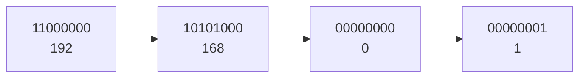

- **Públicas**: se usan en Internet.

- **Privadas**: solo dentro de casa/oficina. Las tres redes privadas típicas empiezan por **10.**, por **172.16.** a **172.31.** y por **192.168.**

La **máscara de red** separa la parte de **red** y la parte del **equipo**. La más común es `255.255.255.0`.

Con la **operación AND** (1 AND 1 = 1; el resto = 0) entre la IP y la máscara obtenemos la **dirección de red**:

```bash
IP:      192.168.0.1     → 11000000.10101000.00000000.00000001
Máscara: 255.255.255.0   → 11111111.11111111.11111111.00000000
AND                            → 11000000.10101000.00000000.00000000
Red:     192.168.0.0
```

En cada red, **dos direcciones no se asignan a equipos**: la **dirección de red** (la primera) y la de **broadcast** (la última, para hablar con todos a la vez). El resto son los **hosts**.

> **📌 Ejemplo con máscara 255.255.0.0**
> 

> IP `172.96.0.22`: red **172.96.0.0**, primer host **172.96.0.1**, broadcast **172.96.255.255**, último host asignable **172.96.255.254**.

### **IPv6 (128 bits)**

Se escribe en **8 grupos de 2 bytes**, en **hexadecimal**, separados por **dos puntos**.

```bash
2001:0DB8:0000:0000:4AC2:0000:B4EB:0FFA
```

Reglas para **abreviar**:

1. Quitar los **ceros a la izquierda** de cada grupo (`00D1` → `D1`).

1. Un grupo `0000` se escribe `0`.

1. Dos o más grupos de ceros seguidos se cambian por `::` (**solo una vez**).

Para adaptar una IPv4 se escriben los dos primeros bloques a cero y los dos últimos como la IPv4: `192.168.0.1` → `0:0:192.168.0.1` o `::192.168.0.1`.

> **📌 Para no confundir IPv4 e IPv6**
> 

|  | IPv4 | IPv6 |
| --- | --- | --- |
| Bits | 32 | 128 |
| Grupos | 4 bloques | 8 grupos |
| Separador | Puntos (**.**) | Dos puntos (**:**) |
| Formato | Decimal | Hexadecimal |

## **Lo importante**

1. Los **5 elementos** de la comunicación + ruido, protocolo e intérprete.

1. Saber **convertir** entre decimal, binario y hexadecimal.

1. Las **medidas** de información (bit → EB, ×1024, ×8 para bits).

1. **OSI = 7 capas**, **TCP/IP = 4 capas** y su correspondencia.

1. Diferencia **IP (lógica, cambia)** y **MAC (física, fija)**.

1. **IPv4** (32 bits, 4 bloques decimales) e **IPv6** (128 bits, 8 grupos hex).

1. La **máscara de red** y la operación **AND** para hallar la red de una IP.

> **📌 Para practicar**
> 

> Repasa con las **fichas de trabajo** (FICHA101 a FICHA104).

---

## ✏️ Actividades y Prácticas de la Unidad


---

### Ficha Práctica FICHA101 — 1.1 · Elementos de un sistema de comunicación

# **FICHA 1.1 · Elementos de un sistema de comunicación**

📥 Guardar como PDF
📄 Descargar Word

| Alumno/a | Grupo | Fecha |
| --- | --- | --- |
|  |  |  |

> **📌 ¿Qué repasamos?**
> 

> Todo sistema de comunicación necesita **cinco elementos**: un **emisor**, un **receptor**, un **mensaje**, un **canal** y un **código**. Además, el **ruido** intenta estropear la comunicación y el **protocolo** pone las normas.

## 1 · El proceso de comunicación

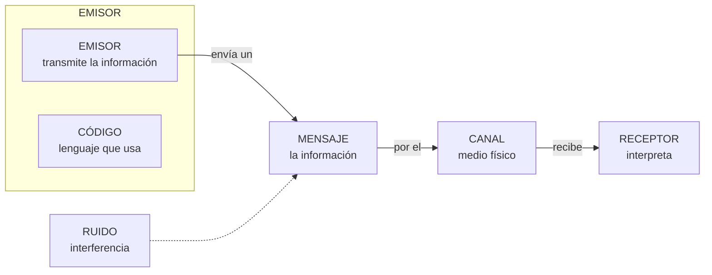

### Completa la tabla

| Elemento | ¿Qué es? | Ponlo con tus palabras |
| --- | --- | --- |
| **Emisor** | Entidad que transmite la información |  |
| **Receptor** | Entidad que recibe la información |  |
| **Mensaje** | Información que el emisor transmite al receptor |  |
| **Canal** | Medio por el que se transmite el mensaje |  |
| **Código** | Conjunto de signos, reglas y normas (lenguaje) |  |

## 2 · Identifica los elementos

Para cada situación, escribe el **emisor**, **receptor**, **mensaje**, **canal** y **código**:

| Situación | Emisor | Receptor | Mensaje | Canal | Código |
| --- | --- | --- | --- | --- | --- |
| Un conductor interpreta las señales de tráfico |  |  |  |  |  |
| Escuchas un podcast en Spotify |  |  |  |  |  |
| Haces una compra online |  |  |  |  |  |
| Un repartidor llama al cliente para avisarle de que llega su paquete |  |  |  |  |  |

## 3 · El ruido

El **ruido** es cualquier interferencia que contamina tanto el mensaje como el canal o el código.

1. Completa: "El ruido es cualquier ……………… que contamina el ………………, el ……………… o el ………………"

1. Pon un **ejemplo de ruido** para cada situación del ejercicio 2:

| Situación | ¿Qué ruido podría estropearla? |
| --- | --- |
| Conductor y señales de tráfico |  |
| Podcast en Spotify |  |
| Compra online |  |
| Llamada del repartidor |  |

## 4 · El protocolo de comunicación

1. 

Define con tus palabras qué es un **protocolo de comunicación**.

1. 

Marca **V** (verdadero) o **F** (falso):

| Afirmación | V/F |
| --- | --- |
| El protocolo determina cómo se inicia y finaliza la comunicación |  |
| El protocolo fija el idioma o nivel de lenguaje que se emplea |  |
| El protocolo tolera todo tipo de ruido sin importar su cantidad |  |
| El protocolo dice cómo actuar si la comunicación se interrumpe |  |

## 5 · Autoevaluación

Marca una casilla por fila para valorar cómo te sientes con cada idea:

| Concepto | Lo entiendo | Casi | Lo necesito repasar |
| --- | --- | --- | --- |
| Elementos de la comunicación |  |  |  |
| Identificar emisor, receptor, mensaje, canal y código |  |  |  |
| Ruido e interferencias |  |  |  |
| Protocolo de comunicación |  |  |  |

> **📌 Se valorará**
> 

> *La identificación correcta de los elementos de la comunicación en situaciones reales.
* La definición precisa de **ruido** y **protocolo**.
* La limpieza y claridad en las respuestas.

> Esta ficha te servirá para practicar el **CE5a** (describir los principios de funcionamiento de las redes locales) antes del **EXA101**.

---

### 💡 Solución y Criterios de Corrección (FICHA101)

<details markdown="1">
<summary>🔍 Ver solución paso a paso de FICHA101</summary>

# **FICHA 1.1 · Elementos de un sistema de comunicación**

Ficha en blanco: FICHA 1.1

📥 Guardar como PDF

## **1 · Completa la tabla**

| Elemento | ¿Qué es? | Ponlo con tus palabras (ejemplo) |
| --- | --- | --- |
| **Emisor** | Entidad que transmite la información | La persona o equipo que **manda** el mensaje (quien habla o envía) |
| **Receptor** | Entidad que recibe la información | La persona o equipo que **recibe e interpreta** el mensaje |
| **Mensaje** | Información que el emisor transmite al receptor | **Lo que se dice**: la noticia, la orden, el saludo… |
| **Canal** | Medio por el que se transmite el mensaje | El medio físico: **aire, cable, wifi, luz**… |
| **Código** | Conjunto de signos, reglas y normas (lenguaje) | El lenguaje: **idioma, señales, colores, emojis**… |

## **2 · Identifica los elementos**

| Situación | Emisor | Receptor | Mensaje | Canal | Código |
| --- | --- | --- | --- | --- | --- |
| Un conductor interpreta las señales de tráfico | La señal (o el organismo de tráfico) | El conductor | La indicación (peligro, prohibición…) | La luz de la señal, que viaja por el aire | El lenguaje de las señales (formas y colores) |
| Escuchas un podcast en Spotify | El creador del podcast | Tú | El contenido del episodio | Internet + la app Spotify (y los altavoces) | El idioma (habla, música) |
| Haces una compra online | Tú (el comprador) | La tienda online (su servidor) | Los datos del pedido (artículo, dirección, pago) | Internet (la web de la tienda) | El idioma y el formato del formulario |
| Un repartidor llama al cliente para avisarle de que llega su paquete | El repartidor | El cliente | El aviso de llegada (dirección, hora) | La red telefónica (el teléfono) | El idioma (castellano) |

## **3 · El ruido**

1. 

"El ruido es cualquier **interferencia** que contamina el **mensaje**, el **canal** o el **código**".

1. 

Ejemplos de ruido:

| Situación | ¿Qué ruido podría estropearla? |
| --- | --- |
| Conductor y señales de tráfico | La señal **sucia o tapada**, niebla, deslumbramiento del sol |
| Podcast en Spotify | **Cortes de conexión**, ruido de fondo en la grabación, anuncios |
| Compra online | **Caída de Internet**, la web que no carga, página lenta |
| Llamada del repartidor | **Mala cobertura**, ruido ambiental, interferencias de la línea |

## **4 · El protocolo de comunicación**

1. 

*Respuesta personal*: **conjunto de normas que rigen la comunicación**: cómo iniciar y finalizarla, qué nivel de lenguaje usar, cuánto ruido tolera y cómo actuar si se interrumpe.

1. 

Marca **V** o **F**:

| Afirmación | V/F |
| --- | --- |
| El protocolo determina cómo se inicia y finaliza la comunicación | **V** |
| El protocolo fija el idioma o nivel de lenguaje que se emplea | **V** |
| El protocolo tolera todo tipo de ruido sin importar su cantidad | **F** (solo tolera hasta un umbral) |
| El protocolo dice cómo actuar si la comunicación se interrumpe | **V** |

</details>

---

### Ficha Práctica FICHA102 — 1.2 · Representación de la información

# **FICHA 1.2 · Representación de la información**

📥 Guardar como PDF
📄 Descargar Word

| Alumno/a | Grupo | Fecha |
| --- | --- | --- |
|  |  |  |

> **📌 ¿Qué repasamos?**
> 

> La información viaja **codificada**. Los tres sistemas de codificación que manejamos son el **decimal**, el **binario** (ceros y unos, los famosos **bits**) y el **hexadecimal**. Aprender a traducir entre ellos es el objetivo de esta ficha.

## 1 · Los tres sistemas de codificación

| Sistema | Símbolos | ¿Quién lo usa? | Ejemplo |
| --- | --- | --- | --- |
| **Decimal** | 0 1 2 3 4 5 6 7 8 9 | Las personas | 125 |
| **Binario** | 0 1 | Los ordenadores | 1111101 |
| **Hexadecimal** | 0-9, A B C D E F | Intermedio decimal-binario | 7D |

> **📌 Aprende**
> 

> Cada **bit** vale 0 o 1. Al bit de la izquierda (más valor) se le llama **MSB** y al de la derecha (menos valor), **LSB**.


## 2 · Traducción decimal ↔ binario

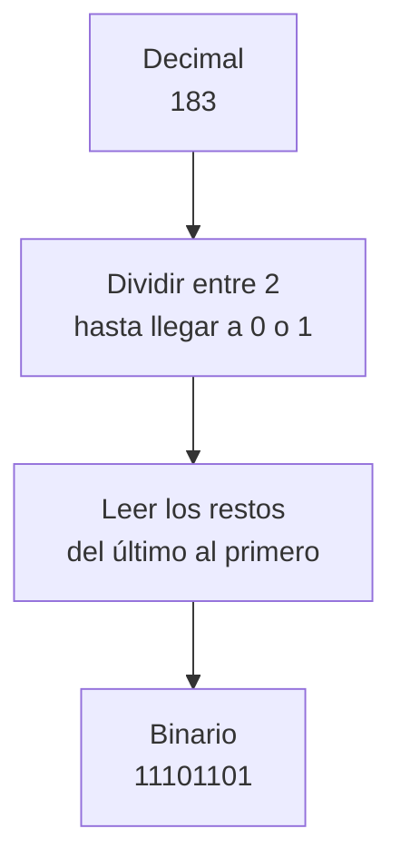

### 2.1 · Decimal → binario

| Decimal | Resolución (divisiones) | Resultado binario |
| --- | --- | --- |
| 10 |  |  |
| 25 |  |  |
| 183 |  |  |
| 200 |  |  |

### 2.2 · Binario → decimal

Recuerda: cada posición vale una potencia de 2: **1, 2, 4, 8, 16, 32, 64, 128…**

| Binario | Potencias que suman (ej.: 1010 = 8 + 2) | Decimal |
| --- | --- | --- |
| 1010 | 8 + 2 | 10 |
| 1101 |  |  |
| 100000 |  |  |
| 11111111 |  |  |

## 3 · Traducción hexadecimal ↔ binario

Cada cifra hexadecimal = **4 bits** (un cuarteto). Usa esta tabla como chuleta:

| Hex | Bin |  | Hex | Bin |
| --- | --- | --- | --- | --- |
| 0 | 0000 |  | 8 | 1000 |
| 1 | 0001 |  | 9 | 1001 |
| 2 | 0010 |  | A | 1010 |
| 3 | 0011 |  | B | 1011 |
| 4 | 0100 |  | C | 1100 |
| 5 | 0101 |  | D | 1101 |
| 6 | 0110 |  | E | 1110 |
| 7 | 0111 |  | F | 1111 |

### 3.1 · Hexadecimal → binario

| Hexadecimal | Cuartetos | Binario |
| --- | --- | --- |
| A5 | A=1010 · 5=0101 | 10100101 |
| 1F |  |  |
| B09 |  |  |

### 3.2 · Binario → hexadecimal

| Binario | Cuartetos (rellena ceros a la izquierda si falta) | Hexadecimal |
| --- | --- | --- |
| 10100101 | 1010 · 0101 | A5 |
| 1111011 |  |  |
| 10000001 |  |  |

## 4 · Medidas de información

Recuerda la escalera: para **bajar** una medida multiplica por 1024; para **subir**, divide entre 1024 (y entre 8 si vas a bits).

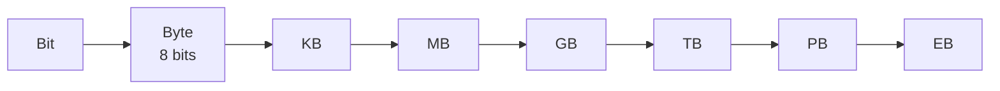

Completa las conversiones:

| Conversión | Resolución | Resultado |
| --- | --- | --- |
| 2 B → bits | 2 × 8 | 16 b |
| 1 GB → MB | 1 × 1024 |  |
| 60 KB → TB | 60 / 1024 / 1024 / 1024 |  |
| 4 MB → bits |  |  |

## 5 · Reto express

1. ¿Cuántos bits tiene que enciende la «forma» de escribir la letra **A** en binario `01000001`? Escribe su valor **decimal** y sus brillos en **hexadecimal**.

1. Ordena de menor a mayor: **1 GB**, **1024 KB**, **1024 MB**, **1 TB**.

> **📌 Se valorará**
> 

> - La correcta aplicación del algoritmo de **división sucesiva** (decimal → binario).

> - El uso de la **tabla de correspondencia** para los cuartetos hexadecimales.

> - La precisión en las conversiones de **medidas de información**.

> - La limpieza y el orden al resolver los ejercicios.

> Esta ficha te servirá para practicar el **CE5a** antes del **EXA101**.

---

### 💡 Solución y Criterios de Corrección (FICHA102)

<details markdown="1">
<summary>🔍 Ver solución paso a paso de FICHA102</summary>

# **FICHA 1.2 · Representación de la información**

Ficha en blanco: FICHA 1.2

📥 Guardar como PDF

## **1 · Los tres sistemas de codificación**

| Sistema | Símbolos | ¿Quién lo usa? | Ejemplo |
| --- | --- | --- | --- |
| **Decimal** | 0 1 2 3 4 5 6 7 8 9 | Las personas | 125 |
| **Binario** | 0 1 | Los ordenadores | 1111101 |
| **Hexadecimal** | 0-9, A B C D E F | Intermedio decimal-binario | 7D |

**MSB** = bit de la izquierda (más valor) · **LSB** = bit de la derecha (menos valor).

## **2 · Traducción decimal ↔ binario**

### **2.1 · Decimal → binario**

| Decimal | Resolución (divisiones) | Resultado binario |
| --- | --- | --- |
| 10 | 10÷2=5·0 ; 5÷2=2·1 ; 2÷2=1·0 ; 1÷2=0·1 | **1010** |
| 25 | 25÷2=12·1 ; 12÷2=6·0 ; 6÷2=3·0 ; 3÷2=1·1 ; 1÷2=0·1 | **11001** |
| 183 | 183÷2=91·1 ; 91÷2=45·1 ; 45÷2=22·1 ; 22÷2=11·0 ; 11÷2=5·1 ; 5÷2=2·1 ; 2÷2=1·0 ; 1÷2=0·1 | **10110111** |
| 200 | 200÷2=100·0 ; 100÷2=50·0 ; 50÷2=25·0 ; 25÷2=12·1 ; 12÷2=6·0 ; 6÷2=3·0 ; 3÷2=1·1 ; 1÷2=0·1 | **11001000** |

*Se leen los restos del último al primero.*

### **2.2 · Binario → decimal**

| Binario | Potencias que suman | Decimal |
| --- | --- | --- |
| 1010 | 8 + 2 | 10 |
| 1101 | 8 + 4 + 1 | **13** |
| 100000 | 32 | **32** |
| 11111111 | 128 + 64 + 32 + 16 + 8 + 4 + 2 + 1 | **255** |

## **3 · Traducción hexadecimal ↔ binario**

### **3.1 · Hexadecimal → binario**

| Hexadecimal | Cuartetos | Binario |
| --- | --- | --- |
| A5 | A=1010 · 5=0101 | 10100101 |
| 1F | 1=0001 · F=1111 | **00011111** |
| B09 | B=1011 · 0=0000 · 9=1001 | **101100001001** |

### **3.2 · Binario → hexadecimal**

| Binario | Cuartetos (rellena ceros a la izquierda si falta) | Hexadecimal |
| --- | --- | --- |
| 10100101 | 1010 · 0101 | A5 |
| 1111011 | 0001 · 1011 | **1B** |
| 10000001 | 1000 · 0001 | **81** |

## **4 · Medidas de información**

| Conversión | Resolución | Resultado |
| --- | --- | --- |
| 2 B → bits | 2 × 8 | 16 b |
| 1 GB → MB | 1 × 1024 | **1024 MB** |
| 60 KB → TB | 60 / 1024 / 1024 / 1024 | **≈ 0,0000000559 TB** |
| 4 MB → bits | 4 × 1024 × 1024 × 8 | **33 554 432 bits** |

## **5 · Reto express**

1. `01000001` tiene **8 bits** (un byte); en decimal es **65** y en hexadecimal **41**.

1. De menor a mayor: **1024 KB = 1 MB < 1024 MB = 1 GB < 1 TB** (los dos primeros son iguales, y los dos siguientes también).

</details>

---

### Ficha Práctica FICHA103 — 1.3 · Redes de comunicaciones: modelos OSI y TCP/IP

# **FICHA 1.3 · Redes de comunicaciones: modelos OSI y TCP/IP**

📥 Guardar como PDF
📄 Descargar Word

| Alumno/a | Grupo | Fecha |
| --- | --- | --- |
|  |  |  |

> **📌 ¿Qué repasamos?**
> 

> Una **red de comunicaciones** es un grupo de **dos o más equipos** que intercambian información. Esa información viaja troceada en **paquetes de datos** hechos de ceros y unos (los **bits**). Para que todos los equipos se entiendan, usamos unas normas llamadas **protocolos**. Y para organizarlos, existen dos modelos: **OSI** y **TCP/IP**.

## 1 · ¿Qué es una red de comunicaciones?

Una red de comunicaciones sirve para que los equipos se **intercambien información**. El equipo que envía es el **emisor**, el que recibe es el **receptor**, y entre ellos hay un **canal** (el cable o el wifi). Si algo estropea los datos, hay **ruido**.

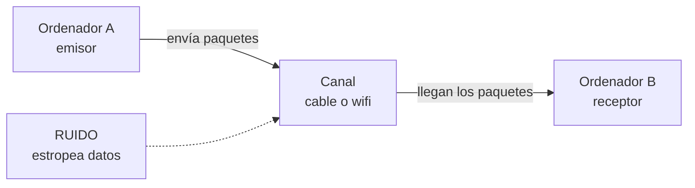

Completa las frases:

| Frase | Completa |
| --- | --- |
| Una red de comunicaciones sirve para ………… información entre varios equipos. |  |
| La información viaja troceada en ………… de datos. |  |
| Los paquetes están hechos de ceros y unos, llamados ………… |  |
| Las normas para que los equipos se entiendan se llaman ………… |  |
| El equipo que envía es el ………… y el que recibe es el ………… |  |

## 2 · El modelo OSI: las 7 capas

El modelo **OSI** organiza la comunicación en **7 capas** (como un edificio de 7 pisos). La información **sale** por la capa 7 (la de arriba) y **baja** hasta la capa 1 (la física); al llegar al otro equipo, hace el camino **inverso** (sube de la 1 a la 7).


Completa la tabla con la función de cada capa:

| Capa | Nombre | ¿Qué hace? |
| --- | --- | --- |
| 7 | Aplicación | Los programas que usas (web, correo, juegos). |
| 6 | Presentación | Traduce y comprime la información. |
| 5 | Sesión | Mantiene abierta la conversación. |
| 4 | Transporte | Trocea el mensaje y controla los errores (**TCP** y **UDP**). |
| 3 | Red | Pone la **dirección IP** y elige la mejor ruta. |
| 2 | Enlace de datos | Pone la **dirección MAC** de cada equipo. |
| 1 | Física | Envía los **bits** por el cable. |

> **📌 Aprende**
> 

> Para memorizar las 7 capas de arriba abajo usa esta frase:
**«A**las **P**ersonas **S**iempre **T**raen **R**opa **E**n **F**lores»** → **A**plicación, **P**resentación, **S**esión, **T**ransporte, **R**ed, **E**nlace, **F**ísica.

## 3 · El encapsulamiento: los sobres

Al **enviar**, cada capa **añade una pegatina** con información (como cuando metes un mensaje en varios sobres). Al **recibir**, se quitan los sobres uno a uno. A esto se le llama **encapsular** (poner sobres) y **desencapsular** (quitarlos).

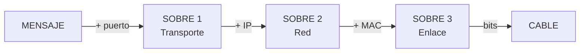

Completa: ¿qué sobre (pegatina) añade cada capa?

| Capa | Pegatina que añade |
| --- | --- |
| Transporte | Un número llamado ………… |
| Red | La dirección ………… (IP) |
| Enlace de datos | La dirección ………… (MAC) |
| Física | Todo se convierte en ………… que viajan por el cable |

## 4 · El modelo TCP/IP: 4 capas

El modelo **TCP/IP** es el que **se usa de verdad en Internet**. Tiene solo **4 capas**. Relaciona cada capa con las capas del modelo OSI que le corresponden (complétalo con números):

| Capa TCP/IP | ¿Qué hace? | Capa/s OSI que le corresponden |
| --- | --- | --- |
| 4 Aplicación | Los programas que usas (web, correo, WhatsApp). | Capa ………… (y 6 y 5) |
| 3 Transporte | Envía los trozos de punta a punta y controla errores (**TCP** y **UDP**). | Capa ………… |
| 2 Internet | Pone la **dirección IP** y elige la ruta. | Capa ………… |
| 1 Acceso a red | Usa el cable o el wifi (**Ethernet**). | Capas ………… y ………… |

> **📌 Aprende**
> 

> - **OSI** tiene **7 capas** y sirve para **aprender** cómo funciona la comunicación.

> - **TCP/IP** tiene **4 capas** y es el modelo que **utiliza Internet** en la práctica.

## 5 · Los protocolos que usas a diario

Los **protocolos** son las normas de cada capa. Cuando usas el móvil o el ordenador, están trabajando sin que te des cuenta. Escribe un ejemplo de uso cotidiano para cada uno:

| Protocolo | ¿Para qué sirve? | Ejemplo cotidiano |
| --- | --- | --- |
| HTTP / HTTPS | Ver páginas web. |  |
| DNS | Traduce los nombres (www.google.es) a direcciones IP. |  |
| SMTP / POP3 | Enviar y recibir correo electrónico. |  |
| FTP | Transferir archivos entre equipos. |  |
| IP | Le da una dirección única a cada equipo. |  |
| TCP | Envía los datos en orden y sin errores. |  |
| UDP | Envío rápido, muy usado para vídeo y llamadas. |  |

## 6 · Reto express

1. ¿Cuántas capas tiene el modelo **OSI**? ¿Y el modelo **TCP/IP**? ¿Cuál de los dos usa Internet de verdad?

1. Cuando un amigo te envía un **WhatsApp** y tú lo recibes, el mensaje ha bajado las 7 capas en el emisor y ha subido en el receptor. ¿Qué proceso es ese?

1. Une cada protocolo con su función:

  - **DNS** → Ver páginas web

  - **HTTP** → Traducir nombres a direcciones IP

  - **IP** → Enviar datos en orden y sin errores

  - **TCP** → Dar una dirección única a cada equipo

1. La **dirección MAC** está formada por **48 bits** separados en seis bloques. Escribe un ejemplo: `..:..:..:..:..:..`

> **📌 Se valorará**
> 

> - La comprensión de los modelos **OSI y TCP/IP** y de sus capas.

> - La correcta asociación entre **capas, protocolos y su función**.

> - La interpretación del **encapsulamiento** como el viaje del mensaje en sobres.

> - La limpieza y el orden al resolver los ejercicios.

> Esta ficha te servirá para practicar el **CE5a** antes del **EXA101**.

---

### 💡 Solución y Criterios de Corrección (FICHA103)

<details markdown="1">
<summary>🔍 Ver solución paso a paso de FICHA103</summary>

# **FICHA 1.3 · Redes de comunicaciones: modelos OSI y TCP/IP**

Ficha en blanco: FICHA 1.3

📥 Guardar como PDF

## **1 · ¿Qué es una red de comunicaciones?**

| Frase | Completa |
| --- | --- |
| Una red de comunicaciones sirve para **intercambiar** información entre varios equipos. |  |
| La información viaja troceada en **paquetes** de datos. |  |
| Los paquetes están hechos de ceros y unos, llamados **bits**. |  |
| Las normas para que los equipos se entiendan se llaman **protocolos**. |  |
| El equipo que envía es el **emisor** y el que recibe es el **receptor**. |  |

## **2 · El modelo OSI: las 7 capas**

| Capa | Nombre | ¿Qué hace? |
| --- | --- | --- |
| 7 | **Aplicación** | Los programas que usas (web, correo, juegos). |
| 6 | **Presentación** | Traduce y comprime la información. |
| 5 | **Sesión** | Mantiene abierta la conversación. |
| 4 | **Transporte** | Trocea el mensaje y controla errores (TCP y UDP). |
| 3 | **Red** | Pone la dirección IP y elige la mejor ruta. |
| 2 | **Enlace de datos** | Pone la dirección MAC de cada equipo. |
| 1 | **Física** | Envía los bits por el cable. |

Mnemotecnia: **«A**las **P**ersonas **S**iempre **T**raen **R**opa **E**n **F**lores».

## **3 · El encapsulamiento: los sobres**

| Capa | Pegatina que añade |
| --- | --- |
| Transporte | Un número llamado **puerto** |
| Red | La dirección **IP** |
| Enlace de datos | La dirección **MAC** |
| Física | Todo se convierte en **bits** que viajan por el cable |

## **4 · El modelo TCP/IP: 4 capas**

| Capa TCP/IP | ¿Qué hace? | Capa/s OSI que le corresponden |
| --- | --- | --- |
| 4 Aplicación | Los programas que usas (web, correo, WhatsApp). | Capa **7** (y 6 y 5) |
| 3 Transporte | Envía los trozos de punta a punta y controla errores (TCP y UDP). | Capa **4** |
| 2 Internet | Pone la dirección IP y elige la ruta. | Capa **3** |
| 1 Acceso a red | Usa el cable o el wifi (Ethernet). | Capas **2** y **1** |

## **5 · Los protocolos que usas a diario**

| Protocolo | ¿Para qué sirve? | Ejemplo cotidiano |
| --- | --- | --- |
| HTTP / HTTPS | Ver páginas web. | Abrir google.es o YouTube (HTTPS cifra los datos) |
| DNS | Traduce los nombres a direcciones IP. | Escribes www.google.es y el DNS la convierte en IP |
| SMTP / POP3 | Enviar y recibir correo electrónico. | Enviar un correo y recibirlo en el móvil |
| FTP | Transferir archivos entre equipos. | Subir los apuntes al servidor del instituto |
| IP | Le da una dirección única a cada equipo. | Tu equipo con 192.168.1.25 dentro de la red |
| TCP | Envía los datos en orden y sin errores. | Descargar un archivo completo y sin fallos |
| UDP | Envío rápido, muy usado para vídeo y llamadas. | Una videollamada o streaming de vídeo |

## **6 · Reto express**

1. **OSI** tiene **7** capas; **TCP/IP** tiene **4**; Internet usa de verdad **TCP/IP**.

1. El proceso se llama **encapsulamiento** (al enviar) y **desencapsulamiento** (al recibir).

1. Correcciones de las parejas:

  - **DNS** → Traducir nombres a direcciones IP

  - **HTTP** → Ver páginas web

  - **IP** → Dar una dirección única a cada equipo y elegir la ruta

  - **TCP** → Enviar datos en orden y sin errores

1. Ejemplo de dirección MAC (6 bloques hexadecimales): `00:E0:7D:F9:EA:6D` *(cualquier ejemplo de 48 bits vale)*.

</details>

---

### Ficha Práctica FICHA104 — 1.4 · La dirección IP: IPv4 e IPv6

# **FICHA 1.4 · La dirección IP: IPv4 e IPv6**

📥 Guardar como PDF
📄 Descargar Word

| Alumno/a | Grupo | Fecha |
| --- | --- | --- |
|  |  |  |

> **📌 ¿Qué repasamos?**
> 

> Cada equipo de una red tiene **dos direcciones**: la **MAC** (física, no cambia) y la **IP** (lógica, puede cambiar). Existen dos versiones del protocolo IP: **IPv4** (32 bits) e **IPv6** (128 bits). En esta ficha aprenderás a distinguirlas y a leerlas.

## 1 · Dos direcciones: ¿cuál es cuál?

Cuando enviamos una carta por correo, necesitamos saber **dónde vive** la persona y **quién es**. En una red pasa igual: la **dirección IP** es la dirección de la casa y la **dirección MAC** es el nombre del destinatario.

| Dirección IP | Dirección MAC |
| --- | --- |
| Como la **dirección de una casa** | Como el **nombre del destinatario** |
| Es **lógica**: cambia según la red | Es **física**: viene en la tarjeta |
| Puede ser **estática** (fija) o **dinámica** (cambia) | Nunca cambia |

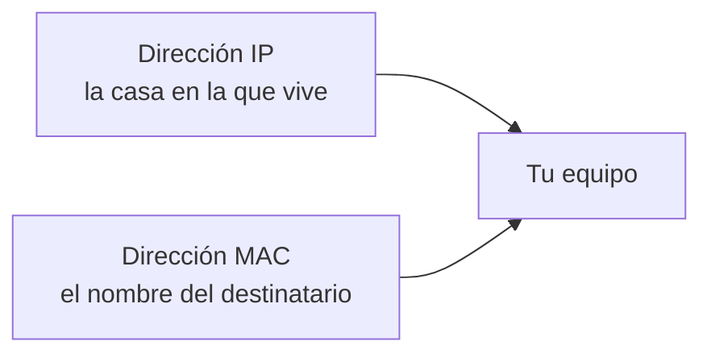

Completa la tabla escribiendo **IP** o **MAC**:

| Frase | ¿IP o MAC? |
| --- | --- |
| Es fija y no cambia nunca. |  |
| Es lógica y la asigna la red en cada momento. |  |
| Tiene **48 bits** separados en seis bloques. |  |
| Puede ser estática o dinámica. |  |
| Identifica la tarjeta de red de forma unívoca. |  |

## 2 · La dirección IPv4

La dirección **IPv4** tiene **32 bits** y se escribe en **4 bloques de 8 bits** (un byte cada uno) en formato **decimal**, separados por puntos. Cada bloque puede valer de **0 a 255**.


Completa:

| Pregunta | Completa |
| --- | --- |
| ¿Cuántos bits tiene una dirección IPv4? | ………… bits |
| ¿En cuántos bloques se escriben? | ………… bloques |
| ¿Con qué signo se separan los bloques? | Con ………… |
| ¿En qué formato se escribe cada bloque? | ………… (decimal o binario) |
| ¿Cuánto vale el bloque más alto? | Hasta el ………… |

Hay direcciones IP que **no se pueden usar en Internet** porque son **privadas** (solo valen dentro de casa o del instituto). Escribe si cada dirección es **pública** o **privada**:

| Dirección | ¿Pública o privada? |
| --- | --- |
| 192.168.1.10 |  |
| 10.0.0.25 |  |
| 8.8.8.8 |  |
| 172.20.3.5 |  |
| 150.214.12.8 |  |

> **📌 Aprende**
> 

> Las tres redes **privadas** más típicas son las que empiezan por **10.**, por **172.16.** a **172.31.** y por **192.168.**

## 3 · La máscara de red

La **máscara de red** acompaña a la dirección IP y sirve para saber qué parte de la dirección identifica a la **red** y qué parte al **equipo** (host). La más común es `255.255.255.0`.

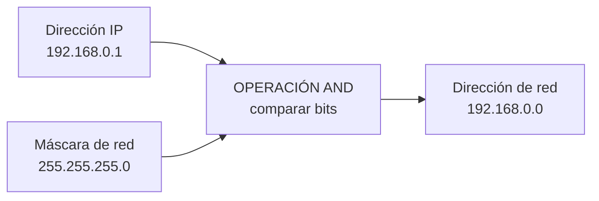

> **📌 Aprende**
> 

> La operación **AND** compara los bits de la IP con los de la máscara:
**1 AND 1 = 1** · **1 AND 0 = 0** · **0 AND 0 = 0**

Dentro de una red, **dos direcciones no se pueden asignar a equipos**. Une cada una con su nombre:

| Dirección | Nombre |
| --- | --- |
| 192.168.0.0 | Dirección de ………… (red) |
| 192.168.0.255 | Dirección de ………… (broadcast) |
| De 192.168.0.1 a 192.168.0.254 | Direcciones para los ………… (hosts) |

## 4 · La dirección IPv6

La dirección **IPv6** tiene **128 bits** y se escribe en **8 grupos de 2 bytes**, separados por dos puntos (**:**), en formato **hexadecimal**.

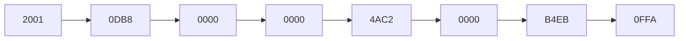

Para abreviarla se siguen estas reglas:
1. Se pueden quitar los **ceros a la izquierda** de cada grupo: `00D1` → `D1`.
2. Un grupo `0000` se puede escribir como `0`.
3. Si hay **dos o más grupos con ceros seguidos**, se sustituyen por `::` (solo **una vez** por dirección).

Completa:

| Pregunta | Completa |
| --- | --- |
| ¿Cuántos bits tiene una dirección IPv6? | ………… bits |
| ¿En cuántos grupos de 2 bytes se escribe? | ………… grupos |
| ¿Con qué carácter se separan los grupos? | Con ………… |
| ¿En qué formato se escriben? | ………… (hexadecimal) |

Abrevia estas direcciones IPv6:

- `2000:0011:3D4A:0055:0000:0000:2F01:5432` → `2000:11:3D4A:55:…:2F01:5432` (escribe el `::`)

- `7144:0000:A101:0000:0000:0000:31BB:4A23` → `…`

## 5 · Reto express

1. ¿Cuántos bits tiene **IPv4**? ¿Y **IPv6**? ¿Cuál de las dos ofrece más direcciones?

1. La IP de la impresora del instituto **no cambia nunca**: es ……… (estática o dinámica). La IP del móvil en casa **cambia cada día**: es ………

1. Marca **V** (verdadero) o **F** (falso):

| Afirmación | V/F |
| --- | --- |
| La dirección MAC es fija e identifica la tarjeta de red. |  |
| La dirección IP puede cambiar según la red en la que esté el equipo. |  |
| `192.168.1.10` es una dirección pública. |  |
| La máscara de red separa la parte de red de la parte del host. |  |
| En IPv4 cada bloque se escribe en hexadecimal. |  |

1. Escribe tu dirección IPv4 y tu dirección MAC en este hueco (puedes usar `ipconfig /all` en el símbolo del sistema):

1. IPv4: `…`

1. MAC: `…`

> **📌 Se valorará**
> 

> - La distinción correcta entre **dirección IP** y **dirección MAC**.

> - La correcta lectura de las direcciones **IPv4 e IPv6**.

> - La aplicación de la **máscara de red** y la operación **AND**.

> - La limpieza y el orden al resolver los ejercicios.

> Esta ficha te servirá para practicar el **CE5a** antes del **EXA101**.

---

### 💡 Solución y Criterios de Corrección (FICHA104)

<details markdown="1">
<summary>🔍 Ver solución paso a paso de FICHA104</summary>

# **FICHA 1.4 · La dirección IP: IPv4 e IPv6**

Ficha en blanco: FICHA 1.4

📥 Guardar como PDF

## **1 · Dos direcciones: ¿cuál es cuál?**

| Frase | ¿IP o MAC? |
| --- | --- |
| Es fija y no cambia nunca. | **MAC** |
| Es lógica y la asigna la red en cada momento. | **IP** |
| Tiene 48 bits separados en seis bloques. | **MAC** |
| Puede ser estática (fija) o dinámica (cambia). | **IP** |
| Identifica la tarjeta de red de forma unívoca. | **MAC** |

## **2 · La dirección IPv4**

| Pregunta | Completa |
| --- | --- |
| ¿Cuántos bits tiene una dirección IPv4? | **32** bits |
| ¿En cuántos bloques se escriben? | **4** bloques |
| ¿Con qué signo se separan los bloques? | Con **puntos (.)** |
| ¿En qué formato se escribe cada bloque? | **decimal** |
| ¿Cuánto vale el bloque más alto? | Hasta el **255** |

| Dirección | ¿Pública o privada? |
| --- | --- |
| 192.168.1.10 | **Privada** |
| 10.0.0.25 | **Privada** |
| 8.8.8.8 | **Pública** |
| 172.20.3.5 | **Privada** (entre 172.16 y 172.31) |
| 150.214.12.8 | **Pública** |

## **3 · La máscara de red**

| Dirección | Nombre |
| --- | --- |
| 192.168.0.0 | Dirección de **red** |
| 192.168.0.255 | Dirección de **broadcast** |
| De 192.168.0.1 a 192.168.0.254 | Direcciones para los **hosts** |

## **4 · La dirección IPv6**

| Pregunta | Completa |
| --- | --- |
| ¿Cuántos bits tiene una dirección IPv6? | **128** bits |
| ¿En cuántos grupos de 2 bytes se escribe? | **8** grupos |
| ¿Con qué carácter se separan los grupos? | Con **dos puntos (:)** |
| ¿En qué formato se escriben? | **hexadecimal** |

Abreviaciones:

- `2000:0011:3D4A:0055:0000:0000:2F01:5432` → `2000:11:3D4A:55:…:2F01:5432` → **`2000:11:3D4A:55::2F01:5432`**

- `7144:0000:A101:0000:0000:0000:31BB:4A23` → **`7144:0:A101::31BB:4A23`**

## **5 · Reto express**

1. **IPv4** tiene **32 bits**; **IPv6** tiene **128 bits**; ofrece más direcciones **IPv6**.

1. 

La IP de la impresora es **estática**; la IP del móvil en casa es **dinámica**.

1. 

Marca **V** o **F**:

| Afirmación | V/F |
| --- | --- |
| La dirección MAC es fija e identifica la tarjeta de red. | **V** |
| La dirección IP puede cambiar según la red en la que esté el equipo. | **V** |
| `192.168.1.10` es una dirección pública. | **F** (es privada) |
| La máscara de red separa la parte de red de la parte del host. | **V** |
| En IPv4 cada bloque se escribe en hexadecimal. | **F** (en decimal) |

1. *Respuesta personal*: usa `ipconfig /all` (Windows) o `ifconfig` / `ip a` (Linux/macOS) para copiar tu **IPv4** y tu **MAC**.

</details>

---

### Actividad de Repaso REP101 — REPASO 1.1 · Elementos de un sistema de comunicación

# **FICHA REPASO 1.1 · Elementos de un sistema de comunicación**

📥 Guardar como PDF
📄 Descargar Word

| Alumno/a | Grupo | Fecha |
| --- | --- | --- |
|  |  |  |

> **📌 ¿Qué repasamos?**
> 

> Repaso de la **FICHA 1.1**: todo sistema de comunicación necesita **cinco elementos** (**emisor**, **receptor**, **mensaje**, **canal** y **código**); el **ruido** intenta estropearla, el **protocolo** la ordena con normas y el **intérprete** traduce cuando los códigos no coinciden.

## 1 · Lo esencial, en una tabla

Completa la columna derecha:

| Concepto | Completa con tus palabras |
| --- | --- |
| **Emisor** | Entidad que ………… la información |
| **Receptor** | Entidad que ………… la información |
| **Mensaje** | ………… que el emisor transmite al receptor |
| **Canal** | ………… por el que viaja el mensaje |
| **Código** | Conjunto de signos, reglas y ………… (lenguaje) |
| **Ruido** | Cualquier ………… que contamina el mensaje, el canal o el código |
| **Protocolo** | Conjunto de ………… que rigen la comunicación |
| **Intérprete** | Elemento que ………… entre códigos distintos (módem, router…) |

## 2 · El proceso de comunicación

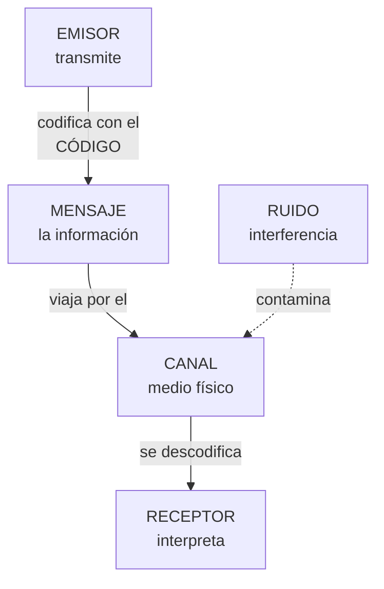

Completa el recorrido del mensaje:

| Pasos del proceso | Completa |
| --- | --- |
| El ………… codifica y envía el mensaje |  |
| El mensaje viaja por el ………… |  |
| El ………… recibe e interpreta el mensaje |  |
| Si los códigos no coinciden, actúa el ………… |  |
| Si hay interferencias, decimos que hay ………… |  |

## 3 · Identifica los elementos

Para cada situación, escribe el **emisor**, **receptor**, **mensaje**, **canal** y **código**:

| Situación | Emisor | Receptor | Mensaje | Canal | Código |
| --- | --- | --- | --- | --- | --- |
| Tu profesor explica en la pizarra y tú tomas apuntes |  |  |  |  |  |
| Ves las noticias en la televisión |  |  |  |  |  |
| Mandas un mensaje de voz por WhatsApp a un amigo |  |  |  |  |  |
| El semáforo se pone en rojo y los coches se detienen |  |  |  |  |  |

## 4 · Ruido y protocolo

1. Marca **V** (verdadero) o **F** (falso):

| Afirmación | V/F |
| --- | --- |
| El ruido puede contaminar el mensaje, el canal o el código |  |
| Si el ruido supera un umbral, la información puede no llegar completa |  |
| El protocolo indica cómo iniciar y finalizar la comunicación |  |
| El protocolo fija el nivel de lenguaje y la tolerancia a los fallos |  |
| El intérprete hace falta cuando emisor y receptor usan el mismo código |  |

1. Escribe un **ejemplo de ruido** para cada situación:

| Situación | ¿Qué ruido podría estropearla? |
| --- | --- |
| Explicación del profesor |  |
| Noticias en la televisión |  |
| Mensaje de voz por WhatsApp |  |
| Semáforo en rojo |  |

## 5 · Autoevaluación

Marca una casilla por fila para valorar cómo te sientes con cada idea:

| Concepto | Lo entiendo | Casi | Lo necesito repasar |
| --- | --- | --- | --- |
| Los 5 elementos de la comunicación |  |  |  |
| Ruido, protocolo e intérprete |  |  |  |
| Identificar los elementos en situaciones reales |  |  |  |
| El proceso de comunicación completo |  |  |  |

> **📌 Se valorará**
> 

> - La identificación correcta de los elementos de la comunicación en situaciones nuevas.

> - La definición precisa de **ruido**, **protocolo** e **intérprete**.

> - La limpieza y claridad en las respuestas.

> Esta ficha te servirá para repasar el **CE5a** antes del **EXA101**.

---

### 💡 Solución y Criterios de Corrección (REP101)

<details markdown="1">
<summary>🔍 Ver solución paso a paso de REP101</summary>

# **REPASO 1.1 · Elementos de un sistema de comunicación**

Ficha en blanco: Repaso 1.1

📥 Guardar como PDF

## **1 · Lo esencial, en una tabla**

| Concepto | Completa con tus palabras |
| --- | --- |
| **Emisor** | Entidad que **transmite** la información |
| **Receptor** | Entidad que **recibe** la información |
| **Mensaje** | **La información** que el emisor transmite al receptor |
| **Canal** | **El medio físico** por el que viaja el mensaje |
| **Código** | Conjunto de signos, reglas y **normas** (lenguaje) |
| **Ruido** | Cualquier **interferencia** que contamina el mensaje, el canal o el código |
| **Protocolo** | Conjunto de **normas** que rigen la comunicación |
| **Intérprete** | Elemento que **traduce** entre códigos distintos (módem, router…) |

## **2 · El proceso de comunicación**

| Pasos del proceso | Completa |
| --- | --- |
| El **emisor** codifica y envía el mensaje |  |
| El mensaje viaja por el **canal** |  |
| El **receptor** recibe e interpreta el mensaje |  |
| Si los códigos no coinciden, actúa el **intérprete** |  |
| Si hay interferencias, decimos que hay **ruido** |  |

## **3 · Identifica los elementos**

| Situación | Emisor | Receptor | Mensaje | Canal | Código |
| --- | --- | --- | --- | --- | --- |
| Tu profesor explica en la pizarra y tú tomas apuntes | El profesor | Los alumnos (tú) | La explicación | El aire (el sonido) y la pizarra | El idioma y la grafía |
| Ves las noticias en la televisión | Los periodistas / la cadena | Tú (espectador) | La información de actualidad | La señal de TV hasta tu tele | El idioma, imágenes y gráficos |
| Mandas un mensaje de voz por WhatsApp a un amigo | Tú | Tu amigo | Lo que dices en el audio | Internet + la app WhatsApp | El idioma (habla) |
| El semáforo se pone en rojo y los coches se detienen | El semáforo | Los conductores | «Detente» | La luz | El convenio de colores (rojo = parar) |

## **4 · Ruido y protocolo**

1. Marca **V** o **F**:

| Afirmación | V/F |
| --- | --- |
| El ruido puede contaminar el mensaje, el canal o el código | **V** |
| Si el ruido supera un umbral, la información puede no llegar completa | **V** |
| El protocolo indica cómo iniciar y finalizar la comunicación | **V** |
| El protocolo fija el nivel de lenguaje y la tolerancia a los fallos | **V** |
| El intérprete hace falta cuando emisor y receptor usan el mismo código | **F** (solo hace falta si los códigos son distintos) |

1. Ejemplos de ruido:

| Situación | ¿Qué ruido podría estropearla? |
| --- | --- |
| Explicación del profesor | Ruido de la clase: conversaciones, pasillos, móviles sonando |
| Noticias en la televisión | Imagen pixelada, cortes de señal, estática |
| Mensaje de voz por WhatsApp | Mala conexión, viento, ruido de la calle |
| Semáforo en rojo | Suciedad o niebla que tapa la luz, bombilla fundida |

## **5 · Autoevaluación**

Es una **valoración personal**: marca la casilla honestamente según cómo te haya ido al resolverla.

</details>

---

### Actividad de Repaso REP102 — REPASO 1.2 · Representación de la información

# **FICHA REPASO 1.2 · Representación de la información**

📥 Guardar como PDF
📄 Descargar Word

| Alumno/a | Grupo | Fecha |
| --- | --- | --- |
|  |  |  |

> **📌 ¿Qué repasamos?**
> 

> Repaso de la **FICHA 1.2**: la información viaja **codificada** en **decimal**, **binario** (ceros y unos, **bits**) o **hexadecimal**. Saber traducir entre ellos y moverte por la escalera de **medidas de información** es el objetivo de esta ficha.

## 1 · Los tres sistemas de codificación

Completa la tabla:

| Sistema | Símbolos | ¿Quién lo usa? | Ejemplo |
| --- | --- | --- | --- |
| **Decimal** | ………… | Las personas | 125 |
| **Binario** | ………… | ………… | 1111101 |
| **Hexadecimal** | 0-9 y ………… | Intermedio decimal-binario | 7D |

> **📌 Aprende**
> 

> Cada **bit** vale 0 o 1. Al bit de la **izquierda** (más valor) se le llama **MSB** y al de la **derecha** (menos valor), **LSB**. Cada posición vale el doble que la anterior: **1, 2, 4, 8, 16, 32, 64, 128…**

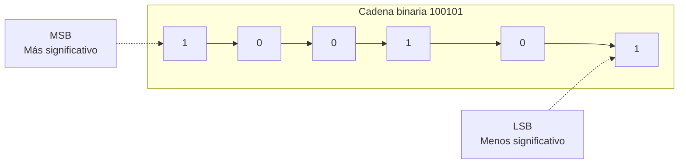

## 2 · Traducción decimal ↔ binario

### 2.1 · Decimal → binario (divisiones entre 2)

| Decimal | Resolución (divisiones) | Resultado binario |
| --- | --- | --- |
| 45 |  |  |
| 100 |  |  |
| 128 |  |  |
| 255 |  |  |

### 2.2 · Binario → decimal (sumas de potencias de 2)

| Binario | Potencias que suman | Decimal |
| --- | --- | --- |
| 110010 | 32 + 16 + 2 | 50 |
| 10111111 |  |  |
| 11100000 |  |  |
| 10101010 |  |  |

## 3 · Traducción hexadecimal ↔ binario

Recuerda: cada cifra hexadecimal = **4 bits** (un cuarteto) y dentro del cuarteto los bits valen **8 · 4 · 2 · 1**.

### 3.1 · Hexadecimal → binario

| Hexadecimal | Cuartetos | Binario |
| --- | --- | --- |
| 3C | 3=0011 · C=1100 | 00111100 |
| 9E |  |  |
| 2A |  |  |

### 3.2 · Binario → hexadecimal

| Binario | Cuartetos (rellena ceros a la izquierda si falta) | Hexadecimal |
| --- | --- | --- |
| 01011010 | 0101 · 1010 | 5A |
| 11110000 |  |  |
| 110111 |  |  |

## 4 · Medidas de información

Recuerda la escalera: para **bajar** de unidad divide entre 1024; para **subir**, multiplica por 1024 (y por 8 si vas a bits).


Completa las conversiones:

| Conversión | Resolución | Resultado |
| --- | --- | --- |
| 8 B → bits | 8 × 8 | 64 b |
| 3 GB → MB | 3 × 1024 |  |
| 512 MB → KB | 512 × 1024 |  |
| 1 TB → GB | 1 × 1024 |  |

## 5 · Reto express

1. El byte `01000010` codifica una letra: escribe su valor **decimal** y su valor en **hexadecimal**.

1. Ordena de menor a mayor: **1 GB**, **512 KB**, **2 MB**, **1 MB**.

1. Marca **V** (verdadero) o **F** (falso):

| Afirmación | V/F |
| --- | --- |
| El bit de la derecha es el LSB |  |
| 1 KB = 1024 B |  |
| El hexadecimal usa las letras de la A a la G |  |
| 4 MB = 4 × 1024 bits |  |

> **📌 Se valorará**
> 

> - La correcta aplicación del algoritmo de **división sucesiva** (decimal → binario).

> - El uso de los **cuartetos** (8-4-2-1) para el hexadecimal.

> - La precisión en las conversiones de **medidas de información**.

> - La limpieza y el orden al resolver los ejercicios.

> Esta ficha te servirá para repasar el **CE5a** antes del **EXA101**.

---

### 💡 Solución y Criterios de Corrección (REP102)

<details markdown="1">
<summary>🔍 Ver solución paso a paso de REP102</summary>

# Repaso 1.02 Resuelta

## REPASO 1.2 · Representación de la información

Ficha en blanco: Repaso 1.2

📥 Guardar como PDF

## **1 · Los tres sistemas de codificación**

| Sistema | Símbolos | ¿Quién lo usa? | Ejemplo |
| --- | --- | --- | --- |
| **Decimal** | **0 1 2 3 4 5 6 7 8 9** | Las personas | 125 |
| **Binario** | **0 1** | **Los ordenadores** | 1111101 |
| **Hexadecimal** | 0-9 y **A B C D E F** | Intermedio decimal-binario | 7D |

## **2 · Traducción decimal ↔ binario**

### **2.1 · Decimal → binario**

| Decimal | Resolución (divisiones) | Resultado binario |
| --- | --- | --- |
| 45 | 45÷2=22·1 ; 22÷2=11·0 ; 11÷2=5·1 ; 5÷2=2·1 ; 2÷2=1·0 ; 1÷2=0·1 | **101101** |
| 100 | 100÷2=50·0 ; 50÷2=25·0 ; 25÷2=12·1 ; 12÷2=6·0 ; 6÷2=3·0 ; 3÷2=1·1 ; 1÷2=0·1 | **1100100** |
| 128 | 128÷2=64·0 ; 64÷2=32·0 ; 32÷2=16·0 ; 16÷2=8·0 ; 8÷2=4·0 ; 4÷2=2·0 ; 2÷2=1·0 ; 1÷2=0·1 | **10000000** |
| 255 | 255÷2=127·1 ; 127÷2=63·1 ; 63÷2=31·1 ; 31÷2=15·1 ; 15÷2=7·1 ; 7÷2=3·1 ; 3÷2=1·1 ; 1÷2=0·1 | **11111111** |

### **2.2 · Binario → decimal**

| Binario | Potencias que suman | Decimal |
| --- | --- | --- |
| 110010 | 32 + 16 + 2 | 50 |
| 10111111 | 128 + 32 + 16 + 8 + 4 + 2 + 1 | **191** |
| 11100000 | 128 + 64 + 32 | **224** |
| 10101010 | 128 + 32 + 8 + 2 | **170** |

## **3 · Traducción hexadecimal ↔ binario**

### **3.1 · Hexadecimal → binario**

| Hexadecimal | Cuartetos | Binario |
| --- | --- | --- |
| 3C | 3=0011 · C=1100 | 00111100 |
| 9E | 9=1001 · E=1110 | **10011110** |
| 2A | 2=0010 · A=1010 | **00101010** |

### **3.2 · Binario → hexadecimal**

| Binario | Cuartetos (rellena ceros a la izquierda si falta) | Hexadecimal |
| --- | --- | --- |
| 01011010 | 0101 · 1010 | 5A |
| 11110000 | 1111 · 0000 | **F0** |
| 110111 | 0011 · 0111 | **37** |

## **4 · Medidas de información**

| Conversión | Resolución | Resultado |
| --- | --- | --- |
| 8 B → bits | 8 × 8 | 64 b |
| 3 GB → MB | 3 × 1024 | **3072 MB** |
| 512 MB → KB | 512 × 1024 | **524 288 KB** |
| 1 TB → GB | 1 × 1024 | **1024 GB** |

## **5 · Reto express**

1. `01000010` → decimal **66** (64 + 2) y hexadecimal **42**.

1. De menor a mayor: **512 KB < 1 MB < 2 MB < 1 GB**.

1. Marca **V** o **F**:

| Afirmación | V/F |
| --- | --- |
| El bit de la derecha es el LSB | **V** |
| 1 KB = 1024 B | **V** |
| El hexadecimal usa las letras de la A a la G | **F** (usa de la **A a la F**) |
| 4 MB = 4 × 1024 bits | **F** (4 MB = 4 × 1024 × 1024 × 8 bits) |

</details>

---

### Actividad de Repaso REP103 — REPASO 1.3 · Redes de comunicaciones: modelos OSI y TCP/IP

# **FICHA REPASO 1.3 · Redes de comunicaciones: modelos OSI y TCP/IP**

📥 Guardar como PDF
📄 Descargar Word

| Alumno/a | Grupo | Fecha |
| --- | --- | --- |
|  |  |  |

> **📌 ¿Qué repasamos?**
> 

> Repaso de la **FICHA 1.3**: una **red** son **dos o más equipos** intercambiando información en **paquetes** de **bits**, regidos por **protocolos**. El modelo **OSI** la organiza en **7 capas** y el modelo **TCP/IP** (el de Internet) en **4**.

## 1 · ¿Qué es una red de comunicaciones?


Completa las frases:

| Frase | Completa |
| --- | --- |
| Una red de comunicaciones sirve para ………… información entre varios equipos. |  |
| La información viaja troceada en ………… de datos. |  |
| Los paquetes están hechos de ceros y unos, llamados ………… |  |
| Las normas para que los equipos se entiendan se llaman ………… |  |
| El equipo que envía es el ………… y el que recibe es el ………… |  |

## 2 · El modelo OSI: las 7 capas

La información **sale** por la capa 7 y **baja** hasta la capa 1; al llegar al otro equipo hace el camino **inverso** (sube de la 1 a la 7).

```mermaid
flowchart TB
    C7["7 Aplicación"] --> C6["6 Presentación"] --> C5["5 Sesión"] --> C4["4 Transporte"] --> C3["3 Red"] --> C2["2 Enlace"] --> C1["1 Física"]
```

Escribe el **nombre** de cada capa a partir de lo que hace:

| Capa | ¿Qué hace? | Nombre |
| --- | --- | --- |
| 7 | Los programas que usas (web, correo, juegos). | ………… |
| 6 | Traduce y comprime la información. | ………… |
| 5 | Mantiene abierta la conversación. | ………… |
| 4 | Trocea el mensaje y controla errores (TCP y UDP). | ………… |
| 3 | Pone la dirección IP y elige la mejor ruta. | ………… |
| 2 | Pone la dirección MAC de cada equipo. | ………… |
| 1 | Envía los bits por el cable. | ………… |

> **📌 Aprende**
> 

> Para memorizarlas de arriba abajo: **«A**las **P**ersonas **S**iempre **T**raen **R**opa **E**n **F**lores» → **A**plicación, **P**resentación, **S**esión, **T**ransporte, **R**ed, **E**nlace, **F**ísica.

## 3 · El encapsulamiento: los sobres

Al **enviar**, cada capa añade una pegatina (**encapsular**); al **recibir**, se quitan los sobres (**desencapsular**).


Escribe el recorrido de fuera hacia dentro (de la capa más alta a la física):

| Orden | Sobre (pegatina) que se añade |
| --- | --- |
| 1.er sobre | ………… (Transporte) → añade un número llamado ………… |
| 2.º sobre | ………… (Red) → añade la dirección ………… |
| 3.er sobre | ………… (Enlace) → añade la dirección ………… |
| Último paso | La capa ………… convierte todo en ………… que viajan por el cable |

## 4 · El modelo TCP/IP: 4 capas

El modelo **TCP/IP** es el que **se usa de verdad en Internet**. Relaciona cada capa con las capas OSI que le corresponden (completa con números):

| Capa TCP/IP | ¿Qué hace? | Capa/s OSI que le corresponden |
| --- | --- | --- |
| 4 Aplicación | Los programas que usas (web, correo, WhatsApp). | Capa ………… (y 6 y 5) |
| 3 Transporte | Envía los trozos de punta a punta y controla errores (TCP y UDP). | Capa ………… |
| 2 Internet | Pone la dirección IP y elige la ruta. | Capa ………… |
| 1 Acceso a red | Usa el cable o el wifi (Ethernet). | Capas ………… y ………… |

> **📌 Aprende**
> 

> - **OSI** tiene **7 capas** y sirve para **aprender** cómo funciona la comunicación.

> - **TCP/IP** tiene **4 capas** y es el modelo que **utiliza Internet** en la práctica.

## 5 · Los protocolos que usas a diario

Escribe el **protocolo** que corresponde a cada función:

| Función | Protocolo |
| --- | --- |
| Ver páginas web (y cifrarlas). | ………… / HTTPS |
| Traduce los nombres (www.google.es) a direcciones IP. | ………… |
| Enviar y recibir correo electrónico. | SMTP / ………… |
| Transferir archivos entre equipos. | ………… |
| Le da una dirección única a cada equipo. | ………… |
| Envía los datos en orden y sin errores. | ………… |
| Envío rápido, muy usado para vídeo y llamadas. | ………… |

## 6 · Reto express

1. ¿Cuántas capas tiene el modelo **OSI**? ¿Y el modelo **TCP/IP**? ¿Cuál de los dos usa Internet de verdad?

1. Cuando un amigo te envía un **WhatsApp** y tú lo recibes, el mensaje ha bajado las 7 capas en el emisor y ha subido en el receptor. ¿Qué proceso es ese?

1. ¿Qué capa OSI se ocupa de cada cosa?

  - De la dirección IP y de elegir la ruta → capa …………

  - De la dirección MAC → capa …………

  - De los bits por el cable → capa …………

  - De TCP y UDP → capa …………

1. La **dirección MAC** está formada por **48 bits** separados en seis bloques. Escribe un ejemplo: `..:..:..:..:..:..`

> **📌 Se valorará**
> 

> - La comprensión de los modelos **OSI y TCP/IP** y de sus capas.

> - La correcta asociación entre **capas, protocolos y su función**.

> - La interpretación del **encapsulamiento** como el viaje del mensaje en sobres.

> - La limpieza y el orden al resolver los ejercicios.

> Esta ficha te servirá para repasar el **CE5a** antes del **EXA101**.

---

### 💡 Solución y Criterios de Corrección (REP103)

<details markdown="1">
<summary>🔍 Ver solución paso a paso de REP103</summary>

# Repaso 1.03 Resuelta

## REPASO 1.3 · Redes de comunicaciones: modelos OSI y TCP/IP

Ficha en blanco: Repaso 1.3

📥 Guardar como PDF

## **1 · ¿Qué es una red de comunicaciones?**

| Frase | Completa |
| --- | --- |
| Una red de comunicaciones sirve para **intercambiar** información entre varios equipos. |  |
| La información viaja troceada en **paquetes** de datos. |  |
| Los paquetes están hechos de ceros y unos, llamados **bits**. |  |
| Las normas para que los equipos se entiendan se llaman **protocolos**. |  |
| El equipo que envía es el **emisor** y el que recibe es el **receptor**. |  |

## **2 · El modelo OSI: las 7 capas**

| Capa | ¿Qué hace? | Nombre |
| --- | --- | --- |
| 7 | Los programas que usas (web, correo, juegos). | **Aplicación** |
| 6 | Traduce y comprime la información. | **Presentación** |
| 5 | Mantiene abierta la conversación. | **Sesión** |
| 4 | Trocea el mensaje y controla errores (TCP y UDP). | **Transporte** |
| 3 | Pone la dirección IP y elige la mejor ruta. | **Red** |
| 2 | Pone la dirección MAC de cada equipo. | **Enlace de datos** |
| 1 | Envía los bits por el cable. | **Física** |

## **3 · El encapsulamiento: los sobres**

| Orden | Sobre (pegatina) que se añade |
| --- | --- |
| 1.er sobre | **Transporte** → añade un número llamado **puerto** |
| 2.º sobre | **Red** → añade la dirección **IP** |
| 3.er sobre | **Enlace** → añade la dirección **MAC** |
| Último paso | La capa **Física** convierte todo en **bits** que viajan por el cable |

## **4 · El modelo TCP/IP: 4 capas**

| Capa TCP/IP | ¿Qué hace? | Capa/s OSI que le corresponden |
| --- | --- | --- |
| 4 Aplicación | Los programas que usas (web, correo, WhatsApp). | Capa **7** (y 6 y 5) |
| 3 Transporte | Envía los trozos de punta a punta y controla errores (TCP y UDP). | Capa **4** |
| 2 Internet | Pone la dirección IP y elige la ruta. | Capa **3** |
| 1 Acceso a red | Usa el cable o el wifi (Ethernet). | Capas **2** y **1** |

## **5 · Los protocolos que usas a diario**

| Función | Protocolo |
| --- | --- |
| Ver páginas web (y cifrarlas). | **HTTP** / HTTPS |
| Traduce los nombres (www.google.es) a direcciones IP. | **DNS** |
| Enviar y recibir correo electrónico. | SMTP / **POP3** |
| Transferir archivos entre equipos. | **FTP** |
| Le da una dirección única a cada equipo. | **IP** |
| Envía los datos en orden y sin errores. | **TCP** |
| Envío rápido, muy usado para vídeo y llamadas. | **UDP** |

## **6 · Reto express**

1. **OSI** = **7** capas; **TCP/IP** = **4** capas; Internet usa **TCP/IP**.

1. El proceso se llama **encapsulamiento** (al bajar las capas en el emisor) y **desencapsulamiento** (al subir en el receptor).

1. Capas que se ocupan de cada cosa:

  - Dirección IP y ruta → capa **3 (Red)**

  - Dirección MAC → capa **2 (Enlace de datos)**

  - Bits por el cable → capa **1 (Física)**

  - TCP y UDP → capa **4 (Transporte)**

1. Ejemplo de dirección MAC (48 bits, seis bloques): `00:E0:7D:F9:EA:6D`.

</details>

---

### Actividad de Repaso REP104 — REPASO 1.4 · La dirección IP: IPv4 e IPv6

# **FICHA REPASO 1.4 · La dirección IP: IPv4 e IPv6**

📥 Guardar como PDF
📄 Descargar Word

| Alumno/a | Grupo | Fecha |
| --- | --- | --- |
|  |  |  |

> **📌 ¿Qué repasamos?**
> 

> Repaso de la **FICHA 1.4**: cada equipo tiene la **MAC** (física, no cambia) y la **IP** (lógica, puede cambiar). Existen dos versiones del protocolo IP: **IPv4** (32 bits) e **IPv6** (128 bits), junto con la **máscara de red** y la operación **AND**.

## 1 · Dos direcciones: ¿cuál es cuál?


Completa cada frase con **IP** o **MAC**:

| Frase | ¿IP o MAC? |
| --- | --- |
| Es fija y no cambia nunca. |  |
| Es lógica y la asigna la red en cada momento. |  |
| Tiene 48 bits separados en seis bloques. |  |
| Puede ser estática (fija) o dinámica (cambia). |  |
| Identifica la tarjeta de red de forma unívoca. |  |
| Como la dirección de una casa. |  |

## 2 · La dirección IPv4

La dirección **IPv4** tiene **32 bits** y se escribe en **4 bloques de 8 bits** en formato **decimal**, separados por **puntos**. Cada bloque vale de **0 a 255**.

```mermaid
flowchart LR
    A["11000000<br/>192"] --> B["10101000<br/>168"] --> C["00000000<br/>0"] --> D["00000001<br/>1"]
```

Completa:

| Pregunta | Completa |
| --- | --- |
| ¿Cuántos bits tiene una dirección IPv4? | ………… bits |
| ¿En cuántos bloques se escriben? | ………… bloques |
| ¿Con qué signo se separan los bloques? | Con ………… |
| ¿En qué formato se escribe cada bloque? | ………… (decimal o binario) |
| ¿Cuánto vale el bloque más alto? | Hasta el ………… |

Escribe si cada dirección es **pública** o **privada**:

| Dirección | ¿Pública o privada? |
| --- | --- |
| 192.168.1.20 |  |
| 10.1.2.3 |  |
| 172.16.4.9 |  |
| 8.8.4.4 |  |
| 185.60.216.35 |  |

> **📌 Aprende**
> 

> Las tres redes **privadas** más típicas son las que empiezan por **10.**, por **172.16.** a **172.31.** y por **192.168.**

## 3 · La máscara de red

La **máscara de red** acompaña a la dirección IP y sirve para saber qué parte identifica a la **red** y qué parte al **equipo** (host). La más común es `255.255.255.0`.

```mermaid
flowchart LR
    A["Dirección IP<br/>192.168.5.77"] --> OP["OPERACIÓN AND<br/>comparar bits"]
    B["Máscara de red<br/>255.255.255.0"] --> OP
    OP --> C["Dirección de red<br/>……………"]
```

> **📌 Aprende**
> 

> La operación **AND** compara los bits de la IP con los de la máscara:
**1 AND 1 = 1** · **1 AND 0 = 0** · **0 AND 0 = 0**

1. Aplica la operación **AND** y escribe la dirección de red:

| Dirección IP | Máscara | Dirección de red |
| --- | --- | --- |
| 192.168.5.77 | 255.255.255.0 |  |
| 10.20.30.40 | 255.0.0.0 |  |
| 172.96.0.22 | 255.255.255.0 |  |

1. Completa con **red**, **broadcast** o **hosts**:

| Dirección | Nombre |
| --- | --- |
| 192.168.5.0 | Dirección de ………… |
| 192.168.5.255 | Dirección de ………… |
| De 192.168.5.1 a 192.168.5.254 | Direcciones para los ………… |

## 4 · La dirección IPv6

La dirección **IPv6** tiene **128 bits** y se escribe en **8 grupos de 2 bytes**, separados por dos puntos (**:**), en formato **hexadecimal**.

```mermaid
flowchart LR
    A["2001"] --> B["0DB8"] --> C["0000"] --> D["0000"] --> E["4AC2"] --> F["0000"] --> G["B4EB"] --> H["0FFA"]
```

Recuerda las reglas de abreviación:
1. Se pueden quitar los **ceros a la izquierda** de cada grupo: `00D1` → `D1`.
2. Un grupo `0000` se puede escribir como `0`.
3. Si hay **dos o más grupos con ceros seguidos**, se sustituyen por `::` (solo **una vez** por dirección).

Completa:

| Pregunta | Completa |
| --- | --- |
| ¿Cuántos bits tiene una dirección IPv6? | ………… bits |
| ¿En cuántos grupos de 2 bytes se escribe? | ………… grupos |
| ¿Con qué carácter se separan los grupos? | Con ………… |
| ¿En qué formato se escriben? | ………… (hexadecimal) |

Abrevia estas direcciones IPv6:

- `2001:0DB8:0000:0000:0000:0000:0000:0001` → `…`

- `FE80:0000:0000:0000:0202:B3FF:FE1E:8329` → `…`

- `0000:0000:0000:0000:0000:0000:0000:0001` → `…`

## 5 · Reto express

1. ¿Cuántos bits tiene **IPv4**? ¿Y **IPv6**? ¿Cuál de las dos ofrece más direcciones?

1. La IP de la impresora del instituto **no cambia nunca**: es ……… (estática o dinámica). La IP del móvil en casa **cambia cada día**: es ………

1. Marca **V** (verdadero) o **F** (falso):

| Afirmación | V/F |
| --- | --- |
| La dirección MAC es fija e identifica la tarjeta de red. |  |
| La dirección IP puede cambiar según la red en la que esté el equipo. |  |
| `192.168.1.10` es una dirección pública. |  |
| La máscara de red separa la parte de red de la parte del host. |  |
| En IPv4 cada bloque se escribe en hexadecimal. |  |

1. Escribe tu dirección IPv4 y tu dirección MAC en este hueco (puedes usar `ipconfig /all` en el símbolo del sistema):

1. IPv4: `…`

1. MAC: `…`

> **📌 Se valorará**
> 

> - La distinción correcta entre **dirección IP** y **dirección MAC**.

> - La correcta lectura de las direcciones **IPv4 e IPv6** y de su **abreviación**.

> - La aplicación de la **máscara de red** y la operación **AND**.

> - La limpieza y el orden al resolver los ejercicios.

> Esta ficha te servirá para repasar el **CE5a** antes del **EXA101**.

---

### 💡 Solución y Criterios de Corrección (REP104)

<details markdown="1">
<summary>🔍 Ver solución paso a paso de REP104</summary>

# **REPASO 1.4 · La dirección IP: IPv4 e IPv6**

Ficha en blanco: Repaso 1.4

📥 Guardar como PDF

## **1 · Dos direcciones: ¿cuál es cuál?**

| Frase | ¿IP o MAC? |
| --- | --- |
| Es fija y no cambia nunca. | **MAC** |
| Es lógica y la asigna la red en cada momento. | **IP** |
| Tiene 48 bits separados en seis bloques. | **MAC** |
| Puede ser estática (fija) o dinámica (cambia). | **IP** |
| Identifica la tarjeta de red de forma unívoca. | **MAC** |
| Como la dirección de una casa. | **IP** |

## **2 · La dirección IPv4**

| Pregunta | Completa |
| --- | --- |
| ¿Cuántos bits tiene una dirección IPv4? | **32** bits |
| ¿En cuántos bloques se escriben? | **4** bloques |
| ¿Con qué signo se separan los bloques? | Con **puntos (.)** |
| ¿En qué formato se escribe cada bloque? | **decimal** |
| ¿Cuánto vale el bloque más alto? | Hasta el **255** |

| Dirección | ¿Pública o privada? |
| --- | --- |
| 192.168.1.20 | **Privada** |
| 10.1.2.3 | **Privada** |
| 172.16.4.9 | **Privada** |
| 8.8.4.4 | **Pública** |
| 185.60.216.35 | **Pública** |

## **3 · La máscara de red**

Operación **AND** con `192.168.5.77` y `255.255.255.0` → dirección de red **192.168.5.0**.

| Dirección IP | Máscara | Dirección de red |
| --- | --- | --- |
| 192.168.5.77 | 255.255.255.0 | **192.168.5.0** |
| 10.20.30.40 | 255.0.0.0 | **10.0.0.0** |
| 172.96.0.22 | 255.255.255.0 | **172.96.0.0** |

| Dirección | Nombre |
| --- | --- |
| 192.168.5.0 | Dirección de **red** |
| 192.168.5.255 | Dirección de **broadcast** |
| De 192.168.5.1 a 192.168.5.254 | Direcciones para los **hosts** |

## **4 · La dirección IPv6**

| Pregunta | Completa |
| --- | --- |
| ¿Cuántos bits tiene una dirección IPv6? | **128** bits |
| ¿En cuántos grupos de 2 bytes se escribe? | **8** grupos |
| ¿Con qué carácter se separan los grupos? | Con **dos puntos (:)** |
| ¿En qué formato se escriben? | **hexadecimal** |

Abreviaciones (paso a paso):

- `2001:0DB8:0000:0000:0000:0000:0000:0001` → `2001:DB8:0:0:0:0:0:1` → **`2001:DB8::1`**

- `FE80:0000:0000:0000:0202:B3FF:FE1E:8329` → `FE80:0:0:0:202:B3FF:FE1E:8329` → **`FE80::202:B3FF:FE1E:8329`**

- `0000:0000:0000:0000:0000:0000:0000:0001` → **`::1`**

## **5 · Reto express**

1. **IPv4** = **32 bits**; **IPv6** = **128 bits**; ofrece más direcciones **IPv6**.

1. 

La impresora es **estática**; el móvil en casa es **dinámico**.

1. 

Marca **V** o **F**:

| Afirmación | V/F |
| --- | --- |
| La dirección MAC es fija e identifica la tarjeta de red. | **V** |
| La dirección IP puede cambiar según la red en la que esté el equipo. | **V** |
| `192.168.1.10` es una dirección pública. | **F** (es privada) |
| La máscara de red separa la parte de red de la parte del host. | **V** |
| En IPv4 cada bloque se escribe en hexadecimal. | **F** (en decimal) |

1. *Respuesta personal*: usa `ipconfig /all` (Windows) o `ifconfig` / `ip a` (Linux/macOS) para copiar tu **IPv4** y tu **MAC**.

</details>
