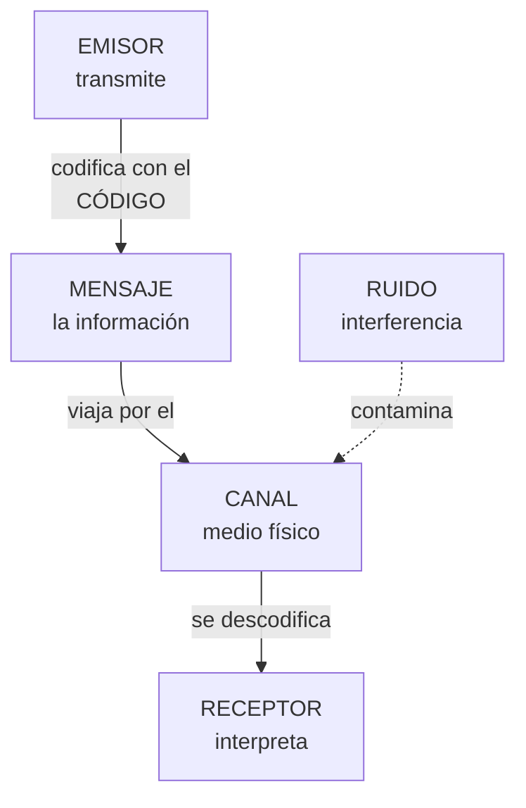

# **FITXA REPÀS 1.1 · Elements d'un sistema de comunicació**

  

    🏆 <strong>Progrés d'aquesta secció:</strong> 0 de 4 superats (0%)
    ⭐ <strong>0 punts</strong>
  

  

    

  

📥 
📄 

| Alumne/a | Grup | Data |
| --- | --- | --- |
|  |  |  |

> **📌 Què repassem?**
> 

> Repàs de la **FITXA 1.1**: tot sistema de comunicació necessita **cinc elements** (**emissor**, **receptor**, **missatge**, **canal** i **codi**); el **soroll** intenta espatlar-la, el **protocol** l'ordena amb normes i el **intèrpret** tradueix quan els codis no coincideixen.

## 1 · L'essencial, en una taula

Completa la columna dreta:

| Concepte | Completa amb les teues paraules |
| --- | --- |
| **Emissor** | Entitat que ………… la informació |
| **Receptor** | Entitat que ………… la informació |
| **Missatge** | ………… que l'emissor transmet al receptor |
| **Canal** | ………… pel que viatja el missatge |
| **Codi** | Conjunt de signes, regles i ………… (llenguatge) |
| **Soroll** | Qualsevol ………… que contamina el missatge, el canal o el codi |
| **Protocol** | Conjunt de ………… que regeixen la comunicació |
| **Intèrpret** | Element que ………… entre codis distints (módem, router…) |

## 2 · El procés de comunicació

Completa el recorregut del missatge:

| Passos del procés | Completa |
| --- | --- |
| El ………… codifica i envia el missatge |  |
| El missatge viatja pel ………… |  |
| El ………… rep i interpreta el missatge |  |
| Si els codis no coincideixen, actua el ………… |  |
| Si hi ha interferències, diem que hi ha ………… |  |

## 3 · Identifica els elements

Per a cada situació, escriu el **emissor**, **receptor**, **missatge**, **canal** i **codi**:

| Situació | Emissor | Receptor | Missatge | Canal | Codi |
| --- | --- | --- | --- | --- | --- |
| El teu professor explica en la pissarra i tu preses apuntes |  |  |  |  |  |
| Veus les notícies en la televisió |  |  |  |  |  |
| Mandas un missatge de veu per WhatsApp a un amigo |  |  |  |  |  |
| El semáforo es posa en roig i els cotxes es detienen |  |  |  |  |  |

## 4 · Soroll i protocol

1. Marca **V** (vertader) o **F** (fals):

| Afirmació | V/F |
| --- | --- |
| El soroll pot contaminar el missatge, el canal o el codi |  |
| Si el soroll supera un llindar, la informació pot no arribar completa |  |
| El protocol indica com iniciar i finalitzar la comunicació |  |
| El protocol fixa el nivell de llenguatge i la tolerància als fallades |  |
| L'intèrpret fa falta quan emissor i receptor usen el mateix codi |  |

1. Escriu un **exemple de soroll** per a cada situació:

| Situació | Quin soroll podria espatlar-la? |
| --- | --- |
| Explicació del professor |  |
| Notícies en la televisió |  |
| Missatge de veu per WhatsApp |  |
| Semáforo en roig |  |

## 5 · Autoavaluació

Marca una casella per fila per a valorar com et sents amb cada idea:

| Concepte | L'entenc | Quasi | El necessite repassar |
| --- | --- | --- | --- |
| Els 5 elements de la comunicació |  |  |  |
| Soroll, protocol i intèrpret |  |  |  |
| Identificar els elements en situacions reals |  |  |  |
| El procés de comunicació complet |  |  |  |

> **📌 Es valorarà**
> 

> - La identificació correcta dels elements de la comunicació en situacions noves.

> - La definició precisa de **soroll**, **protocol** e **intèrpret**.

> - La neteja i claredat en les respostes.

> Aquesta fitxa et servirà per a repassar el **CE5a** abans del **EXA101**.

---

💡 Mostrar / Amagar el Solucionari Oficial complet (FITXA REPÀS 1.1 · Elements d'un sistema de comunicació)

# **REPÀS 1.1 · Elements d'un sistema de comunicació**

Fitxa en blanc: Repàs 1.1

📥 

## **1 · L'essencial, en una taula**

| Concepte | Completa amb les teues paraules |
| --- | --- |
| **Emissor** | Entitat que **transmet** la informació |
| **Receptor** | Entitat que **rep** la informació |
| **Missatge** | **La informació** que l'emissor transmet al receptor |
| **Canal** | **El mitjà físic** pel que viatja el missatge |
| **Codi** | Conjunt de signes, regles i **normes** (llenguatge) |
| **Soroll** | Qualsevol **interferència** que contamina el missatge, el canal o el codi |
| **Protocol** | Conjunt de **normes** que regeixen la comunicació |
| **Intèrpret** | Element que **tradueix** entre codis distints (módem, router…) |

## **2 · El procés de comunicació**

| Passos del procés | Completa |
| --- | --- |
| El **emissor** codifica i envia el missatge |  |
| El missatge viatja pel **canal** |  |
| El **receptor** rep i interpreta el missatge |  |
| Si els codis no coincideixen, actua el **intèrpret** |  |
| Si hi ha interferències, diem que hi ha **soroll** |  |

## **3 · Identifica els elements**

| Situació | Emissor | Receptor | Missatge | Canal | Codi |
| --- | --- | --- | --- | --- | --- |
| El teu professor explica en la pissarra i tu preses apuntes | El professor | Els alumnes (tu) | L'explicació | L'aire (el sonido) i la pissarra | L'idioma i la grafía |
| Veus les notícies en la televisió | Els periodistas / la cadena | Tu (espectador) | La informació d'actualitat | El senyal de TV fins al teu tele | L'idioma, imatges i gràfics |
| Mandas un missatge de veu per WhatsApp a un amigo | Tu | El teu amigo | El que dices en l'àudio | Internet + l'app WhatsApp | L'idioma (parla) |
| El semáforo es posa en roig i els cotxes es detienen | El semáforo | Els conductors | «Detente» | La llum | El convenio de colors (roig = parar) |

## **4 · Soroll i protocol**

1. Marca **V** o **F**:

| Afirmació | V/F |
| --- | --- |
| El soroll pot contaminar el missatge, el canal o el codi | **V** |
| Si el soroll supera un llindar, la informació pot no arribar completa | **V** |
| El protocol indica com iniciar i finalitzar la comunicació | **V** |
| El protocol fixa el nivell de llenguatge i la tolerància als fallades | **V** |
| L'intèrpret fa falta quan emissor i receptor usen el mateix codi | **F** (només fa falta si els codis són distints) |

1. Exemples de soroll:

| Situació | Quin soroll podria espatlar-la? |
| --- | --- |
| Explicació del professor | Soroll de la classe: conversacions, pasillos, mòbils sonant |
| Notícies en la televisió | Imatge pixelada, talls de senyal, estàtica |
| Missatge de veu per WhatsApp | Mala connexió, vent, soroll de la carrer |
| Semáforo en roig | Sucietat o boira que tapa la llum, bombilla fundida |

## **5 · Autoavaluació**

És una **valoració personal**: marca la casella honestament segons com et haja anat al resolverla.

---

## 🎮 Reptes Interactius d'Autoavaluació (+100 XP)

Comprova el teu domini sobre **FITXA REPÀS 1.1 · Elements d'un sistema de comunicació** superant aquests 4 reptes gamificats (+25 punts cadascun):

  
🎯 <strong>Repte 1 (+25 pts):</strong> Quins són els cinc elements fonamentals que intervenen en tot sistema de comunicació?

  

    <button type="button" class="btn-mcq-opt" data-opt="A">A) Emissor, receptor, missatge, canal i codi.</button>
    <button type="button" class="btn-mcq-opt" data-opt="B">B) Teclat, ratolí, impressora, altaveu i taula.</button>
    <button type="button" class="btn-mcq-opt" data-opt="C">C) Paret, sostre, porta, finestra i armari.</button>
    <button type="button" class="btn-mcq-opt" data-opt="D">D) Cobre, plàstic, vidre, paper i fusta.</button>
  

  

  
🎯 <strong>Repte 2 (+25 pts):</strong> En el model de referència OSI de 7 capes, quina és la capa 1 encarregada de transmetre els bits com a senyals elèctrics, òptics o d'ones per el mitjà?

  

    <button type="button" class="btn-mcq-opt" data-opt="A">A) Capa d'Aplicació (Capa 7).</button>
    <button type="button" class="btn-mcq-opt" data-opt="B">B) Capa Física (Capa 1).</button>
    <button type="button" class="btn-mcq-opt" data-opt="C">C) Capa de Sessió (Capa 5).</button>
    <button type="button" class="btn-mcq-opt" data-opt="D">D) Capa de Presentació (Capa 6).</button>
  

  

  
✅ <strong>Repte 3 (Vertader o Fals · +25 pts):</strong> Una adreça IPv4 està formada per 32 bits dividits en 4 octets (4 números decimals entre 0 i 255 separats per punts, com <code>192.168.1.10</code>).

  

    <button type="button" class="btn-vf" data-opt="V">Vertader (V)</button>
    <button type="button" class="btn-vf" data-opt="F">Fals (F)</button>
  

  

  
⌨️ <strong>Repte 4 (+25 pts):</strong> Quants bits formen un byte (o octet) en els sistemes digitals i de comunicacions?

  

    <input type="text" class="quiz-input" placeholder="Escriu la resposta..." />
    <button type="button" class="btn-quiz-check">Comprovar</button>
  

  

### 📋 Llista de Comprovació i Rúbrica d'Assoliment

Marca cada criteri a mesura que completes l'estudi o la resolució pràctica d'aquesta pàgina (**FITXA REPÀS 1.1 · Elements d'un sistema de comunicació**):

- [ ] He llegit detingudament la teoria o l'enunciat d'aquesta secció i he anotat els conceptes clau.
- [ ] He revisat els esquemes, taules o blocs de codi i he verificat que sé aplicar-los a l'entorn de treball.
- [ ] He resolt correctament els **4 reptes interactius** superiors obtenint els **100 punts XP**.
- [ ] He descarregat el comprovant oficial en PDF per a adjuntar-lo a la tasca d'**Aules**.

  <h3>📤 Comprovant de Lliurament per a Aules</h3>
  
Quan hages completat els reptes interactius i la llista d'autoavaluació d'aquesta pàgina, introdueix el teu nom i descarrega el teu certificat oficial en PDF per a adjuntar-lo a la tasca d'<strong>Aules</strong>.

  

    <label for="aules-student-name">👤 Nom i Cognoms de l'Alumne/a:</label>
    <input type="text" id="aules-student-name" class="aules-student-name" placeholder="Ex: Joan Garcia Pérez" />
  

  

    0/4 reptes completats (0%) · 0 punts · 0/4 criteris d'autoavaluació
  

  

    <button type="button" class="btn-aules-dl" data-module="IMX" data-unit="UD01" data-activity="rep101">📥 Descarregar Comprovant PDF</button>
    <button type="button" class="btn-aules-copy">📋 Copiar Resum al Porta-retalls</button>
  

  

