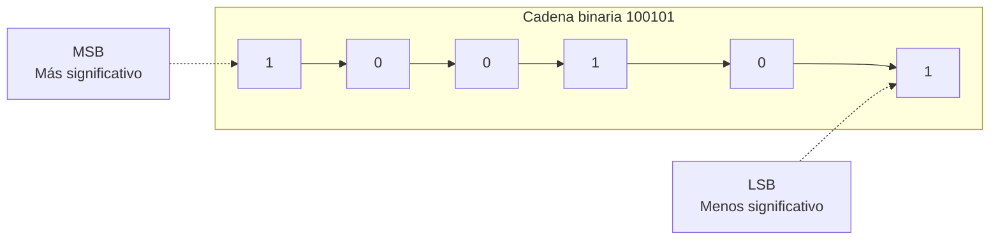
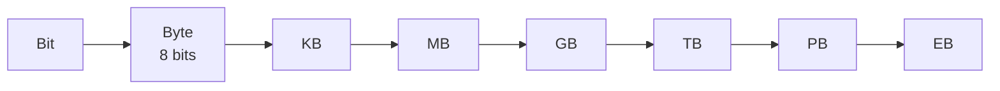

# **FICHA REPASO 1.2 · Representación de la información**

  

    🏆 <strong>Progreso de esta sección:</strong> 0 de 4 superados (0%)
    ⭐ <strong>0 puntos</strong>
  

  

    

  

📥 
📄 

| Alumne/a | Grup | Data |
| --- | --- | --- |
|  |  |  |

> **📌 ¿Qué repasamos?**
> 

> Repàs de la **FICHA 1.2**: la informació viatja **codificada** en **decimal**, **binari** (zeros i uns, **bits**) o **hexadecimal**. Saber traduir entre ells i moverte per l'escala de **mesures d'informació** és l'objectiu d'aquesta fitxa.

## 1 · Els tres sistemes de codificació

Completa la taula:

| Sistema | Símbols | Qui l'usa? | Exemple |
| --- | --- | --- | --- |
| **Decimal** | ………… | Les persones | 125 |
| **Binari** | ………… | ………… | 1111101 |
| **Hexadecimal** | 0-9 i ………… | Intermedi decimal-binari | 7D |

> **📌 Aprèn**
> 

> Cada **bit** val 0 o 1. Al bit de la **esquerra** (més valor) es li anomena **MSB** i al de la **dreta** (menys valor), **LSB**. Cada posició val el doble que l'anterior: **1, 2, 4, 8, 16, 32, 64, 128…**

## 2 · Traducció decimal ↔ binari

### 2.1 · Decimal → binari (divisions entre 2)

| Decimal | Resolució (divisions) | Resultat binari |
| --- | --- | --- |
| 45 |  |  |
| 100 |  |  |
| 128 |  |  |
| 255 |  |  |

### 2.2 · Binari → decimal (sumas de potències de 2)

| Binari | Potències que suman | Decimal |
| --- | --- | --- |
| 110010 | 32 + 16 + 2 | 50 |
| 10111111 |  |  |
| 11100000 |  |  |
| 10101010 |  |  |

## 3 · Traducció hexadecimal ↔ binari

Recorda: cada xifra hexadecimal = **4 bits** (un quartet) i dins del quartet els bits valen **8 · 4 · 2 · 1**.

### 3.1 · Hexadecimal → binari

| Hexadecimal | Quartets | Binari |
| --- | --- | --- |
| 3C | 3=0011 · C=1100 | 00111100 |
| 9E |  |  |
| 2A |  |  |

### 3.2 · Binari → hexadecimal

| Binari | Quartets (emplena zeros a l'esquerra si falta) | Hexadecimal |
| --- | --- | --- |
| 01011010 | 0101 · 1010 | 5A |
| 11110000 |  |  |
| 110111 |  |  |

## 4 · Mesures d'informació

Recorda l'escala: per a **baixar** d'unitat divideix entre 1024; per a **pujar**, multiplica per 1024 (i per 8 si vas a bits).

Completa les conversions:

| Conversió | Resolució | Resultat |
| --- | --- | --- |
| 8 B → bits | 8 × 8 | 64 b |
| 3 GB → MB | 3 × 1024 |  |
| 512 MB → KB | 512 × 1024 |  |
| 1 TB → GB | 1 × 1024 |  |

## 5 · Repte express

1. El byte `01000010` codifica una lletra: escriu el seu valor **decimal** i el seu valor en **hexadecimal**.

1. Ordena de menor a major: **1 GB**, **512 KB**, **2 MB**, **1 MB**.

1. Marca **V** (vertader) o **F** (fals):

| Afirmació | V/F |
| --- | --- |
| El bit de la dreta és el LSB |  |
| 1 KB = 1024 B |  |
| L'hexadecimal usa les lletres de la A a la G |  |
| 4 MB = 4 × 1024 bits |  |

> **📌 Es valorarà**
> 

> - La correcta aplicació de l'algoritmo de **divisió sucesiva** (decimal → binari).

> - L'ús dels **quartets** (8-4-2-1) per a l'hexadecimal.

> - La precisió en les conversions de **mesures d'informació**.

> - La neteja i l'ordre al resoldre els exercicis.

> Aquesta fitxa et servirà per a repassar el **CE5a** abans del **EXA101**.

---

💡 Mostrar / Amagar el Solucionari Oficial complet (FICHA REPASO 1.2 · Representación de la información)

# Repàs 1.02 Resolta

## REPÀS 1.2 · Representación de la información

Fitxa en blanc: Repàs 1.2

📥 

## **1 · Els tres sistemes de codificació**

| Sistema | Símbols | Qui l'usa? | Exemple |
| --- | --- | --- | --- |
| **Decimal** | **0 1 2 3 4 5 6 7 8 9** | Les persones | 125 |
| **Binari** | **0 1** | **Els ordinadors** | 1111101 |
| **Hexadecimal** | 0-9 i **A B C D E F** | Intermedi decimal-binari | 7D |

## **2 · Traducció decimal ↔ binari**

### **2.1 · Decimal → binari**

| Decimal | Resolució (divisions) | Resultat binari |
| --- | --- | --- |
| 45 | 45÷2=22·1 ; 22÷2=11·0 ; 11÷2=5·1 ; 5÷2=2·1 ; 2÷2=1·0 ; 1÷2=0·1 | **101101** |
| 100 | 100÷2=50·0 ; 50÷2=25·0 ; 25÷2=12·1 ; 12÷2=6·0 ; 6÷2=3·0 ; 3÷2=1·1 ; 1÷2=0·1 | **1100100** |
| 128 | 128÷2=64·0 ; 64÷2=32·0 ; 32÷2=16·0 ; 16÷2=8·0 ; 8÷2=4·0 ; 4÷2=2·0 ; 2÷2=1·0 ; 1÷2=0·1 | **10000000** |
| 255 | 255÷2=127·1 ; 127÷2=63·1 ; 63÷2=31·1 ; 31÷2=15·1 ; 15÷2=7·1 ; 7÷2=3·1 ; 3÷2=1·1 ; 1÷2=0·1 | **11111111** |

### **2.2 · Binari → decimal**

| Binari | Potències que suman | Decimal |
| --- | --- | --- |
| 110010 | 32 + 16 + 2 | 50 |
| 10111111 | 128 + 32 + 16 + 8 + 4 + 2 + 1 | **191** |
| 11100000 | 128 + 64 + 32 | **224** |
| 10101010 | 128 + 32 + 8 + 2 | **170** |

## **3 · Traducció hexadecimal ↔ binari**

### **3.1 · Hexadecimal → binari**

| Hexadecimal | Quartets | Binari |
| --- | --- | --- |
| 3C | 3=0011 · C=1100 | 00111100 |
| 9E | 9=1001 · E=1110 | **10011110** |
| 2A | 2=0010 · A=1010 | **00101010** |

### **3.2 · Binari → hexadecimal**

| Binari | Quartets (emplena zeros a l'esquerra si falta) | Hexadecimal |
| --- | --- | --- |
| 01011010 | 0101 · 1010 | 5A |
| 11110000 | 1111 · 0000 | **F0** |
| 110111 | 0011 · 0111 | **37** |

## **4 · Mesures d'informació**

| Conversió | Resolució | Resultat |
| --- | --- | --- |
| 8 B → bits | 8 × 8 | 64 b |
| 3 GB → MB | 3 × 1024 | **3072 MB** |
| 512 MB → KB | 512 × 1024 | **524 288 KB** |
| 1 TB → GB | 1 × 1024 | **1024 GB** |

## **5 · Repte express**

1. `01000010` → decimal **66** (64 + 2) i hexadecimal **42**.

1. De menor a major: **512 KB < 1 MB < 2 MB < 1 GB**.

1. Marca **V** o **F**:

| Afirmació | V/F |
| --- | --- |
| El bit de la dreta és el LSB | **V** |
| 1 KB = 1024 B | **V** |
| L'hexadecimal usa les lletres de la A a la G | **F** (usa de la **A a la F**) |
| 4 MB = 4 × 1024 bits | **F** (4 MB = 4 × 1024 × 1024 × 8 bits) |

---

## 🎮 Reptes Interactius d'Autoavaluació (+100 XP)

Comprova el teu domini sobre **FICHA REPASO 1.2 · Representación de la información** superant aquests 4 reptes gamificats (+25 puntos cadascun):

  
🎯 <strong>Repte 1 (+25 pts):</strong> Quins són els cinc elements fonamentals que intervenen en tot sistema de comunicació?

  

    <button type="button" class="btn-mcq-opt" data-opt="A">A) Emissor, receptor, mensaje, canal i código.</button>
    <button type="button" class="btn-mcq-opt" data-opt="B">B) Teclat, ratolí, impressora, altaveu i taula.</button>
    <button type="button" class="btn-mcq-opt" data-opt="C">C) Paret, sostre, porta, finestra i armari.</button>
    <button type="button" class="btn-mcq-opt" data-opt="D">D) Cobre, plàstic, vidre, paper i fusta.</button>
  

  

  
🎯 <strong>Repte 2 (+25 pts):</strong> En el model de referència OSI de 7 capes, quina és la capa 1 encarregada de transmetre els bits com a senyals elèctrics, òptics o d'ones per el mitjà?

  

    <button type="button" class="btn-mcq-opt" data-opt="A">A) Capa d'Aplicació (Capa 7).</button>
    <button type="button" class="btn-mcq-opt" data-opt="B">B) Capa Física (Capa 1).</button>
    <button type="button" class="btn-mcq-opt" data-opt="C">C) Capa de Sessió (Capa 5).</button>
    <button type="button" class="btn-mcq-opt" data-opt="D">D) Capa de Presentació (Capa 6).</button>
  

  

  
✅ <strong>Repte 3 (Vertader o Fals · +25 pts):</strong> Una adreça IPv4 està formada per 32 bits dividits en 4 octets (4 números decimals entre 0 i 255 separats per puntos, com <code>192.168.1.10</code>).

  

    <button type="button" class="btn-vf" data-opt="V">Vertader (V)</button>
    <button type="button" class="btn-vf" data-opt="F">Fals (F)</button>
  

  

  
⌨️ <strong>Repte 4 (+25 pts):</strong> Quants bits formen un byte (o octet) en els sistemes digitals i de comunicacions?

  

    <input type="text" class="quiz-input" placeholder="Escriu la resposta..." />
    <button type="button" class="btn-quiz-check">Comprovar</button>
  

  

### 📋 Llista de Comprovació i Rúbrica d'Assoliment

Marca cada criteri a mesura que completes l'estudi o la resolució pràctica d'aquesta pàgina (**FICHA REPASO 1.2 · Representación de la información**):

- [ ] He llegit detingudament la teoria o l'enunciat d'aquesta secció i he anotat els conceptes clau.
- [ ] He revisat els esquemes, taules o blocs de código i he verificat que sé aplicar-los a l'entorn de treball.
- [ ] He resolt correctament els **4 reptes interactius** superiors obtenint els **100 puntos XP**.
- [ ] He descarregat el comprovant oficial en PDF per a adjuntar-lo a la tasca d'**Aules**.

  <h3>📤 Comprovant de Lliurament per a Aules</h3>
  
Quan hages completat els reptes interactius i la llista d'autoavaluació d'aquesta pàgina, introdueix el teu nom i descarrega el teu certificat oficial en PDF per a adjuntar-lo a la tasca d'<strong>Aules</strong>.

  

    <label for="aules-student-name">👤 Nom i Cognoms de l'Alumne/a:</label>
    <input type="text" id="aules-student-name" class="aules-student-name" placeholder="Ex: Joan Garcia Pérez" />
  

  

    0/4 reptes completats (0%) · 0 puntos · 0/4 criteris d'autoavaluació
  

  

    <button type="button" class="btn-aules-dl" data-module="IMX" data-unit="UD01" data-activity="rep102">📥 Descarregar Comprovant PDF</button>
    <button type="button" class="btn-aules-copy">📋 Copiar Resum al Porta-retalls</button>
  

  

