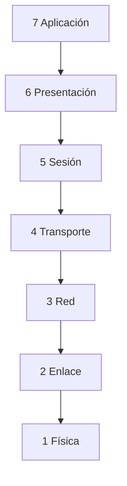
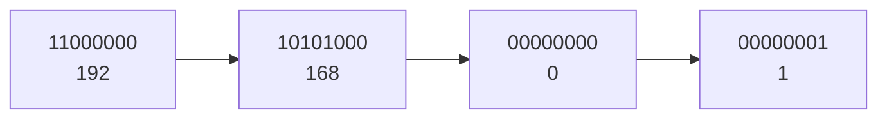

# **UP01 · Resum en Text**

<div class="interactive-progress-tracker">
  <div class="tracker-header">
    <span>🏆 <strong>Progrés d'aquesta secció:</strong> <span class="tracker-count">0 de 4 superats (0%)</span></span>
    <span class="tracker-pts">⭐ <strong>0 punts</strong></span>
  </div>
  <div class="tracker-bar">
    <div class="tracker-fill" style="width: 0%;"></div>
  </div>
</div>

📥 

## **1.1 · La comunicació i els seus elements**

La **comunicació** és el procés pel que una entitat **transmet informació** a una altra. Perquè es produïsca fan falta **cinc elements**:

| Element | Què és? | Exemple (un vídeo de TikTok) |
| --- | --- | --- |
| **Emissor** | El que envia la informació | La persona que puja el vídeo |
| **Receptor** | El que la rep | Tu, que el veus en el mòbil |
| **Missatge** | La informació que es transmet | El contingut del vídeo |
| **Canal** | El mitjà pel que viatja | Internet + la xarxa social |
| **Codi** | El llenguatge usat (signes i normes) | L'idioma, subtítulos, emojis |

A més, intervenen tres elements més:

- **Soroll**: qualsevol interferència que espatla el missatge, el canal o el codi (talls de wifi, sonido ambient…).

- **Protocol**: les normes que regulan la comunicació (com s'inicia, com es acaba, què fer si falla).

- **Intèrpret**: tradueix entre codis distints (per exemple, un router o un módem).

> **📌 A estudiar**
> 

> Memoriza els cinc: **Emissor, Receptor, Missatge, Canal, Codi**. I no olvides: **soroll** l'espatla, **protocol** l'ordena, **intèrpret** el tradueix.

## **1.2 · La representació de la informació**

La informació **ha de codificar-se** per a poder transmitir-se. Els tres sistemes de codificació que usem són:

| Sistema | Símbols | Qui l'usa? |
| --- | --- | --- |
| **Decimal** | 0, 1, 2, 3, 4, 5, 6, 7, 8, 9 | Les persones |
| **Binari** | 0, 1 | Els ordinadors |
| **Hexadecimal** | 0-9 i A, B, C, D, E, F | Intermedi decimal-binari |

- Cada xifra binària és un **bit** (0 o 1).

- En una cadena binària, el bit de la **esquerra** (més valor) és el **MSB** i el de la **dreta** (menys valor) és el **LSB**.

### **La taula de valors de cada bit (mètode de la taula)**

Per a convertir usem sempre aquesta taula. Cada bit, d'esquerra a dreta, val **el doble** que l'anterior: **1, 2, 4, 8, 16, 32, 64, 128 i 256**. Apúntala sempre.

| Posició del bit | 8 | 7 | 6 | 5 | 4 | 3 | 2 | 1 | 0 |
| --- | --- | --- | --- | --- | --- | --- | --- | --- | --- |
| **Valor del bit** | **256** | **128** | **64** | **32** | **16** | **8** | **4** | **2** | **1** |

#### **Binari → decimal (sumar els valors amb un 1)**

Colocamos cada bit davall del seu valor i **sumem** només els valors que tenen un **1**.

| Valor | 128 | 64 | 32 | 16 | 8 | 4 | 2 | 1 |
| --- | --- | --- | --- | --- | --- | --- | --- | --- |
| Bit | 1 | 0 | 1 | 1 | 0 | 1 | 1 | 1 |

10110111₂ = 128 + 32 + 16 + 4 + 2 + 1 = **183₁₀**

#### **Decimal → binari (restar els valors de la taula)**

Cerquem el valor **més alt** de la taula que siga igual o menor que el número, posem un **1**, restamos i repetim amb la qual cosa quede (si no cap, posem un **0**).

Exemple amb **183₁₀**:

| Pas | Operació | Bit |
| --- | --- | --- |
| 1 | 183 − 128 = 55 | **1** |
| 2 | 64 no cap en 55 | **0** |
| 3 | 55 − 32 = 23 | **1** |
| 4 | 23 − 16 = 7 | **1** |
| 5 | 8 no cap en 7 | **0** |
| 6 | 7 − 4 = 3 | **1** |
| 7 | 3 − 2 = 1 | **1** |
| 8 | 1 − 1 = 0 | **1** |

Resultat: **183₁₀ = 10110111₂** (comprova que és el mateix exemple anterior)

#### **Hexadecimal: els quartets valen 8 · 4 · 2 · 1**

Cada xifra hexadecimal són **4 bits** (un quartet). Dins de cada quartet els bits valen **8, 4, 2, 1**.

| Bit del quartet | 4º | 3º | 2º | 1º |
| --- | --- | --- | --- | --- |
| **Valor** | **8** | **4** | **2** | **1** |

#### **Hex → binari (cada xifra hex val 4 bits)**

**A59₁₆**: cada xifra es converteix amb la taula 8-4-2-1:

- A = 1010 (8 + 2)

- 5 = 0101 (4 + 1)

- 9 = 1001 (8 + 1)

Resultat: **A59₁₆ = 1010 0101 1001₂**

#### **Binari → hex (agrupar de 4 en 4)**

Agrupamos de dreta a esquerra en **quartets** (si falta, rellenamos amb zeros a l'esquerra) i cada quartet es llegix amb la taula 8-4-2-1.

**1010 0101 1001₂** → 1010 = A · 0101 = 5 · 1001 = 9 → **1010 0101 1001₂ = A59₁₆**

#### ** Decimal ↔ hexadecimal (passant per la taula gran)**

**Decimal → hex**: primer passem el número a binari amb la taula gran i després agrupamos en quartets.

- 127₁₀ = 0111 1111₂ → 0111 = 7 · 1111 = F → **127₁₀ = 7F₁₆**

**Hex → decimal**: passem cada xifra a 4 bits i sumem els valors dels **1** amb la taula gran.

- 7F₁₆ = 0111 1111₂ → 64 + 32 + 16 + 8 + 4 + 2 + 1 = **127₁₀**

> **📌 Taula de correspondència (10 valors que has de reconèixer)**
> 

| Hex | Bin | Dec |  | Hex | Bin | Dec |
| --- | --- | --- | --- | --- | --- | --- |
| 0 | 0000 | 0 |  | 8 | 1000 | 8 |
| 1 | 0001 | 1 |  | 9 | 1001 | 9 |
| 2 | 0010 | 2 |  | A | 1010 | 10 |
| 3 | 0011 | 3 |  | B | 1011 | 11 |
| 4 | 0100 | 4 |  | C | 1100 | 12 |
| 5 | 0101 | 5 |  | D | 1101 | 13 |
| 6 | 0110 | 6 |  | E | 1110 | 14 |
| 7 | 0111 | 7 |  | F | 1111 | 15 |

### **Mesures d'informació**

| Magnitud | Equival a |
| --- | --- |
| 1 **bit** (b) | 0 o 1 |
| 1 **byte** (B) | 8 bits |
| 1 **KB** | 1024 B |
| 1 **MB** | 1024 KB |
| 1 **GB** | 1024 MB |
| 1 **TB** | 1024 GB |
| 1 **PB** | 1024 TB |
| 1 **EB** | 1024 PB |

- Per a **pujar** una magnitud: multiplica per 1024 (i per 8 si pasas a bits).

- Per a **baixar**: divideix entre 1024 (i entre 8 si vienes de bits).

- La **velocitat** de transmissió es mide en **Mb/s** o **Mbps** (megabits per segon).

> **📌 Repàs ràpid**
> 

> - 2 B = 2 × 8 = **16 b**

> - 4 MB = 4 × 1024 × 1024 × 8 = **33 554 432 bits**

> - 60 KB = 60 / 1024 / 1024 / 1024 ≈ **0,00000006 TB**

## **1.3 · Les xarxes de comunicacions: models OSI i TCP/IP**

Una **xarxa de comunicacions** és un conjunt de **dos o més equips** que intercambian informació. Aquesta viatja trossejada en **paquets de dades** (zeros i uns). Perquè tots es entenguen s'usen **protocols**.

### **El model OSI (7 capes)**

Organitza la comunicació com un **edifici de 7 pisos**. La informació **baixa** del 7 al 1 a l'enviar-se i **puja** del 1 al 7 al recibir-se. Entre capa i capa es afegeix un **sobre** amb informació (això és el **encapsulament**; quitar-lo és **desencapsular**).

| Capa | Nom | Què fa? |
| --- | --- | --- |
| 7 | **Aplicació** | Els programes que uses (web, correu, jocs) |
| 6 | **Presentació** | Tradueix i comprime la informació |
| 5 | **Sessió** | Manté oberta la conversa |
| 4 | **Transport** | Trocea el missatge i controla errors (**TCP** i **UDP**) |
| 3 | **Xarxa** | Posa la **adreça IP** i tria la ruta |
| 2 | **Enllaç de dades** | Posa la **adreça MAC** i detecta errors |
| 1 | **Física** | Envia els **bits** pel cable |



> **📌 Truco per a recordar-les (d'adalt abaix)**
> 

> **«A**les **P**ersonas **S**iempre **T**raen **R**opa **E**n **F**lores»** → Aplicació, Presentació, Sessió, Transport, Xarxa, Enllaç, Física.

### **El model TCP/IP (4 capes)**

És el model que **utilitza Internet de veritat**.

| Capa TCP/IP | Què fa? | Capa OSI |
| --- | --- | --- |
| 4 Aplicació | Programes i serveis de Internet | 7 (i 6, 5) |
| 3 Transport | Envia punta a punta (**TCP**, **UDP**) | 4 |
| 2 Internet | Adreça **IP** i ruta | 3 |
| 1 Accés a xarxa | El cable o el wifi (**Ethernet**) | 2 i 1 |

### **Protocols que has de reconèixer**

| Protocol | Per a què serveix? |
| --- | --- |
| **HTTP / HTTPS** | Veure pàgines web (HTTPS xifra la informació) |
| **DNS** | Tradueix noms () a adreces IP |
| **SMTP / POP3 / IMAP** | Enviar i rebre correu |
| **FTP / FTPS** | Transferir arxius |
| **DHCP** | Assigna la IP automàticament |
| **ARP** | Cerca l'adreça MAC des de la IP |
| **NAT** | Tradueix IP privades a públiques |
| **TCP** | En ordre i sense errors |
| **UDP** | Més ràpid, per a vídeo i anomenades |
| **IP** | Adreça i encaminament |

## **1.4 · L'adreça IP (IPv4 i IPv6)**

Cada equip d'una xarxa té **dos adreces**:

|  | **Adreça IP** | **Adreça MAC** |
| --- | --- | --- |
| Tipus | **Lògica** | **Física** |
| Canvia | Sí (estàtica o dinàmica) | No, mai |
| Format | 32 o 128 bits | 48 bits (6 blocs) |
| Exemple | 192.168.0.1 | 00:E0:7D:F9:EA:6D |
| Com el correu | La **casa** on viu | El **nom** del destinatari |

### **IPv4 (32 bits)**

Es escriu en **4 blocs de 8 bits** (un byte), en **decimal**, separats per **punts**. Cada bloc va de **0 a 255**.



- **Públiques**: s'usen en Internet.

- **Privades**: només dins de casa/oficina. Les tres xarxes privades típiques comencen per **10.**, per **172.16.** a **172.31.** i per **192.168.**

La **màscara de xarxa** separa la part de **xarxa** i la part del **equip**. La més comú és `255.255.255.0`.

Amb la **operació AND** (1 AND 1 = 1; el resta = 0) entre la IP i la màscara obtenim la **adreça de xarxa**:

```bash
IP:      192.168.0.1     → 11000000.10101000.00000000.00000001
Máscara: 255.255.255.0   → 11111111.11111111.11111111.00000000
AND                            → 11000000.10101000.00000000.00000000
Red:     192.168.0.0
```

En cada xarxa, **dos adreces no s'assignen a equips**: la **adreça de xarxa** (la primera) i la de **broadcast** (la última, per a parlar amb tots alhora). El resta són els **hosts**.

> **📌 Exemple amb màscara 255.255.0.0**
> 

> IP `172.96.0.22`: xarxa **172.96.0.0**, primer host **172.96.0.1**, broadcast **172.96.255.255**, últim host asignable **172.96.255.254**.

### **IPv6 (128 bits)**

Es escriu en **8 grups de 2 bytes**, en **hexadecimal**, separats per **dos punts**.

```bash
2001:0DB8:0000:0000:4AC2:0000:B4EB:0FFA
```

Regles per a **abreviar**:

1. Quitar els **zeros a l'esquerra** de cada grup (`00D1` → `D1`).

1. Un grup `0000` es escriu `0`.

1. Dos o més grups de zeros seguits es canvien per `::` (**només una vegada**).

Per a adaptar una IPv4 es escriuen els dos primers blocs a zero i els dos últims com la IPv4: `192.168.0.1` → `0:0:192.168.0.1` o `::192.168.0.1`.

> **📌 Per a no confundir IPv4 i IPv6**
> 

|  | IPv4 | IPv6 |
| --- | --- | --- |
| Bits | 32 | 128 |
| Grups | 4 blocs | 8 grups |
| Separador | Punts (**.**) | Dos punts (**:**) |
| Format | Decimal | Hexadecimal |

## **L'important**

1. Els **5 elements** de la comunicació + soroll, protocol i intèrpret.

1. Saber **convertir** entre decimal, binari i hexadecimal.

1. Les **mesures** d'informació (bit → EB, ×1024, ×8 per a bits).

1. **OSI = 7 capes**, **TCP/IP = 4 capes** i la seua correspondència.

1. Diferència **IP (lògica, canvia)** i **MAC (física, fixa)**.

1. **IPv4** (32 bits, 4 blocs decimals) e **IPv6** (128 bits, 8 grups hex).

1. La **màscara de xarxa** i l'operació **AND** per a hallar la xarxa d'una IP.

> **📌 Per a practicar**
> 

> Repassa amb les **fitxes de treball** (FICHA101 a FICHA104).


---

## 🎮 Reptes Interactius d'Autoavaluació (+100 XP)

Comprova el teu domini sobre **UP01 · Resum en Text** superant aquests 4 reptes gamificats (+25 punts cadascun):

<div class="interactive-mcq" data-answer="A" data-hint="L'emissor envia el missatge al receptor a través d'un canal utilitzant un codi comú.">
  <div class="mcq-question">🎯 <strong>Repte 1 (+25 pts):</strong> Quins són els cinc elements fonamentals que intervenen en tot sistema de comunicació?</div>
  <div class="mcq-options">
    <button type="button" class="btn-mcq-opt" data-opt="A">A) Emissor, receptor, missatge, canal i codi.</button>
    <button type="button" class="btn-mcq-opt" data-opt="B">B) Teclat, ratolí, impressora, altaveu i taula.</button>
    <button type="button" class="btn-mcq-opt" data-opt="C">C) Paret, sostre, porta, finestra i armari.</button>
    <button type="button" class="btn-mcq-opt" data-opt="D">D) Cobre, plàstic, vidre, paper i fusta.</button>
  </div>
  <div class="quiz-feedback"></div>
</div>

<div class="interactive-mcq" data-answer="B" data-hint="La Capa 1 del model OSI és la Capa Física.">
  <div class="mcq-question">🎯 <strong>Repte 2 (+25 pts):</strong> En el model de referència OSI de 7 capes, quina és la capa 1 encarregada de transmetre els bits com a senyals elèctrics, òptics o d'ones per el mitjà?</div>
  <div class="mcq-options">
    <button type="button" class="btn-mcq-opt" data-opt="A">A) Capa d'Aplicació (Capa 7).</button>
    <button type="button" class="btn-mcq-opt" data-opt="B">B) Capa Física (Capa 1).</button>
    <button type="button" class="btn-mcq-opt" data-opt="C">C) Capa de Sessió (Capa 5).</button>
    <button type="button" class="btn-mcq-opt" data-opt="D">D) Capa de Presentació (Capa 6).</button>
  </div>
  <div class="quiz-feedback"></div>
</div>

<div class="interactive-vf" data-answer="V" data-hint="4 octets × 8 bits = 32 bits en total per a una adreça IPv4.">
  <div class="vf-statement">✅ <strong>Repte 3 (Vertader o Fals · +25 pts):</strong> Una adreça IPv4 està formada per 32 bits dividits en 4 octets (4 números decimals entre 0 i 255 separats per punts, com <code>192.168.1.10</code>).</div>
  <div class="vf-buttons">
    <button type="button" class="btn-vf" data-opt="V">Vertader (V)</button>
    <button type="button" class="btn-vf" data-opt="F">Fals (F)</button>
  </div>
  <div class="quiz-feedback" style="width: 100%;"></div>
</div>

<div class="interactive-quiz" data-answer="8|vuit|8 bits" data-hint="Un byte o octet equival a 8 bits.">
  <div class="quiz-question">⌨️ <strong>Repte 4 (+25 pts):</strong> Quants bits formen un byte (o octet) en els sistemes digitals i de comunicacions?</div>
  <div class="quiz-controls">
    <input type="text" class="quiz-input" placeholder="Escriu la resposta..." />
    <button type="button" class="btn-quiz-check">Comprovar</button>
  </div>
  <div class="quiz-feedback"></div>
</div>

### 📋 Llista de Comprovació i Rúbrica d'Assoliment

Marca cada criteri a mesura que completes l'estudi o la resolució pràctica d'aquesta pàgina (**UP01 · Resum en Text**):

- [ ] He llegit detingudament la teoria o l'enunciat d'aquesta secció i he anotat els conceptes clau.
- [ ] He revisat els esquemes, taules o blocs de codi i he verificat que sé aplicar-los a l'entorn de treball.
- [ ] He resolt correctament els **4 reptes interactius** superiors obtenint els **100 punts XP**.
- [ ] He descarregat el comprovant oficial en PDF per a adjuntar-lo a la tasca d'**Aules**.

<div class="aules-delivery-card">
  <h3>📤 Comprovant de Lliurament per a Aules</h3>
  <p>Quan hages completat els reptes interactius i la llista d'autoavaluació d'aquesta pàgina, introdueix el teu nom i descarrega el teu certificat oficial en PDF per a adjuntar-lo a la tasca d'<strong>Aules</strong>.</p>
  <div class="aules-student-field">
    <label for="aules-student-name">👤 Nom i Cognoms de l'Alumne/a:</label>
    <input type="text" id="aules-student-name" class="aules-student-name" placeholder="Ex: Joan Garcia Pérez" />
  </div>
  <div class="aules-score-badge">
    <span class="aules-score-count">0/4 reptes completats (0%) · 0 punts · 0/4 criteris d'autoavaluació</span>
  </div>
  <div class="aules-actions">
    <button type="button" class="btn-aules-dl" data-module="IMX" data-unit="UD01" data-activity="resum_text">📥 Descarregar Comprovant PDF</button>
    <button type="button" class="btn-aules-copy">📋 Copiar Resum al Porta-retalls</button>
  </div>
  <div class="aules-toast"></div>
</div>
