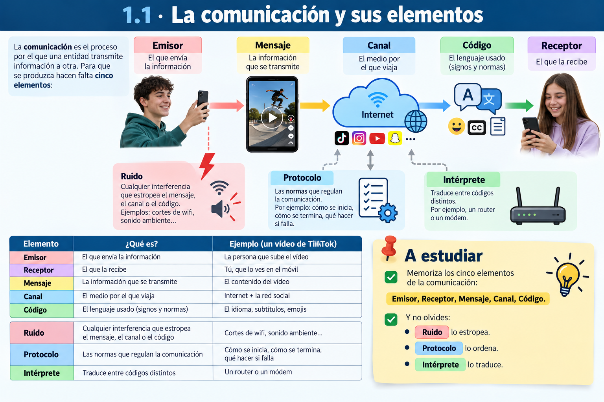
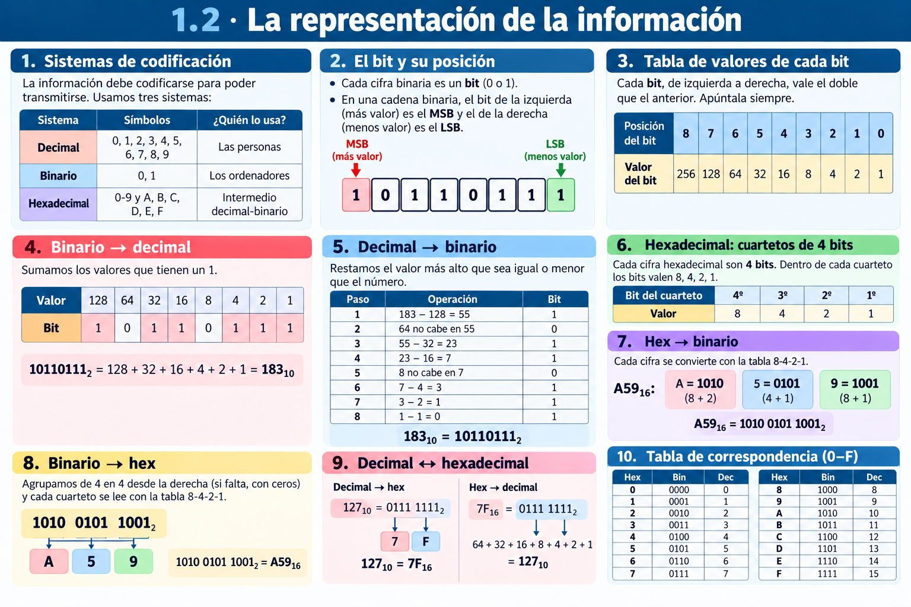
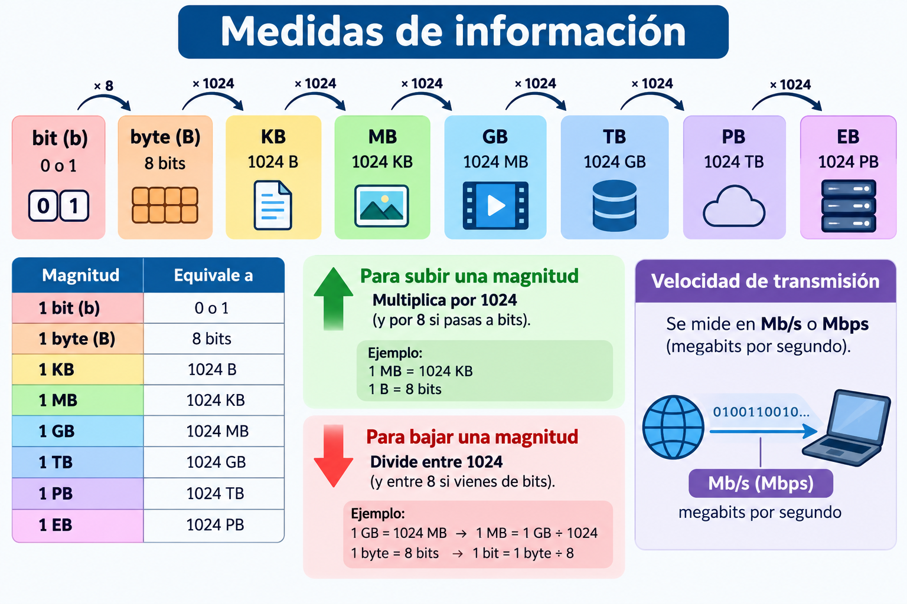
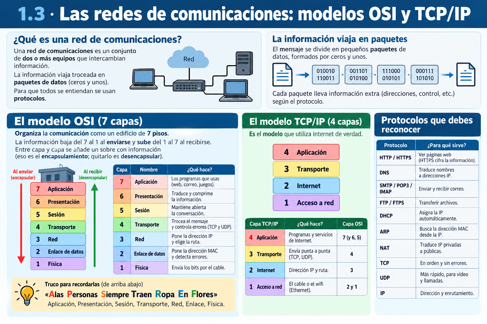
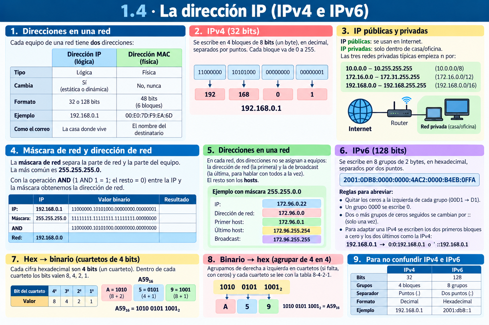

# **UP01 · Resumen en Imagenes**

📥 Guardar como PDF

## **1.1 · La comunicación y sus elementos**

## **1.2 · La representación de la información**

### **Medidas de información**

## **1.3 · Las redes de comunicaciones: modelos OSI y TCP/IP**

## **1.4 · La dirección IP (IPv4 e IPv6)**

