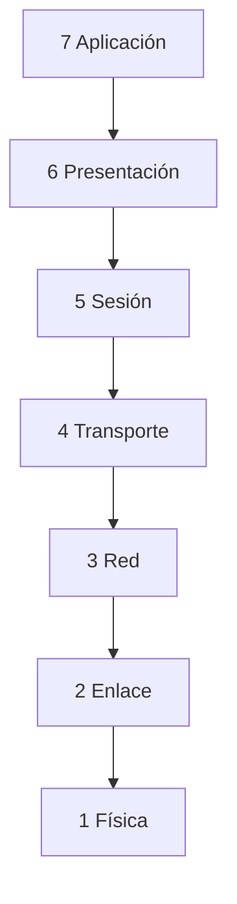
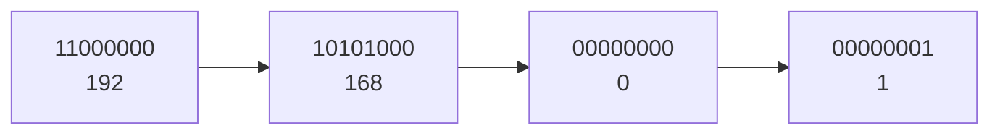

# **UP01 · Resumen en Texto**

📥 Guardar como PDF

## **1.1 · La comunicación y sus elementos**

La **comunicación** es el proceso por el que una entidad **transmite información** a otra. Para que se produzca hacen falta **cinco elementos**:

| Elemento | ¿Qué es? | Ejemplo (un vídeo de TikTok) |
| --- | --- | --- |
| **Emisor** | El que envía la información | La persona que sube el vídeo |
| **Receptor** | El que la recibe | Tú, que lo ves en el móvil |
| **Mensaje** | La información que se transmite | El contenido del vídeo |
| **Canal** | El medio por el que viaja | Internet + la red social |
| **Código** | El lenguaje usado (signos y normas) | El idioma, subtítulos, emojis |

Además, intervienen tres elementos más:

- **Ruido**: cualquier interferencia que estropea el mensaje, el canal o el código (cortes de wifi, sonido ambiente…).

- **Protocolo**: las normas que regulan la comunicación (cómo se inicia, cómo se termina, qué hacer si falla).

- **Intérprete**: traduce entre códigos distintos (por ejemplo, un router o un módem).

> **📌 A estudiar**
> 

> Memoriza los cinco: **Emisor, Receptor, Mensaje, Canal, Código**. Y no olvides: **ruido** lo estropea, **protocolo** lo ordena, **intérprete** lo traduce.

## **1.2 · La representación de la información**

La información **debe codificarse** para poder transmitirse. Los tres sistemas de codificación que usamos son:

| Sistema | Símbolos | ¿Quién lo usa? |
| --- | --- | --- |
| **Decimal** | 0, 1, 2, 3, 4, 5, 6, 7, 8, 9 | Las personas |
| **Binario** | 0, 1 | Los ordenadores |
| **Hexadecimal** | 0-9 y A, B, C, D, E, F | Intermedio decimal-binario |

- Cada cifra binaria es un **bit** (0 o 1).

- En una cadena binaria, el bit de la **izquierda** (más valor) es el **MSB** y el de la **derecha** (menos valor) es el **LSB**.

### **La tabla de valores de cada bit (método de la tabla)**

Para convertir usamos siempre esta tabla. Cada bit, de izquierda a derecha, vale **el doble** que el anterior: **1, 2, 4, 8, 16, 32, 64, 128 y 256**. Apúntala siempre.

| Posición del bit | 8 | 7 | 6 | 5 | 4 | 3 | 2 | 1 | 0 |
| --- | --- | --- | --- | --- | --- | --- | --- | --- | --- |
| **Valor del bit** | **256** | **128** | **64** | **32** | **16** | **8** | **4** | **2** | **1** |

#### **Binario → decimal (sumar los valores con un 1)**

Colocamos cada bit debajo de su valor y **sumamos** solo los valores que tienen un **1**.

| Valor | 128 | 64 | 32 | 16 | 8 | 4 | 2 | 1 |
| --- | --- | --- | --- | --- | --- | --- | --- | --- |
| Bit | 1 | 0 | 1 | 1 | 0 | 1 | 1 | 1 |

10110111₂ = 128 + 32 + 16 + 4 + 2 + 1 = **183₁₀**

#### **Decimal → binario (restar los valores de la tabla)**

Buscamos el valor **más alto** de la tabla que sea igual o menor que el número, ponemos un **1**, restamos y repetimos con lo que quede (si no cabe, ponemos un **0**).

Ejemplo con **183₁₀**:

| Paso | Operación | Bit |
| --- | --- | --- |
| 1 | 183 − 128 = 55 | **1** |
| 2 | 64 no cabe en 55 | **0** |
| 3 | 55 − 32 = 23 | **1** |
| 4 | 23 − 16 = 7 | **1** |
| 5 | 8 no cabe en 7 | **0** |
| 6 | 7 − 4 = 3 | **1** |
| 7 | 3 − 2 = 1 | **1** |
| 8 | 1 − 1 = 0 | **1** |

Resultado: **183₁₀ = 10110111₂** (comprueba que es el mismo ejemplo anterior)

#### **Hexadecimal: los cuartetos valen 8 · 4 · 2 · 1**

Cada cifra hexadecimal son **4 bits** (un cuarteto). Dentro de cada cuarteto los bits valen **8, 4, 2, 1**.

| Bit del cuarteto | 4º | 3º | 2º | 1º |
| --- | --- | --- | --- | --- |
| **Valor** | **8** | **4** | **2** | **1** |

#### **Hex → binario (cada cifra hex vale 4 bits)**

**A59₁₆**: cada cifra se convierte con la tabla 8-4-2-1:

- A = 1010 (8 + 2)

- 5 = 0101 (4 + 1)

- 9 = 1001 (8 + 1)

Resultado: **A59₁₆ = 1010 0101 1001₂**

#### **Binario → hex (agrupar de 4 en 4)**

Agrupamos de derecha a izquierda en **cuartetos** (si falta, rellenamos con ceros a la izquierda) y cada cuarteto se lee con la tabla 8-4-2-1.

**1010 0101 1001₂** → 1010 = A · 0101 = 5 · 1001 = 9 → **1010 0101 1001₂ = A59₁₆**

#### ** Decimal ↔ hexadecimal (pasando por la tabla grande)**

**Decimal → hex**: primero pasamos el número a binario con la tabla grande y luego agrupamos en cuartetos.

- 127₁₀ = 0111 1111₂ → 0111 = 7 · 1111 = F → **127₁₀ = 7F₁₆**

**Hex → decimal**: pasamos cada cifra a 4 bits y sumamos los valores de los **1** con la tabla grande.

- 7F₁₆ = 0111 1111₂ → 64 + 32 + 16 + 8 + 4 + 2 + 1 = **127₁₀**

> **📌 Tabla de correspondencia (10 valores que debes reconocer)**
> 

| Hex | Bin | Dec |  | Hex | Bin | Dec |
| --- | --- | --- | --- | --- | --- | --- |
| 0 | 0000 | 0 |  | 8 | 1000 | 8 |
| 1 | 0001 | 1 |  | 9 | 1001 | 9 |
| 2 | 0010 | 2 |  | A | 1010 | 10 |
| 3 | 0011 | 3 |  | B | 1011 | 11 |
| 4 | 0100 | 4 |  | C | 1100 | 12 |
| 5 | 0101 | 5 |  | D | 1101 | 13 |
| 6 | 0110 | 6 |  | E | 1110 | 14 |
| 7 | 0111 | 7 |  | F | 1111 | 15 |

### **Medidas de información**

| Magnitud | Equivale a |
| --- | --- |
| 1 **bit** (b) | 0 o 1 |
| 1 **byte** (B) | 8 bits |
| 1 **KB** | 1024 B |
| 1 **MB** | 1024 KB |
| 1 **GB** | 1024 MB |
| 1 **TB** | 1024 GB |
| 1 **PB** | 1024 TB |
| 1 **EB** | 1024 PB |

- Para **subir** una magnitud: multiplica por 1024 (y por 8 si pasas a bits).

- Para **bajar**: divide entre 1024 (y entre 8 si vienes de bits).

- La **velocidad** de transmisión se mide en **Mb/s** o **Mbps** (megabits por segundo).

> **📌 Repaso rápido**
> 

> - 2 B = 2 × 8 = **16 b**

> - 4 MB = 4 × 1024 × 1024 × 8 = **33 554 432 bits**

> - 60 KB = 60 / 1024 / 1024 / 1024 ≈ **0,00000006 TB**

## **1.3 · Las redes de comunicaciones: modelos OSI y TCP/IP**

Una **red de comunicaciones** es un conjunto de **dos o más equipos** que intercambian información. Esta viaja troceada en **paquetes de datos** (ceros y unos). Para que todos se entiendan se usan **protocolos**.

### **El modelo OSI (7 capas)**

Organiza la comunicación como un **edificio de 7 pisos**. La información **baja** del 7 al 1 al enviarse y **sube** del 1 al 7 al recibirse. Entre capa y capa se añade un **sobre** con información (eso es el **encapsulamiento**; quitarlo es **desencapsular**).

| Capa | Nombre | ¿Qué hace? |
| --- | --- | --- |
| 7 | **Aplicación** | Los programas que usas (web, correo, juegos) |
| 6 | **Presentación** | Traduce y comprime la información |
| 5 | **Sesión** | Mantiene abierta la conversación |
| 4 | **Transporte** | Trocea el mensaje y controla errores (**TCP** y **UDP**) |
| 3 | **Red** | Pone la **dirección IP** y elige la ruta |
| 2 | **Enlace de datos** | Pone la **dirección MAC** y detecta errores |
| 1 | **Física** | Envía los **bits** por el cable |



> **📌 Truco para recordarlas (de arriba abajo)**
> 

> **«A**las **P**ersonas **S**iempre **T**raen **R**opa **E**n **F**lores»** → Aplicación, Presentación, Sesión, Transporte, Red, Enlace, Física.

### **El modelo TCP/IP (4 capas)**

Es el modelo que **utiliza Internet de verdad**.

| Capa TCP/IP | ¿Qué hace? | Capa OSI |
| --- | --- | --- |
| 4 Aplicación | Programas y servicios de Internet | 7 (y 6, 5) |
| 3 Transporte | Envía punta a punta (**TCP**, **UDP**) | 4 |
| 2 Internet | Dirección **IP** y ruta | 3 |
| 1 Acceso a red | El cable o el wifi (**Ethernet**) | 2 y 1 |

### **Protocolos que debes reconocer**

| Protocolo | ¿Para qué sirve? |
| --- | --- |
| **HTTP / HTTPS** | Ver páginas web (HTTPS cifra la información) |
| **DNS** | Traduce nombres () a direcciones IP |
| **SMTP / POP3 / IMAP** | Enviar y recibir correo |
| **FTP / FTPS** | Transferir archivos |
| **DHCP** | Asigna la IP automáticamente |
| **ARP** | Busca la dirección MAC desde la IP |
| **NAT** | Traduce IP privadas a públicas |
| **TCP** | En orden y sin errores |
| **UDP** | Más rápido, para vídeo y llamadas |
| **IP** | Dirección y enrutamiento |

## **1.4 · La dirección IP (IPv4 e IPv6)**

Cada equipo de una red tiene **dos direcciones**:

|  | **Dirección IP** | **Dirección MAC** |
| --- | --- | --- |
| Tipo | **Lógica** | **Física** |
| Cambia | Sí (estática o dinámica) | No, nunca |
| Formato | 32 o 128 bits | 48 bits (6 bloques) |
| Ejemplo | 192.168.0.1 | 00:E0:7D:F9:EA:6D |
| Como el correo | La **casa** donde vive | El **nombre** del destinatario |

### **IPv4 (32 bits)**

Se escribe en **4 bloques de 8 bits** (un byte), en **decimal**, separados por **puntos**. Cada bloque va de **0 a 255**.



- **Públicas**: se usan en Internet.

- **Privadas**: solo dentro de casa/oficina. Las tres redes privadas típicas empiezan por **10.**, por **172.16.** a **172.31.** y por **192.168.**

La **máscara de red** separa la parte de **red** y la parte del **equipo**. La más común es `255.255.255.0`.

Con la **operación AND** (1 AND 1 = 1; el resto = 0) entre la IP y la máscara obtenemos la **dirección de red**:

```bash
IP:      192.168.0.1     → 11000000.10101000.00000000.00000001
Máscara: 255.255.255.0   → 11111111.11111111.11111111.00000000
AND                            → 11000000.10101000.00000000.00000000
Red:     192.168.0.0
```

En cada red, **dos direcciones no se asignan a equipos**: la **dirección de red** (la primera) y la de **broadcast** (la última, para hablar con todos a la vez). El resto son los **hosts**.

> **📌 Ejemplo con máscara 255.255.0.0**
> 

> IP `172.96.0.22`: red **172.96.0.0**, primer host **172.96.0.1**, broadcast **172.96.255.255**, último host asignable **172.96.255.254**.

### **IPv6 (128 bits)**

Se escribe en **8 grupos de 2 bytes**, en **hexadecimal**, separados por **dos puntos**.

```bash
2001:0DB8:0000:0000:4AC2:0000:B4EB:0FFA
```

Reglas para **abreviar**:

1. Quitar los **ceros a la izquierda** de cada grupo (`00D1` → `D1`).

1. Un grupo `0000` se escribe `0`.

1. Dos o más grupos de ceros seguidos se cambian por `::` (**solo una vez**).

Para adaptar una IPv4 se escriben los dos primeros bloques a cero y los dos últimos como la IPv4: `192.168.0.1` → `0:0:192.168.0.1` o `::192.168.0.1`.

> **📌 Para no confundir IPv4 e IPv6**
> 

|  | IPv4 | IPv6 |
| --- | --- | --- |
| Bits | 32 | 128 |
| Grupos | 4 bloques | 8 grupos |
| Separador | Puntos (**.**) | Dos puntos (**:**) |
| Formato | Decimal | Hexadecimal |

## **Lo importante**

1. Los **5 elementos** de la comunicación + ruido, protocolo e intérprete.

1. Saber **convertir** entre decimal, binario y hexadecimal.

1. Las **medidas** de información (bit → EB, ×1024, ×8 para bits).

1. **OSI = 7 capas**, **TCP/IP = 4 capas** y su correspondencia.

1. Diferencia **IP (lógica, cambia)** y **MAC (física, fija)**.

1. **IPv4** (32 bits, 4 bloques decimales) e **IPv6** (128 bits, 8 grupos hex).

1. La **máscara de red** y la operación **AND** para hallar la red de una IP.

> **📌 Para practicar**
> 

> Repasa con las **fichas de trabajo** (FICHA101 a FICHA104).
