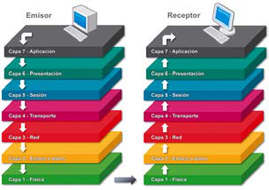
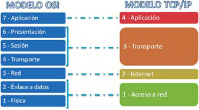
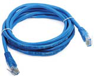
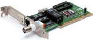
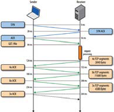
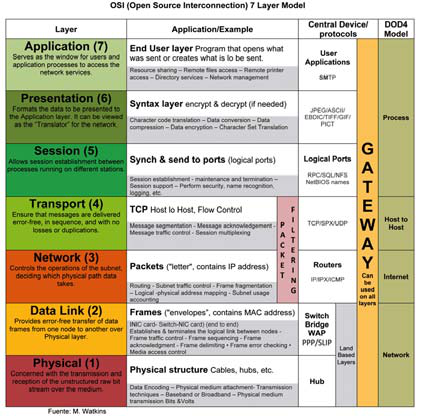

# **Xarxes de comunicacions**

  

    🏆 <strong>Progrés d'aquesta secció:</strong> 0 de 4 superats (0%)
    ⭐ <strong>0 punts</strong>
  

  

    

  

Podem considerar una **xarxa de comunicacions** la composta per **dos o més entitats** la finalitat de la qual és intercanviar informació. Aquesta informació, quan es tracta d'equips informàtics, viatja en forma de **paquets de dades**, que contenen seqüències de zeros i uns.

La forma en la que es connecten les entitats, el mitjà que utilitzen, el protocol que fixen per a les seues comunicacions, etc. pot ser molt variable. De fet, les **primeres xarxes de comunicacions** tenien el seu propi plantejament. No obstant això, açò originava grans esforços a l'hora d'interconnectar-les, per la qual cosa es va decidir fixar un **estàndard** que establira tots els paràmetres que caracteritzen una xarxa.

A continuació tractarem amb detall dos dels models més característics i utilitzats en xarxes de dades i telecomunicacions:

## **El model de referència OSI**

El model OSI (*Open System Interconnection*, interconnexió de sistemes oberts) és un model dissenyat per la **ISO** (*International Organization for Standardization*, organització internacional per a la normalització).

Aquest model **divideix les funcions de la comunicació en set capes**, de manera que cada una es comunica amb l'anterior i amb la següent:

| Capa | Nom | Funció |
| --- | --- | --- |
| 1 | **Física** | Defineix les especificacions eléctriques, mecániques i funcionals de tots els equips que intervenen en el procés de comunicació. |
| 2 | **Enllaç de dades** | Es ocupa de la transferència de les cadenes de dades (en aquest nivell anomenades **tramas**) d'una entitat a una altra, així com de detectar i corregir errors en aquest procés. Ací té importància el codi que identifica a la interfície de comunicació de l'equip (**adreça MAC**). |
| 3 | **Xarxa** | La seua misió és enrutar les cadenes de dades (en aquest nivell anomenades **paquets**) entre entitats de la mateixa xarxa o fins i tot de distintes xarxes, estiguen o no connectades directament. En aquest nivell a cada entitat es li assigna un codi lògic anomenat **adreça IP**. |
| 4 | **Transport** | S'encarrega de segmentar les cadenes de dades a transmetre (en aquest nivell anomenades **segmentos**) i transportar-les d'una entitat a una altra, amb independència del tipus de xarxa que s'utilitze. |
| 5 | **Sessió** | Té com misió controlar l'enllaç que es ha establit en la capa anterior entre les dos entitats que es comuniquen, així com mantener-lo o reestablecer-lo en el cas que la transmissió de dades es interrumpa. |
| 6 | **Presentació** | El seu objectiu és representar la informació que es ha transmitido, amb independència del codi empleat. En aquesta capa comença a prestar-se més atenció a la informació que es transmet que al procés de comunicació en sí. |
| 7 | **Aplicació** | S'encarrega de proporcionar l'accés als serveis propis de cada una de les capes anteriors, així com d'establir els diferents protocols que es utilizarán per a intercanviar informació. |

> **📌 Has de conèixer**
> 

> La **adreça MAC** és un codi de **48 bits** separats en sis blocs que identifica de forma unívoca una targeta o dispositiu de xarxa.

> Exemple: `00:E0:7D:F9:EA:6D`

### **Com funciona el model OSI?**

La base del sistema de capes del model OSI és el **encapsulament**. Mitjançant aquest procés, tot el que concierne a una capa es encapsula, ofrecent a les capes colindantes només la informació que necessiten per a comunicar-se.

Per regla general, quan la informació es va a transmetre des d'una entitat A (**emissor**) a una altra entitat B (**receptor**):

1. L'emissor part de la **capa més alta** del model OSI (la d'aplicació).

1. Va **descendent** per les capes, afegint en cada una d'elles unes **traces d'informació** pròpies de la capa que, entre altres coses, serveixen per a passar informació relevante d'unes capes a altres.

1. Quan arriba a la **capa 1**, es produeix el **enllaç físic** amb el receptor i, en eixe moment, la informació es rep en la capa 1 de l'entitat receptora.

1. Es segueix el procés invers: va **ascendent** per les capes, liberant les traces corresponents en cada una.

1. Finalment arribarà a la capa més alta i el receptor donarà per recibida la informació que es transmitió.

En realitat, les comunicacions també poden hacerse entre capes del mateix nivell a partir de la capa 3, gràcies a l'ús de protocols específics de capa. En qualsevol cas, el flux descendent en l'emissor i ascendent en el receptor sempre es produeix.

## **El model TCP/IP**

El model TCP/IP és **anterior al model OSI**. En realitat és un model que surge a partir de la investigació de diferents protocols, i el nom del model el pren dels seus dos principals protocols: **TCP** e **IP**.

És un model que pot aplicar-se a qualsevol suport, tant maquinari com programari. A més, té la capacitat d'operar en qualsevol tipus de xarxa, el que li permet ser la base d'un gran número d'aplicacions.

A diferència del model de referència OSI, el model TCP/IP **no té una divisió clara de les seues capes**. És més, els seus protocols poden arribar a actuar en més d'una. Les capes en les que es podria organitzar són les següents:

| Capa | Nom | Correspondència amb OSI | Funció |
| --- | --- | --- | --- |
| 1 | **Accés a xarxa** | Capes 1 i 2 | La seua funció és permetre que els paquets d'informació que entren i viajen a través de la xarxa arriben al seu destí. El protocol per a conseguir-lo dependrà de la xarxa de que es trate. |
| 2 | **Internet** | Capa 3 | A l'igual que sucedía amb la capa de xarxa del model OSI, la seua misió és aconseguir que totes les entitats puguen connectar-se amb independència de la xarxa en la que es troben. |
| 3 | **Transport** | Capes 4, 5 i 6 | S'encarrega de gestionar l'enviament d'informació entre les dos entitats que es comuniquen, d'un extremo a l'un altre de la línia de comunicació, amb la possibilitat de detectar i reparar errors durant el procés. |
| 4 | **Aplicació** | Capa 7 | És la capa més alta del model TCP/IP i inclou les aplicacions i els processos amb els que es produeix l'intercanvi de dades. |

## **Protocols de comunicació**

Com recordarás, els **protocols** són un conjunt de normes que, aplicades a un procés de comunicació, permeten que dos entitats intercanvien informació.

Existeix una gamma bastant àmplia de protocols de comunicació. De tots ells destaquem els següents, prenent com referència el **model OSI**, on la distribució de protocols per capes és molt més clara que en el model TCP/IP.

### **Protocols de capa 1**

Fan alusió al tipus de **mitjà** que s'utilitzarà per a establir la connexió, mitjançant cablejat o sense fil, així com a les característiques d'aquest mitjà. Els més representatius són:

- **Cable coaxial**: utilitzat en les primeres xarxes. L'hi ha de distints grosors, amb diferents característiques. En l'actualitat aquest cable s'utilitza en alguns trams de distribucions de xarxes extensas.

- **Cable UTP**: és el cable més utilitzat en xarxes d'àrea local. Existeixen
  distints tipus, cada un amb característiques diferents.

- **Fibra òptica**: empleat mayoritariament en xarxes de gran longitud. És el mitjà que resulta més veloz per a transmetre.
- **Ondas**: infrarrojas, microones, de ràdio, etc.

### **Protocols de capa 2**

Ací destaquem els protocols específics de la **interfície** que s'utilitza per a connectar l'entitat a la xarxa de comunicacions. Entre els més característics estan:

- **Ethernet**: orientat a xarxes d'àrea local. Permet operar fins a a **10 Mbps**.

- **Fast Ethernet**: és una millora de Ethernet, on la velocitat pot arribar fins als **100 Mbps**.

- **Gigabit Ethernet**: millora de Fast Ethernet fins a **1000 Mbps**.

- **10-Gigabit Ethernet**: revisió de l'estàndard Gigabit Ethernet que prevé una millora en la velocitat de fins a **10 Gbps**.

Un protocol molt típic en aquesta capa és **ARP**. Aquest protocol s'encarrega de localitzar la **adreça MAC** d'una entitat a partir del seu **adreça IP**. El protocol que fa l'operació inversa és **RARP**.

### **Protocols de capa 3**

El protocol més característic d'aquesta capa és el protocol **IP**. La seua finalitat és aconseguir que la informació viatge de l'origen al destí a través de la millor ruta possible. Per a això, a cada entitat de la xarxa li assigna un valor anomenat **adreça IP**. El trazado de la ruta des de l'origen al destí es fa a través d'un mecanisme anomenat **encaminament** o **encaminament**.

Un altre protocol destacable d'aquesta capa és **NAT** (*Network Address Translation*): tradueix les adreces IP privades en adreces IP públiques, de forma que diversos dispositius puguen compartir la mateixa connexió a Internet amb una única adreça pública.

Aquest protocol és una de les bases del funcionament de les xarxes i el tratarem amb detall més avant.

### **Protocols de capa 4**

Els principals protocols en aquesta capa són:

- 

**UDP**: es basa en l'enviament de paquets al destí **sense necessitat d'una connexió previa** amb aquest. Cada paquet conté informació suficient com per a arribar al destí per la seua compta. És un protocol on **no existeix sincronizació ni confirmació d'arribada**, per la qual cosa alguns paquets poden adelantar a altres o fins i tot no arribar mai. S'utilitza quan és més important la velocitat de la transmissió que la integritat del que es transmet (per exemple, àudio o vídeo).

- 

**TCP**: juntament amb IP, és un dels principals protocols de Internet. Al contrari que UDP, TCP **estableix una connexió** entre emissor i receptor, garantint que les dades que es transmeten arriben en el **mateix ordre** en que es transmeten i **sense errors**. Aquest protocol és la base de gran part de les aplicacions que treballen sobre Internet, així com de molts dels protocols de capes superiors.

### **Protocols de capa 5**

Els protocols que destaquem en aquesta capa són els següents:

- 

**RPC**: és un protocol utilitzat per a establir connexions remotas, de forma que un equip puga treballar sobre un altre sense necessitat de preocupar-se per les seues comunicacions. Hui en dia, és la base per a l'asistencia remota, així com per a l'ejecució remota d'aplicacions i dels denominats serveis web.

- 

**SSL i TLS**: tant SSL com el seu sucesor, TLS, són protocols la finalitat de la qual és **encriptar la informació** que es transmet perquè només puga ser descifrada pel receptor. S'utilitzen en capes superiors per a donar seguretat a altres protocols, com puguen ser els de correu electrònic o els d'interpretació de pàgines web.

> **📌 Saber més**
> 

> Un **servei web** és una tecnologia que permet que diverses aplicacions intercanvien informació entre sí mitjançant una configuració previa molt simple per a interconnectar-les.

### **Protocols de capa 6**

No hi ha protocols a destacar en aquesta capa.

### **Protocols de capa 7**

Aquesta capa és la que més protocols representatius té, ja que és amb la que interactúa l'usuari. Els més representatius són:

| Protocol | Descripció |
| --- | --- |
| **HTTP** | Potser és el protocol més conegut pels usuaris de Internet. S'encarrega de publicar i interpretar pàgines web. La versió de HTTP amb SSL/TLS es anomena **HTTPS**. |
| **SMTP** | Protocol empleat per a **remitir** correu electrònic. |
| **POP3 i IMAP** | Protocols empleats per a **rebre** el correu electrònic. IMAP és una millora de POP3. |
| **FTP** | Protocol orientat a la **transferència d'arxius** fent ús del protocol TCP. Com en HTTP, la versió segura de FTP es denomina **FTPS**. |

### **Resum: protocols més utilitzats**

En la següent taula es presentan els protocols de comunicació més utilitzats, agrupats per capes del model OSI:

| Capa | Protocol | Descripció |
| --- | --- | --- |
| **Aplicació** | HTTP, HTTPS | Publicar i interpretar text, imatges, sonido, vídeo, etc. en Internet. |
|  | SMTP, POP3, IMAP | Enviar i rebre correu electrònic. |
|  | DHCP | Configurar l'equip per a obtindre automàticament una adreça IP. |
|  | DNS | Traduir noms de domini a adreces IP. |
|  | FTP, FTPS | Transferir arxius. |
|  | RPC | Establir connexions remotas per a treballar sobre un altre equip. |
|  | SSL, TLS | Encriptar la informació en l'emissor perquè només el receptor puga descifrar-la. |
| **Transport** | TCP, UDP | Enviar paquets per la millor ruta possible perquè arriben al seu destí. |
| **Xarxa** | IP | Assigna adreces úniques als dispositius de la xarxa i enruta els paquets (*encaminament* o *encaminament*). |
|  | NAT | Tradueix adreces IP privades en adreces IP públiques. |
| **Enllaç de dades** | Ethernet, WLAN | Definir com es comuniquen els dispositius dins d'una xarxa cablejada (Ethernet) o sense fil (WLAN). |

> **📌 Fitxa de treball · Protocols de comunicació**
> 

> En la Fitxa de treball protocols del mòdul completaréis la taula dels protocols **HTTP, FTP, NNTP, TELNET i SMTP**, indicant la capa del model OSI en la que opera cada un, la seua funció i un exemple d'ús.

## **Activitats**

> **📌 Activitat 7**
> 

> Completa els espais buits del següent esquema, corresponent als models de sistemes de comunicacions:

| Model OSI | Model TCP/IP |
| --- | --- |
| Capa 7: ………… | Capa 4: ………… |
| Capa 6: ………… |  |
| Capa 5: ………… |  |
| Capa 4: ………… | Capa 3: ………… |
| Capa 3: ………… | Capa 2: ………… |
| Capa 2: ………… |  |
| Capa 1: ………… | Capa 1: ………… |

> **📌 Activitat 8 · Utilitza les TIC**
> 

> En equips de dos a quatre persones:

> 1. 

> Completad una taula com la següent amb els protocols HTTP, FTP, NNTP, TELNET i SMTP:

| Protocol | Capa/s del model OSI en la que opera | Funció | Exemple d'ús |
| --- | --- | --- | --- |
| HTTP | 6 i 7 | Accedeix a un servidor d'hipertext, mostrant el contingut del fitxer o guardándolo en l'equip. | [http://todofp.es](http://todofp.es) |
| FTP |  |  |  |
| NNTP |  |  |  |
| TELNET |  |  |  |
| SMTP |  |  |  |

> 1. 

> Añadid almenys dos protocols més, a la vostra elecció, amb la seua capa, funció i exemple d'ús.

> **📌 Activitat 9**
> 

> El model OSI ha contribuido a impulsar la comunicació. Individualment o en xicotets grups, haced una llista d'almenys **deu aplicacions** que permitan la comunicació en mòbils, portátiles o ordinadors (exemples: WhatsApp, Zoom, correu electrònic). Per a cada una, indicad què capes del model OSI intervenen en el seu funcionament.

## **En resum**

---

## 🎮 Reptes Interactius d'Autoavaluació (+100 XP)

Comprova el teu domini sobre **1.3 Xarxes de comunicacions** superant aquests 4 reptes gamificats (+25 punts cadascun):

  
🎯 <strong>Repte 1 (+25 pts):</strong> Quins són els cinc elements fonamentals que intervenen en tot sistema de comunicació?

  

    <button type="button" class="btn-mcq-opt" data-opt="A">A) Emissor, receptor, missatge, canal i codi.</button>
    <button type="button" class="btn-mcq-opt" data-opt="B">B) Teclat, ratolí, impressora, altaveu i taula.</button>
    <button type="button" class="btn-mcq-opt" data-opt="C">C) Paret, sostre, porta, finestra i armari.</button>
    <button type="button" class="btn-mcq-opt" data-opt="D">D) Cobre, plàstic, vidre, paper i fusta.</button>
  

  

  
🎯 <strong>Repte 2 (+25 pts):</strong> En el model de referència OSI de 7 capes, quina és la capa 1 encarregada de transmetre els bits com a senyals elèctrics, òptics o d'ones per el mitjà?

  

    <button type="button" class="btn-mcq-opt" data-opt="A">A) Capa d'Aplicació (Capa 7).</button>
    <button type="button" class="btn-mcq-opt" data-opt="B">B) Capa Física (Capa 1).</button>
    <button type="button" class="btn-mcq-opt" data-opt="C">C) Capa de Sessió (Capa 5).</button>
    <button type="button" class="btn-mcq-opt" data-opt="D">D) Capa de Presentació (Capa 6).</button>
  

  

  
✅ <strong>Repte 3 (Vertader o Fals · +25 pts):</strong> Una adreça IPv4 està formada per 32 bits dividits en 4 octets (4 números decimals entre 0 i 255 separats per punts, com <code>192.168.1.10</code>).

  

    <button type="button" class="btn-vf" data-opt="V">Vertader (V)</button>
    <button type="button" class="btn-vf" data-opt="F">Fals (F)</button>
  

  

  
⌨️ <strong>Repte 4 (+25 pts):</strong> Quants bits formen un byte (o octet) en els sistemes digitals i de comunicacions?

  

    <input type="text" class="quiz-input" placeholder="Escriu la resposta..." />
    <button type="button" class="btn-quiz-check">Comprovar</button>
  

  

### 📋 Llista de Comprovació i Rúbrica d'Assoliment

Marca cada criteri a mesura que completes l'estudi o la resolució pràctica d'aquesta pàgina (**1.3 Xarxes de comunicacions**):

- [ ] He llegit detingudament la teoria o l'enunciat d'aquesta secció i he anotat els conceptes clau.
- [ ] He revisat els esquemes, taules o blocs de codi i he verificat que sé aplicar-los a l'entorn de treball.
- [ ] He resolt correctament els **4 reptes interactius** superiors obtenint els **100 punts XP**.
- [ ] He descarregat el comprovant oficial en PDF per a adjuntar-lo a la tasca d'**Aules**.

  <h3>📤 Comprovant de Lliurament per a Aules</h3>
  
Quan hages completat els reptes interactius i la llista d'autoavaluació d'aquesta pàgina, introdueix el teu nom i descarrega el teu certificat oficial en PDF per a adjuntar-lo a la tasca d'<strong>Aules</strong>.

  

    <label for="aules-student-name">👤 Nom i Cognoms de l'Alumne/a:</label>
    <input type="text" id="aules-student-name" class="aules-student-name" placeholder="Ex: Joan Garcia Pérez" />
  

  

    0/4 reptes completats (0%) · 0 punts · 0/4 criteris d'autoavaluació
  

  

    <button type="button" class="btn-aules-dl" data-module="IMX" data-unit="UD01" data-activity="ut0103">📥 Descarregar Comprovant PDF</button>
    <button type="button" class="btn-aules-copy">📋 Copiar Resum al Porta-retalls</button>
  

  

