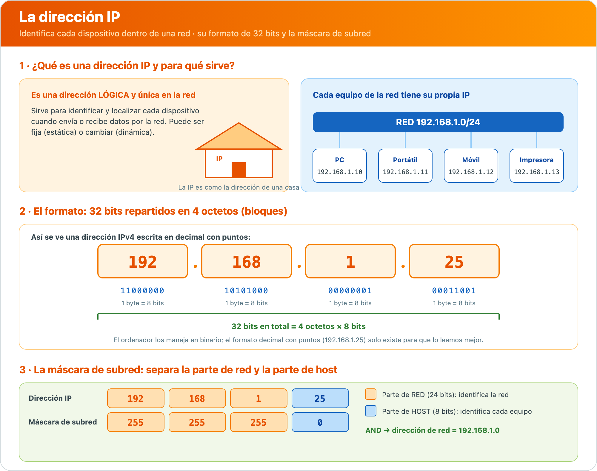
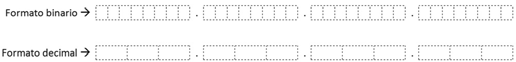
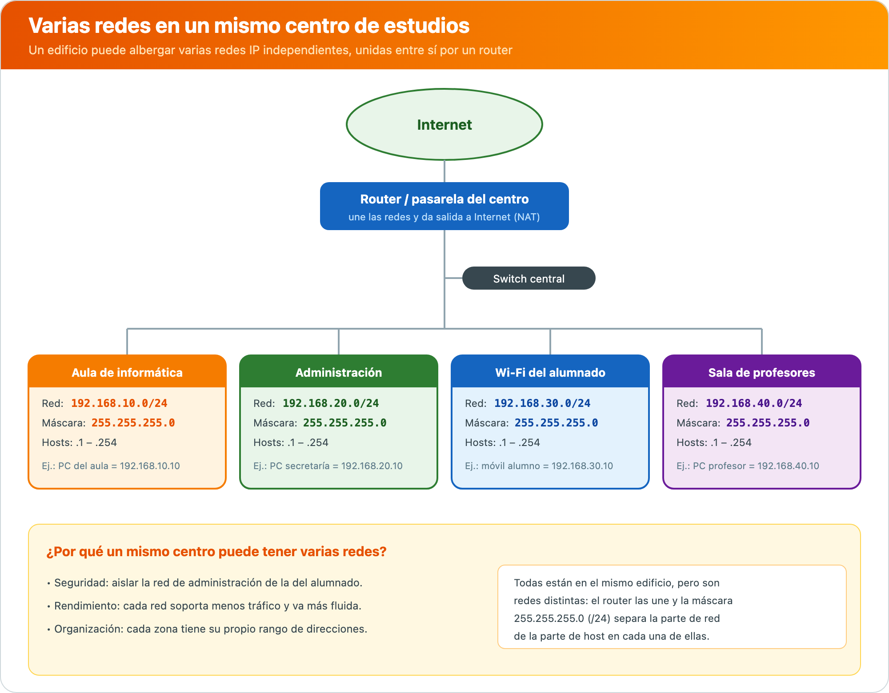

# **Adreça IP**

<div class="interactive-progress-tracker">
  <div class="tracker-header">
    <span>🏆 <strong>Progrés d'aquesta secció:</strong> <span class="tracker-count">0 de 4 superats (0%)</span></span>
    <span class="tracker-pts">⭐ <strong>0 punts</strong></span>
  </div>
  <div class="tracker-bar">
    <div class="tracker-fill" style="width: 0%;"></div>
  </div>
</div>

Un dels elements clau a l'hora de treballar amb xarxes de dades i telecomunicacions és el concepte de **IP**.

Com hem vist, cada una de les entitats amb capacitat per a emitir i rebre informació rep una **adreça IP**. Eixa adreça IP, al contrari que la **adreça MAC**, **no és específica del dispositiu**, podent donar-se el cas de que una entitat reba adreces IP diferents en un determinat moment en la xarxa, en funció de què paper tome en la mateixa.

Ja que cada element de la xarxa estarà identificat per una adreça IP, és imprescindible conèixer què són, com s'assignen i com es gestionen.

> **📌 Recorda**
> 

> - **Adreça MAC**: codi fix de **48 bits** (sis blocs) que identifica de forma unívoca la targeta o dispositiu de xarxa. Exemple: `00:E0:7D:F9:EA:6D`.

> - **Adreça IP**: codi lògic que s'assigna a cada entitat de la xarxa. Pot canviar segons el paper que tome el dispositiu en la xarxa.

> **📌 Exemple**
> 

> Les adreces IP i MAC són l'equivalent a la manera en la que enviem una carta per correu postal: la **adreça IP** es correspon amb la **adreça d'una casa** i la **adreça MAC** amb el **destinatari**.

Qualsevol dispositiu connectat a una xarxa informàtica ha de disposar de **dos adreces** necessàriament:

- **Adreça IP**: és l'adreça **lògica** que es necessita per a accedir a un equip. Pot ser:

- **Estàtica**: és fixa per al dispositiu i no canvia, com la dels servidors de Internet.

- **Dinàmica**: pot canviar amb el pas del temps, com la dels nostres equips en casa.

- **Adreça MAC**: és l'adreça **física** necessària per a identificar unívocament la targeta de xarxa. Un dispositiu de xarxa pot tindre diverses targetes de xarxa, però cada una amb la seua pròpia adreça MAC.

L'adreça IP va acompañada de la **màscara de xarxa**. Entre les dos s'identifica la xarxa en la que es treballa. La màscara de xarxa fa que es enruten els paquets de dades de la millor forma possible per a arribar al seu destí segons l'adreça d'origen i de destí.



## **Les versions del protocol IP**

De totes les versions del protocol IP, les dos més característiques són les que veurem a continuació.

### **Protocol IPv4**

És la **quarta versió** del protocol IP i la primera que es implantó a gran escala. Fa ús de **32 bits** separats per punts en blocs de **un byte**, seguint una estructura com aquesta:

```bash
192.168.0.1
```



Així, existeixen **2³² adreces possibles** (més de quatre milions), que es estructuran inicialment en **cinc classes**:

| Classe | Rang | Ús |
| --- | --- | --- |
| **Classe A** | 0.0.0.0 – 0.255.255.255 | Reservat |
|  | 1.0.0.0 – 9.255.255.255 | Públic |
|  | 10.0.0.0 – 10.255.255.255 | Privat |
|  | 11.0.0.0 – 126.255.255.255 | Públic |
|  | 127.0.0.0 – 127.255.255.255 | Reservat |
| **Classe B** | 128.0.0.0 – 172.15.255.255 | Públic |
|  | 172.16.0.0 – 172.31.255.255 | Privat |
|  | 172.32.0.0 – 191.255.255.255 | Públic |
| **Classe C** | 192.0.0.0 – 192.167.255.255 | Públic |
|  | 192.168.0.0 – 192.168.255.255 | Privat |
|  | 192.169.0.0 – 223.255.255.255 | Públic |
| **Classe D** | 224.0.0.0 – 239.255.255.255 | Reservat |
| **Classe E** | 240.0.0.0 – 255.255.255.255 | Reservat |

En el format decimal, l'adreça IPv4 va des de `0.0.0.0` fins a `255.255.255.255`. Els equips treballen amb les adreces IP en **format binari** però, lógicament, per a nosaltres és més manejable el format decimal, motiu pel que convé manejar adequadament la conversió binari-decimal-binari.

La forma en que es secuencian les adreces IP és molt simple: cada bloc podria considerar-se un element en un comptador. El bloc situat més a la dreta va crecent fins a arribar a 255. Al crecer un més, l'element volvería a començar en el 0 i aumentaría en 1 el bloc de l'esquerra, i així amb el resta de blocs.

El continu creixement de Internet, unido al desperdicio d'adreces a l'hora de crear subredes, ha fet que l'oferta d'adreces IP disponibles a través de IPv4 es quede corta i haja que recurrir a un altre protocol.

#### **La màscara de xarxa**

La **màscara de xarxa** és un codi que acompanya a l'adreça IP i que determina què part de l'adreça identifica la **xarxa** i què part identifica al **host** (equip). Té la mateixa estructura que l'adreça IPv4: 32 bits separats per punts en blocs d'un byte.

```bash
Dirección IP:   192.168.0.1
Máscara de red: 255.255.255.0
```

En binari, la màscara de xarxa està formada per **uns consecutius** (part de xarxa) seguits de **zeros consecutius** (part d'host). Els zeros de la màscara de xarxa indiquen les adreces, dins de l'adreça de xarxa, que es poden assignar a equips de xarxa u **hosts**.

#### **Operació lògica AND**

Al fer una **operació lògica AND** entre l'adreça IP i la màscara de xarxa, obtenim la **adreça de xarxa**.

| Operació AND |
| --- |
| 1 AND 1 = 1 |
| 1 AND 0 = 0 |
| 0 AND 0 = 0 |
| 0 AND 1 = 0 |

> **📌 Exemple**
> 

> Adreça IP `192.168.0.1` i màscara de xarxa `255.255.255.0`:

> - IP en binari: `11000000.10101000.00000000.00000001`

> - Màscara en binari: `11111111.11111111.11111111.00000000`

> - Resultat AND: `11000000.10101000.00000000.00000000`

> L'adreça de xarxa obtenida és **192.168.0.0**.

#### **Adreça de xarxa, broadcast i rang d'hosts**

Dins de les adreces d'host, **dos d'elles no es poden assignar**:

- **Adreça de xarxa**: identifica la xarxa en sí. En l'exemple és `192.168.0.0`.

- **Adreça de broadcast**: emprada per a enviar paquets a tots els hosts de la xarxa al mateix temps. És l'adreça de xarxa més alta dins del rang de la xarxa. En l'exemple és `192.168.0.255`.

El **resta d'adreces IP** entre les dos anteriors es poden assignar a hosts. En l'exemple: des de `192.168.0.1` fins a `192.168.0.254`.

#### **Adreces IP privades i notació CIDR**

Existeixen adreces IP **privades** que no es poden assignar públicament en Internet, reservades només per a **xarxes privades** com les de les nostres cases o oficines:

| Xarxa privada | Rang |
| --- | --- |
| 10.0.0.0/8 | 10.0.0.0 – 10.255.255.255 |
| 172.16.0.0/12 | 172.16.0.0 – 172.31.255.255 |
| 192.168.0.0/16 | 192.168.0.0 – 192.168.255.255 |

La **notació IP/màscara (o notació CIDR)** és una forma compacta de representar una adreça IP juntament amb la seua màscara de xarxa. Per exemple, en `192.168.1.0/24`:

- `192.168.1.0` és l'adreça base de la xarxa.

- `/24` indica que els primers **24 bits** s'utilitzen per a definir la part de xarxa. Per tant, la seua màscara de xarxa és `255.255.255.0`.

#### **Diverses xarxes en un mateix centre**

Un mateix centre d'estudios pot tindre **diverses xarxes IP distintes**. És habitual separar per zones (aula d'informàtica, administració, Wi-Fi de l'alumnat, sala de professors…) perquè cada una té els seus pròpies necessitats de **seguretat, rendiment i organització**.



Encara que totes les zones estiguen en el mateix edifici, són **xarxes independents**: cada una usa el seu propi rang d'adreces (per exemple `192.168.10.0/24`, `192.168.20.0/24`…) i la seua màscara `255.255.255.0`. El **router** s'encarrega d'unirlas i de darles eixida a Internet.

#### **Cas pràctic resuelto**

Disposem d'una targeta de xarxa amb IP `172.96.0.22` i màscara de xarxa `255.255.0.0`. Hem de calcular l'adreça de xarxa, el número de bits que es poden assignar a hosts, la primera adreça d'host, la última adreça d'host i l'adreça de broadcast:

1. Passem l'adreça IP `172.96.0.22` a binari: `10101100.01100000.00000000.00010110`.

1. Passem la màscara de xarxa `255.255.0.0` a binari: `11111111.11111111.00000000.00000000`.

1. Fem la **operació AND** entre totes dues per a obtindre l'adreça de xarxa: `10101100.01100000.00000000.00000000`, que es correspon amb l'adreça decimal **172.96.0.0**.

1. Els **bits a zero** de la màscara de xarxa són els que es poden utilitzar per a compondre adreces d'hosts. Per tant, són els **últims 16 bits**.

1. Si `172.96.0.0` és l'adreça de xarxa, la següent, `172.96.0.1`, és la **primera adreça d'host**.

1. La **adreça de broadcast** és la última adreça d'host reservada per a això i, per tant, és la `172.96.255.255`.

1. L'adreça anterior a la de broadcast és la **última adreça asignable a hosts**: `172.96.255.254`.

### **Protocol IPv6**

El protocol IPv6 ve a cubrir les necessitats del protocol IPv4. Empra **128 bits** en lloc de 32, per la qual cosa ofereix un total de **2¹²⁸ adreces IP diferents** (uns 340 sextillones).

Les adreces IPv6 es representen com **8 grups de 2 bytes**, separats per dos punts («:»). No es representa amb el sistema decimal sinó amb el **hexadecimal**:

```bash
3FFA:00D1:AF29:1001:34D1:0000:B4EB:0FFA
```

#### **Sistema hexadecimal**

$$H = {0, 1, 2, 3, 4, 5, 6, 7, 8, 9, A, B, C, D, E, F}$$

- Cada número hexadecimal pot considerar-se una representació d'un número binari de **4 bits**.

- Els valors de `A` a `F` es corresponen en decimal als valors 10 a 15, respectivament.

| Hexadecimal | Binari | Decimal |
| --- | --- | --- |
| 0 | 0000 | 0 |
| 1 | 0001 | 1 |
| 2 | 0010 | 2 |
| 3 | 0011 | 3 |
| 4 | 0100 | 4 |
| 5 | 0101 | 5 |
| 6 | 0110 | 6 |
| 7 | 0111 | 7 |
| 8 | 1000 | 8 |
| 9 | 1001 | 9 |
| A | 1010 | 10 |
| B | 1011 | 11 |
| C | 1100 | 12 |
| D | 1101 | 13 |
| E | 1110 | 14 |
| F | 1111 | 15 |

#### **Conversió hexadecimal – binari**

Es converteix a **binari** cada un dels elements hexadecimals, en el mateix ordre en que es troben, tenint en compte que `A = 10`, `B = 11`, `C = 12`, `D = 13`, `E = 14` i `F = 15` en la notació decimal.

#### **Conversió hexadecimal – decimal**

La conversió d'hexadecimal a decimal, o viceversa, passa per traduir el valor a **binari** i, d'ahí, al sistema corresponent, aplicant les tècniques que hem vist.

#### **Notació abreujada**

La notació permet abreviar els blocs de la següent manera:

- Els **zeros a l'esquerra** poden descartar-se. Per exemple, és el mateix `003E` que `3E`.

- El bloc `0000` pot reducir-se a `0`.

- Si hi ha **dos o més grups consecutius amb valor 0**, pot reducir-se a `::`, però **només en una ocasió** en la mateixa adreça IP.

> **📌 Exemple**
> 

> - `2000:0011:3D4A:0055:0000:0000:2F01:5432` equival a `2000:11:3D4A:55::2F01:5432`.

> - `7144:0000:A101:0000:0000:0000:31BB:4A23` equival a `7144:0:A101::31BB:4A23`.

#### **Adreces IPv4 compatibles**

Les adreces IPv6 permeten adaptar adreces IPv4 a la seua notació. La forma habitual de fer-ho és posar els **dos primers blocs a zero** i els dos últims representar-los com una **IPv4**. Açò és el que es coneix com **adreça IPv4 compatible**.

> **📌 Exemple**
> 

> L'adreça IPv4 `192.168.0.1` podria escriure's en notació de IPv6 com `0:0:192.168.0.1`, o també com `::192.168.0.1`.

## **Activitats**

> **📌 Activitat 10**
> 

> 1. Un adaptador de xarxa té l'adreça IP `10.0.0.25` i la màscara de xarxa `255.255.255.0`. Quin és l'adreça de xarxa? I la de broadcast?

> 1. Un equip té l'adreça IP `172.16.5.200` i la màscara de xarxa `255.255.255.0`. Quin és l'adreça de broadcast?

> 1. Obtingues l'adreça de xarxa, l'adreça de broadcast i el rang de les IP direccionables del següent equip amb adreça IP `192.168.3.6` i màscara de subxarxa `255.255.255.0`.

> **📌 Activitat 11**
> 

> 1. Quants bits té una adreça IPv6? I una IPv4? Quantes adreces diferents ofereix cada una?

> 1. Escriu l'adreça `2001:0DB8:1:2::3:4` amb tots els seus blocs complets i sense abreviar. Indica si l'adreça `2001:::1:2:3` està bé escrita i explicad per què.

> 1. Converteix l'adreça IPv4 `10.0.0.1` a notació IPv4 compatible en IPv6.

> **📌 Activitat 12**
> 

> Accedeix a [https://whatismyipaddress.com/](https://whatismyipaddress.com/) i comprova quin és el teu IP pública en Internet. Després, en Windows, escriu `ipconfig /all` en el símbol del sistema (cmd) i anota el teu **adreça IPv4** i el teu **adreça física (MAC)**, comparándolas amb les del resta de l'aula.

> **📌 Activitat 13**
> 

> Completa cada frase amb el protocol correcte entre **FTP, UDP, SMTP, DHCP, NAT, HTTPS i ARP**:

> 1. Quan un ordinador vol saber què adreça física (MAC) té un altre ordinador en la xarxa, usa el protocol ………

> 1. Perquè diversos dispositius compartan la mateixa connexió a Internet amb una única adreça pública, s'usa ………

> 1. Quan enviem un correu electrònic, aquest viatja a través de ………

> 1. Els videojuegos online i les videollamades funcionen millor amb ……… perquè envia dades més ràpid, encara que a vegades es pierdan.

> 1. Quan entramos a una pàgina web segura, com un banco o una botiga online, el navegador usa ……… per a cifrar la informació.

> 1. Per a descarregar o pujar arxius a un servidor, usem ……….

## **En resum**

- La **adreça IP** és l'adreça lògica que s'assigna a cada entitat de la xarxa; pot ser **estàtica** (fixa) o **dinàmica** (canvia amb el temps).

- La **adreça MAC** és el codi físic de **48 bits** que identifica unívocament la targeta de xarxa.

- Les adreces IP van acompañades de la **màscara de xarxa**; la **operació lògica AND** entre totes dues dóna la **adreça de xarxa**.

- Dos adreces dins d'una xarxa no es poden assignar a hosts: la **adreça de xarxa** i la **adreça de broadcast** (la més alta del rang).

- **IPv4** usa 32 bits (4 blocs de 1 byte, decimal), amb **5 classes** (A–E) i **rangs públics, privats i reservats**. Es expressa en **notació CIDR** (ej.: `/24`).

- **IPv6** usa 128 bits (8 blocs de 2 bytes, hexadecimal), amb regles de **abreviació** i **IPv4 compatible**.


---

## 🎮 Reptes Interactius d'Autoavaluació (+100 XP)

Comprova el teu domini sobre **1.4 Adreça IP** superant aquests 4 reptes gamificats (+25 punts cadascun):

<div class="interactive-mcq" data-answer="A" data-hint="L'emissor envia el missatge al receptor a través d'un canal utilitzant un codi comú.">
  <div class="mcq-question">🎯 <strong>Repte 1 (+25 pts):</strong> Quins són els cinc elements fonamentals que intervenen en tot sistema de comunicació?</div>
  <div class="mcq-options">
    <button type="button" class="btn-mcq-opt" data-opt="A">A) Emissor, receptor, missatge, canal i codi.</button>
    <button type="button" class="btn-mcq-opt" data-opt="B">B) Teclat, ratolí, impressora, altaveu i taula.</button>
    <button type="button" class="btn-mcq-opt" data-opt="C">C) Paret, sostre, porta, finestra i armari.</button>
    <button type="button" class="btn-mcq-opt" data-opt="D">D) Cobre, plàstic, vidre, paper i fusta.</button>
  </div>
  <div class="quiz-feedback"></div>
</div>

<div class="interactive-mcq" data-answer="B" data-hint="La Capa 1 del model OSI és la Capa Física.">
  <div class="mcq-question">🎯 <strong>Repte 2 (+25 pts):</strong> En el model de referència OSI de 7 capes, quina és la capa 1 encarregada de transmetre els bits com a senyals elèctrics, òptics o d'ones per el mitjà?</div>
  <div class="mcq-options">
    <button type="button" class="btn-mcq-opt" data-opt="A">A) Capa d'Aplicació (Capa 7).</button>
    <button type="button" class="btn-mcq-opt" data-opt="B">B) Capa Física (Capa 1).</button>
    <button type="button" class="btn-mcq-opt" data-opt="C">C) Capa de Sessió (Capa 5).</button>
    <button type="button" class="btn-mcq-opt" data-opt="D">D) Capa de Presentació (Capa 6).</button>
  </div>
  <div class="quiz-feedback"></div>
</div>

<div class="interactive-vf" data-answer="V" data-hint="4 octets × 8 bits = 32 bits en total per a una adreça IPv4.">
  <div class="vf-statement">✅ <strong>Repte 3 (Vertader o Fals · +25 pts):</strong> Una adreça IPv4 està formada per 32 bits dividits en 4 octets (4 números decimals entre 0 i 255 separats per punts, com <code>192.168.1.10</code>).</div>
  <div class="vf-buttons">
    <button type="button" class="btn-vf" data-opt="V">Vertader (V)</button>
    <button type="button" class="btn-vf" data-opt="F">Fals (F)</button>
  </div>
  <div class="quiz-feedback" style="width: 100%;"></div>
</div>

<div class="interactive-quiz" data-answer="8|vuit|8 bits" data-hint="Un byte o octet equival a 8 bits.">
  <div class="quiz-question">⌨️ <strong>Repte 4 (+25 pts):</strong> Quants bits formen un byte (o octet) en els sistemes digitals i de comunicacions?</div>
  <div class="quiz-controls">
    <input type="text" class="quiz-input" placeholder="Escriu la resposta..." />
    <button type="button" class="btn-quiz-check">Comprovar</button>
  </div>
  <div class="quiz-feedback"></div>
</div>

### 📋 Llista de Comprovació i Rúbrica d'Assoliment

Marca cada criteri a mesura que completes l'estudi o la resolució pràctica d'aquesta pàgina (**1.4 Adreça IP**):

- [ ] He llegit detingudament la teoria o l'enunciat d'aquesta secció i he anotat els conceptes clau.
- [ ] He revisat els esquemes, taules o blocs de codi i he verificat que sé aplicar-los a l'entorn de treball.
- [ ] He resolt correctament els **4 reptes interactius** superiors obtenint els **100 punts XP**.
- [ ] He descarregat el comprovant oficial en PDF per a adjuntar-lo a la tasca d'**Aules**.

<div class="aules-delivery-card">
  <h3>📤 Comprovant de Lliurament per a Aules</h3>
  <p>Quan hages completat els reptes interactius i la llista d'autoavaluació d'aquesta pàgina, introdueix el teu nom i descarrega el teu certificat oficial en PDF per a adjuntar-lo a la tasca d'<strong>Aules</strong>.</p>
  <div class="aules-student-field">
    <label for="aules-student-name">👤 Nom i Cognoms de l'Alumne/a:</label>
    <input type="text" id="aules-student-name" class="aules-student-name" placeholder="Ex: Joan Garcia Pérez" />
  </div>
  <div class="aules-score-badge">
    <span class="aules-score-count">0/4 reptes completats (0%) · 0 punts · 0/4 criteris d'autoavaluació</span>
  </div>
  <div class="aules-actions">
    <button type="button" class="btn-aules-dl" data-module="IMX" data-unit="UD01" data-activity="ut0104">📥 Descarregar Comprovant PDF</button>
    <button type="button" class="btn-aules-copy">📋 Copiar Resum al Porta-retalls</button>
  </div>
  <div class="aules-toast"></div>
</div>
