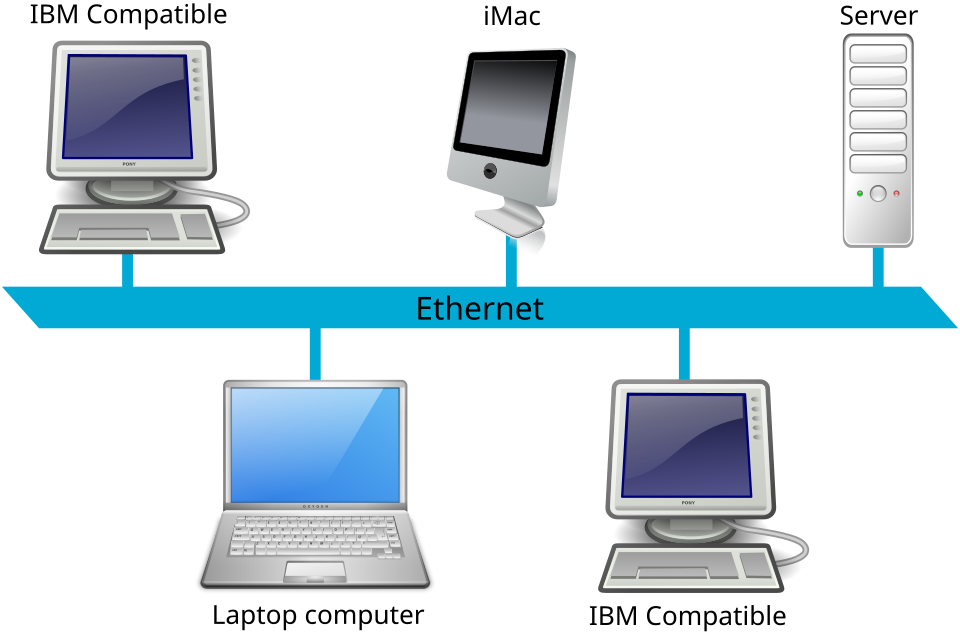

# Cuaderno Práctico de Actividades — UD2: Xarxes de Dades — Tipus (LAN/MAN/WAN), Topologies i Arquitectures

  

    🏆 <strong>Progreso de esta sección:</strong> 0 de 4 superados (0%)
    ⭐ <strong>0 puntos</strong>
  

  

    

  

En esta sección tienes acceso directo a todas las actividades prácticas, fichas de trabajo y retos evaluables de esta unidad didáctica. Puedes acceder a cada actividad individualmente o consultar la recopilación completa a continuación:

## 🗂️ Índice de Actividades de la Unidad

- **[🛠️ FICHA 2.1 · Tipus de xarxes, abast i arquitectures](ficha201.html)**
- **[🛠️ FICHA 2.2 · Mitjans de transmissió guiats i no guiats](ficha202.html)**

---

## FICHA 2.1 · Tipus de xarxes, abast i arquitectures

👉 *[Obrir aquesta activitat en pàgina individual](ficha201.html)*

# **FICHA 2.1 · Tipus de xarxes, abast i arquitectures**

📥 
📄 

| Alumne/a | Grup | Data |
| --- | --- | --- |
|  |  |  |

> **📌 ¿Qué repasamos?**
> 

> Les xarxes es classifiquen segons el seu **abast geogràfic** (PAN, LAN, MAN, WAN). Les **topologies** defineixen la forma en que es connecten els equips (bus, estrela, anell, malla, arbre, mixta). Les **arquitectures** determinan la relació entre equips: **client-servidor** o **peer-to-peer** (*igual a igual*).

## 1 · Classificació de xarxes per abast geogràfic

1. Completa la següent taula indicant per a cada tipus de xarxa el seu abast, una tecnologia habitual i un exemple pràctic:

| Tipus de xarxa | Abast geogràfic | Tecnologia habitual | Exemple pràctic |
| --- | --- | --- | --- |
| **PAN** |  |  |  |
| **LAN** |  |  |  |
| **MAN** |  |  |  |
| **WAN** |  |  |  |

1. Què tipus de xarxa es utilizaría en cada un d'aquests escenarios? Raona brevement la teua resposta:

| Escenario | Tipus de xarxa (PAN/LAN/MAN/WAN) | Justificació |
| --- | --- | --- |
| Connectar l'ordinador portàtil d'un usuari amb el seu telèfon mòbil mitjançant Bluetooth. |  |  |
| Connectar els ordinadors de les tres plantes d'un institut de Educació Secundària. |  |  |
| Connectar les oficines d'una empresa en Valencia, Madrid i Barcelona. |  |  |
| Connectar els dispositius de l'hogar (TV, consola, portàtil) al router doméstic. |  |  |

## 2 · Topologies de xarxa

1. Completa la següent taula amb les **avantatges** e **inconvenients** de les topologies de **estrela** i **malla**:

| Topologia | Avantatges | Inconvenients |
| --- | --- | --- |
| **Estrela** |  |  |
| **Malla** |  |  |

1. Què topologia de xarxa s'utilitza habitualment en les xarxes d'oficina actuals? Justifica la teua resposta.

1. Dibuixa un esquema amb **almenys 5 nodes** per a cada una de les següents topologies. Indica clarament els nodes i les connexions:

| Topologia | Dibuix / esquema (descripció o representació) |
| --- | --- |
| **Bus** |  |
| **Estrela** |  |
| **Anell** |  |

## 3 · Arquitectures de xarxa

1. Completa la taula comparativa entre **client-servidor** i **peer-to-peer** (*igual a igual*):

| Aspecte a comparar | **Client-Servidor** | **Peer-to-peer (P2P)** |
| --- | --- | --- |
| **Qui gestiona els recursos?** |  |  |
| **Seguretat** |  |  |
| **Escalabilitat** |  |  |
| **Cost d'implementació** |  |  |
| **Exemple d'ús** |  |  |

1. 

Indica en què situacions és més convenient utilitzar cada arquitectura i justifica la teua resposta:

1. 

**Client-Servidor:** ***_**_**_**_**_**_**_**_**  

**_**_**_**_**_**_**_**_**_**_***_  

***_**_**_**_**_**_**_**_**_**_***____

1. 

**Peer-to-peer (P2P):** ***_**_**_**_**_**_**_**_**  

***_**_**_**_**_**_**_**_**_**_**_  

**_**_**_**_**_**_**_**_**_**_**

## 4 · Autoavaluació

Marca una casella per fila per a valorar com et sents amb cada idea:

| Concepte | L'entenc | Quasi | El necessite repassar |
| --- | --- | --- | --- |
| Classificació de xarxes per abast (PAN/LAN/MAN/WAN) |  |  |  |
| Identificar el tipus de xarxa en un escenario real |  |  |  |
| Topologies de xarxa: característiques, avantatges i inconvenients |  |  |  |
| Arquitectures client-servidor i peer-to-peer |  |  |  |
| Triar l'arquitectura més adequada segons el cas |  |  |  |

> **📌 Es valorarà**
> 

> - La correcta classificació de les xarxes per abast geogràfic.

> - La descripció d'avantatges, inconvenients i característiques de les topologies.

> - La comparació correcta entre arquitectures client-servidor i peer-to-peer.

> - La justificació razonada en els escenarios planteats.

> - Neteja, ordre i claredat en les respostes.

> Aquesta fitxa et servirà per a practicar el **CE5b** (identificar els diferents tipus de xarxes i els seus estructures alternatives) abans del **EXA102**.

---

## FICHA 2.2 · Mitjans de transmissió guiats i no guiats

👉 *[Obrir aquesta activitat en pàgina individual](ficha202.html)*

# **FICHA 2.2 · Mitjans de transmissió guiats i no guiats**

📥 
📄 

| Alumne/a | Grup | Data |
| --- | --- | --- |
|  |  |  |

> **📌 ¿Qué repasamos?**
> 

> Els **mitjans de transmissió guiats** conducen el senyal per un cable (parell trenat, fibra òptica, cable coaxial). Els **mitjans no guiats** la propagan pel espai lliure (microones, infrarojos, radiofreqüència). El cablejat estructurat es rige per la normativa **TIA/EIA-568**.

## 1 · Mitjans de transmissió guiats

1. Completa la següent taula de mitjans de transmissió guiats:

| Mitjà | Categories/tipus | Velocitat típica | Distància màxima aproximada | Ús principal |
| --- | --- | --- | --- | --- |
| **Parell trenat (UTP/STP/FTP)** | Cat 5e, Cat 6, Cat 6a, Cat 7, Cat 8 |  |  |  |
| **Fibra òptica** | Monomode / Multimode |  |  |  |
| **Cable coaxial** | RG-58, RG-59, RG-6 (o altres) |  |  |  |

1. Per què es trenzan els parells d'hilos en el cable **UTP**? Què problema resol el trenat?

1. Completa la taula comparativa entre **UTP**, **STP** i **FTP**:

| Aspecte | **UTP** (*Unshielded Twisted Pair*) | **STP** (*Shielded Twisted Pair*) | **FTP** (*Foiled Twisted Pair*) |
| --- | --- | --- | --- |
| **Blindatge** |  |  |  |
| **Inmunitat a interferències** |  |  |  |
| **Flexibilitat / facilitat d'instal·lació** |  |  |  |
| **Cost** |  |  |  |
| **Ús més habitual** |  |  |  |

1. Què tipus de fibra òptica utilitzaries per a un enllaç entre dos edificis d'un campus situats a **3 km** de distància? Justifica la teua resposta.

## 2 · Mitjans de transmissió no guiats

1. Explica brevement en què consisteixen els següents mitjans no guiats i cita un **ús habitual** de cada un:

| Mitjà no guiat | En què consisteix? | Ús habitual |
| --- | --- | --- |
| **Microones terrestres** |  |  |
| **Microones per satélite** |  |  |
| **Infrarojos** |  |  |
| **Radiofreqüència (Wi-Fi)** |  |  |

1. Completa la taula comparativa entre **mitjans guiats** i **mitjans no guiats**:

| Aspecte | **Mitjans guiats** | **Mitjans no guiats** |
| --- | --- | --- |
| **Seguretat** |  |  |
| **Abast** |  |  |
| **Interferències** |  |  |
| **Movilitat** |  |  |
| **Velocitat / estabilitat** |  |  |
| **Instal·lació (cost/complexitat)** |  |  |

## 3 · Normativa de cablejat TIA/EIA-568

1. Què pot ocórrer si la distància d'un tramo de cable de parell trenat supera els **100 metros**?

1. Completa la taula amb les diferències entre els estàndards **TIA/EIA-568A** i **TIA/EIA-568B**:

| Aspecte | **TIA/EIA-568A** | **TIA/EIA-568B** |
| --- | --- | --- |
| **Ús habitual en l'actualitat** |  |  |
| **Ordre de colors (idea general)** |  |  |
| **Són intercambiables?** |  |  |

1. 

Quan s'utilitza un **cable directe** i quan un **cable encreuat**?

1. 

**Cable directe (mateix estàndard en tots dos extrems):** ***_**_**_**_**  

**_**_**_**_**_**_**_**_**_**_***_

1. 

**Cable encreuat (568A en un extremo i 568B en l'un altre):** ***_**_**_**_*_  

**_**_**_**_**_**_**_**_**_**_***__

1. 

Què funció té la tecnologia **Auto-MDI/MDIX**? Per què ha perdido importància l'ús del cable encreuat?

## 4 · Autoavaluació

Marca una casella per fila per a valorar com et sents amb cada idea:

| Concepte | L'entenc | Quasi | El necessite repassar |
| --- | --- | --- | --- |
| Diferència entre mitjans guiats i no guiats |  |  |  |
| Característiques de parell trenat, fibra òptica i coaxial |  |  |  |
| Diferència entre UTP, STP i FTP |  |  |  |
| Mitjans no guiats: microones, infrarojos i radiofreqüència |  |  |  |
| Normativa TIA/EIA-568, cable directe/encreuat i Auto-MDI/MDIX |  |  |  |

> **📌 Es valorarà**
> 

> - La correcta classificació i característiques dels mitjans de transmissió.

> - La distinció entre UTP, STP, FTP i entre fibra monomode/multimode.

> - La identificació dels mitjans no guiats i les seues aplicacions.

> - El coneixement de la normativa TIA/EIA-568 i la funció de Auto-MDI/MDIX.

> - Neteja, ordre i claredat en les respostes.

> Aquesta fitxa et servirà per a practicar el **CE5d** (descriure els mitjans de transmissió) abans del **EXA102**.

---

---

## 🎮 Reptes Interactius d'Autoavaluació (+100 XP)

Comprova el teu domini sobre **Cuaderno Completo de Actividades — UD2** superant aquests 4 reptes gamificats (+25 puntos cadascun):

  
🎯 <strong>Repte 1 (+25 pts):</strong> En les xarxes de dades segons la seua extensió geogràfica, què és una xarxa LAN (Local Area Network)?

  

    <button type="button" class="btn-mcq-opt" data-opt="A">A) Una xarxa d'àrea local que connecta equips dins d'un espai reduït com una aula, oficina o edifici.</button>
    <button type="button" class="btn-mcq-opt" data-opt="B">B) Una xarxa mundial que connecta continents sencers per satèl·lit.</button>
    <button type="button" class="btn-mcq-opt" data-opt="C">C) Un cable d'alimentació elèctrica de 230 V.</button>
    <button type="button" class="btn-mcq-opt" data-opt="D">D) Una targeta gràfica per a videojocs.</button>
  

  

  
🎯 <strong>Repte 2 (+25 pts):</strong> En quina topologia física de xarxa tots els ordinadors es connecten a un punt central (com un commutador o Switch)?

  

    <button type="button" class="btn-mcq-opt" data-opt="A">A) Topologia en estrela.</button>
    <button type="button" class="btn-mcq-opt" data-opt="B">B) Topologia en anell tancat.</button>
    <button type="button" class="btn-mcq-opt" data-opt="C">C) Topologia en bus lineal.</button>
    <button type="button" class="btn-mcq-opt" data-opt="D">D) Topologia sense cap dispositiu.</button>
  

  

  
✅ <strong>Repte 3 (Vertader o Fals · +25 pts):</strong> En l'arquitectura Client-Servidor, el servidor centralitza els recursos o serveis i atén les peticions que li fan els equips clients.

  

    <button type="button" class="btn-vf" data-opt="V">Vertader (V)</button>
    <button type="button" class="btn-vf" data-opt="F">Fals (F)</button>
  

  

  
⌨️ <strong>Repte 4 (+25 pts):</strong> Quines són les sigles d'una Xarxa d'Àrea Local (Local Area Network)?

  

    <input type="text" class="quiz-input" placeholder="Escriu la resposta..." />
    <button type="button" class="btn-quiz-check">Comprovar</button>
  

  

### 📋 Llista de Comprovació i Rúbrica d'Assoliment

Marca cada criteri a mesura que completes l'estudi o la resolució pràctica d'aquesta pàgina (**Cuaderno Completo de Actividades — UD2**):

- [ ] He llegit detingudament la teoria o l'enunciat d'aquesta secció i he anotat els conceptes clau.
- [ ] He revisat els esquemes, taules o blocs de código i he verificat que sé aplicar-los a l'entorn de treball.
- [ ] He resolt correctament els **4 reptes interactius** superiors obtenint els **100 puntos XP**.
- [ ] He descarregat el comprovant oficial en PDF per a adjuntar-lo a la tasca d'**Aules**.

  <h3>📤 Comprovant de Lliurament per a Aules</h3>
  
Quan hages completat els reptes interactius i la llista d'autoavaluació d'aquesta pàgina, introdueix el teu nom i descarrega el teu certificat oficial en PDF per a adjuntar-lo a la tasca d'<strong>Aules</strong>.

  

    <label for="aules-student-name">👤 Nom i Cognoms de l'Alumne/a:</label>
    <input type="text" id="aules-student-name" class="aules-student-name" placeholder="Ex: Joan Garcia Pérez" />
  

  

    0/4 reptes completats (0%) · 0 puntos · 0/4 criteris d'autoavaluació
  

  

    <button type="button" class="btn-aules-dl" data-module="IMX" data-unit="UD02" data-activity="activitats">📥 Descarregar Comprovant PDF</button>
    <button type="button" class="btn-aules-copy">📋 Copiar Resum al Porta-retalls</button>
  

  

