# UD2: Redes de Datos — Tipos (LAN/MAN/WAN), Topologías y Arquitecturas

Bienvenido/a a la **UD2: Redes de Datos — Tipos (LAN/MAN/WAN), Topologías y Arquitecturas** del módulo profesional de **Instalación y Mantenimiento de Redes para Transmisión de Datos (Networking Essentials)** (2º FPB · Instalación y Mantenimiento de Redes (IMX / NE)).

En esta unidad encontrarás los contenidos teóricos, ejemplos prácticos, ejercicios resueltos y actividades de evaluación curricular desarrollados por el profesor **Manuel Alonso Argente**.

---

### 📑 Índice de Apartados y Actividades de la Unidad

- [**📋 2.0 Propuesta Didáctica: Tipos de redes, topologías y medios de transmisión**](./ut0200.html)
- [**2.1 Tipos de redes y estructuras alternativas**](./ut0201.html)
- [**2.2 Medios de transmisión**](./ut0202.html)

**Actividades Prácticas y Fichas de Trabajo:**

- [**🛠️ Ficha FICHA201: 2.1 · Tipos de redes, alcance y arquitecturas**](./act_ficha201.html)
- [**🛠️ Ficha FICHA202: 2.2 · Medios de transmisión guiados y no guiados**](./act_ficha202.html)

---

# 📖 Vista Completa de la Unidad

## 2.0 Propuesta Didáctica — Tipos de redes, topologías y medios de transmisión

# **Tipos de redes, topologías y medios de transmisión**

## **Propuesta didáctica**

En esta unidad continuamos trabajando el RA5: **Realiza operaciones básicas de configuración en redes locales cableadas relacionándolas con sus aplicaciones**.

## **Criterios de evaluación**

### **Respecto al RA5:**

| Código | Descripción | Peso (%) | Herramientas Evaluación |
| --- | --- | --- | --- |
| **CE5b** | Se han identificado los diferentes tipos de redes y sus estructuras alternativas | 60% | ACT101 (5%) -- EXA102 (95%) |
| **CE5d** | Se han descrito los medios de transmisión | 40% | ACT102 (5%) -- EXA102 (95%) |

## **Contenidos**

### **Tipos de redes y estructuras alternativas:**

- Clasificación de redes por alcance: PAN, LAN, MAN, WAN.

- Topologías de red: bus, estrella, anillo, malla, árbol.

- Arquitecturas de red: cliente-servidor y peer-to-peer.

### **Medios de transmisión:**

- Medios de transmisión guiados: par trenzado (UTP, STP, FTP), fibra óptica (monomodo, multimodo), cable coaxial.

- Medios de transmisión no guiados: microondas, infrarrojos, radiofrecuencia.

- Estándares de cableado y normativa TIA/EIA-568.

> **📌 Cuestionario inicial**
> 

> 1. ¿Qué tipos de redes existen según su alcance geográfico?

> 1. ¿Qué topología de red se utiliza actualmente en la mayoría de oficinas?

> 1. ¿En qué se diferencia un cable UTP de uno STP?

> 1. ¿Qué diferencia hay entre fibra óptica monomodo y multimodo?

## **Programación de Aula (10 h)**

Esta unidad se imparte en la primera evaluación, con una duración estimada de **5 sesiones lectivas de 2 h** (10 h), durante los días que se indican en el calendario.

### **Distribución de horas por contenido**

| Contenido | Sesiones | Horas |
| --- | --- | --- |
| 2.1 Tipos de redes y estructuras alternativas: UP2.1 | 3 | 6 |
| 2.2 Medios de transmisión: UP2.2 | 1 | 2 |
| **Total** | **4 + 1 eval** | **8 + 2 eval** |

### **Sesiones**

| Sesión | Contenidos | Actividades | Criterios trabajados |
| --- | --- | --- | --- |
| 1 | Tipos de redes y estructuras alternativas |  | CE5b |
| 2 | Tipos de redes y estructuras alternativas |  | CE5b |
| 3 | Tipos de redes y estructuras alternativas | ACT201 | CE5b |
| 4 | Medios de transmisión | ACT202 | CE5d |
| 5 | Actividades de refuerzo y evaluación | **EXA102** | CE5b - CE5d |

---

## 2.1 Tipos de redes y estructuras alternativas

# **Tipos de redes y estructuras alternativas**

Las redes se clasifican en función de diferentes criterios como su alcance geográfico, la topología de conexión, la arquitectura de funcionamiento o los protocolos utilizados. En este tema analizaremos cada uno de estos aspectos.

## **Clasificación de redes por alcance geográfico**

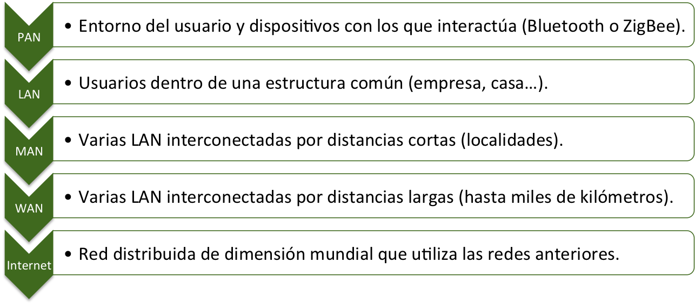

### **PAN (Personal Area Network)**

Es una red de ámbito personal, con un alcance de entre 1 y 10 metros aproximadamente. Conecta dispositivos pertenecientes a una misma persona o zona de trabajo.

- **Ejemplos**: conexión entre un teléfono móvil y unos auriculares por Bluetooth, sincronización entre un reloj inteligente y un smartphone, conexión USB entre dispositivos.

- **Tecnologías más habituales**: Bluetooth, NFC (Near Field Communication), USB.

- **Ventajas**: bajo coste, fácil instalación, bajo consumo de energía.

- **Inconvenientes**: alcance muy limitado, velocidad reducida en comparación con otras tecnologías.

### **LAN (Local Area Network)**

Es una red de área local que interconecta dispositivos dentro de un área geográfica limitada: una oficina, un edificio o un campus.

- **Ejemplos**: red de una oficina, red doméstica, red de un centro educativo.

- **Tecnologías más habituales**: Ethernet (IEEE 802.3), Wi-Fi (IEEE 802.11).

- **Características**: alta velocidad de transmisión (desde 100 Mbps hasta 10 Gbps), bajo retardo de transmisión, administración centralizada.

- **Ventajas**: alto rendimiento, coste moderado, fácil mantenimiento.

- **Inconvenientes**: alcance limitado, necesita cableado o infraestructura de red dedicada.

### **MAN (Metropolitan Area Network)**

Es una red de área metropolitana que abarca una ciudad o una zona metropolitana. Es más extensa que una LAN pero más limitada que una WAN.

- **Ejemplos**: red que conecta distintos edificios de una universidad en una ciudad, red de cable de una compañía de televisión por cable.

- **Tecnologías más habituales**: fibra óptica, microondas, cable coaxial, tecnologías Metro Ethernet.

- **Características**: velocidades elevadas, alcance de hasta 50-100 km.

- **Ventajas**: cobertura amplia dentro de una zona urbana, alta velocidad.

- **Inconvenientes**: coste de despliegue elevado, complejidad administrativa.

### **WAN (Wide Area Network)**

Es una red de área amplia que conecta dispositivos y redes en distintas ciudades, países o continentes. Internet es la WAN más grande del mundo.

- **Ejemplos**: Internet, redes corporativas que conectan oficinas en distintos países, redes privadas virtuales (VPN).

- **Tecnologías más habituales**: fibra óptica de largo recorrido, microondas, satélite, líneas telefónicas conmutadas (DSL), tecnologías MPLS.

- **Características**: alcance mundial, velocidades variables, alta latencia en comparación con LAN.

- **Ventajas**: conectividad global, acceso a recursos y servicios en cualquier parte del mundo.

- **Inconvenientes**: coste elevado de alquiler de líneas, velocidad menor que LAN, dependencia de proveedores de servicios.

### **Resumen comparativo**

| Tipo | Alcance | Velocidad típica | Tecnologías principales | Ejemplo |
| --- | --- | --- | --- | --- |
| PAN | 1-10 m | 1-3 Mbps | Bluetooth, NFC, USB | Auriculares Bluetooth |
| LAN | Edificio / campus | 100 Mbps - 10 Gbps | Ethernet, Wi-Fi | Red de oficina |
| MAN | Ciudad (50-100 km) | 1-10 Gbps | Fibra óptica, Metro Ethernet | Red universitaria |
| WAN | Países / continentes | Variable | Fibra, microondas, satélite | Internet |

## **Otros criterios de clasificación de redes**

Además del alcance geográfico, las redes se pueden clasificar atendiendo a otros criterios:

- **Según su carácter o titularidad**: redes públicas (de acceso libre, como Internet), redes privadas (de uso exclusivo de una organización) y redes privadas virtuales (VPN), que utilizan una infraestructura pública para crear una red privada.

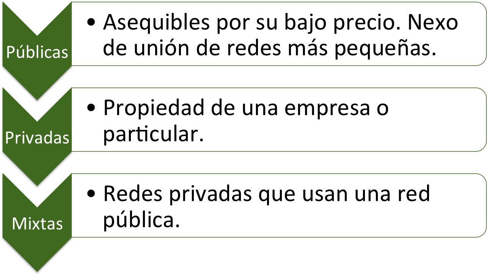

- **Según su tecnología de transmisión**: redes punto a punto (enlace dedicado entre dos nodos) y redes de difusión o multipunto (un único canal compartido por todos los nodos).

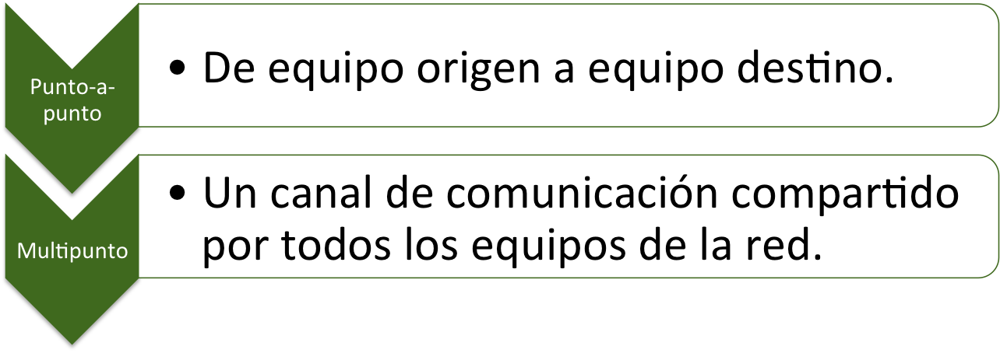

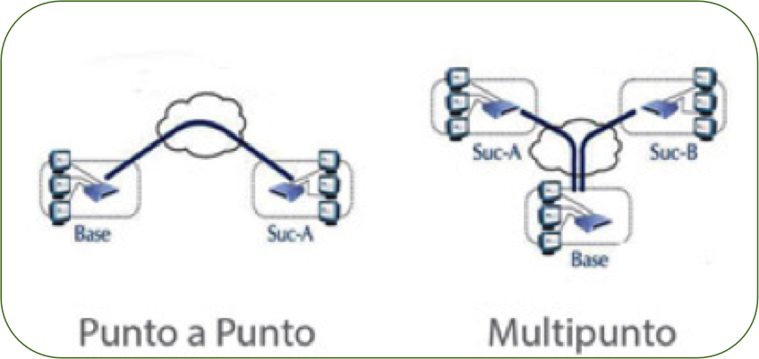

- **Según su relación funcional**: redes igual a igual o *peer-to-peer* (todos los nodos tienen la misma jerarquía) y redes cliente-servidor (existe un nodo que presta servicios y otros que los solicitan).

## **Topologías de red**

La topología de red define la forma en que los dispositivos (nodos) están organizados y conectados entre sí. Existen topologías físicas (cómo están los cables) y topologías lógicas (cómo fluyen los datos).

Las topologías físicas pueden ser **cableadas** o **inalámbricas**, según el medio de transmisión empleado. A continuación se estudian ambos grupos por separado.

### **Topologías cableadas**

En las topologías cableadas los nodos se conectan mediante un medio físico (cable de par trenzado, coaxial o fibra óptica). Las principales son bus, estrella, anillo, malla, árbol y mixta.

#### **Topología de bus**

Todos los dispositivos se conectan a un único cable central (bus o backbone). Los datos viajan en ambas direcciones a lo largo del bus y todos los dispositivos reciben las tramas, pero solo el destinatario las procesa.

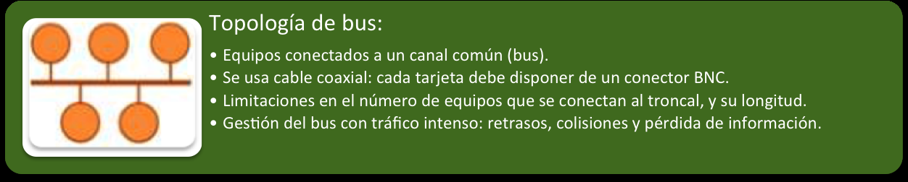

- **Ventajas**: instalación sencilla y económica, requiere poco cableado.

- **Inconvenientes**: si el bus principal falla, toda la red cae; es difícil de detectar y aislar fallos; rendimiento disminuye con muchos dispositivos; obsoleta en instalaciones modernas.

#### **Topología de estrella**

Todos los dispositivos se conectan a un equipo central (switch o hub). La comunicación se realiza a través de este punto central.

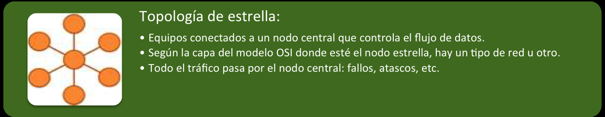

- **Ventajas**: si un nodo falla, los demás continúan funcionando; fácil de instalar, mantener y ampliar; los fallos se localizan con rapidez.

- **Inconvenientes**: si el equipo central falla, toda la red cae; requiere más cableado que la topología de bus.

#### **Topología de anillo**

Los dispositivos se conectan formando un circuito cerrado. Los datos viajan en una sola dirección (unidireccional) o en ambas (bidireccional) a través del anillo, pasando de nodo en nodo hasta llegar a su destino.

- **Ventajas**: rendimiento constante independientemente del número de nodos; no hay colisiones de datos (utilizando token passing).

- **Inconvenientes**: si un nodo falla, puede cortar toda la comunicación; la adición o eliminación de nodos interrumpe la red; difícil de ampliar.

#### **Topología de malla**

Cada dispositivo se conecta con todos (malla completa) o con varios (malla parcial) de los demás dispositivos de la red.

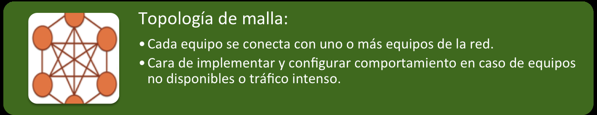

- **Ventajas**: alta fiabilidad y tolerancia a fallos (si una ruta falla, los datos pueden tomar otra); alta privacidad y seguridad; equilibrio de carga.

- **Inconvenientes**: coste elevado de cableado y configuración; complejidad de instalación y mantenimiento; cada nodo debe gestionar múltiples conexiones.

#### **Topología de árbol**

Combina las topologías de bus y estrella. Se estructura en niveles jerárquicos, con un nodo raíz en la parte superior y ramas que se subdividen hacia los dispositivos finales.

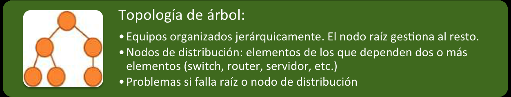

- **Ventajas**: escalable, permite crecer añadiendo nuevos niveles; fácil de administrar en entornos jerárquicos.

- **Inconvenientes**: si falla un nodo intermedio, todos los nodos dependientes se desconectan; más compleja de configurar que una estrella simple.

#### **Topología mixta**

Surge cuando los nodos de distribución de una red en árbol actúan como puente hacia otras topologías, combinando varias de ellas en una misma instalación.

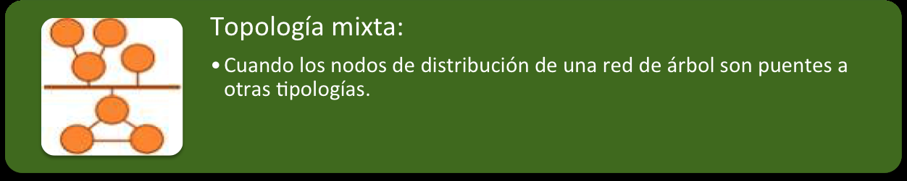

### **Topologías inalámbricas**

En las topologías inalámbricas los nodos se comunican sin cables, mediante ondas de radio, y el medio de transmisión es el aire. Su elemento característico es la **celda**: la zona en la que la señal de un punto de acceso se emite con la potencia suficiente para ofrecer cobertura. Los equipos que amplían el radio de acción de la red se denominan **puntos de acceso** (AP). Cuando un dispositivo cambia de una celda a otra sin perder la conexión se habla de **itinerancia** (*roaming*).

Según cómo se organicen esas celdas, se distinguen dos modelos principales:

#### **Topología inalámbrica distribuida**

Cada celda dispone de su propio punto de acceso, que gestiona de forma autónoma los dispositivos conectados a ella. La red se forma por la unión de varias celdas independientes.

- **Ventajas**: es sencilla de desplegar y ampliar (basta con añadir nuevas celdas); no depende de un único elemento central.

- **Inconvenientes**: requiere que exista *roaming* para que un dispositivo pueda moverse entre celdas sin desconectarse; la gestión y la seguridad han de configurarse en cada punto de acceso.

#### **Topología inalámbrica centralizada**

Adecuada cuando hay muchas celdas y la información es de naturaleza variada. Todos los puntos de acceso dependen de un nodo central (los *switches* WLAN) que gobierna la red.

- **Ventajas**: la administración, la seguridad y la configuración se centralizan en un único punto; es más fácil de gestionar en instalaciones grandes.

- **Inconvenientes**: los puntos de acceso son "tontos" y solo amplían la cobertura, sin poder gestionar por sí mismos los dispositivos conectados a ellos; si falla el controlador central, la red queda afectada.

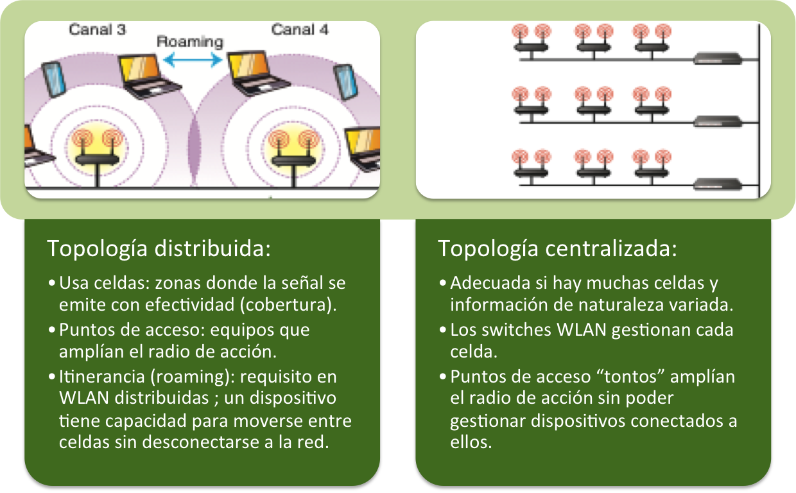

### **Resumen de topologías**

| Topología | Tipo | Estructura | Ventaja principal | Desventaja principal |
| --- | --- | --- | --- | --- |
| Bus | Cableada | Cable central compartido | Sencilla y barata | Un fallo en el bus afecta a toda la red |
| Estrella | Cableada | Nodo central (switch) | Fácil mantenimiento | El fallo del central invalida la red |
| Anillo | Cableada | Circuito cerrado | Rendimiento predecible | Un nodo caído puede cortar el anillo |
| Malla | Cableada | Interconexión múltiple | Alta fiabilidad | Coste y complejidad elevados |
| Árbol | Cableada | Jerárquica | Escalable | Dependencia de nodos intermedios |
| Mixta | Cableada | Combinación de topologías | Se adapta a cada necesidad | Mayor complejidad de diseño y gestión |
| Distribuida | Inalámbrica | Celdas con AP autónomos | Fácil de desplegar y ampliar | Necesita *roaming*; configuración por AP |
| Centralizada | Inalámbrica | Controlador central (switch WLAN) | Gestión y seguridad centralizadas | Depende del controlador central |

## **Arquitecturas de red**

La arquitectura de red define el modelo de funcionamiento y las reglas que rigen la comunicación entre los dispositivos. Las dos arquitecturas principales son cliente-servidor y peer-to-peer.

### **Arquitectura cliente-servidor**

En esta arquitectura existe una distinción clara entre los servidores (que proporcionan recursos y servicios) y los clientes (que solicitan y utilizan esos recursos).

- **Servidor**: es un ordenador potente que ejecuta un sistema operativo de servidor (Windows Server, Linux) y ofrece servicios centralizados como almacenamiento de ficheros, gestión de impresión, acceso a Internet o autenticación de usuarios.

- **Cliente**: es el ordenador del usuario final que se conecta al servidor para acceder a los servicios y recursos.

- **Funcionamiento**: el cliente realiza una petición al servidor, que la procesa y devuelve la respuesta correspondiente.

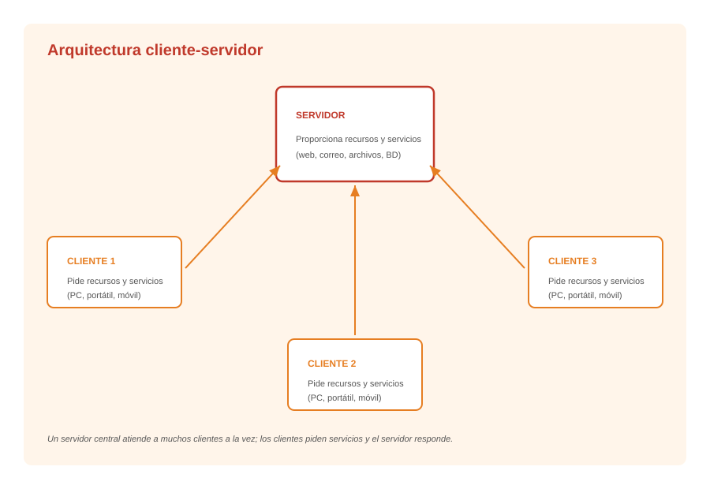

**Ventajas:**
- Gestión centralizada de usuarios, permisos y recursos.
- Mayor seguridad: el servidor controla el acceso a la información.
- Copias de seguridad centralizadas.
- Escalabilidad: se pueden añadir más clientes sin modificar la configuración.

**Inconvenientes:**
- Dependencia total del servidor: si falla, todos los clientes pierden los servicios.
- Coste elevado del servidor y del software de servidor.
- Se requiere personal técnico especializado para su administración.

### **Arquitectura peer-to-peer (P2P)**

En esta arquitectura todos los dispositivos tienen la misma categoría. No hay servidores dedicados; cada ordenador puede actuar simultáneamente como cliente y como servidor.

- **Funcionamiento**: cada dispositivo comparte parte de sus recursos (ficheros, impresoras, conexión a Internet) y a su vez accede a los recursos de los demás.

- **Ejemplos**: redes domésticas pequeñas, redes ad hoc, redes de intercambio de ficheros (BitTorrent).

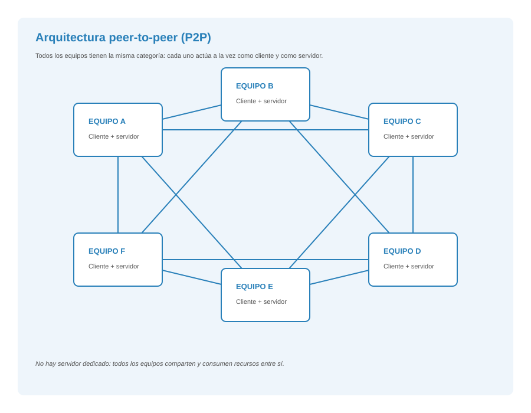

**Ventajas:**
- No necesita un servidor dedicado, lo que reduce el coste.
- Sencillez de instalación y configuración.
- No depende de un único punto central.

**Inconvenientes:**
- Gestión de seguridad compleja: cada usuario administra sus propios recursos.
- No hay centralización de copias de seguridad.
- Rendimiento disminuye con el aumento de dispositivos.
- Difícil administración en redes grandes.

### **Comparación**

| Característica | Cliente-servidor | Peer-to-peer |
| --- | --- | --- |
| Número de servidores | Uno o varios dedicados | Ninguno dedicado |
| Coste | Elevado | Bajo |
| Seguridad | Alta (centralizada) | Variable (descentralizada) |
| Escalabilidad | Alta | Limitada |
| Administración | Centralizada | Descentralizada |
| Depende de | El servidor | Todos los nodos |

---

## 2.2 Medios de transmisión

# **Medios de transmisión**

Los medios de transmisión son los canales físicos o no físicos a través de los cuales se propagan las señales que transportan la información entre los dispositivos de la red.

> **📌 Ampliación en UP03**
> 

> Las características técnicas de los conductores guiados —tipos de par trenzado (UTP, FTP, STP, S/FTP), categorías Cat 5e a Cat 8, conectores, variantes y normativa— se tratan con detalle en la UP03 – Tipos de conductores.

### **Medios de transmisión guiados**

Son aquellos en los que la señal se transmite a través de un medio físico: cables.

#### **Par trenzado**

Es el medio de transmisión más utilizado en las redes locales. Consiste en pares de cables de cobre trenzados entre sí para reducir la interferencia electromagnética. Se presenta en categorías normalizadas (Cat 5e, Cat 6, Cat 6a, Cat 7, Cat 8) que determinan su velocidad y frecuencia de trabajo.

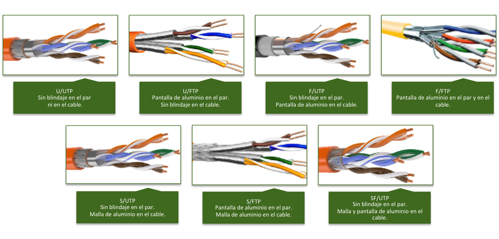

#### **Fibra óptica**

Transmite datos mediante pulsos de luz a través de un núcleo de vidrio o plástico. Ofrece mayor velocidad y alcance que el par trenzado, y es inmune a las interferencias electromagnéticas.

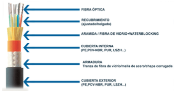

Existen dos grandes tipos: monomodo (SMF), para largas distancias, y multimodo (MMF), para redes locales y centros de datos.

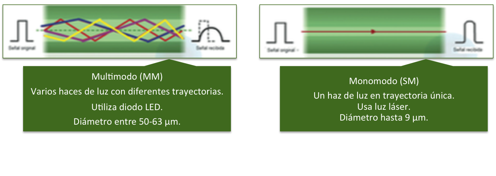

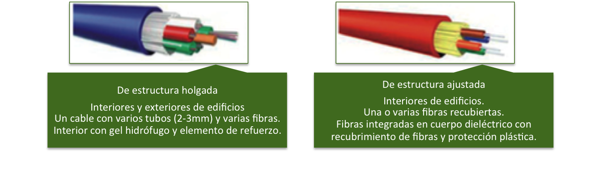

Los conectores más habituales para la fibra óptica son ST, SC, FC, LC y MT-RJ:

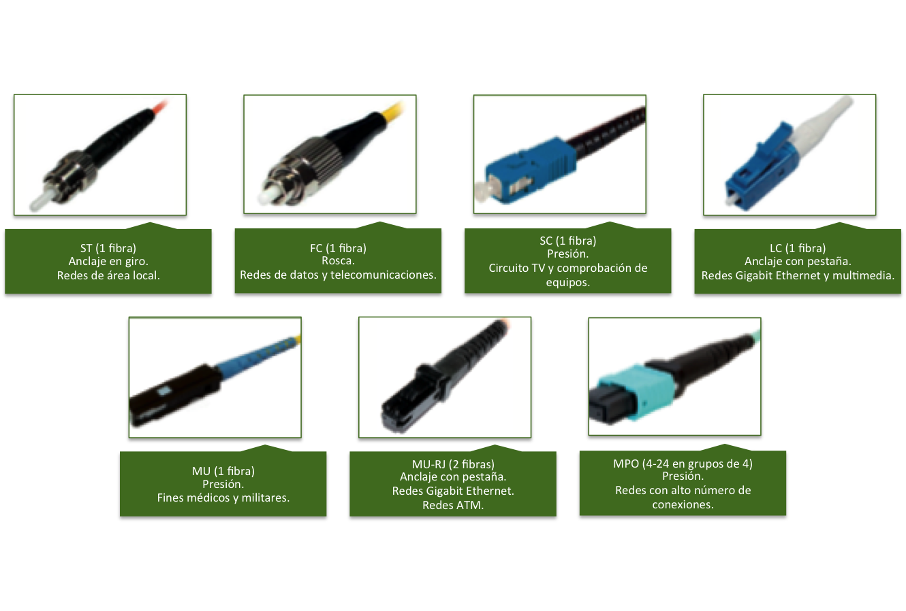

**Ventajas:**
- Alta velocidad de transmisión (hasta 100 Gbps).
- Gran alcance (varios kilómetros sin repetidores).
- Inmunidad a interferencias electromagnéticas.
- Alta seguridad: es muy difícil de intervenir.
- Elevada capacidad de ancho de banda.

**Inconvenientes:**
- Coste mayor que el par trenzado.
- Fragilidad: no soporta curvaturas pronunciadas ni tracciones mecánicas.
- Instalación y empalme más complejos.
- Necesita equipos de transmisión/recepción ópticos.

#### **Cable coaxial**

Consiste en un conductor central de cobre rodeado por un aislante, una malla metálica de blindaje y una cubierta exterior. Se utilizó ampliamente en redes de cable y en la conexión de antenas, pero ha sido sustituido mayoritariamente por la fibra óptica y el par trenzado en las redes de datos.

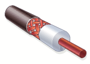

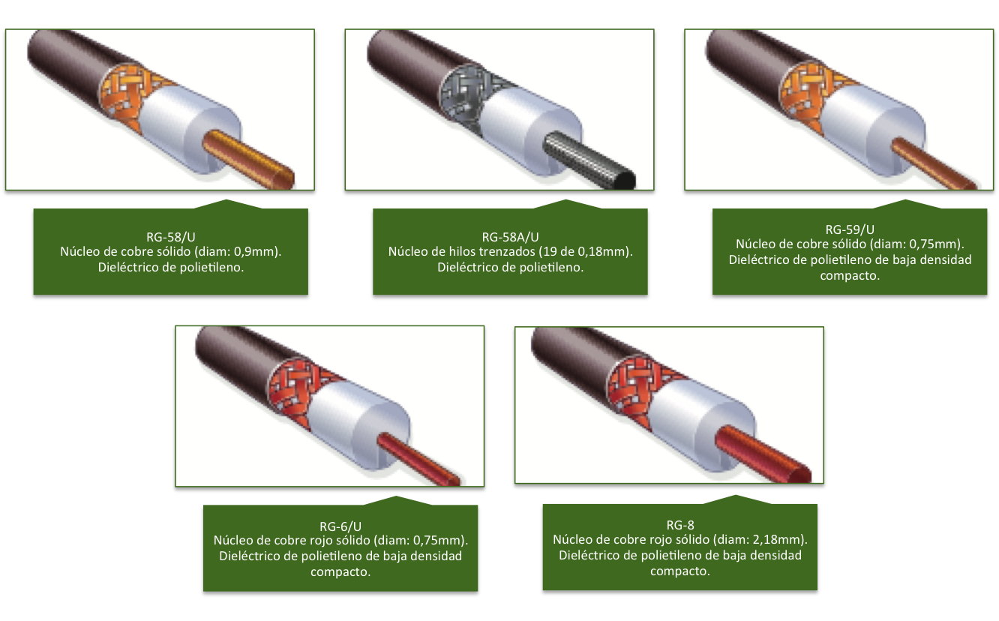

Su conector más característico es el **BNC**:

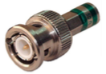

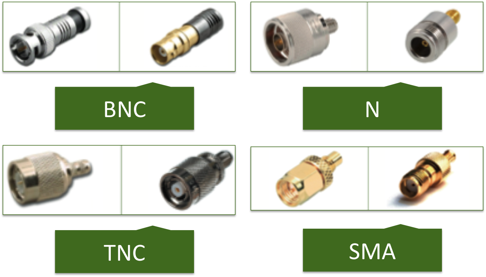

### **Medios de transmisión no guiados**

Son aquellos en los que la señal se propaga por el espacio libre, sin necesidad de un medio físico conductor.

- **Microondas terrestres**: utilizan antenas parabólicas para transmitir señales de radio en línea de visión directa. Se usan para enlaces de telecomunicaciones de larga distancia.

- **Microondas por satélite**: permiten la comunicación entre puntos muy alejados, incluso en diferentes continentes. Se utilizan para televisiones, telefonía y conexión a Internet en zonas remotas.

- **Infrarrojos**: utilizan ondas de infrarrojo para transmitir datos a corta distancia (controladores remotos, conexión entre dispositivos móviles). No atraviesan paredes.

- **Radiofrecuencia (Wi-Fi)**: utilizan ondas de radio en las bandas de 2.4 GHz y 5 GHz para transmitir datos de forma inalámbrica. Es la tecnología más utilizada en las redes locales inalámbricas.

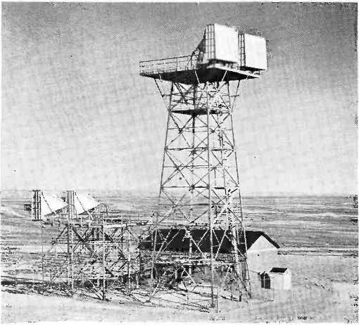

El conjunto de ondas electromagnéticas utilizables se denomina **espectro electromagnético**. Las tecnologías inalámbricas emplean bandas de frecuencia concretas, cuyo uso está regulado por las autoridades de telecomunicaciones.

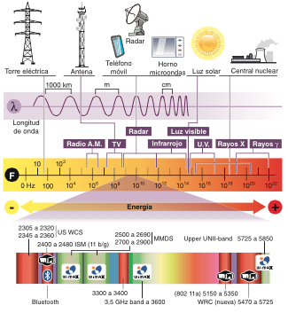

Las **bandas de frecuencia** se reparten entre los distintos servicios (radio, microondas e infrarrojos):

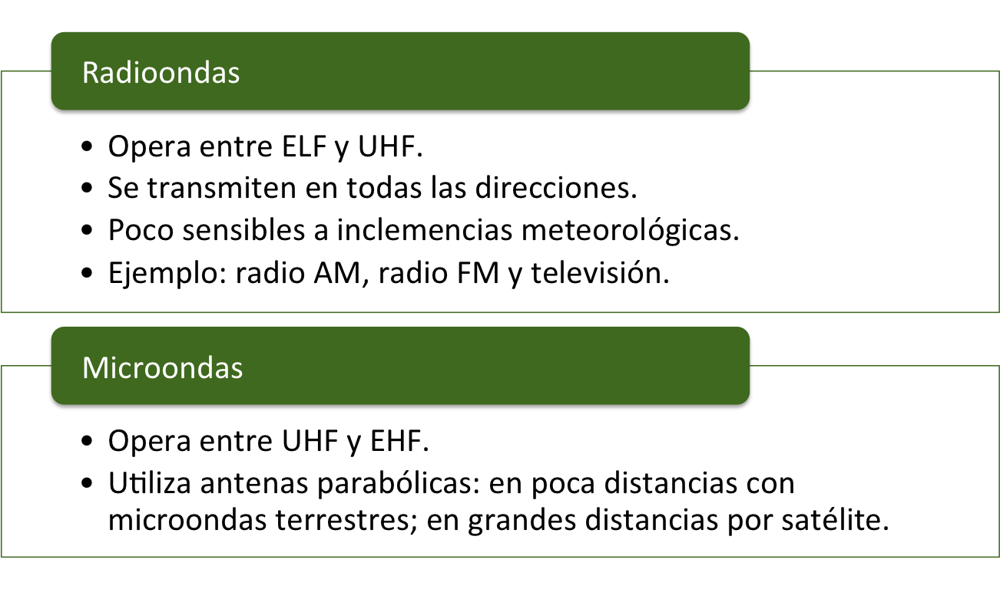

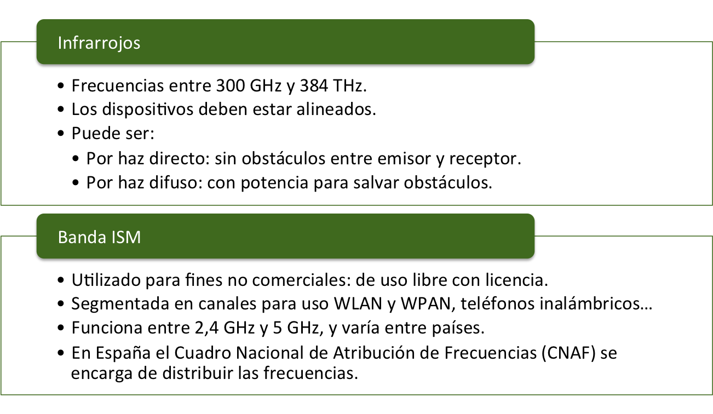

### **Estándares inalámbricos**

Las comunicaciones inalámbricas se normalizan mediante la familia de estándares IEEE 802:

- **WPAN (IEEE 802.15)**: redes de área personal inalámbricas. El más utilizado es **Bluetooth** (IEEE 802.15.1), que usa una topología *piconet* ampliable a *scatternet*.

- **WLAN (IEEE 802.11)**: redes de área local inalámbricas (Wi-Fi). Es el más difundido y dispone de varias revisiones (802.11a/b/g/n/ac/ax).

- **WMAN (IEEE 802.16)**: redes de área metropolitana inalámbricas. El más utilizado es **WiMAX** (revisión 802.16m), que trabaja en el rango 2,3–3,5 GHz y se emplea donde no llega el ADSL o la fibra.

- **WWAN**: redes de área amplia inalámbricas, aplicadas a la telefonía móvil (desde GSM o 2G hasta LTE o 4G, y 5G).

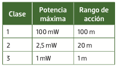

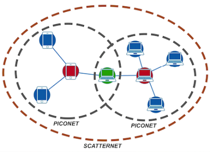

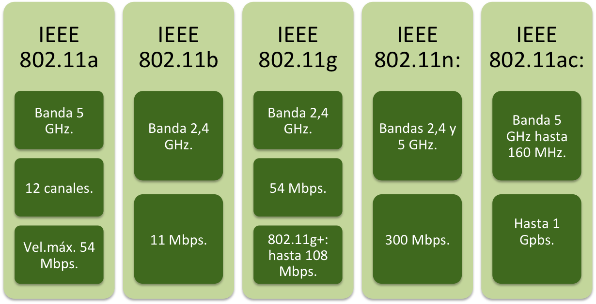

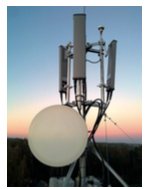

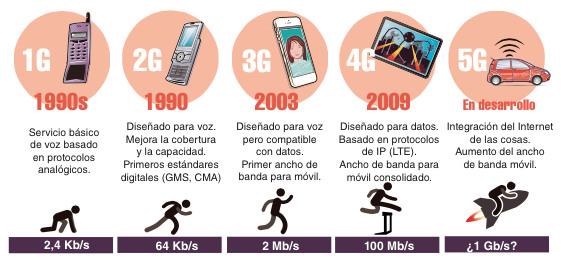

### **Resumen de medios de transmisión**

| Medio | Tipo | Velocidad | Distancia | Coste | Uso principal |
| --- | --- | --- | --- | --- | --- |
| Par trenzado UTP | Guiado | 1-10 Gbps | Hasta 100 m | Bajo | LAN, doméstico |
| Fibra óptica multimodo | Guiado | Hasta 100 Gbps | Hasta 2 km | Medio-alto | Centros de datos |
| Fibra óptica monomodo | Guiado | Hasta 100 Gbps | Hasta 100 km | Alto | WAN, fibra al hogar |
| Cable coaxial | Guiado | Hasta 10 Gbps | Hasta 500 m | Medio | CATV, antenas |
| Microondas | No guiado | Variable | Hasta 50 km | Alto | Enlaces punto a punto |
| Wi-Fi | No guiado | Hasta 9.6 Gbps (Wi-Fi 6E) | Hasta 100 m | Bajo | LAN inalámbrica |

## **Estándares de cableado estructurado: TIA/EIA-568**

El estándar TIA/EIA-568 define las especificaciones para el cableado estructurado en edificios comerciales. Establece dos normas de coloración para los pines del conector RJ-45:

- **TIA/EIA-568A**: orden de colores: blanco-verde, verde, blanco-naranja, azul, blanco-azul, naranja, blanco-marrón, marrón.

- **TIA/EIA-568B**: orden de colores: blanco-naranja, naranja, blanco-verde, azul, blanco-azul, verde, blanco-marrón, marrón.

El conector RJ-45 tiene 8 pines. Para una conexión directa (cable recto) se utiliza el mismo estándar en ambos extremos. Para conectar dispositivos del mismo tipo (PC a PC, switch a switch) se utiliza un cable cruzado (un extremo 568A y el otro 568B).

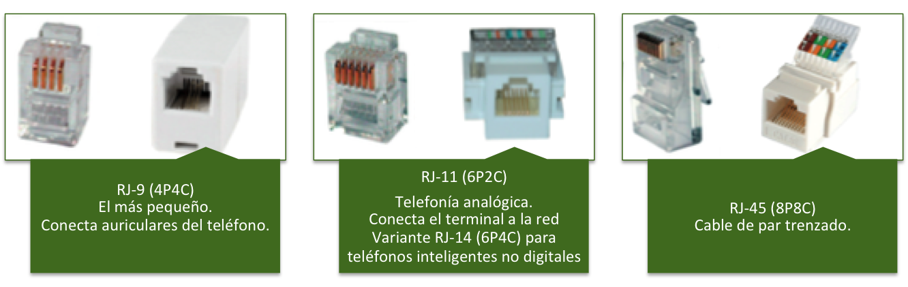

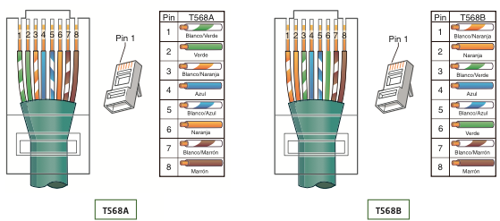

A continuación se muestra el esquema de cada tipo de cable:

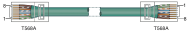

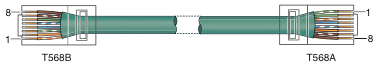

Actualmente, la mayoría de dispositivos admiten la función Auto-MDI/MDIX, que detecta automáticamente el tipo de cable y ajusta la conexión, por lo que la distinción entre cable recto y cruzado es menos relevante en la práctica.

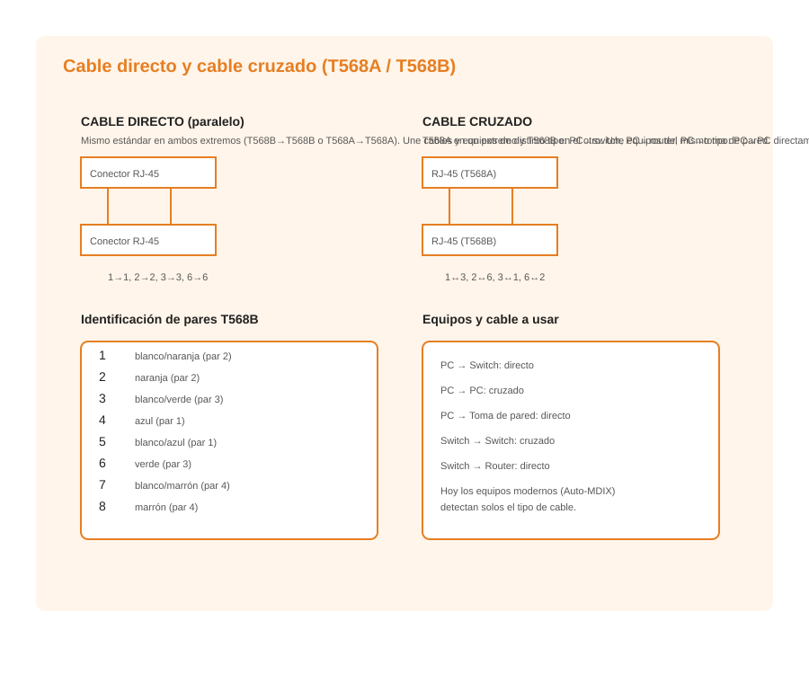

## **Topologías de cableado en edificios**

En el cableado de edificios la topología empleada es la **estrella**: el nodo central es el **centro de cableado**, compuesto por uno o más **armarios de distribución** (racks). En edificios pequeños con distancias menores a 100 m se utiliza esta topología en estrella, ya que el par trenzado garantiza la transmisión hasta esa distancia sin repetidores.

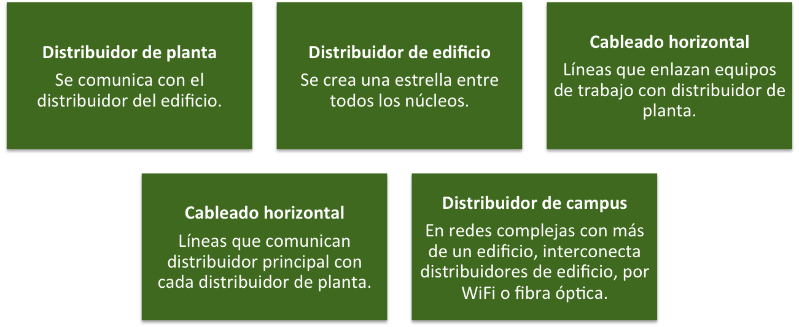

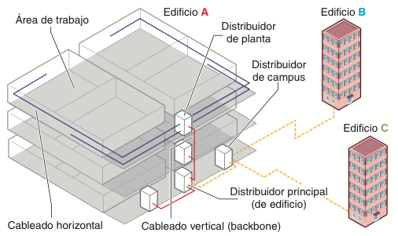

## **En resumen**

Los principales conceptos de la unidad se recogen en el siguiente esquema:

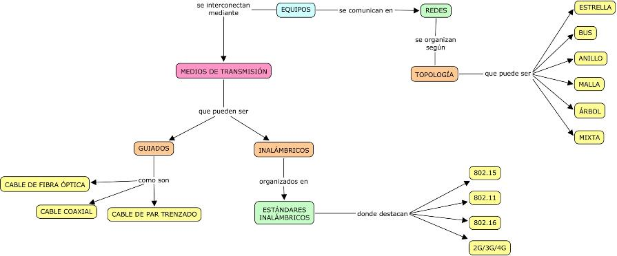

---

## ✏️ Actividades y Prácticas de la Unidad

---

### Ficha Práctica FICHA201 — 2.1 · Tipos de redes, alcance y arquitecturas

# **FICHA 2.1 · Tipos de redes, alcance y arquitecturas**

📥 Guardar como PDF
📄 Descargar Word

| Alumno/a | Grupo | Fecha |
| --- | --- | --- |
|  |  |  |

> **📌 ¿Qué repasamos?**
> 

> Las redes se clasifican según su **alcance geográfico** (PAN, LAN, MAN, WAN). Las **topologías** definen la forma en que se conectan los equipos (bus, estrella, anillo, malla, árbol, mixta). Las **arquitecturas** determinan la relación entre equipos: **cliente-servidor** o **peer-to-peer** (*igual a igual*).

## 1 · Clasificación de redes por alcance geográfico

1. Completa la siguiente tabla indicando para cada tipo de red su alcance, una tecnología habitual y un ejemplo práctico:

| Tipo de red | Alcance geográfico | Tecnología habitual | Ejemplo práctico |
| --- | --- | --- | --- |
| **PAN** |  |  |  |
| **LAN** |  |  |  |
| **MAN** |  |  |  |
| **WAN** |  |  |  |

1. ¿Qué tipo de red se utilizaría en cada uno de estos escenarios? Razona brevemente tu respuesta:

| Escenario | Tipo de red (PAN/LAN/MAN/WAN) | Justificación |
| --- | --- | --- |
| Conectar el ordenador portátil de un usuario con su teléfono móvil mediante Bluetooth. |  |  |
| Conectar los ordenadores de las tres plantas de un instituto de Educación Secundaria. |  |  |
| Conectar las oficinas de una empresa en Valencia, Madrid y Barcelona. |  |  |
| Conectar los dispositivos del hogar (TV, consola, portátil) al router doméstico. |  |  |

## 2 · Topologías de red

1. Completa la siguiente tabla con las **ventajas** e **inconvenientes** de las topologías de **estrella** y **malla**:

| Topología | Ventajas | Inconvenientes |
| --- | --- | --- |
| **Estrella** |  |  |
| **Malla** |  |  |

1. ¿Qué topología de red se utiliza habitualmente en las redes de oficina actuales? Justifica tu respuesta.

1. Dibuja un esquema con **al menos 5 nodos** para cada una de las siguientes topologías. Indica claramente los nodos y las conexiones:

| Topología | Dibujo / esquema (descripción o representación) |
| --- | --- |
| **Bus** |  |
| **Estrella** |  |
| **Anillo** |  |

## 3 · Arquitecturas de red

1. Completa la tabla comparativa entre **cliente-servidor** y **peer-to-peer** (*igual a igual*):

| Aspecto a comparar | **Cliente-Servidor** | **Peer-to-peer (P2P)** |
| --- | --- | --- |
| **¿Quién gestiona los recursos?** |  |  |
| **Seguridad** |  |  |
| **Escalabilidad** |  |  |
| **Coste de implementación** |  |  |
| **Ejemplo de uso** |  |  |

1. 

Indica en qué situaciones es más conveniente utilizar cada arquitectura y justifica tu respuesta:

1. 

**Cliente-Servidor:** ***_**_**_**_**_**_**_**_**  

**_**_**_**_**_**_**_**_**_**_***_  

***_**_**_**_**_**_**_**_**_**_***____

1. 

**Peer-to-peer (P2P):** ***_**_**_**_**_**_**_**_**  

***_**_**_**_**_**_**_**_**_**_**_  

**_**_**_**_**_**_**_**_**_**_**

## 4 · Autoevaluación

Marca una casilla por fila para valorar cómo te sientes con cada idea:

| Concepto | Lo entiendo | Casi | Lo necesito repasar |
| --- | --- | --- | --- |
| Clasificación de redes por alcance (PAN/LAN/MAN/WAN) |  |  |  |
| Identificar el tipo de red en un escenario real |  |  |  |
| Topologías de red: características, ventajas e inconvenientes |  |  |  |
| Arquitecturas cliente-servidor y peer-to-peer |  |  |  |
| Elegir la arquitectura más adecuada según el caso |  |  |  |

> **📌 Se valorará**
> 

> - La correcta clasificación de las redes por alcance geográfico.

> - La descripción de ventajas, inconvenientes y características de las topologías.

> - La comparación correcta entre arquitecturas cliente-servidor y peer-to-peer.

> - La justificación razonada en los escenarios planteados.

> - Limpieza, orden y claridad en las respuestas.

> Esta ficha te servirá para practicar el **CE5b** (identificar los diferentes tipos de redes y sus estructuras alternativas) antes del **EXA102**.

---

### Ficha Práctica FICHA202 — 2.2 · Medios de transmisión guiados y no guiados

# **FICHA 2.2 · Medios de transmisión guiados y no guiados**

📥 Guardar como PDF
📄 Descargar Word

| Alumno/a | Grupo | Fecha |
| --- | --- | --- |
|  |  |  |

> **📌 ¿Qué repasamos?**
> 

> Los **medios de transmisión guiados** conducen la señal por un cable (par trenzado, fibra óptica, cable coaxial). Los **medios no guiados** la propagan por el espacio libre (microondas, infrarrojos, radiofrecuencia). El cableado estructurado se rige por la normativa **TIA/EIA-568**.

## 1 · Medios de transmisión guiados

1. Completa la siguiente tabla de medios de transmisión guiados:

| Medio | Categorías/tipos | Velocidad típica | Distancia máxima aproximada | Uso principal |
| --- | --- | --- | --- | --- |
| **Par trenzado (UTP/STP/FTP)** | Cat 5e, Cat 6, Cat 6a, Cat 7, Cat 8 |  |  |  |
| **Fibra óptica** | Monomodo / Multimodo |  |  |  |
| **Cable coaxial** | RG-58, RG-59, RG-6 (u otros) |  |  |  |

1. ¿Por qué se trenzan los pares de hilos en el cable **UTP**? ¿Qué problema resuelve el trenzado?

1. Completa la tabla comparativa entre **UTP**, **STP** y **FTP**:

| Aspecto | **UTP** (*Unshielded Twisted Pair*) | **STP** (*Shielded Twisted Pair*) | **FTP** (*Foiled Twisted Pair*) |
| --- | --- | --- | --- |
| **Blindaje** |  |  |  |
| **Inmunidad a interferencias** |  |  |  |
| **Flexibilidad / facilidad de instalación** |  |  |  |
| **Coste** |  |  |  |
| **Uso más habitual** |  |  |  |

1. ¿Qué tipo de fibra óptica utilizarías para un enlace entre dos edificios de un campus situados a **3 km** de distancia? Justifica tu respuesta.

## 2 · Medios de transmisión no guiados

1. Explica brevemente en qué consisten los siguientes medios no guiados y cita un **uso habitual** de cada uno:

| Medio no guiado | ¿En qué consiste? | Uso habitual |
| --- | --- | --- |
| **Microondas terrestres** |  |  |
| **Microondas por satélite** |  |  |
| **Infrarrojos** |  |  |
| **Radiofrecuencia (Wi-Fi)** |  |  |

1. Completa la tabla comparativa entre **medios guiados** y **medios no guiados**:

| Aspecto | **Medios guiados** | **Medios no guiados** |
| --- | --- | --- |
| **Seguridad** |  |  |
| **Alcance** |  |  |
| **Interferencias** |  |  |
| **Movilidad** |  |  |
| **Velocidad / estabilidad** |  |  |
| **Instalación (coste/complejidad)** |  |  |

## 3 · Normativa de cableado TIA/EIA-568

1. ¿Qué puede ocurrir si la distancia de un tramo de cable de par trenzado supera los **100 metros**?

1. Completa la tabla con las diferencias entre los estándares **TIA/EIA-568A** y **TIA/EIA-568B**:

| Aspecto | **TIA/EIA-568A** | **TIA/EIA-568B** |
| --- | --- | --- |
| **Uso habitual en la actualidad** |  |  |
| **Orden de colores (idea general)** |  |  |
| **¿Son intercambiables?** |  |  |

1. 

¿Cuándo se utiliza un **cable directo** y cuándo un **cable cruzado**?

1. 

**Cable directo (mismo estándar en ambos extremos):** ***_**_**_**_**  

**_**_**_**_**_**_**_**_**_**_***_

1. 

**Cable cruzado (568A en un extremo y 568B en el otro):** ***_**_**_**_*_  

**_**_**_**_**_**_**_**_**_**_***__

1. 

¿Qué función tiene la tecnología **Auto-MDI/MDIX**? ¿Por qué ha perdido importancia el uso del cable cruzado?

## 4 · Autoevaluación

Marca una casilla por fila para valorar cómo te sientes con cada idea:

| Concepto | Lo entiendo | Casi | Lo necesito repasar |
| --- | --- | --- | --- |
| Diferencia entre medios guiados y no guiados |  |  |  |
| Características de par trenzado, fibra óptica y coaxial |  |  |  |
| Diferencia entre UTP, STP y FTP |  |  |  |
| Medios no guiados: microondas, infrarrojos y radiofrecuencia |  |  |  |
| Normativa TIA/EIA-568, cable directo/cruzado y Auto-MDI/MDIX |  |  |  |

> **📌 Se valorará**
> 

> - La correcta clasificación y características de los medios de transmisión.

> - La distinción entre UTP, STP, FTP y entre fibra monomodo/multimodo.

> - La identificación de los medios no guiados y sus aplicaciones.

> - El conocimiento de la normativa TIA/EIA-568 y la función de Auto-MDI/MDIX.

> - Limpieza, orden y claridad en las respuestas.

> Esta ficha te servirá para practicar el **CE5d** (describir los medios de transmisión) antes del **EXA102**.
