# **Tipus de xarxes i estructures alternatives**

  

    🏆 <strong>Progrés d'aquesta secció:</strong> 0 de 4 superats (0%)
    ⭐ <strong>0 punts</strong>
  

  

    

  

Les xarxes es classifiquen en funció de diferents criteris com el seu abast geogràfic, la topologia de connexió, l'arquitectura de funcionament o els protocols utilitzats. En aquest tema analizarem cada un d'aquests aspectes.

## **Classificació de xarxes per abast geogràfic**

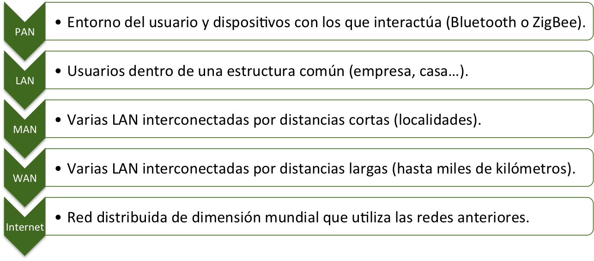

### **PAN (Personal Area Network)**

És una xarxa d'àmbit personal, amb un abast d'entre 1 i 10 metros aproximadament. Connecta dispositius pertenecientes a una mateixa persona o zona de treball.

- **Exemples**: connexió entre un telèfon mòbil i uns auriculars per Bluetooth, sincronizació entre un reloj inteligente i un smartphone, connexió USB entre dispositius.

- **Tecnologies més habituals**: Bluetooth, NFC (Near Field Communication), USB.

- **Avantatges**: sota cost, fàcil instal·lació, sota consumo d'energía.

- **Inconvenients**: abast molt limitat, velocitat reducida en comparació amb altres tecnologies.

### **LAN (Local Area Network)**

És una xarxa d'àrea local que interconecta dispositius dins d'un àrea geográfica limitada: una oficina, un edifici o un campus.

- **Exemples**: xarxa d'una oficina, xarxa doméstica, xarxa d'un centre educativo.

- **Tecnologies més habituals**: Ethernet (IEEE 802.3), Wi-Fi (IEEE 802.11).

- **Característiques**: alta velocitat de transmissió (des de 100 Mbps fins a 10 Gbps), sota retardo de transmissió, administració centralitzada.

- **Avantatges**: alt rendiment, cost moderado, fàcil manteniment.

- **Inconvenients**: abast limitat, necessita cablejat o infraestructura de xarxa dedicada.

### **MAN (Metropolitan Area Network)**

És una xarxa d'àrea metropolitana que abarca una ciutat o una zona metropolitana. És més extensa que una LAN però més limitada que una WAN.

- **Exemples**: xarxa que connecta distints edificis d'una universitat en una ciutat, xarxa de cable d'una companyia de televisió per cable.

- **Tecnologies més habituals**: fibra òptica, microones, cable coaxial, tecnologies Metro Ethernet.

- **Característiques**: velocitats elevades, abast de fins a 50-100 km.

- **Avantatges**: cobertura àmplia dins d'una zona urbana, alta velocitat.

- **Inconvenients**: cost de desplegament elevat, complexitat administrativa.

### **WAN (Wide Area Network)**

És una xarxa d'àrea àmplia que connecta dispositius i xarxes en distintes ciutats, països o continentes. Internet és la WAN més gran del món.

- **Exemples**: Internet, xarxes corporativas que connecten oficines en distints països, xarxes privades virtuals (VPN).

- **Tecnologies més habituals**: fibra òptica de llarg recorregut, microones, satélite, línies telefóniques conmutades (DSL), tecnologies MPLS.

- **Característiques**: abast mundial, velocitats variables, alta latencia en comparació amb LAN.

- **Avantatges**: conectivitat global, accés a recursos i serveis en qualsevol part del món.

- **Inconvenients**: cost elevat d'alquiler de línies, velocitat menor que LAN, dependència de proveïdors de serveis.

### **Resum comparativo**

| Tipus | Abast | Velocitat típica | Tecnologies principals | Exemple |
| --- | --- | --- | --- | --- |
| PAN | 1-10 m | 1-3 Mbps | Bluetooth, NFC, USB | Auriculars Bluetooth |
| LAN | Edifici / campus | 100 Mbps - 10 Gbps | Ethernet, Wi-Fi | Xarxa d'oficina |
| MAN | Ciutat (50-100 km) | 1-10 Gbps | Fibra òptica, Metro Ethernet | Xarxa universitaria |
| WAN | Països / continentes | Variable | Fibra, microones, satélite | Internet |

## **Altres criteris de classificació de xarxes**

A més de l'abast geogràfic, les xarxes es poden classificar atenent a altres criteris:

- **Segons el seu caràcter o titularitat**: xarxes públiques (d'accés lliure, com Internet), xarxes privades (d'ús exclusivo d'una organització) i xarxes privades virtuals (VPN), que utilitzen una infraestructura pública per a crear una xarxa privada.

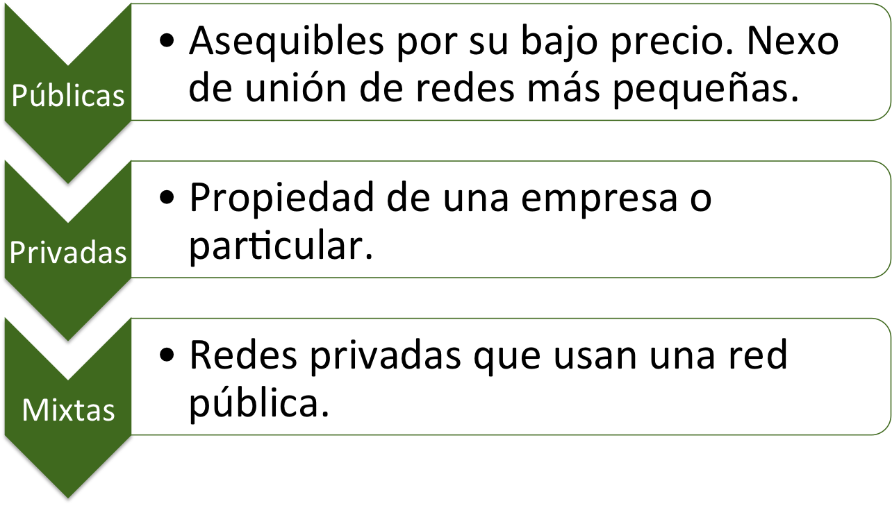

- **Segons la seua tecnologia de transmissió**: xarxes punt a punt (enllaç dedicat entre dos nodes) i xarxes de difusió o multipunto (un únic canal compartit per tots els nodes).

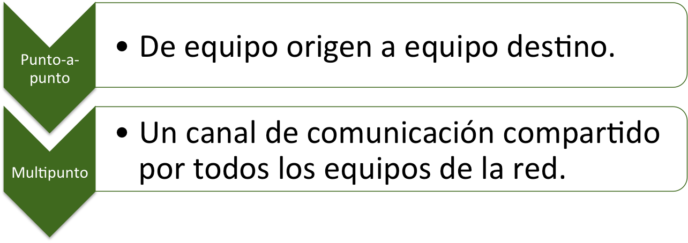

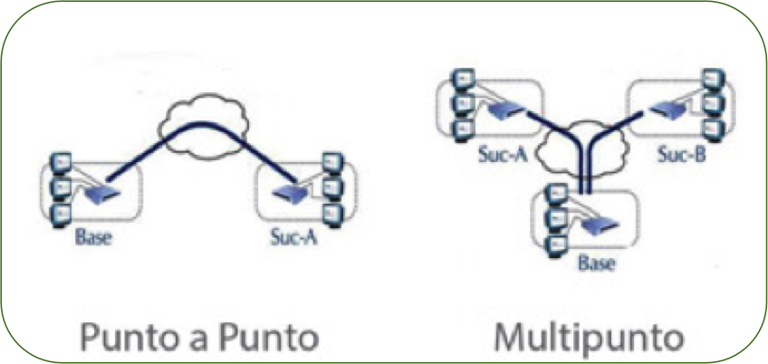

- **Segons la seua relació funcional**: xarxes igual a igual o *peer-to-peer* (tots els nodes tenen la mateixa jerarquia) i xarxes client-servidor (existeix un node que presta serveis i altres que els solicitan).

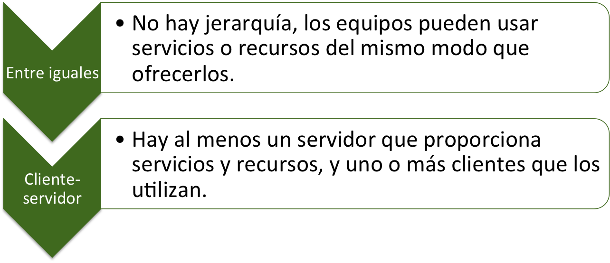

## **Topologies de xarxa**

La topologia de xarxa defineix la forma en que els dispositius (nodes) estan organitzats i connectats entre sí. Existeixen topologies físiques (com estan els cables) i topologies lògiques (com fluyen les dades).

Les topologies físiques poden ser **cablejades** o **sense fil**, segons el mitjà de transmissió empleat. A continuació es estudian tots dos grups per separat.

### **Topologies cablejades**

En les topologies cablejades els nodes es connecten mitjançant un mitjà físic (cable de parell trenat, coaxial o fibra òptica). Les principals són bus, estrela, anell, malla, arbre i mixta.

#### **Topologia de bus**

Tots els dispositius es connecten a un únic cable central (bus o backbone). Les dades viatgen en totes dues adreces al llarg del bus i tots els dispositius reben les tramas, però només el destinatari les processa.

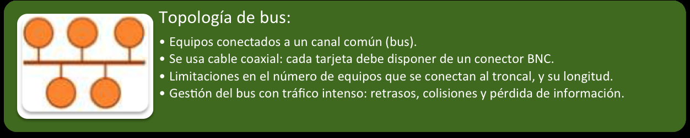

- **Avantatges**: instal·lació senzilla i económica, requereix poc cablejat.

- **Inconvenients**: si el bus principal falla, tota la xarxa cae; és difícil de detectar i aislar fallades; rendiment disminuye amb molts dispositius; obsoleta en instal·lacions modernes.

#### **Topologia d'estrela**

Tots els dispositius es connecten a un equip central (switch o hub). La comunicació es realitza a través d'aquest punt central.

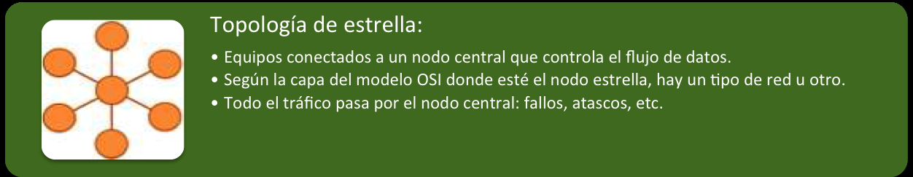

- **Avantatges**: si un node falla, els resta continúan funcionant; fàcil d'instal·lar, mantindre i ampliar; els fallades es localizan amb rapidesa.

- **Inconvenients**: si l'equip central falla, tota la xarxa cae; requereix més cablejat que la topologia de bus.

#### **Topologia d'anell**

Els dispositius es connecten formant un circuito tancat. Les dades viatgen en una sola adreça (unidireccional) o en totes dues (bidireccional) a través de l'anell, passant de node en node fins a arribar al seu destí.

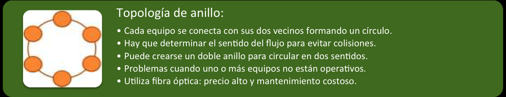

- **Avantatges**: rendiment constant independentment del número de nodes; no hi ha colisions de dades (utilitzant token passing).

- **Inconvenients**: si un node falla, pot cortar tota la comunicació; l'adició o eliminació de nodes interromp la xarxa; difícil d'ampliar.

#### **Topologia de malla**

Cada dispositiu es connecta amb tots (malla completa) o amb diversos (malla parcial) dels resta dispositius de la xarxa.

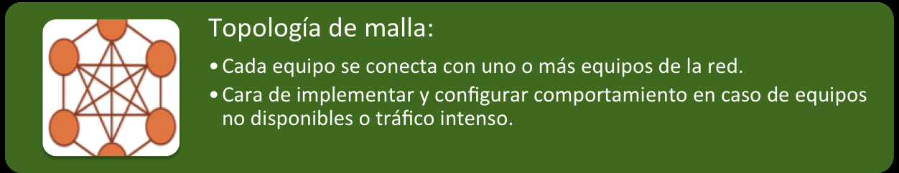

- **Avantatges**: alta fiabilitat i tolerància a fallades (si una ruta falla, les dades poden prendre una altra); alta privacitat i seguretat; equilibrio de carrega.

- **Inconvenients**: cost elevat de cablejat i configuració; complexitat d'instal·lació i manteniment; cada node ha de gestionar múltiples connexions.

#### **Topologia d'arbre**

Combina les topologies de bus i estrela. Es estructura en nivells jeràrquics, amb un node arrel en la part superior i ramas que es subdividen cap als dispositius finals.

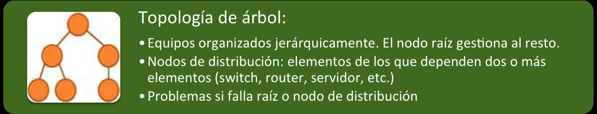

- **Avantatges**: escalable, permet crecer afegint nous nivells; fàcil d'administrar en entorns jeràrquics.

- **Inconvenients**: si falla un node intermedi, tots els nodes dependientes es desconectan; més complexa de configurar que una estrela simple.

#### **Topologia mixta**

Surge quan els nodes de distribució d'una xarxa en arbre actuen com puente cap a altres topologies, combinant diverses d'elles en una mateixa instal·lació.

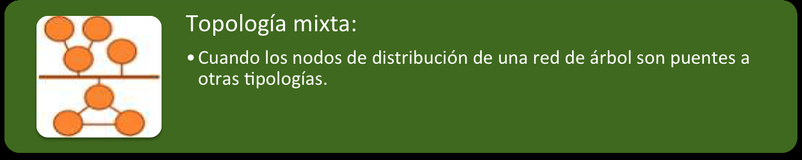

### **Topologies sense fil**

En les topologies sense fil els nodes es comuniquen sense cables, mitjançant ondas de ràdio, i el mitjà de transmissió és l'aire. El seu element característic és la **cel·la**: la zona en la que el senyal d'un punt d'accés es emite amb la potència suficient per a oferir cobertura. Els equips que amplían el ràdio d'acció de la xarxa es denominen **punts d'accés** (AP). Quan un dispositiu canvia d'una cel·la a una altra sense perdre la connexió es parla de **itinerancia** (*roaming*).

Segons com es organicen eixes cel·les, es distingeixen dos models principals:

#### **Topologia sense fil distribuïda**

Cada cel·la disposa del seu propi punt d'accés, que gestiona de forma autónoma els dispositius connectats a ella. La xarxa es forma per la unió de diverses cel·les independents.

- **Avantatges**: és senzilla de desplegar i ampliar (basta amb afegir noves cel·les); no depèn d'un únic element central.

- **Inconvenients**: requereix que existisca *roaming* perquè un dispositiu puga moverse entre cel·les sense desconectar-se; la gestió i la seguretat han de configurar-se en cada punt d'accés.

#### **Topologia sense fil centralitzada**

Adequada quan hi ha moltes cel·les i la informació és de naturalesa variada. Tots els punts d'accés depenen d'un node central (els *switches* WLAN) que gobierna la xarxa.

- **Avantatges**: l'administració, la seguretat i la configuració es centralizan en un únic punt; és més fàcil de gestionar en instal·lacions grans.

- **Inconvenients**: els punts d'accés són "tontos" i només amplían la cobertura, sense poder gestionar per sí mateixos els dispositius connectats a ells; si falla el controlador central, la xarxa queda afectada.

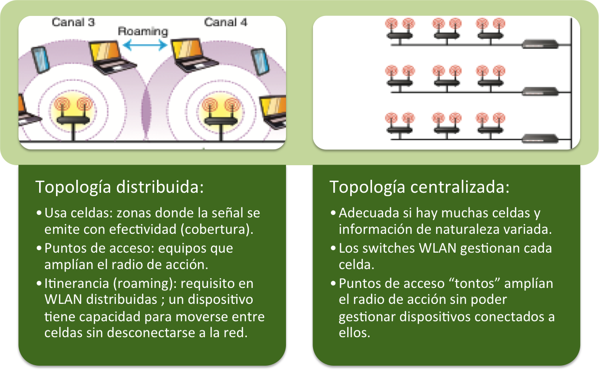

### **Resum de topologies**

| Topologia | Tipus | Estructura | Avantatge principal | Desavantatge principal |
| --- | --- | --- | --- | --- |
| Bus | Cablejada | Cable central compartit | Senzilla i barata | Un fallada en el bus afecta a tota la xarxa |
| Estrela | Cablejada | Node central (switch) | Fàcil manteniment | El fallada del central invalida la xarxa |
| Anell | Cablejada | Circuito tancat | Rendiment predecible | Un node caído pot cortar l'anell |
| Malla | Cablejada | Interconnexió múltiple | Alta fiabilitat | Cost i complexitat elevats |
| Arbre | Cablejada | Jeràrquica | Escalable | Dependència de nodes intermedios |
| Mixta | Cablejada | Combinació de topologies | Es adapta a cada necessitat | Major complexitat de disseny i gestió |
| Distribuïda | Sense fil | Cel·les amb AP autónomos | Fàcil de desplegar i ampliar | Necessita *roaming*; configuració per AP |
| Centralitzada | Sense fil | Controlador central (switch WLAN) | Gestió i seguretat centralitzades | Depèn del controlador central |

## **Arquitectures de xarxa**

L'arquitectura de xarxa defineix el model de funcionament i les regles que regeixen la comunicació entre els dispositius. Les dos arquitectures principals són client-servidor i peer-to-peer.

### **Arquitectura client-servidor**

En aquesta arquitectura existeix una distinció clara entre els servidors (que proporcionen recursos i serveis) i els clients (que solicitan i utilitzen eixos recursos).

- **Servidor**: és un ordinador potent que executa un sistema operatiu de servidor (Windows Server, Linux) i ofereix serveis centralitzats com emmagatzematge de fitxers, gestió d'impressió, accés a Internet o autenticació d'usuaris.

- **Client**: és l'ordinador de l'usuari final que es connecta al servidor per a accedir als serveis i recursos.

- **Funcionament**: el client realitza una petició al servidor, que la processa i retorna la resposta corresponent.

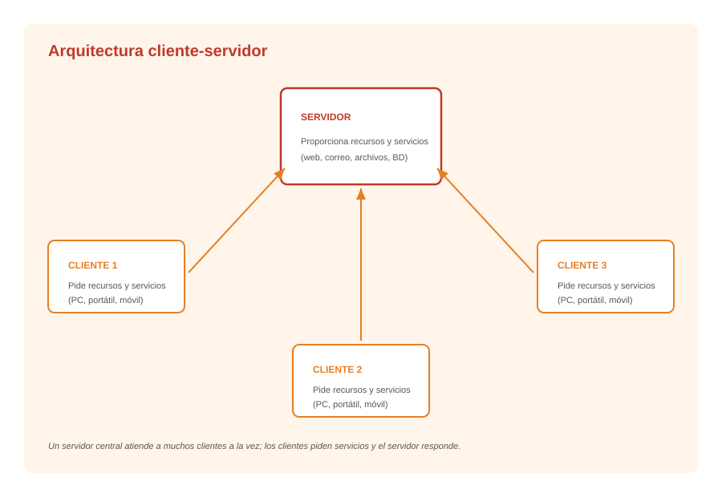

**Avantatges:**
- Gestió centralitzada d'usuaris, permisos i recursos.
- Major seguretat: el servidor controla l'accés a la informació.
- Còpies de seguretat centralitzades.
- Escalabilitat: es poden afegir més clients sense modificar la configuració.

**Inconvenients:**
- Dependència total del servidor: si falla, tots els clients pierden els serveis.
- Cost elevat del servidor i del programari de servidor.
- Es requereix personal tècnic especialitzat per a la seua administració.

### **Arquitectura peer-to-peer (P2P)**

En aquesta arquitectura tots els dispositius tenen la mateixa categoria. No hi ha servidors dedicats; cada ordinador pot actuar simultàniament com client i com servidor.

- **Funcionament**: cada dispositiu comparteix part dels seus recursos (fitxers, impresoras, connexió a Internet) i a la seua vegada accedeix als recursos dels resta.

- **Exemples**: xarxes doméstiques xicotetes, xarxes ad hoc, xarxes d'intercanvi de fitxers (BitTorrent).

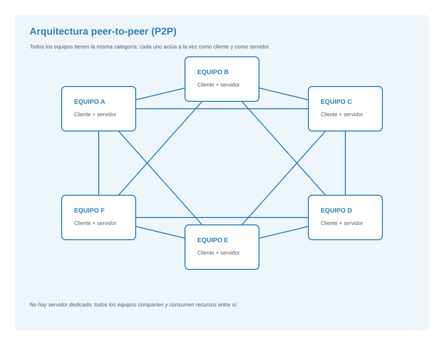

**Avantatges:**
- No necessita un servidor dedicat, el que redueix el cost.
- Senzillesa d'instal·lació i configuració.
- No depèn d'un únic punt central.

**Inconvenients:**
- Gestió de seguretat complexa: cada usuari administra els seus propis recursos.
- No hi ha centralizació de còpies de seguretat.
- Rendiment disminuye amb l'aumento de dispositius.
- Difícil administració en xarxes grans.

### **Comparació**

| Característica | Client-servidor | Peer-to-peer |
| --- | --- | --- |
| Número de servidors | Un o diversos dedicats | Cap dedicat |
| Cost | Elevat | Sota |
| Seguretat | Alta (centralitzada) | Variable (descentralitzada) |
| Escalabilitat | Alta | Limitada |
| Administració | Centralitzada | Descentralitzada |
| Depèn de | El servidor | Tots els nodes |

---

## 🎮 Reptes Interactius d'Autoavaluació (+100 XP)

Comprova el teu domini sobre **2.1 Tipus de xarxes i estructures alternatives** superant aquests 4 reptes gamificats (+25 punts cadascun):

  
🎯 <strong>Repte 1 (+25 pts):</strong> En les xarxes de dades segons la seua extensió geogràfica, què és una xarxa LAN (Local Area Network)?

  

    <button type="button" class="btn-mcq-opt" data-opt="A">A) Una xarxa d'àrea local que connecta equips dins d'un espai reduït com una aula, oficina o edifici.</button>
    <button type="button" class="btn-mcq-opt" data-opt="B">B) Una xarxa mundial que connecta continents sencers per satèl·lit.</button>
    <button type="button" class="btn-mcq-opt" data-opt="C">C) Un cable d'alimentació elèctrica de 230 V.</button>
    <button type="button" class="btn-mcq-opt" data-opt="D">D) Una targeta gràfica per a videojocs.</button>
  

  

  
🎯 <strong>Repte 2 (+25 pts):</strong> En quina topologia física de xarxa tots els ordinadors es connecten a un punt central (com un commutador o Switch)?

  

    <button type="button" class="btn-mcq-opt" data-opt="A">A) Topologia en estrela.</button>
    <button type="button" class="btn-mcq-opt" data-opt="B">B) Topologia en anell tancat.</button>
    <button type="button" class="btn-mcq-opt" data-opt="C">C) Topologia en bus lineal.</button>
    <button type="button" class="btn-mcq-opt" data-opt="D">D) Topologia sense cap dispositiu.</button>
  

  

  
✅ <strong>Repte 3 (Vertader o Fals · +25 pts):</strong> En l'arquitectura Client-Servidor, el servidor centralitza els recursos o serveis i atén les peticions que li fan els equips clients.

  

    <button type="button" class="btn-vf" data-opt="V">Vertader (V)</button>
    <button type="button" class="btn-vf" data-opt="F">Fals (F)</button>
  

  

  
⌨️ <strong>Repte 4 (+25 pts):</strong> Quines són les sigles d'una Xarxa d'Àrea Local (Local Area Network)?

  

    <input type="text" class="quiz-input" placeholder="Escriu la resposta..." />
    <button type="button" class="btn-quiz-check">Comprovar</button>
  

  

### 📋 Llista de Comprovació i Rúbrica d'Assoliment

Marca cada criteri a mesura que completes l'estudi o la resolució pràctica d'aquesta pàgina (**2.1 Tipus de xarxes i estructures alternatives**):

- [ ] He llegit detingudament la teoria o l'enunciat d'aquesta secció i he anotat els conceptes clau.
- [ ] He revisat els esquemes, taules o blocs de codi i he verificat que sé aplicar-los a l'entorn de treball.
- [ ] He resolt correctament els **4 reptes interactius** superiors obtenint els **100 punts XP**.
- [ ] He descarregat el comprovant oficial en PDF per a adjuntar-lo a la tasca d'**Aules**.

  <h3>📤 Comprovant de Lliurament per a Aules</h3>
  
Quan hages completat els reptes interactius i la llista d'autoavaluació d'aquesta pàgina, introdueix el teu nom i descarrega el teu certificat oficial en PDF per a adjuntar-lo a la tasca d'<strong>Aules</strong>.

  

    <label for="aules-student-name">👤 Nom i Cognoms de l'Alumne/a:</label>
    <input type="text" id="aules-student-name" class="aules-student-name" placeholder="Ex: Joan Garcia Pérez" />
  

  

    0/4 reptes completats (0%) · 0 punts · 0/4 criteris d'autoavaluació
  

  

    <button type="button" class="btn-aules-dl" data-module="IMX" data-unit="UD02" data-activity="ut0201">📥 Descarregar Comprovant PDF</button>
    <button type="button" class="btn-aules-copy">📋 Copiar Resum al Porta-retalls</button>
  

  

