# **Mitjans de transmissió**

  

    🏆 <strong>Progrés d'aquesta secció:</strong> 0 de 4 superats (0%)
    ⭐ <strong>0 punts</strong>
  

  

    

  

Els mitjans de transmissió són els canals físics o no físics a través dels quals es propagan els senyals que transportan la informació entre els dispositius de la xarxa.

> **📌 Ampliació en UP03**
> 

> Les característiques tècniques dels conductors guiats —tipus de parell trenat (UTP, FTP, STP, S/FTP), categories Cat 5e a Cat 8, connectors, variants i normativa— es tracten amb detall en la UP03 – Tipus de conductors.

### **Mitjans de transmissió guiats**

Són aquells en els que el senyal es transmet a través d'un mitjà físic: cables.

#### **Parell trenat**

És el mitjà de transmissió més utilitzat en les xarxes locals. Consisteix en parells de cables de coure trenats entre sí per a reduir la interferència electromagnética. Es presenta en categories normalitzades (Cat 5e, Cat 6, Cat 6a, Cat 7, Cat 8) que determinan la seua velocitat i freqüència de treball.

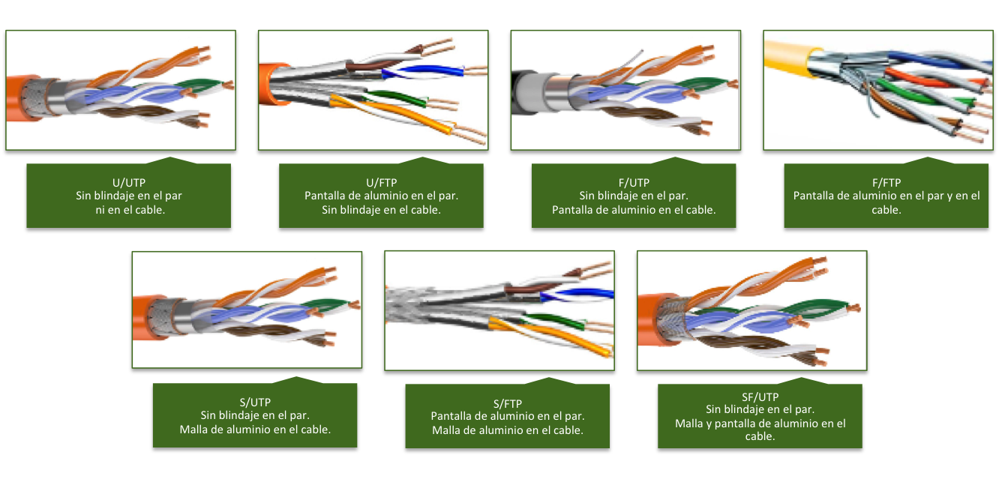

#### **Fibra òptica**

Transmet dades mitjançant pulsos de llum a través d'un nucli de vidrio o plàstic. Ofereix major velocitat i abast que el parell trenat, i és inmune a les interferències electromagnètiques.

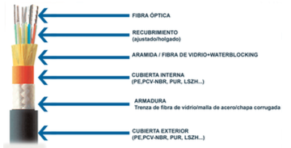

Existeixen dos grans tipus: monomode (SMF), per a largas distàncies, i multimode (MMF), per a xarxes locals i centres de dades.

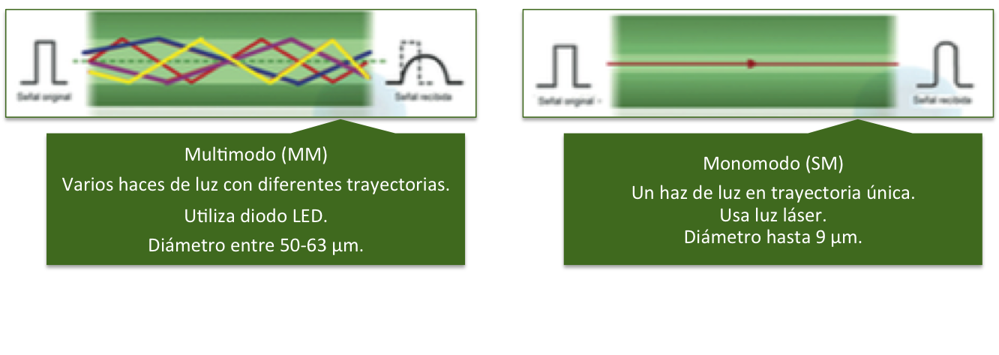

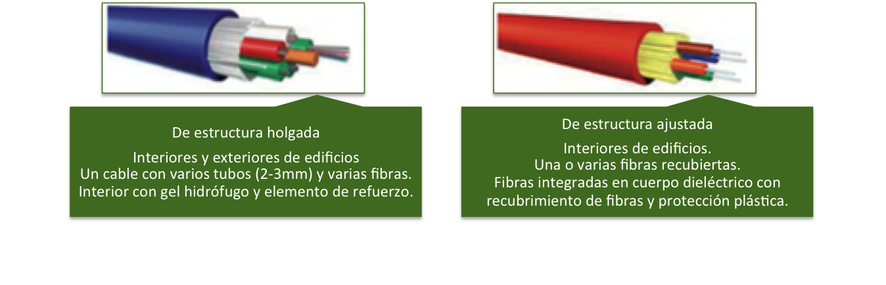

Els connectors més habituals per a la fibra òptica són ST, SC, FC, LC i MT-RJ:

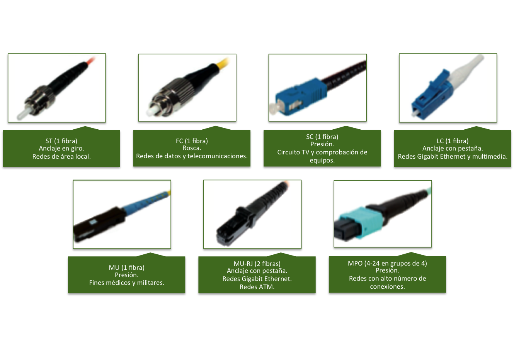

**Avantatges:**
- Alta velocitat de transmissió (fins a 100 Gbps).
- Gran abast (diversos kilómetros sense repetidors).
- Inmunitat a interferències electromagnètiques.
- Alta seguretat: és molt difícil d'intervindre.
- Elevada capacitat d'ample de banda.

**Inconvenients:**
- Cost major que el parell trenat.
- Fragilitat: no suporta curvaturas pronunciades ni traccions mecániques.
- Instal·lació i empalme més complexos.
- Necessita equips de transmissió/recepció óptics.

#### **Cable coaxial**

Consisteix en un conductor central de coure envoltat per un aïllant, una malla metàl·lica de blindatge i una cubierta exterior. Es utilizó àmpliament en xarxes de cable i en la connexió d'antenes, però ha sigut sustituido mayoritariament per la fibra òptica i el parell trenat en les xarxes de dades.

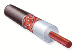

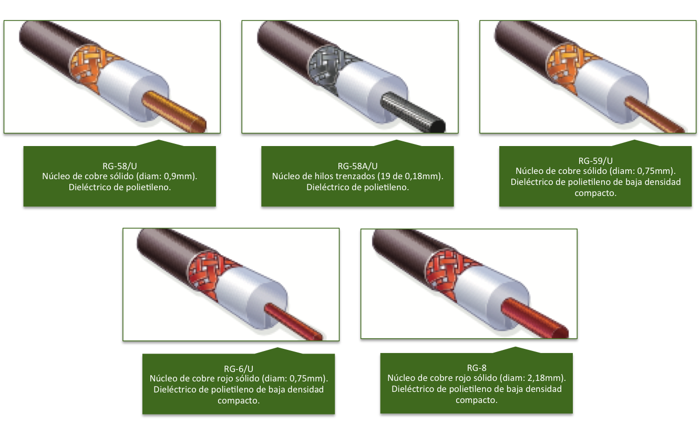

El seu connector més característic és el **BNC**:

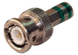

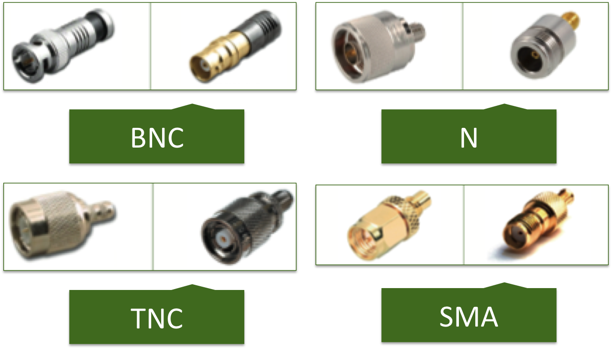

### **Mitjans de transmissió no guiats**

Són aquells en els que el senyal es propaga pel espai lliure, sense necessitat d'un mitjà físic conductor.

- **Microones terrestres**: utilitzen antenes parabóliques per a transmetre senyals de ràdio en línia de visió directa. S'usen per a enllaços de telecomunicacions de llarga distància.

- **Microones per satélite**: permeten la comunicació entre punts molt alejats, fins i tot en diferents continentes. S'utilitzen per a televisions, telefonía i connexió a Internet en zones remotas.

- **Infrarojos**: utilitzen ondas d'infrarrojo per a transmetre dades a corta distància (controladors remotos, connexió entre dispositius mòbils). No atraviesan parets.

- **Radiofreqüència (Wi-Fi)**: utilitzen ondas de ràdio en les bandas de 2.4 GHz i 5 GHz per a transmetre dades de forma sense fil. És la tecnologia més utilitzada en les xarxes locals sense fil.

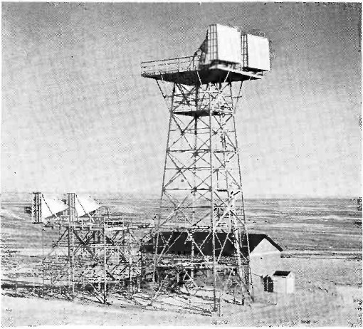

El conjunt d'ondas electromagnètiques utilizables es denomina **espectro electromagnétic**. Les tecnologies sense fil empren bandas de freqüència concretes, del qual ús està regulado per les autoritats de telecomunicacions.

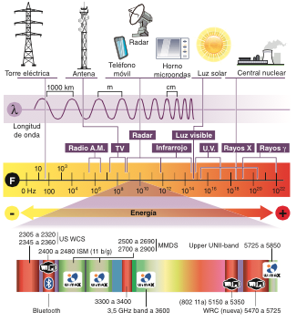

Les **bandas de freqüència** es reparten entre els distints serveis (ràdio, microones i infrarojos):

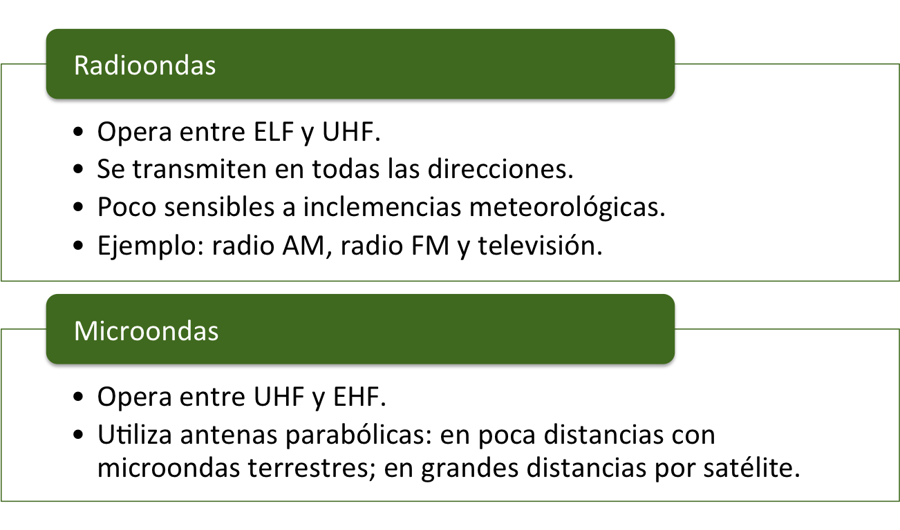

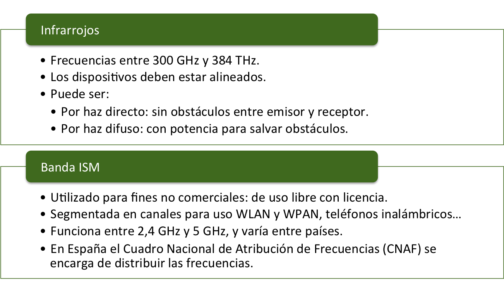

### **Estàndards sense fil**

Les comunicacions sense fil es normalizan mitjançant la família d'estàndards IEEE 802:

- **WPAN (IEEE 802.15)**: xarxes d'àrea personal sense fil. El més utilitzat és **Bluetooth** (IEEE 802.15.1), que usa una topologia *piconet* ampliable a *scatternet*.

- **WLAN (IEEE 802.11)**: xarxes d'àrea local sense fil (Wi-Fi). És el més difundido i disposa de diverses revisions (802.11a/b/g/n/ac/ax).

- **WMAN (IEEE 802.16)**: xarxes d'àrea metropolitana sense fil. El més utilitzat és **WiMAX** (revisió 802.16m), que treballa en el rang 2,3–3,5 GHz i s'empra on no arriba el ADSL o la fibra.

- **WWAN**: xarxes d'àrea àmplia sense fil, aplicades a la telefonía mòbil (des de GSM o 2G fins a LTE o 4G, i 5G).

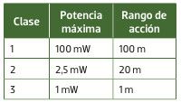

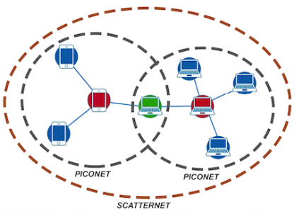

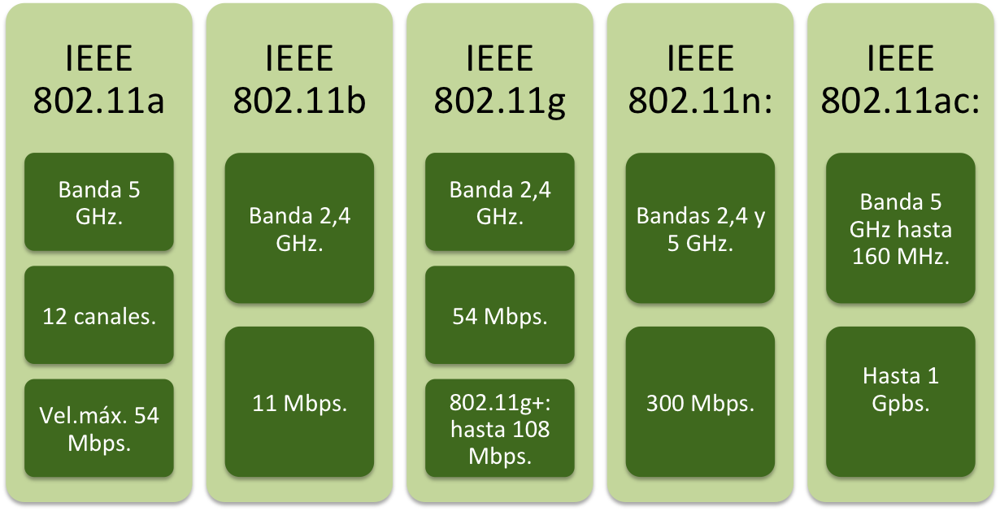

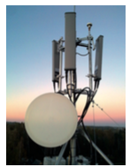

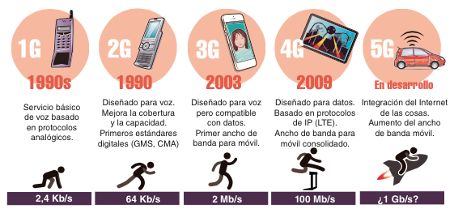

### **Resum de mitjans de transmissió**

| Mitjà | Tipus | Velocitat | Distància | Cost | Ús principal |
| --- | --- | --- | --- | --- | --- |
| Parell trenat UTP | Guiat | 1-10 Gbps | Fins a 100 m | Sota | LAN, doméstic |
| Fibra òptica multimode | Guiat | Fins a 100 Gbps | Fins a 2 km | Mitjà-alt | Centres de dades |
| Fibra òptica monomode | Guiat | Fins a 100 Gbps | Fins a 100 km | Alt | WAN, fibra a l'hogar |
| Cable coaxial | Guiat | Fins a 10 Gbps | Fins a 500 m | Mitjà | CATV, antenes |
| Microones | No guiat | Variable | Fins a 50 km | Alt | Enllaços punt a punt |
| Wi-Fi | No guiat | Fins a 9.6 Gbps (Wi-Fi 6E) | Fins a 100 m | Sota | LAN sense fil |

## **Estàndards de cablejat estructurat: TIA/EIA-568**

L'estàndard TIA/EIA-568 defineix les especificacions per al cablejat estructurat en edificis comercials. Estableix dos normes de coloració per als pines del connector RJ-45:

- **TIA/EIA-568A**: ordre de colors: blanc-verd, verd, blanc-taronja, blau, blanc-blau, taronja, blanc-marrón, marrón.

- **TIA/EIA-568B**: ordre de colors: blanc-taronja, taronja, blanc-verd, blau, blanc-blau, verd, blanc-marrón, marrón.

El connector RJ-45 té 8 pines. Per a una connexió directa (cable recto) s'utilitza el mateix estàndard en tots dos extrems. Per a connectar dispositius del mateix tipus (PC a PC, switch a switch) s'utilitza un cable encreuat (un extremo 568A i l'un altre 568B).

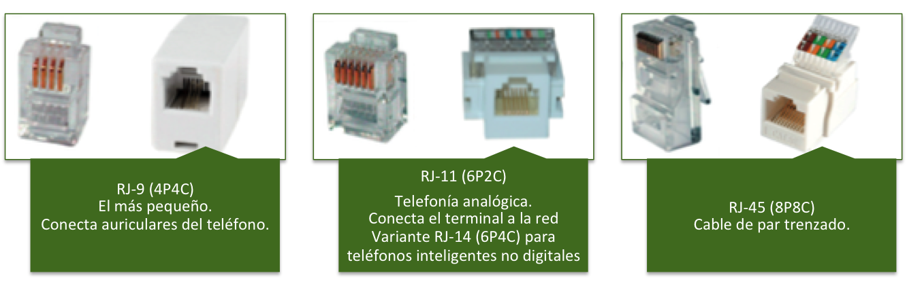

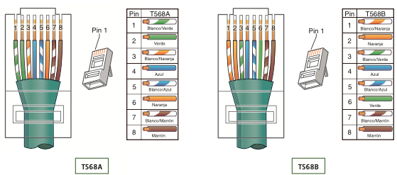

A continuació es mostra l'esquema de cada tipus de cable:

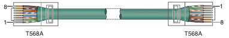

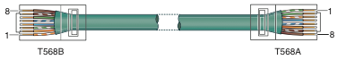

Actualment, la majoria de dispositius admeten la funció Auto-MDI/MDIX, que detecta automàticament el tipus de cable i ajusta la connexió, per la qual cosa la distinció entre cable recto i encreuat és menys relevante en la pràctica.

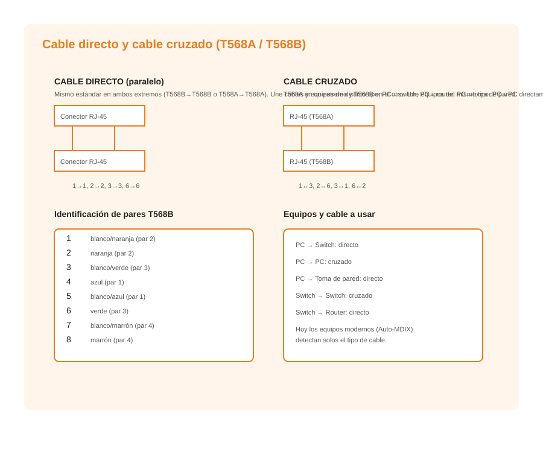

## **Topologies de cablejat en edificis**

En el cablejat d'edificis la topologia emprada és la **estrela**: el node central és el **centre de cablejat**, compost per un o més **armaris de distribució** (racks). En edificis xicotets amb distàncies menors a 100 m s'utilitza aquesta topologia en estrela, ja que el parell trenat garanteix la transmissió fins a eixa distància sense repetidors.

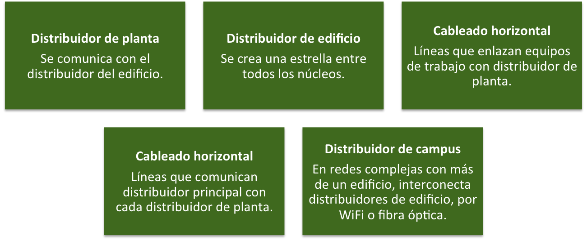

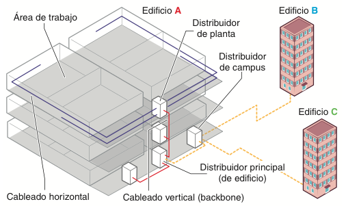

## **En resum**

Els principals conceptes de la unitat es recogen en el següent esquema:

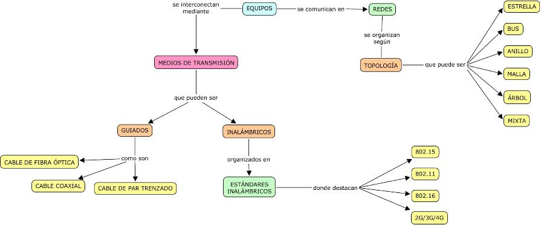

---

## 🎮 Reptes Interactius d'Autoavaluació (+100 XP)

Comprova el teu domini sobre **2.2 Mitjans de transmissió** superant aquests 4 reptes gamificats (+25 punts cadascun):

  
🎯 <strong>Repte 1 (+25 pts):</strong> En les xarxes de dades segons la seua extensió geogràfica, què és una xarxa LAN (Local Area Network)?

  

    <button type="button" class="btn-mcq-opt" data-opt="A">A) Una xarxa d'àrea local que connecta equips dins d'un espai reduït com una aula, oficina o edifici.</button>
    <button type="button" class="btn-mcq-opt" data-opt="B">B) Una xarxa mundial que connecta continents sencers per satèl·lit.</button>
    <button type="button" class="btn-mcq-opt" data-opt="C">C) Un cable d'alimentació elèctrica de 230 V.</button>
    <button type="button" class="btn-mcq-opt" data-opt="D">D) Una targeta gràfica per a videojocs.</button>
  

  

  
🎯 <strong>Repte 2 (+25 pts):</strong> En quina topologia física de xarxa tots els ordinadors es connecten a un punt central (com un commutador o Switch)?

  

    <button type="button" class="btn-mcq-opt" data-opt="A">A) Topologia en estrela.</button>
    <button type="button" class="btn-mcq-opt" data-opt="B">B) Topologia en anell tancat.</button>
    <button type="button" class="btn-mcq-opt" data-opt="C">C) Topologia en bus lineal.</button>
    <button type="button" class="btn-mcq-opt" data-opt="D">D) Topologia sense cap dispositiu.</button>
  

  

  
✅ <strong>Repte 3 (Vertader o Fals · +25 pts):</strong> En l'arquitectura Client-Servidor, el servidor centralitza els recursos o serveis i atén les peticions que li fan els equips clients.

  

    <button type="button" class="btn-vf" data-opt="V">Vertader (V)</button>
    <button type="button" class="btn-vf" data-opt="F">Fals (F)</button>
  

  

  
⌨️ <strong>Repte 4 (+25 pts):</strong> Quines són les sigles d'una Xarxa d'Àrea Local (Local Area Network)?

  

    <input type="text" class="quiz-input" placeholder="Escriu la resposta..." />
    <button type="button" class="btn-quiz-check">Comprovar</button>
  

  

### 📋 Llista de Comprovació i Rúbrica d'Assoliment

Marca cada criteri a mesura que completes l'estudi o la resolució pràctica d'aquesta pàgina (**2.2 Mitjans de transmissió**):

- [ ] He llegit detingudament la teoria o l'enunciat d'aquesta secció i he anotat els conceptes clau.
- [ ] He revisat els esquemes, taules o blocs de codi i he verificat que sé aplicar-los a l'entorn de treball.
- [ ] He resolt correctament els **4 reptes interactius** superiors obtenint els **100 punts XP**.
- [ ] He descarregat el comprovant oficial en PDF per a adjuntar-lo a la tasca d'**Aules**.

  <h3>📤 Comprovant de Lliurament per a Aules</h3>
  
Quan hages completat els reptes interactius i la llista d'autoavaluació d'aquesta pàgina, introdueix el teu nom i descarrega el teu certificat oficial en PDF per a adjuntar-lo a la tasca d'<strong>Aules</strong>.

  

    <label for="aules-student-name">👤 Nom i Cognoms de l'Alumne/a:</label>
    <input type="text" id="aules-student-name" class="aules-student-name" placeholder="Ex: Joan Garcia Pérez" />
  

  

    0/4 reptes completats (0%) · 0 punts · 0/4 criteris d'autoavaluació
  

  

    <button type="button" class="btn-aules-dl" data-module="IMX" data-unit="UD02" data-activity="ut0202">📥 Descarregar Comprovant PDF</button>
    <button type="button" class="btn-aules-copy">📋 Copiar Resum al Porta-retalls</button>
  

  

