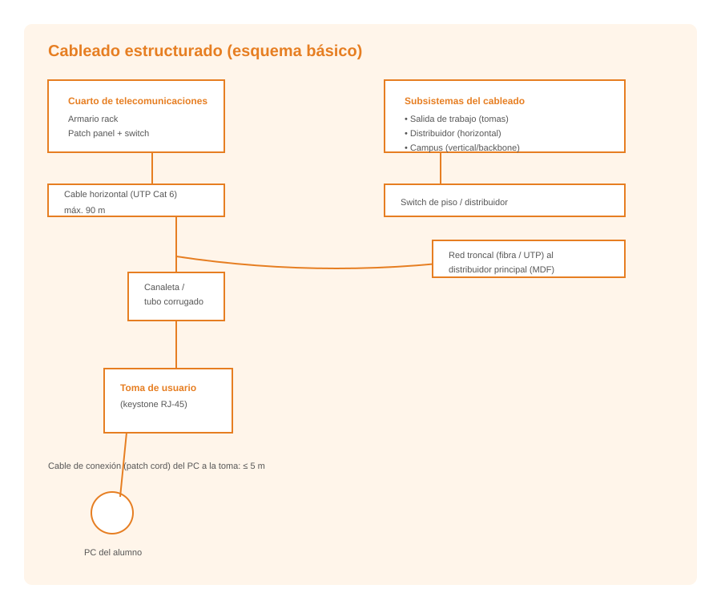
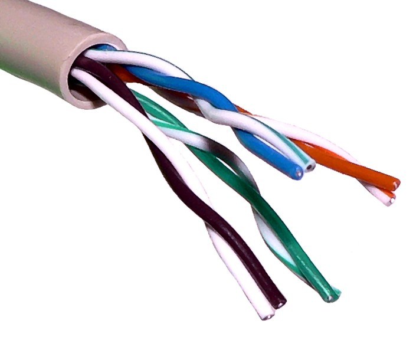
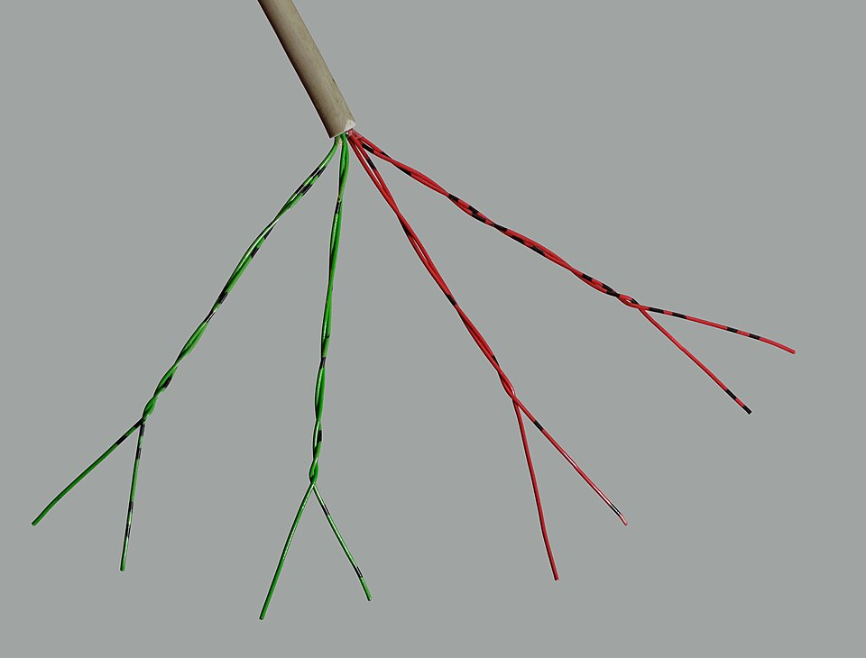
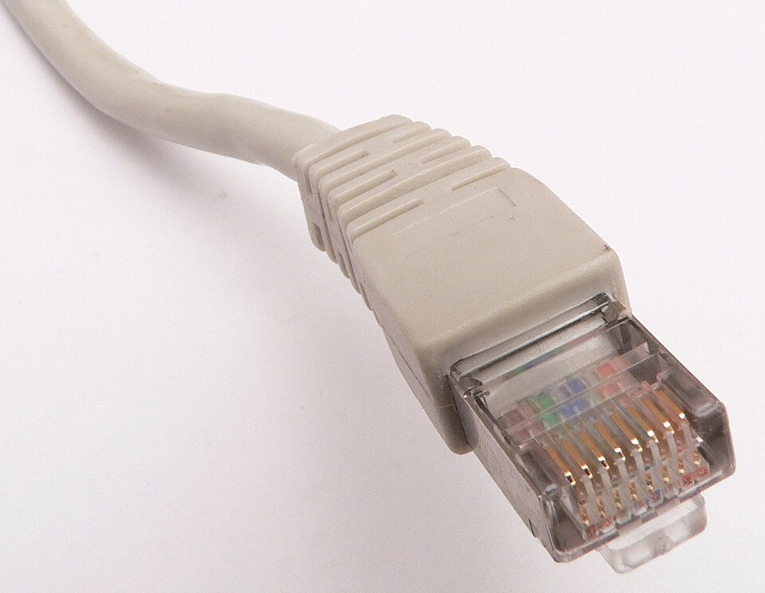
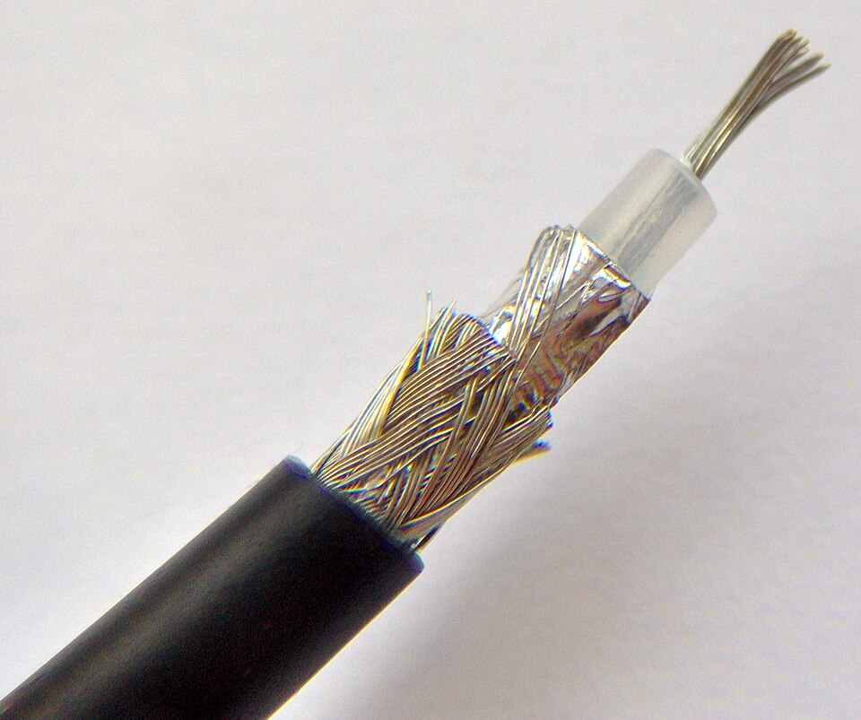
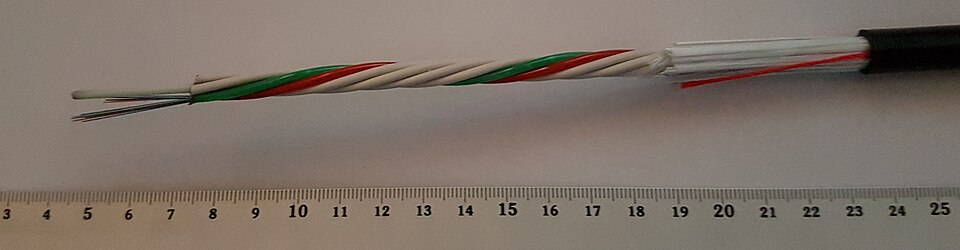
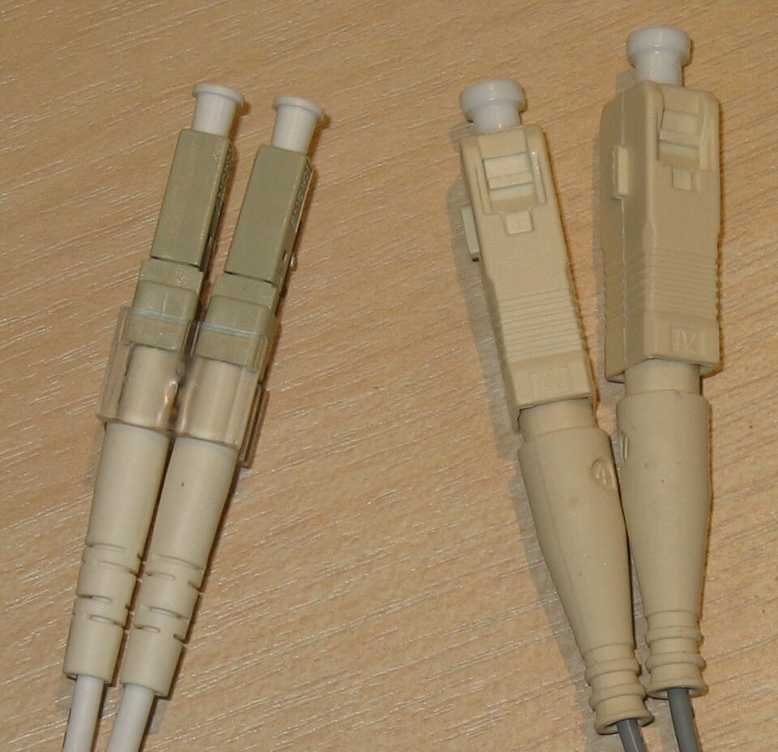

# UD3: Medios de Transmisión — Par Trenzado (UTP/STP), Coaxial, Fibra Óptica e Inalámbrico

Bienvenido/a a la **UD3: Medios de Transmisión — Par Trenzado (UTP/STP), Coaxial, Fibra Óptica e Inalámbrico** del módulo profesional de **Instalación y Mantenimiento de Redes para Transmisión de Datos (Networking Essentials)** (2º FPB · Instalación y Mantenimiento de Redes (IMX / NE)).

En esta unidad encontrarás los contenidos teóricos, ejemplos prácticos, ejercicios resueltos y actividades de evaluación curricular desarrollados por el profesor **Manuel Alonso Argente**.

---

### 📑 Índice de Apartados y Actividades de la Unidad

- [**📋 3.0 Propuesta Didáctica: Infraestructura y cableado de red**](./ut0300.html)
- [**3.1 Tipos de instalaciones de redes de voz y datos**](./ut0301.html)
- [**3.2 Tipos de conductores: par trenzado de cobre, cable coaxial, fibra óptica**](./ut0302.html)

---

# 📖 Vista Completa de la Unidad

## 3.0 Propuesta Didáctica — Infraestructura y cableado de red

# **Infraestructura y cableado de red**

## **Propuesta didáctica**

En esta unidad vamos a trabajar el RA1: **Selecciona els elements que configuren les xarxes per a la transmissió de veu i dades, descrivint les seues principals característiques i funcionalitat.**

## **Criterios de evaluación**

### **Respecto al RA1:**

| Código | Descripción | Peso (%) | Herramientas Evaluación |
| --- | --- | --- | --- |
| **CE1a** | Se han identificado los tipos de instalaciones relacionados con las redes de transmisión de voz y datos | 50% | ACT101 (5%) -- EXA103 (95%) |
| **CE1c** | Se han clasificado los tipos de conductores (par de cobre, cable coaxial, fibra óptica, entre otros) | 50% | ACT102 (5%) -- EXA103 (95%) |

## **Contenidos**

### **Tipos de instalaciones de redes de transmisión de voz y datos:**

- Instalación centralizada: concepto, características y aplicaciones.

- Instalación distribuida: concepto, características y aplicaciones.

- Instalación mixta.

### **Tipos de conductores:**

- Cable de par trenzado de cobre: principio de funcionamiento, tipos y categorías.

- Cable coaxial: estructura y aplicaciones.

- Fibra óptica: estructura, tipos (monomodo y multimodo) y aplicaciones.

- Conductores guiados y no guiados.

> **📌 Cuestionario inicial**
> 

> 1. ¿Cuáles son los principales tipos de instalaciones que conforman una red de telecomunicaciones?

> 1. ¿Qué diferencia existe entre una instalación centralizada y una instalación distribuida en una red de datos?

> 1. ¿Cuáles son los tres grandes tipos de conductores utilizados en las redes de telecomunicaciones?

> 1. ¿En qué se diferencia la fibra óptica monomodo de la fibra óptica multimodo?

> 1. ¿Qué ventajas ofrece el cable de par trenzado frente al cable coaxial?

## **Programación de Aula (14 h)**

Esta unidad se imparte en la primera evaluación, con una duración estimada de **7 sesiones lectivas de 2 h** (14 h), durante los días que se indican en el calendario.

### **Distribución de horas por contenido**

| Contenido | Sesiones | Horas |
| --- | --- | --- |
| 3.1 Tipos de instalaciones: UP3.1 | 3 | 6 |
| 3.2 Tipos de conductores: UP3.2 | 4 | 8 |
| **Total** | **7** | **14** |

### **Sesiones**

| Sesión | Contenidos | Actividades | Criterios trabajados |
| --- | --- | --- | --- |
| 1 | Tipos de instalaciones |  | CE1a |
| 2 | Tipos de instalaciones |  | CE1a |
| 3 | Tipos de instalaciones | ACT101 | CE1a |
| 4 | Tipos de conductores: par trenzado, coaxial, fibra óptica |  | CE1c |
| 5 | Tipos de conductores: par trenzado, coaxial, fibra óptica |  | CE1c |
| 6 | Tipos de conductores: par trenzado, coaxial, fibra óptica | ACT102 | CE1c |
| 7 | Actividades de refuerzo y evaluación | **EXA103** | CE1a - CE1c |

---

## 3.1 Tipos de instalaciones de redes de voz y datos

# **Tipos de instalaciones de redes de voz y datos**

La infraestructura de telecomunicaciones constituye el conjunto de elementos físicos necesarios para proporcionar conectividad en un edificio o campus. Comprende desde los puntos de entrada del proveedor de servicios hasta las tomas de usuario donde se conectan los dispositivos finales.

## **Clasificación de las instalaciones**

### **Instalación centralizada**

En este tipo de instalación todo el cableado converge en un único armario de telecomunicaciones, denominado MDF (Main Distribution Frame). Desde este punto central se distribuye el cableado hacia todas las tomas de usuario del edificio.

**Características:**
- Un solo armario de distribución para todo el edificio.
- Cableado horizontal desde el MDF hasta cada toma de usuario.
- Gestión centralizada de los equipos de red.
- Adecuada para edificios pequeños o con poca distancia entre el armario y los puntos de usuario.

### **Instalación distribuida**

Se utilizan múltiples armarios de planta (IDF - Intermediate Distribution Frame) conectados mediante cableado backbone al armario principal (MDF). Cada armario de planta distribuye el cableado de su zona.

**Características:**
- Múltiples armarios de distribución, uno por planta o zona.
- Cableado backbone (vertical) que conecta los IDF con el MDF.
- Cableado horizontal desde cada IDF hasta las tomas de usuario de su zona.
- Adecuada para edificios grandes o con muchas plantas.
- Permite mejor rendimiento al reducir las distancias del cableado horizontal.

### **Instalación mixta**

Combina elementos de ambos tipos anteriores, adaptándose a las necesidades específicas de cada edificio. Es el tipo más habitual en instalaciones reales.

---

## 3.2 Tipos de conductores: par trenzado de cobre, cable coaxial, fibra óptica

# **Tipos de conductores: par trenzado de cobre, cable coaxial, fibra óptica**

Los conductores son los medios físicos a través de los cuales se transmiten las señales de datos y voz en una red de telecomunicaciones. Se clasifican en conductores guiados (cableados) y conductores no guiados (inalámbricos). En esta unidad nos centraremos en los conductores guiados, que son los más utilizados en las infraestructuras de red fijas.

## **Cable de par trenzado de cobre**

El cable de par trenzado está compuesto por uno o varios pares de hilos de cobre aislados y trenzados entre sí. El trenzado reduce las interferencias electromagnéticas externas (RIE) y las diafonías entre pares adyacentes. Es el medio de transmisión más utilizado en las redes locales (LAN).

### **Principio de funcionamiento**

Cada par de hilos conduce una señal diferencial: un hilo transporta la señal y el otro transporta la versión inversa. Al receiver se resta ambas señales, cancelando así las interferencias captadas por ambos hilos de forma similar (modos comunes).

### **Tipos de cable de par trenzado**

| Tipo | Blindaje | Descripción | Aplicación |
| --- | --- | --- | --- |
| **UTP** (Unshielded Twisted Pair) | Sin blindaje | El más utilizado y económico. Los pares van sin protección adicional. | Redes domésticas y oficinas pequeñas |
| **FTP** (Foiled Twisted Pair) | Lámina de aluminio general | Incorpora una pantalla de aluminio que envuelve todos los pares. | Entornos con interferencias moderadas |
| **STP** (Shielded Twisted Pair) | Malla metálica general | Blindaje de malla metálica que protege todos los pares. | Entornos industriales |
| **S/FTP** | Malla + lámina por par | Blindaje individual por par y blindaje general. | Redes de alta velocidad y centros de datos |

### **Categorías del cable de par trenzado**

| Categoría | Velocidad máxima | Frecuencia | Aplicación típica |
| --- | --- | --- | --- |
| **Cat 5** | 100 Mbps | 100 MHz | Redes Fast Ethernet (obsoleta) |
| **Cat 5e** | 1 Gbps | 100 MHz | Redes Gigabit Ethernet |
| **Cat 6** | 10 Gbps (hasta 55 m) | 250 MHz | Redes Gigabit y 10 Gigabit |
| **Cat 6a** | 10 Gbps | 500 MHz | Redes 10 Gigabit (hasta 100 m) |
| **Cat 7** | 10 Gbps | 600 MHz | Centros de datos de alta densidad |
| **Cat 8** | 25/40 Gbps | 2000 MHz | Centros de datos de última generación |

### **Conectores**

El conector estándar para cable de par trenzado en redes Ethernet es el **RJ-45** (Registered Jack 45), con 8 pines de contacto. Existe también el conector **RJ-11**, con 4 u 8 pines, utilizado para telephoneía.

### **Normativa**

- **ANSI/TIA-568**: Estándar norteamericano para cableado estructurado.

- **ISO/IEC 11801**: Estándar internacional para infraestructura de cableado genérico.

- **EN 50173**: Estándar europeo para cableado estructurado.

### **Ventajas**

- Bajo costo.

- Fácil instalación y manipulación.

- Amplia disponibilidad y compatibilidad.

- Flexibilidad para distintas longitudes de tramo.

### **Desventajas**

- Susceptible a interferencias electromagnéticas (en versiones sin blindaje).

- Longitud máxima limitada a 100 metros por tramo.

- Menor ancho de banda que la fibra óptica.

## **Cable coaxial**

El cable coaxial está formado por un conductor central de cobre rodeado de un aislante dieléctrico, una malla metálica (blindaje) y una chaqueta exterior protectora. Proporciona mejor protección contra interferencias que el cable de par trenzado.

### **Principio de funcionamiento**

La señal se transmite a lo largo del conductor central, mientras que la malla metálica actúa como retorno y blindaje contra interferencias. La geometría coaxial confina el campo electromagnético en el espacio entre el conductor central y la malla.

### **Tipos de cable coaxial**

| Tipo | Diámetro nominal | Estándar | Aplicación |
| --- | --- | --- | --- |
| **Coaxial fino** | 5 mm (RG-58) | 10BASE2 | Redes Ethernet antiguas (hasta 185 m) |
| **Coaxial grueso** | 10 mm (RG-8, RG-11) | 10BASE5 | Redes Ethernet antiguas (hasta 500 m) |
| **Coaxial de banda ancha** | Variable | DOCSIS | Conexiones de Internet por cable (HFC) |

### **Conectores**

- **Conector BNC** (Bayonet Neill-Concelman): Utilizado en redes 10BASE2 y 10BASE5.

- **Conector F**: Utilizado en aplicaciones de televisión por cable y banda ancha (DOCSIS).

- **Conector N**: Utilizado en aplicaciones de alta frecuencia y radiofrecuencia.

### **Ventajas**

- Buena protección contra interferencias electromagnéticas.

- Mayor resistencia mecánica que el par trenzado.

- Capacidad de transmitir señales de alta frecuencia.

- Mayor distancia de transmisión que el par trenzado.

### **Desventajas**

- Mayor costo que el par trenzado.

- Instalación más compleja.

- Menor flexibilidad y más peso.

- Prácticamente obsoleto en redes de datos actuales.

## **Fibra óptica**

La fibra óptica transmite datos mediante pulsos de luz a través de un núcleo de vidrio o plástico extremely fino. Es el medio de transmisión que ofrece mayor velocidad, mayor distancia y mayor inmunidad a interferencias.

### **Principio de funcionamiento**

La luz entra en el núcleo de la fibra y se propaga por reflexión total interna. El núcleo está rodeado de una capa de revestimiento (cladding) con un índice de refracción menor, lo que hace que la luz rebote y permanezca confinada en el núcleo.

### **Componentes de una fibra óptica**

- **Núcleo (core)**: Parte central por donde viaja la luz. Puede ser de vidrio (silicio) o plástico.

- **Revestimiento (cladding)**: Capa que rodea al núcleo y confina la luz por reflexión total interna.

- **Revestimiento protector (buffer)**: Capa de protección mecánica.

- **Chaqueta exterior (jacket)**: Protección contra la intemperie y daños físicos.

### **Tipos de fibra óptica**

| Característica | Fibra multimodo (MM) | Fibra monomodo (SM) |
| --- | --- | --- |
| **Diámetro del núcleo** | 50 µm o 62,5 µm | 9 µm |
| **Fuente de luz** | LED o VCSEL | Láser (LD) |
| **Longitud de onda** | 850 nm, 1300 nm | 1310 nm, 1550 nm |
| **Distancia máxima** | Hasta 550 m (1 Gbps) | Hasta 80 km o más |
| **Ancho de banda** | Limitado | Muy alto |
| **Costo** | Menor | Mayor |
| **Aplicación** | Redes locales, centros de datos | WAN, enlaces entre edificios, telecomunicaciones |

### **Variantes de fibra multimodo**

- **OM1** (62,5/125 µm): Núcleo de 62,5 µm. Obsoleta en nuevas instalaciones.

- **OM2** (50/125 µm): Núcleo de 50 µm. Para enlaces de hasta 550 m a 1 Gbps.

- **OM3** (50/125 µm, láser optimizada): Núcleo de 50 µm. Para 10 Gbps hasta 300 m.

- **OM4** (50/125 µm, láser optimizada): Núcleo de 50 µm. Para 10 Gbps hasta 400 m y 100 Gbps hasta 150 m.

- **OM5** (50/125 µm, banda ancha): Soporta multiplexación por longitud de onda (SWDM).

### **Conectores de fibra óptica**

| Conector | Descripción | Uso |
| --- | --- | --- |
| **SC** (Subscriber Connector) | Conector de bayoneta cuadrado | Redes LAN,FTTH |
| **LC** (Lucent Connector) | Conector pequeño tipo RJ | Centros de datos, alta densidad |
| **ST** (Straight Tip) | Conector de bayoneta circular | Redes legacy |
| **FC** (Ferrule Connector) | Conector rosocado | Equipos de medición |
| **MTP/MPO** | Conector multifibril (12, 24 fibras) | Centros de datos de alta velocidad |

### **Ventajas**

- Altísima velocidad de transmisión (decenas de Gbps).

- Gran distancia de transmisión (decenas de kilómetros).

- Inmunidad total a interferencias electromagnéticas.

- Mayor seguridad (difícil de interceptar la señal).

- Inmunidad a cortocircuitos y descargas eléctricas.

### **Desventajas**

- Mayor costo que el cobre.

- Requiere herramientas y técnicas de instalación especiales.

- Más frágil que los cables de cobre.

- Los empalmes y conectores requieren precisión alta.

## **Tabla comparativa de conductores**

| Característica | Par trenzado | Coaxial | Fibra óptica |
| --- | --- | --- | --- |
| **Velocidad** | Hasta 10-40 Gbps | Hasta 10 Gbps | Hasta 100+ Gbps |
| **Distancia** | 100 m | Hasta 500 m | Hasta 80 km |
| **Costo** | Bajo | Medio | Alto |
| **Interferencias** | Susceptible | Protegido | Inmune |
| **Instalación** | Fácil | Media | Difícil |
| **Uso actual** | Muy frecuente | Escaso | En crecimiento |
