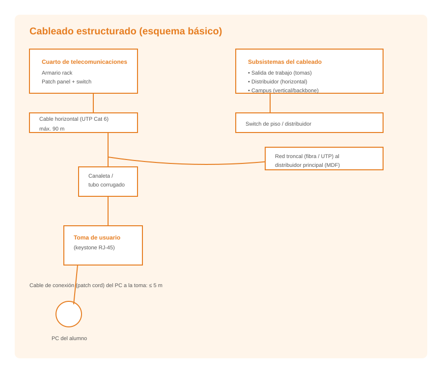

# **Tipus d'instal·lacions de xarxes de veu i dades**

  

    🏆 <strong>Progrés d'aquesta secció:</strong> 0 de 4 superats (0%)
    ⭐ <strong>0 punts</strong>
  

  

    

  

La infraestructura de telecomunicacions constituye el conjunt d'elements físics necessaris per a proporcionar conectivitat en un edifici o campus. Comprèn des dels punts d'entrada del proveïdor de serveis fins a les preses d'usuari on es connecten els dispositius finals.

## **Classificació de les instal·lacions**

### **Instal·lació centralitzada**

En aquest tipus d'instal·lació tot el cablejat converge en un únic armari de telecomunicacions, denominat MDF (Main Distribution Frame). Des d'aquest punt central es distribueix el cablejat cap a totes les preses d'usuari de l'edifici.

**Característiques:**
- Un només armari de distribució per a tot l'edifici.
- Cablejat horitzontal des del MDF fins a cada presa d'usuari.
- Gestió centralitzada dels equips de xarxa.
- Adequada per a edificis xicotets o amb poca distància entre l'armari i els punts d'usuari.

### **Instal·lació distribuïda**

S'utilitzen múltiples armaris de planta (IDF - Intermediate Distribution Frame) connectats mitjançant cablejat backbone a l'armari principal (MDF). Cada armari de planta distribueix el cablejat de la seua zona.

**Característiques:**
- Múltiples armaris de distribució, un per planta o zona.
- Cablejat backbone (vertical) que connecta els IDF amb el MDF.
- Cablejat horitzontal des de cada IDF fins a les preses d'usuari de la seua zona.
- Adequada per a edificis grans o amb moltes plantes.
- Permet millor rendiment al reduir les distàncies del cablejat horitzontal.

### **Instal·lació mixta**

Combina elements de tots dos tipus anteriors, adaptándose a les necessitats específiques de cada edifici. És el tipus més habitual en instal·lacions reals.

---

## 🎮 Reptes Interactius d'Autoavaluació (+100 XP)

Comprova el teu domini sobre **3.1 Tipus d'instal·lacions de xarxes de veu i dades** superant aquests 4 reptes gamificats (+25 punts cadascun):

  
🎯 <strong>Repte 1 (+25 pts):</strong> Per què es trenen per parells els fils de coure dins d'un cable de parell trenat (UTP / STP)?

  

    <button type="button" class="btn-mcq-opt" data-opt="A">A) Perquè ocupe més espai dins de la canaleta.</button>
    <button type="button" class="btn-mcq-opt" data-opt="B">B) Per a reduir les interferències electromagnètiques externes i la diafonia (crosstalk) entre parells veïns.</button>
    <button type="button" class="btn-mcq-opt" data-opt="C">C) Per a transformar el coure en fibra de vidre.</button>
    <button type="button" class="btn-mcq-opt" data-opt="D">D) Només per motius decoratius.</button>
  

  

  
🎯 <strong>Repte 2 (+25 pts):</strong> Quin mitjà de transmissió guiat transmet la informació mitjançant polsos de llum a través d'un nucli de vidre o plàstic i és totalment immune a les interferències electromagnètiques?

  

    <button type="button" class="btn-mcq-opt" data-opt="A">A) El cable coaxial RG-59.</button>
    <button type="button" class="btn-mcq-opt" data-opt="B">B) La fibra òptica (monomode o multimode).</button>
    <button type="button" class="btn-mcq-opt" data-opt="C">C) El cable de parell trenat Cat 5e.</button>
    <button type="button" class="btn-mcq-opt" data-opt="D">D) El Bluetooth d'un ratolí.</button>
  

  

  
✅ <strong>Repte 3 (Vertader o Fals · +25 pts):</strong> El connector estàndard utilitzat per a terminar cables de xarxa de parell trenat de 4 parells (8 fils) en xarxes Ethernet és l'RJ-45.

  

    <button type="button" class="btn-vf" data-opt="V">Vertader (V)</button>
    <button type="button" class="btn-vf" data-opt="F">Fals (F)</button>
  

  

  
⌨️ <strong>Repte 4 (+25 pts):</strong> Com s'anomena el connector de 8 contactes utilitzat habitualment en els latiguillos de xarxa Ethernet de coure (escriu RJ45 o RJ-45)?

  

    <input type="text" class="quiz-input" placeholder="Escriu la resposta..." />
    <button type="button" class="btn-quiz-check">Comprovar</button>
  

  

### 📋 Llista de Comprovació i Rúbrica d'Assoliment

Marca cada criteri a mesura que completes l'estudi o la resolució pràctica d'aquesta pàgina (**3.1 Tipus d'instal·lacions de xarxes de veu i dades**):

- [ ] He llegit detingudament la teoria o l'enunciat d'aquesta secció i he anotat els conceptes clau.
- [ ] He revisat els esquemes, taules o blocs de codi i he verificat que sé aplicar-los a l'entorn de treball.
- [ ] He resolt correctament els **4 reptes interactius** superiors obtenint els **100 punts XP**.
- [ ] He descarregat el comprovant oficial en PDF per a adjuntar-lo a la tasca d'**Aules**.

  <h3>📤 Comprovant de Lliurament per a Aules</h3>
  
Quan hages completat els reptes interactius i la llista d'autoavaluació d'aquesta pàgina, introdueix el teu nom i descarrega el teu certificat oficial en PDF per a adjuntar-lo a la tasca d'<strong>Aules</strong>.

  

    <label for="aules-student-name">👤 Nom i Cognoms de l'Alumne/a:</label>
    <input type="text" id="aules-student-name" class="aules-student-name" placeholder="Ex: Joan Garcia Pérez" />
  

  

    0/4 reptes completats (0%) · 0 punts · 0/4 criteris d'autoavaluació
  

  

    <button type="button" class="btn-aules-dl" data-module="IMX" data-unit="UD03" data-activity="ut0301">📥 Descarregar Comprovant PDF</button>
    <button type="button" class="btn-aules-copy">📋 Copiar Resum al Porta-retalls</button>
  

  

