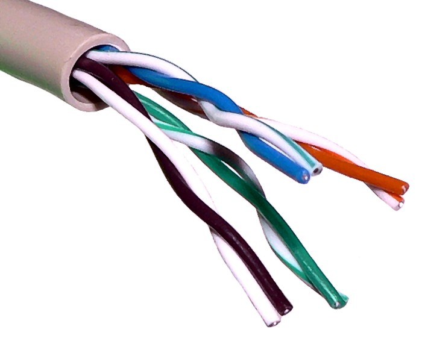
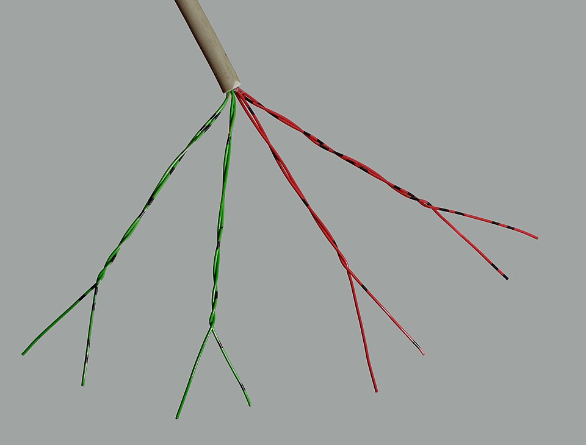
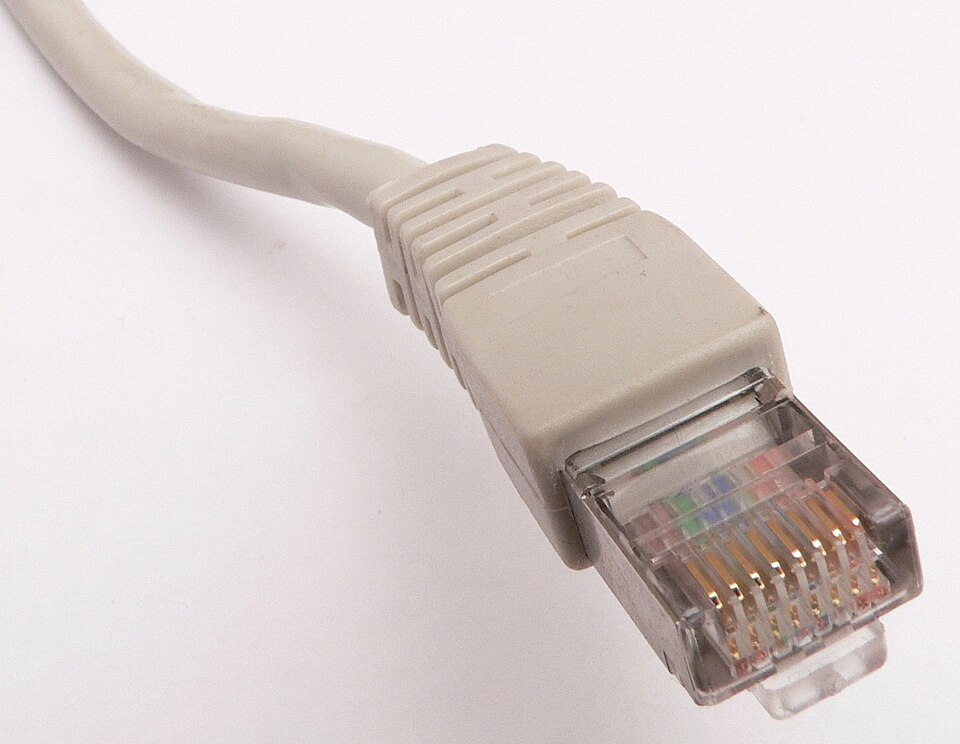
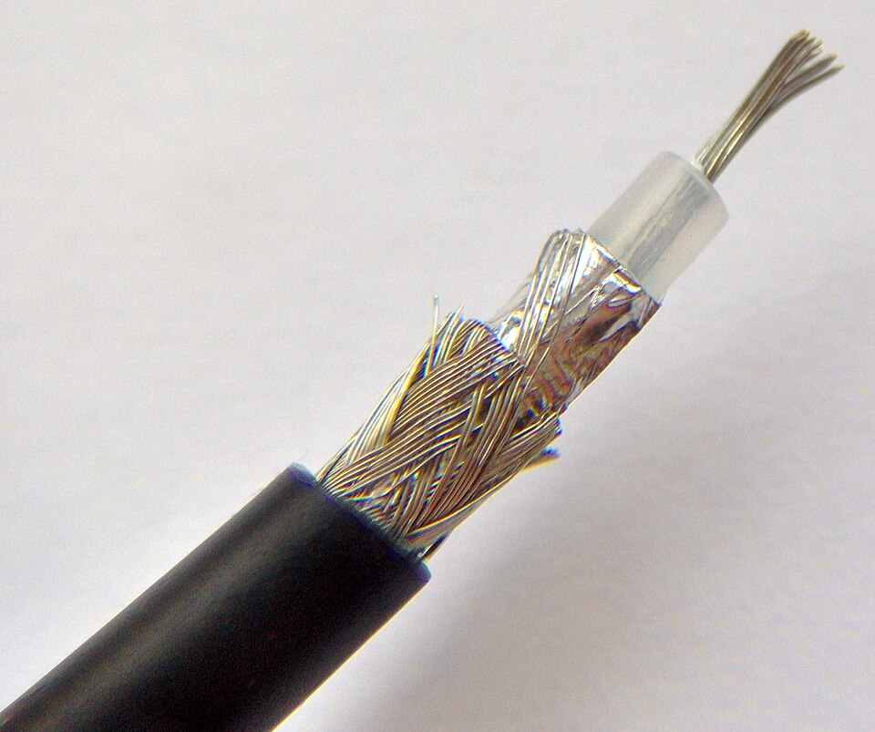
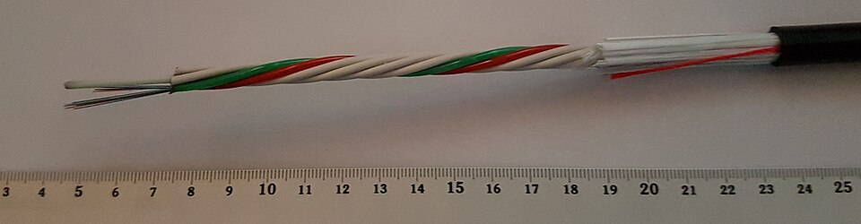
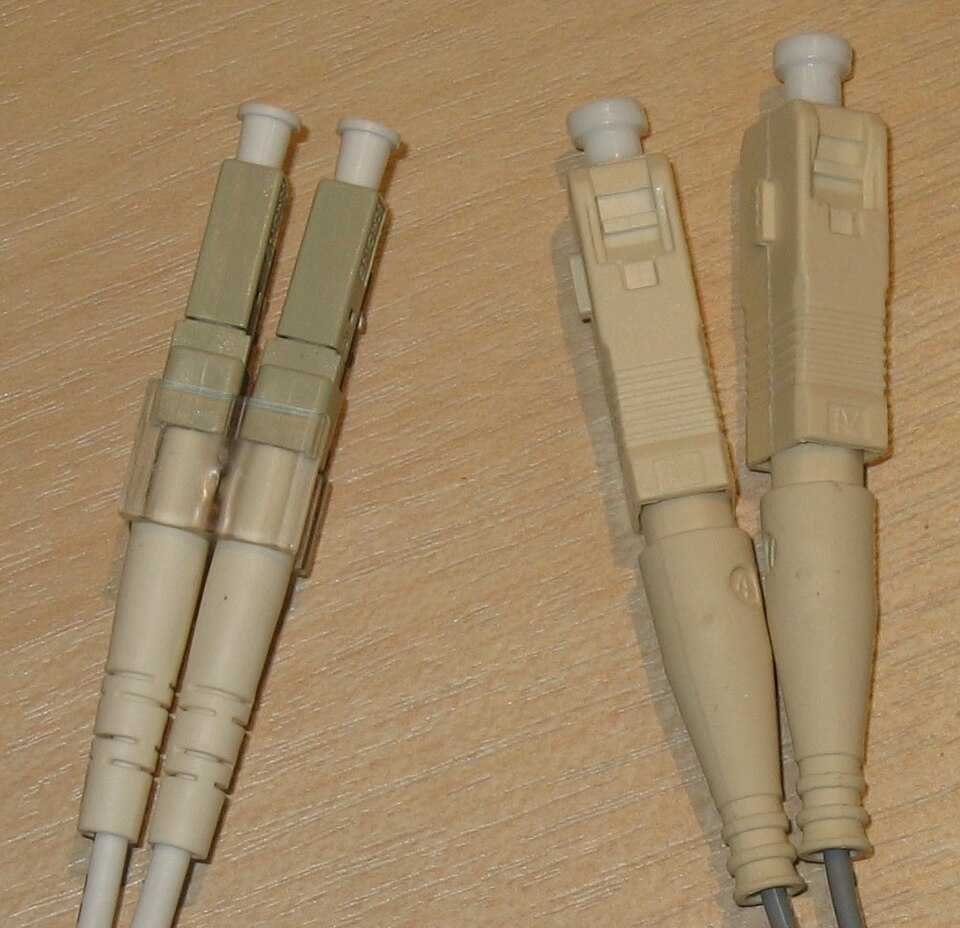

# **Tipus de conductors: parell trenat de coure, cable coaxial, fibra òptica**

  

    🏆 <strong>Progrés d'aquesta secció:</strong> 0 de 4 superats (0%)
    ⭐ <strong>0 punts</strong>
  

  

    

  

Els conductors són els mitjans físics a través dels quals es transmeten els senyals de dades i veu en una xarxa de telecomunicacions. Es classifiquen en conductors guiats (cablejats) i conductors no guiats (sense fil). En aquesta unitat ens centrarem en els conductors guiats, que són els més utilitzats en les infraestructuras de xarxa fixes.

## **Cable de parell trenat de coure**

El cable de parell trenat està compost per un o diversos parells d'hilos de coure aïllats i trenats entre sí. El trenat redueix les interferències electromagnètiques externes (RIE) i les diafonías entre parells adyacentes. És el mitjà de transmissió més utilitzat en les xarxes locals (LAN).

### **Principi de funcionament**

Cada parell d'hilos conduce una senyal diferencial: un hilo transporta el senyal i l'un altre transporta la versió inversa. Al receiver es resta totes dues senyals, cancelant així les interferències captades per tots dos hilos de forma similar (modes comuns).

### **Tipus de cable de parell trenat**

| Tipus | Blindatge | Descripció | Aplicació |
| --- | --- | --- | --- |
| **UTP** (Unshielded Twisted Pair) | Sense blindatge | El més utilitzat i económic. Els parells van sense protecció addicional. | Xarxes doméstiques i oficines xicotetes |
| **FTP** (Foiled Twisted Pair) | Lámina d'aluminio general | Incorpora una pantalla d'aluminio que envuelve tots els parells. | Entorns amb interferències moderades |
| **STP** (Shielded Twisted Pair) | Malla metàl·lica general | Blindatge de malla metàl·lica que protegeix tots els parells. | Entorns industrials |
| **S/FTP** | Malla + lámina per parell | Blindatge individual per parell i blindatge general. | Xarxes d'alta velocitat i centres de dades |

### **Categories del cable de parell trenat**

| Categoria | Velocitat màxima | Freqüència | Aplicació típica |
| --- | --- | --- | --- |
| **Cat 5** | 100 Mbps | 100 MHz | Xarxes Fast Ethernet (obsoleta) |
| **Cat 5e** | 1 Gbps | 100 MHz | Xarxes Gigabit Ethernet |
| **Cat 6** | 10 Gbps (fins a 55 m) | 250 MHz | Xarxes Gigabit i 10 Gigabit |
| **Cat 6a** | 10 Gbps | 500 MHz | Xarxes 10 Gigabit (fins a 100 m) |
| **Cat 7** | 10 Gbps | 600 MHz | Centres de dades d'alta densitat |
| **Cat 8** | 25/40 Gbps | 2000 MHz | Centres de dades d'última generació |

### **Connectors**

El connector estàndard per a cable de parell trenat en xarxes Ethernet és el **RJ-45** (Registered Jack 45), amb 8 pines de contacte. Existeix també el connector **RJ-11**, amb 4 u 8 pines, utilitzat per a telephoneía.

### **Normativa**

- **ANSI/TIA-568**: Estàndard norteamericano per a cablejat estructurat.

- **ISO/IEC 11801**: Estàndard internacional per a infraestructura de cablejat genéric.

- **EN 50173**: Estàndard europeo per a cablejat estructurat.

### **Avantatges**

- Sota cost.

- Fàcil instal·lació i manipulació.

- Àmplia disponibilitat i compatibilitat.

- Flexibilitat per a distintes longituds de tramo.

### **Desavantatges**

- Susceptible a interferències electromagnètiques (en versions sense blindatge).

- Longitud màxima limitada a 100 metros per tramo.

- Menor ample de banda que la fibra òptica.

## **Cable coaxial**

El cable coaxial està format per un conductor central de coure envoltat d'un aïllant dieléctric, una malla metàl·lica (blindatge) i una chaqueta exterior protectora. Proporciona millor protecció contra interferències que el cable de parell trenat.

### **Principi de funcionament**

El senyal es transmet al llarg del conductor central, mentre que la malla metàl·lica actua com retorno i blindatge contra interferències. La geometría coaxial confina el camp electromagnétic en l'espai entre el conductor central i la malla.

### **Tipus de cable coaxial**

| Tipus | Diàmetre nominal | Estàndard | Aplicació |
| --- | --- | --- | --- |
| **Coaxial fino** | 5 mm (RG-58) | 10BASE2 | Xarxes Ethernet antigues (fins a 185 m) |
| **Coaxial grueso** | 10 mm (RG-8, RG-11) | 10BASE5 | Xarxes Ethernet antigues (fins a 500 m) |
| **Coaxial de banda ampla** | Variable | DOCSIS | Connexions de Internet per cable (HFC) |

### **Connectors**

- **Connector BNC** (Bayonet Neill-Concelman): Utilitzat en xarxes 10BASE2 i 10BASE5.

- **Connector F**: Utilitzat en aplicacions de televisió per cable i banda ampla (DOCSIS).

- **Connector N**: Utilitzat en aplicacions d'alta freqüència i radiofreqüència.

### **Avantatges**

- Bona protecció contra interferències electromagnètiques.

- Major resistència mecánica que el parell trenat.

- Capacitat de transmetre senyals d'alta freqüència.

- Major distància de transmissió que el parell trenat.

### **Desavantatges**

- Major cost que el parell trenat.

- Instal·lació més complexa.

- Menor flexibilitat i més pes.

- Pràcticament obsoleto en xarxes de dades actuals.

## **Fibra òptica**

La fibra òptica transmet dades mitjançant pulsos de llum a través d'un nucli de vidrio o plàstic extremely fino. És el mitjà de transmissió que ofereix major velocitat, major distància i major inmunitat a interferències.

### **Principi de funcionament**

La llum entra en el nucli de la fibra i es propaga per reflexión total interna. El nucli està envoltat d'una capa de revestiment (cladding) amb un índex de refracció menor, el que fa que la llum rebote i permanezca confinada en el nucli.

### **Components d'una fibra òptica**

- **Nucli (core)**: Part central per on viatja la llum. Pot ser de vidrio (silicio) o plàstic.

- **Revestiment (cladding)**: Capa que rodea al nucli i confina la llum per reflexión total interna.

- **Revestiment protector (buffer)**: Capa de protecció mecánica.

- **Chaqueta exterior (jacket)**: Protecció contra la intemperie i danys físics.

### **Tipus de fibra òptica**

| Característica | Fibra multimode (MM) | Fibra monomode (SM) |
| --- | --- | --- |
| **Diàmetre del nucli** | 50 µm o 62,5 µm | 9 µm |
| **Font de llum** | LED o VCSEL | Láser (LD) |
| **Longitud d'onda** | 850 nm, 1300 nm | 1310 nm, 1550 nm |
| **Distància màxima** | Fins a 550 m (1 Gbps) | Fins a 80 km o més |
| **Ample de banda** | Limitat | Molt alt |
| **Cost** | Menor | Major |
| **Aplicació** | Xarxes locals, centres de dades | WAN, enllaços entre edificis, telecomunicacions |

### **Variants de fibra multimode**

- **OM1** (62,5/125 µm): Nucli de 62,5 µm. Obsoleta en noves instal·lacions.

- **OM2** (50/125 µm): Nucli de 50 µm. Per a enllaços de fins a 550 m a 1 Gbps.

- **OM3** (50/125 µm, láser optimitzada): Nucli de 50 µm. Per a 10 Gbps fins a 300 m.

- **OM4** (50/125 µm, láser optimitzada): Nucli de 50 µm. Per a 10 Gbps fins a 400 m i 100 Gbps fins a 150 m.

- **OM5** (50/125 µm, banda ampla): Suporta multiplexació per longitud d'onda (SWDM).

### **Connectors de fibra òptica**

| Connector | Descripció | Ús |
| --- | --- | --- |
| **SC** (Subscriber Connector) | Connector de bayoneta quadrat | Xarxes LAN,FTTH |
| **LC** (Lucent Connector) | Connector xicotet tipus RJ | Centres de dades, alta densitat |
| **ST** (Straight Tip) | Connector de bayoneta circular | Xarxes legacy |
| **FC** (Ferrule Connector) | Connector rosocado | Equips de medició |
| **MTP/MPO** | Connector multifibril (12, 24 fibras) | Centres de dades d'alta velocitat |

### **Avantatges**

- Altísima velocitat de transmissió (decenas de Gbps).

- Gran distància de transmissió (decenas de kilómetros).

- Inmunitat total a interferències electromagnètiques.

- Major seguretat (difícil d'interceptar el senyal).

- Inmunitat a cortocircuitos i descargas eléctriques.

### **Desavantatges**

- Major cost que el coure.

- Requereix eines i tècniques d'instal·lació especials.

- Més frágil que els cables de coure.

- Els empalmes i connectors requereixen precisió alta.

## **Taula comparativa de conductors**

| Característica | Parell trenat | Coaxial | Fibra òptica |
| --- | --- | --- | --- |
| **Velocitat** | Fins a 10-40 Gbps | Fins a 10 Gbps | Fins a 100+ Gbps |
| **Distància** | 100 m | Fins a 500 m | Fins a 80 km |
| **Cost** | Sota | Mitjà | Alt |
| **Interferències** | Susceptible | Protegido | Inmune |
| **Instal·lació** | Fàcil | Mitjana | Difícil |
| **Ús actual** | Molt freqüent | Escaso | En creixement |

---

## 🎮 Reptes Interactius d'Autoavaluació (+100 XP)

Comprova el teu domini sobre **3.2 Tipus de conductors: parell trenat de coure, cable coaxial, fibra òptica** superant aquests 4 reptes gamificats (+25 punts cadascun):

  
🎯 <strong>Repte 1 (+25 pts):</strong> Per què es trenen per parells els fils de coure dins d'un cable de parell trenat (UTP / STP)?

  

    <button type="button" class="btn-mcq-opt" data-opt="A">A) Perquè ocupe més espai dins de la canaleta.</button>
    <button type="button" class="btn-mcq-opt" data-opt="B">B) Per a reduir les interferències electromagnètiques externes i la diafonia (crosstalk) entre parells veïns.</button>
    <button type="button" class="btn-mcq-opt" data-opt="C">C) Per a transformar el coure en fibra de vidre.</button>
    <button type="button" class="btn-mcq-opt" data-opt="D">D) Només per motius decoratius.</button>
  

  

  
🎯 <strong>Repte 2 (+25 pts):</strong> Quin mitjà de transmissió guiat transmet la informació mitjançant polsos de llum a través d'un nucli de vidre o plàstic i és totalment immune a les interferències electromagnètiques?

  

    <button type="button" class="btn-mcq-opt" data-opt="A">A) El cable coaxial RG-59.</button>
    <button type="button" class="btn-mcq-opt" data-opt="B">B) La fibra òptica (monomode o multimode).</button>
    <button type="button" class="btn-mcq-opt" data-opt="C">C) El cable de parell trenat Cat 5e.</button>
    <button type="button" class="btn-mcq-opt" data-opt="D">D) El Bluetooth d'un ratolí.</button>
  

  

  
✅ <strong>Repte 3 (Vertader o Fals · +25 pts):</strong> El connector estàndard utilitzat per a terminar cables de xarxa de parell trenat de 4 parells (8 fils) en xarxes Ethernet és l'RJ-45.

  

    <button type="button" class="btn-vf" data-opt="V">Vertader (V)</button>
    <button type="button" class="btn-vf" data-opt="F">Fals (F)</button>
  

  

  
⌨️ <strong>Repte 4 (+25 pts):</strong> Com s'anomena el connector de 8 contactes utilitzat habitualment en els latiguillos de xarxa Ethernet de coure (escriu RJ45 o RJ-45)?

  

    <input type="text" class="quiz-input" placeholder="Escriu la resposta..." />
    <button type="button" class="btn-quiz-check">Comprovar</button>
  

  

### 📋 Llista de Comprovació i Rúbrica d'Assoliment

Marca cada criteri a mesura que completes l'estudi o la resolució pràctica d'aquesta pàgina (**3.2 Tipus de conductors: parell trenat de coure, cable coaxial, fibra òptica**):

- [ ] He llegit detingudament la teoria o l'enunciat d'aquesta secció i he anotat els conceptes clau.
- [ ] He revisat els esquemes, taules o blocs de codi i he verificat que sé aplicar-los a l'entorn de treball.
- [ ] He resolt correctament els **4 reptes interactius** superiors obtenint els **100 punts XP**.
- [ ] He descarregat el comprovant oficial en PDF per a adjuntar-lo a la tasca d'**Aules**.

  <h3>📤 Comprovant de Lliurament per a Aules</h3>
  
Quan hages completat els reptes interactius i la llista d'autoavaluació d'aquesta pàgina, introdueix el teu nom i descarrega el teu certificat oficial en PDF per a adjuntar-lo a la tasca d'<strong>Aules</strong>.

  

    <label for="aules-student-name">👤 Nom i Cognoms de l'Alumne/a:</label>
    <input type="text" id="aules-student-name" class="aules-student-name" placeholder="Ex: Joan Garcia Pérez" />
  

  

    0/4 reptes completats (0%) · 0 punts · 0/4 criteris d'autoavaluació
  

  

    <button type="button" class="btn-aules-dl" data-module="IMX" data-unit="UD03" data-activity="ut0302">📥 Descarregar Comprovant PDF</button>
    <button type="button" class="btn-aules-copy">📋 Copiar Resum al Porta-retalls</button>
  

  

