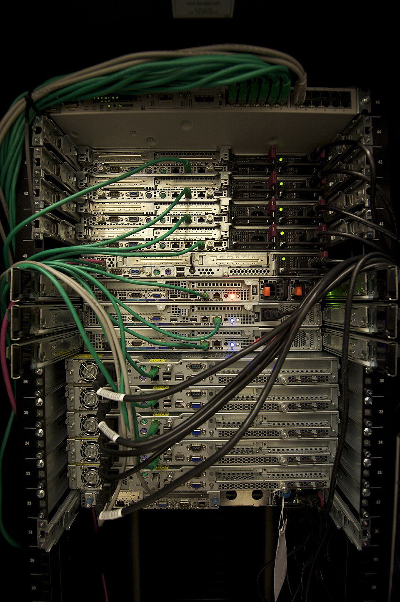
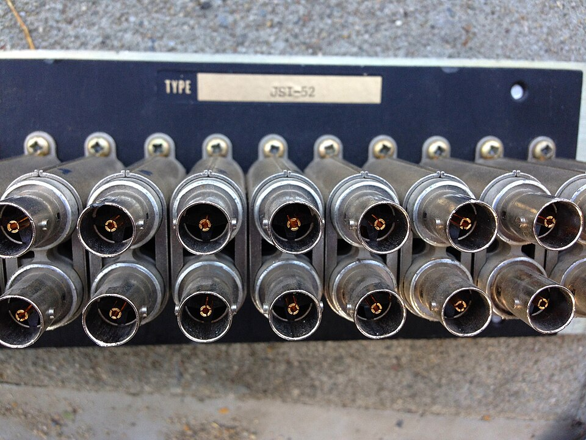
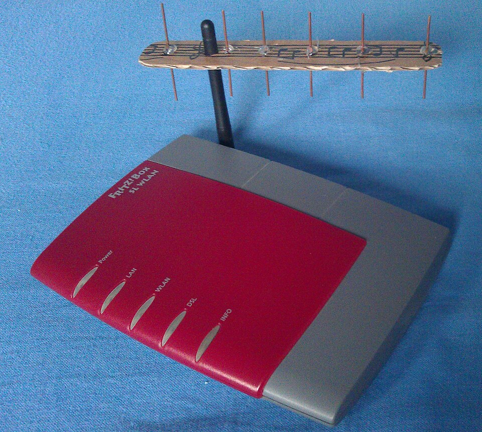
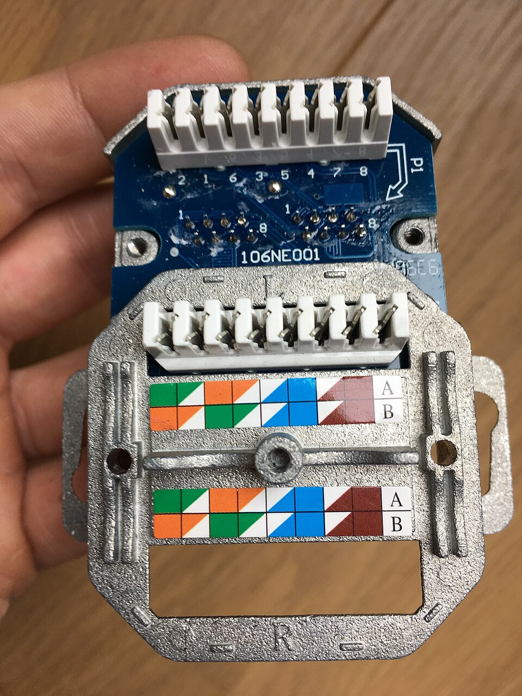

# UD4: Sistemas de Cableado Estructurado y Subsistema Horizontal/Vertical

Bienvenido/a a la **UD4: Sistemas de Cableado Estructurado y Subsistema Horizontal/Vertical** del módulo profesional de **Instalación y Mantenimiento de Redes para Transmisión de Datos (Networking Essentials)** (2º FPB · Instalación y Mantenimiento de Redes (IMX / NE)).

En esta unidad encontrarás los contenidos teóricos, ejemplos prácticos, ejercicios resueltos y actividades de evaluación curricular desarrollados por el profesor **Manuel Alonso Argente**.

---

### 📑 Índice de Apartados y Actividades de la Unidad

- [**📋 4.0 Propuesta Didáctica: Elementos de una instalación de red**](./ut0400.html)
- [**4.1 Elementos de una red de transmisión de datos y tipología de cajas**](./ut0401.html)

---

# 📖 Vista Completa de la Unidad

## 4.0 Propuesta Didáctica — Elementos de una instalación de red

# **Elementos de una instalación de red**

## **Propuesta didáctica**

En esta unidad continuamos trabajando el RA1: **Selecciona els elements que configuren les xarxes per a la transmissió de veu i dades, descrivint les seues principals característiques i funcionalitat.**

## **Criterios de evaluación**

### **Respecto al RA1:**

| Código | Descripción | Peso (%) | Herramientas Evaluación |
| --- | --- | --- | --- |
| **CE1b** | Se han identificado los elementos (canalizaciones, cableados, antenas, armarios, racks y cajas, entre otros) de una red de transmisión de datos | 55% | ACT101 (5%) -- EXA104 (95%) |
| **CE1d** | Se ha determinado la tipología de las diferentes cajas (registros, armarios, racks, cajas de superficie, de empotrar, entre otras) | 45% | ACT102 (5%) -- EXA104 (95%) |

## **Contenidos**

### **Elementos de una red de transmisión de datos y tipología de cajas:**

- Canalizaciones: tipos según su uso (tubos corrugados, bandejas portacables, rígidas metálicas, canales de cableado) y según su ubicación (horizontales, verticales, externas).

- Cableado: par trenzado, coaxial y fibra óptica en la infraestructura de red (características técnicas en UP03).

- Cajas de registro: cajas de superficie, cajas de empotrar y cajas de registro empotrables. Dimensiones normalizadas.

- Armarios de telecomunicaciones: armario principal (MDF), armario de planta (IDF) y armario de redistribución.

- Racks y bastidores: rack de pie y rack de pared. Unidades de rack (U). Accesorios.

- Antenas: dipolo, direccionales (panel y Yagi).

- Tomas de usuario: RJ-45, fibra óptica, coaxial, RJ-11.

- Otros elementos: paneles de parcheo, organizadores de cable, SAI.

- Tabla comparativa de cajas.

> **📌 Cuestionario inicial**
> 

> 1. ¿Qué elementos físicos componen la infraestructura de una red de transmisión de datos?

> 1. ¿Qué tipos de canalizaciones existen según su ubicación?

> 1. ¿Qué es un armario MDF y en qué se diferencia de un armario IDF?

> 1. ¿Qué diferencia hay entre un rack de pie y un rack de pared?

> 1. ¿Qué tipos de cajas de registro se utilizan en las instalaciones de telecomunicaciones?

> 1. ¿Qué es la unidad de rack (U) y cuánto mide?

## **Programación de Aula (14 h)**

Esta unidad se imparte en la primera evaluación, con una duración estimada de **7 sesiones lectivas de 2 h** (14 h), durante los días que se indican en el calendario.

### **Distribución de horas por contenido**

| Contenido | Sesiones | Horas |
| --- | --- | --- |
| 4.1 Elementos de una red de transmisión de datos y tipología de cajas: UP4.1 | 7 | 14 |
| **Total** | **7** | **14** |

### **Sesiones**

| Sesión | Contenidos | Actividades | Criterios trabajados |
| --- | --- | --- | --- |
| 1 | Canalizaciones y cableado |  | CE1b |
| 2 | Cajas de registro |  | CE1b - CE1d |
| 3 | Armarios de telecomunicaciones | ACT101 | CE1b |
| 4 | Racks y bastidores |  | CE1d |
| 5 | Antenas y tomas de usuario |  | CE1b |
| 6 | Repaso general y tabla comparativa de cajas | ACT102 | CE1b - CE1d |
| 7 | Actividades de refuerzo y evaluación | **EXA104** | CE1b - CE1d |

---

## 4.1 Elementos de una red de transmisión de datos y tipología de cajas

# **Elementos de una red de transmisión de datos y tipología de cajas**

Una red de transmisión de datos está formada por un conjunto de elementos físicos que canalizan, transportan y distribuyen la información entre los distintos puntos de un edificio o campus. En este tema identificamos cada uno de estos elementos, su función dentro de la instalación y la tipología de las cajas, armarios y racks que los alojan.

## **Canalizaciones**

Las canalizaciones son los conductos por los que discurre el cableado de la red. Su función es proteger los cables de daños mecánicos, agentes atmosféricos y proporcionar un recorrido ordenado.

**Tipos de canalizaciones:**

| Tipo | Descripción | Uso habitual |
| --- | --- | --- |
| **Tubos corrugados** | Conductos flexibles de PVC o polietileno | Cableado en techos y suelos |
| **Bandejas portacables** | Estructuras metálicas abiertas | Cableado en salas de servidores y armarios |
| **Rigidas metálicas** | Tubos de acero o aluminio | Cableado exterior o en zonas de alto riesgo |
| **Canales de cableado** | Canales abiertos de PVC | Cableado superficial en oficinas |
| **Tubos flexibles** | Conductos corrugados de PVC | Cableado en espacios reducidos |

**Clasificación según su ubicación:**
- **Canalizaciones horizontales**: Discurren por el interior de una planta, conectando el armario de planta con las tomas de usuario.
- **Canalizaciones verticales (backbone)**: Conectan los armarios de planta entre sí y con el armario principal, discurren por las cajas de paso entre plantas.
- **Canalizaciones externas**: Discurren por el exterior del edificio para conectar edificios diferentes o conectar el edificio con la red del proveedor.

### **Cableado**

El cableado es el conjunto de cables que transmiten las señales de datos y voz a través de la red. Los principales tipos que forman parte de la infraestructura son:

- **Cable de par trenzado**: pares de hilos de cobre trenzados, el más utilizado en redes locales (UTP, FTP, STP; categorías Cat 5e a Cat 8).

- **Cable coaxial**: conductor central rodeado de aislante y malla metálica, usado en aplicaciones de vídeo y enlaces de banda ancha.

- **Fibra óptica**: transmite datos mediante pulsos de luz, utilizado para largas distancias y altas velocidades (monomodo y multimodo).

> **📌 Ampliación en UP03**
> 

> Las características técnicas de cada conductor (tipos, conectores, normativa y especificaciones) se estudian con detalle en la UP03 – Tipos de conductores.

## **Cajas de registro**

Las cajas de registro son elementos de conexión que alojan las tomas de usuario y los puntos de distribución del cableado. Se instalan en las paredes o en los techos de las estaciones de trabajo.

### **Cajas de superficie**

Se fijan directamente sobre la superficie de la pared, sin necesidad de embutir. Son la opción más rápida y económica para instalaciones donde no se puede o no se desea abrir la pared.

**Características:**
- Se atornillan o adhieren a la superficie de la pared.
- No requieren obra civil ni picado.
- Son más visibles y menos estéticas.
- Fácil acceso para mantenimiento y modificaciones.

**Aplicaciones:**
- Instalaciones provisionales o temporales.
- Locales comerciales donde no se permite la obra.
- Edificios antiguos donde no hay canalización empotrada.
- Zonas industriales o de trabajo.

### **Cajas de empotrar (encajonar)**

Se introducen en el interior de la pared, quedando al mismo nivel que la superficie. Requieren la apertura de un hueco en la pared para alojarlas.

**Características:**
- Se embuten en la pared mediante picado.
- Quedan ocultas, proporcionando un acabado más limpio y profesional.
- Requieren obra civil para su instalación.
- Menor riesgo de daños accidentales al quedar protegidas por la pared.

**Aplicaciones:**
- Edificios de oficinas y viviendas nuevos.
- Instalaciones permanentes.
- Entornos donde se valora la estética y la protección.

### **Cajas de registro empotrables**

Son las más habituales en instalaciones de telecomunicaciones. Se fabrican en distintos tamaños según el número de puertos que vayan a albergar.

**Dimensiones normalizadas:**
- **Caja simple**: Para una única toma. Dimensiones típicas: 70 x 70 mm.
- **Caja doble**: Para dos tomas. Dimensiones típicas: 147 x 70 mm.
- **Caja triple o múltiple**: Para tres o más tomas.

## **Armarios de telecomunicaciones**

Los armarios de telecomunicaciones son estructuras que concentran los equipos activos y pasivos de la red. Proporcionan un entorno seguro, ordenado y controlado para el equipamiento.

### **Armario principal (MDF - Main Distribution Frame)**

Es el punto de entrada del cableado del proveedor de servicios y el centro de distribución de toda la red del edificio.

**Funciones:**
- Recepción del cableado externo del proveedor.
- Distribución del cableado hacia los armarios de planta (IDF).
- Alojamiento de equipos centrales (router, servidor, switch principal).
- Centralización de la gestión de la red.

**Componentes típicos:**
- Rack de 42U o 47U.
- Panel de parcheo principal.
- Switch de núcleo (core switch).
- Router de borde.
- Sistema de alimentación ininterrumpida (SAI).
- Panel eléctrico dedicado.

### **Armario de planta (IDF - Intermediate Distribution Frame)**

Distribuye el cableado de cada planta o zona del edificio hacia las tomas de usuario.

**Funciones:**
- Distribución del cableado horizontal de la planta.
- Conexión de los dispositivos de usuario al armario principal.
- Segmentación de la red por plantas o zonas.

**Componentes típicos:**
- Rack de 12U a 22U.
- Panel de parcheo de planta.
- Switch de acceso (access switch).
- Panel eléctrico.

### **Armario de redistribución**

Se utiliza en instalaciones muy grandes para distribuir la red entre diferentes edificios o zonas de un campus.

## **Racks y bastidores**

Los racks son estructuras metálicas normalizadas que permiten alojar equipamiento de telecomunicaciones de forma ordenada y segura. Siguen el estándar de 19 pulgadas de ancho definido por el EIA (Electronic Industries Alliance).

### **Rack de pie (floor standing)**

Estructura vertical completa que se apoya en el suelo.

**Características:**
- Alturas típicas: 22U, 37U, 42U, 47U.
- Profundidades: 600 mm, 800 mm, 1000 mm, 1200 mm.
- Puertas delanteras y traseras abatibles o extensibles.
- Paneles laterales desmontables.
- Sistema de cableado integrado.
- Capacidad de carga: 500 kg a 1000 kg.

**Aplicaciones:**
- Salas de servidores y centros de datos.
- Armarios de telecomunicaciones principales (MDF).
- Armarios de planta grandes (IDF).

### **Rack de pared (wall mount)**

Estructura compacta que se fija a la pared.

**Características:**
- Alturas típicas: 6U, 9U, 12U.
- Profundidades: 400 mm, 500 mm, 600 mm.
- Puerta delantera con cerradura.
- Opcionalmente con panel trasero.

**Aplicaciones:**
- Armarios de planta pequeños (IDF).
- Instalaciones en plantas con pocos equipos.
- Puntos de distribución en zonas remotas.

### **Unidades de rack (U)**

La unidad de rack (U) es la unidad de medida estándar para la altura del equipamiento en un rack. 1U equivale a 44,45 mm (1,75 pulgadas).

| Unidades | Altura equivalente | Equipamiento típico |
| --- | --- | --- |
| 1U | 44,45 mm | Switch de 24/48 puertos, panel de parcheo |
| 2U | 88,9 mm | Servidor rack-mount, router |
| 4U | 177,8 mm | Servidor grande, almacenamiento |
| 12U | 533,4 mm | Rack de pared pequeño |
| 42U | 1866,9 mm | Rack completo de pie |

### **Accesorios de rack**

- **Panel de parcheo (Patch panel)**: Dispositivo con varios puertos RJ-45 que permite interconectar cableados de forma ordenada.

- **Organizadores de cable horizontal**: Guían y organizan los cables dentro del rack.

- **Bandejas de extracción**: Superficies que se deslizan para alojar servidores o equipos pesados.

- **Panel eléctrico**: Distribuye la alimentación eléctrica a los equipos del rack.

- **Sistema de ventilación**: Extractores de aire para mantener la temperatura adecuada.

## **Antenas**

Las antenas son elementos utilizados en las redes inalámbricas para transmitir y recibir señales de radiofrecuencia.

**Tipos de antenas en redes de datos:**
- **Antenas dipolo**: Utilizadas en puntos de acceso WiFi. Patrón de radiación omnidireccional.
- **Antenas direccionales (panel)**: Concentran la señal en una dirección concreta. Se utilizan para enlaces punto a punto.
- **Antenas direccionales (Yagi)**: Alta ganancia direccional. Se usan en enlaces de larga distancia.

## **Tomas de usuario**

Puntos de conexión fijos donde los usuarios conectan sus dispositivos a la red.

- **Tomas de red (RJ-45)**: Conector estándar para cable de par trenzado en redes Ethernet.

- **Tomas de fibra óptica**: Conectores tipo SC, LC o ST para conexión de fibra.

- **Tomas de coaxial (F-type)**: Conectores tipo F para señales de banda ancha y vídeo.

- **Tomas de voz (RJ-11)**: Conectores para telefonía tradicional.

## **Otros elementos**

- **Sistemas de alimentación ininterrumpida (SAI)**: Proporcionan energía de respaldo en caso de corte eléctrico.

- **Organizadores de cable**: Elementos para mantener el cableado ordenado dentro del rack.

- **Cajas de paso**: Puntos de conexión y derivación del cableado entre canalizaciones.

## **Tabla comparativa de cajas**

| Tipo | Instalación | Estética | Acceso | Costo | Uso principal |
| --- | --- | --- | --- | --- | --- |
| **Superficie** | Sobre pared | Visible | Fácil | Bajo | Provisional, industrial |
| **Empotrada** | En la pared | Oculta | Medio | Medio | Oficinas, viviendas |
| **Rack de pared** | Fijado a pared | Semioculto | Fácil | Medio | IDF pequeño |
| **Rack de pie** | En suelo | Visible | Muy fácil | Alto | MDF, IDF grande, salas |
| **Armario MDF** | En sala dedicada | Cerrado | Controlado | Muy alto | Centro de la red |
| **Armario IDF** | Por planta | Cerrado | Controlado | Alto | Distribución de planta |
