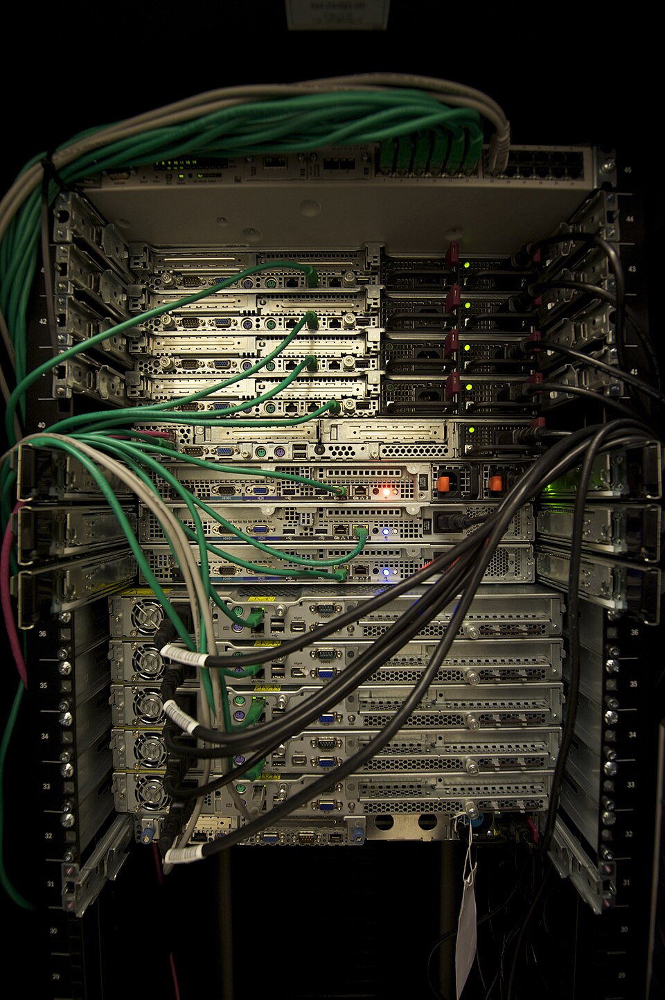
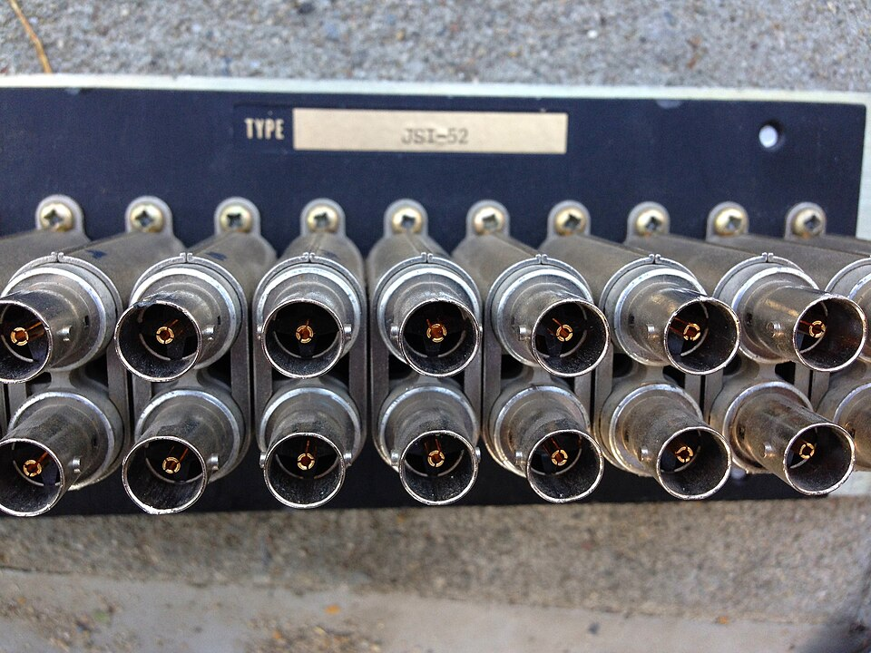
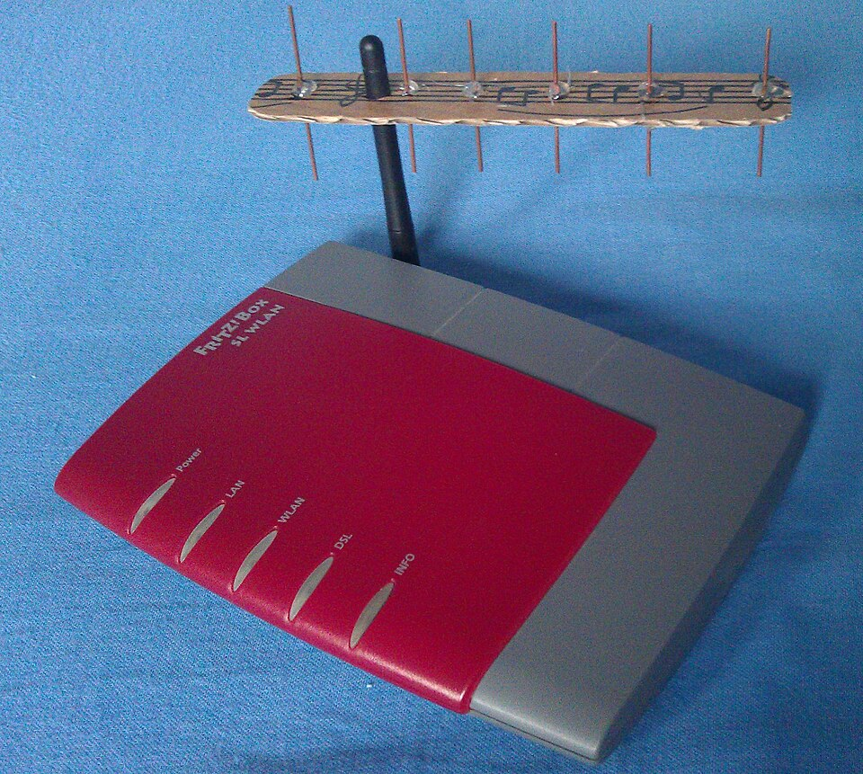
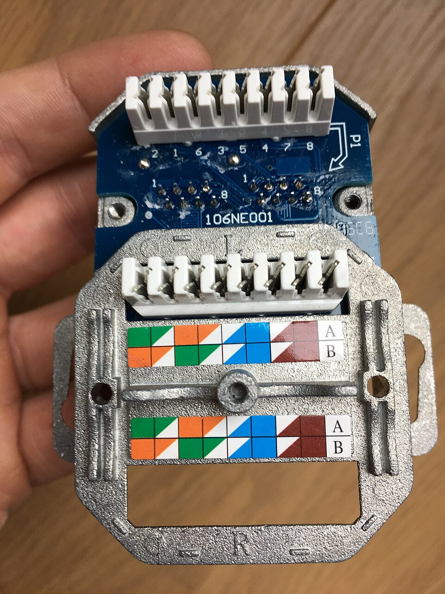

# **Elements d'una xarxa de transmissió de dades i tipología de caixes**

  

    🏆 <strong>Progrés d'aquesta secció:</strong> 0 de 4 superats (0%)
    ⭐ <strong>0 punts</strong>
  

  

    

  

Una xarxa de transmissió de dades està formada per un conjunt d'elements físics que canalizan, transportan i distribuyen la informació entre els distints punts d'un edifici o campus. En aquest tema identificamos cada un d'aquests elements, la seua funció dins de la instal·lació i la tipología de les caixes, armaris i racks que els allotgen.

## **Canalitzacions**

Les canalitzacions són els conductos pels que discurre el cablejat de la xarxa. La seua funció és protegir els cables de danys mecánics, agentes atmosférics i proporcionar un recorregut ordenat.

**Tipus de canalitzacions:**

| Tipus | Descripció | Ús habitual |
| --- | --- | --- |
| **Tubs corrugats** | Conductos flexibles de PVC o polietileno | Cablejat en sostres i sòls |
| **Bandejas portacables** | Estructures metáliques abiertas | Cablejat en sales de servidors i armaris |
| **Rigides metáliques** | Tubs d'acer o aluminio | Cablejat exterior o en zones d'alt risc |
| **Canals de cablejat** | Canals oberts de PVC | Cablejat superficial en oficines |
| **Tubs flexibles** | Conductos corrugats de PVC | Cablejat en espais reducits |

**Classificació segons la seua ubicació:**
- **Canalitzacions horitzontals**: Discurren pel interior d'una planta, conectant l'armari de planta amb les preses d'usuari.
- **Canalitzacions verticals (backbone)**: Connecten els armaris de planta entre sí i amb l'armari principal, discurren per les caixes de pas entre plantes.
- **Canalitzacions externes**: Discurren pel exterior de l'edifici per a connectar edificis diferents o connectar l'edifici amb la xarxa del proveïdor.

### **Cablejat**

El cablejat és el conjunt de cables que transmeten els senyals de dades i veu a través de la xarxa. Els principals tipus que formen part de la infraestructura són:

- **Cable de parell trenat**: parells d'hilos de coure trenats, el més utilitzat en xarxes locals (UTP, FTP, STP; categories Cat 5e a Cat 8).

- **Cable coaxial**: conductor central envoltat d'aïllant i malla metàl·lica, usat en aplicacions de vídeo i enllaços de banda ampla.

- **Fibra òptica**: transmet dades mitjançant pulsos de llum, utilitzat per a largas distàncies i altas velocitats (monomode i multimode).

> **📌 Ampliació en UP03**
> 

> Les característiques tècniques de cada conductor (tipus, connectors, normativa i especificacions) es estudian amb detall en la UP03 – Tipus de conductors.

## **Caixes de registre**

Les caixes de registre són elements de connexió que allotgen les preses d'usuari i els punts de distribució del cablejat. Es instalan en les parets o en els sostres de les estacions de treball.

### **Caixes de superfície**

Es fixen directament sobre la superfície de la paret, sense necessitat d'embutir. Són l'opció més ràpida i económica per a instal·lacions on no es pot o no es desitja obrir la paret.

**Característiques:**
- Es atornillan o adhieren a la superfície de la paret.
- No requereixen obra civil ni picado.
- Són més visibles i menys estétiques.
- Fàcil accés per a manteniment i modificacions.

**Aplicacions:**
- Instal·lacions provisionals o temporals.
- Locals comercials on no es permet l'obra.
- Edificis antics on no hi ha canalització encastada.
- Zones industrials o de treball.

### **Caixes d'empotrar (encajonar)**

Es introdueixen en l'interior de la paret, quedant al mateix nivell que la superfície. Requereixen l'obertura d'un buit en la paret per a alojar-les.

**Característiques:**
- Es embuten en la paret mitjançant picado.
- Queden ocultas, proporcionant un acabado més limpio i professional.
- Requereixen obra civil per a la seua instal·lació.
- Menor risc de danys accidentals al quedar protegides per la paret.

**Aplicacions:**
- Edificis d'oficines i viviendas nous.
- Instal·lacions permanentes.
- Entorns on es valora l'estética i la protecció.

### **Caixes de registre empotrables**

Són les més habituals en instal·lacions de telecomunicacions. Es fabrican en distints mides segons el número de ports que vagen a albergar.

**Dimensions normalitzades:**
- **Caixa simple**: Per a una única pren. Dimensions típiques: 70 x 70 mm.
- **Caixa doble**: Per a dos preses. Dimensions típiques: 147 x 70 mm.
- **Caixa triple o múltiple**: Per a tres o més preses.

## **Armaris de telecomunicacions**

Els armaris de telecomunicacions són estructures que concentran els equips activos i pasivos de la xarxa. Proporcionen un entorn segur, ordenat i controlat per a l'equipament.

### **Armari principal (MDF - Main Distribution Frame)**

És el punt d'entrada del cablejat del proveïdor de serveis i el centre de distribució de tota la xarxa de l'edifici.

**Funcions:**
- Recepció del cablejat extern del proveïdor.
- Distribució del cablejat cap als armaris de planta (IDF).
- Alojament d'equips centrals (router, servidor, switch principal).
- Centralizació de la gestió de la xarxa.

**Components típics:**
- Rack de 42U o 47U.
- Panell de connexions (patch panel) principal.
- Switch de nucli (core switch).
- Router de vora.
- Sistema d'alimentació ininterrumpida (SAI).
- Panell elèctric dedicat.

### **Armari de planta (IDF - Intermediate Distribution Frame)**

Distribueix el cablejat de cada planta o zona de l'edifici cap a les preses d'usuari.

**Funcions:**
- Distribució del cablejat horitzontal de la planta.
- Connexió dels dispositius d'usuari a l'armari principal.
- Segmentació de la xarxa per plantes o zones.

**Components típics:**
- Rack de 12U a 22U.
- Panell de connexions (patch panel) de planta.
- Switch d'accés (access switch).
- Panell elèctric.

### **Armari de redistribució**

S'utilitza en instal·lacions molt grans per a distribuir la xarxa entre diferents edificis o zones d'un campus.

## **Racks i bastidors**

Els racks són estructures metáliques normalitzades que permeten allotjar equipament de telecomunicacions de forma ordenada i segura. Segueixen l'estàndard de 19 polzades d'ample definit pel EIA (Electronic Industries Alliance).

### **Rack de peu (floor standing)**

Estructura vertical completa que es apoya en el sòl.

**Característiques:**
- Alturas típiques: 22U, 37U, 42U, 47U.
- Profunditats: 600 mm, 800 mm, 1000 mm, 1200 mm.
- Portes delanteras i traseras abatibles o extensibles.
- Panells laterals desmontables.
- Sistema de cablejat integrat.
- Capacitat de carrega: 500 kg a 1000 kg.

**Aplicacions:**
- Sales de servidors i centres de dades.
- Armaris de telecomunicacions principals (MDF).
- Armaris de planta grans (IDF).

### **Rack de paret (wall mount)**

Estructura compacta que es fixa a la paret.

**Característiques:**
- Alturas típiques: 6U, 9U, 12U.
- Profunditats: 400 mm, 500 mm, 600 mm.
- Porta delantera amb cerradura.
- Opcionalment amb panell trasero.

**Aplicacions:**
- Armaris de planta xicotets (IDF).
- Instal·lacions en plantes amb pocs equips.
- Punts de distribució en zones remotas.

### **Unitats de rack (U)**

La unitat de rack (U) és la unitat de mesura estàndard per a l'alçària de l'equipament en un rack. 1U equival a 44,45 mm (1,75 polzades).

| Unitats | Alçària equivalent | Equipament típic |
| --- | --- | --- |
| 1U | 44,45 mm | Switch de 24/48 ports, panell de connexions (patch panel) |
| 2U | 88,9 mm | Servidor rack-mount, router |
| 4U | 177,8 mm | Servidor gran, emmagatzematge |
| 12U | 533,4 mm | Rack de paret xicotet |
| 42U | 1866,9 mm | Rack complet de peu |

### **Accesorios de rack**

- **Panell de connexions (patch panel) (Patch panell)**: Dispositiu amb diversos ports RJ-45 que permet interconnectar cablejats de forma ordenada.

- **Organizadors de cable horitzontal**: Guían i organitzen els cables dins del rack.

- **Bandejas d'extracció**: Superfícies que es deslizan per a allotjar servidors o equips pesants.

- **Panell elèctric**: Distribueix l'alimentació elèctrica als equips del rack.

- **Sistema de ventilació**: Extractors d'aire per a mantindre la temperatura adequada.

## **Antenes**

Les antenes són elements utilitzats en les xarxes sense fil per a transmetre i rebre senyals de radiofreqüència.

**Tipus d'antenes en xarxes de dades:**
- **Antenes dipolo**: Utilitzades en punts d'accés WiFi. Patró de radiació omnidireccional.
- **Antenes direccionals (panell)**: Concentran el senyal en una adreça concreta. S'utilitzen per a enllaços punt a punt.
- **Antenes direccionals (Yagi)**: Alta ganancia direccional. S'usen en enllaços de llarga distància.

## **Preses d'usuari**

Punts de connexió fixos on els usuaris connecten els seus dispositius a la xarxa.

- **Preses de xarxa (RJ-45)**: Connector estàndard per a cable de parell trenat en xarxes Ethernet.

- **Preses de fibra òptica**: Connectors tipus SC, LC o ST per a connexió de fibra.

- **Preses de coaxial (F-type)**: Connectors tipus F per a senyals de banda ampla i vídeo.

- **Preses de veu (RJ-11)**: Connectors per a telefonía tradicional.

## **Altres elements**

- **Sistemes d'alimentació ininterrumpida (SAI)**: Proporcionen energía de respaldo en cas de tall elèctric.

- **Organizadors de cable**: Elements per a mantindre el cablejat ordenat dins del rack.

- **Caixes de pas**: Punts de connexió i derivació del cablejat entre canalitzacions.

## **Taula comparativa de caixes**

| Tipus | Instal·lació | Estética | Accés | Cost | Ús principal |
| --- | --- | --- | --- | --- | --- |
| **Superfície** | Sobre paret | Visible | Fàcil | Sota | Provisional, industrial |
| **Encastada** | En la paret | Oculta | Mitjà | Mitjà | Oficines, viviendas |
| **Rack de paret** | Fijado a paret | Semioculto | Fàcil | Mitjà | IDF xicotet |
| **Rack de peu** | En sòl | Visible | Molt fàcil | Alt | MDF, IDF gran, sales |
| **Armari MDF** | En sala dedicada | Tancat | Controlat | Molt alt | Centre de la xarxa |
| **Armari IDF** | Per planta | Tancat | Controlat | Alt | Distribució de planta |

---

## 🎮 Reptes Interactius d'Autoavaluació (+100 XP)

Comprova el teu domini sobre **4.1 Elements d'una xarxa de transmissió de dades i tipología de caixes** superant aquests 4 reptes gamificats (+25 punts cadascun):

  
🎯 <strong>Repte 1 (+25 pts):</strong> En un sistema de cablejat estructurat segons la normativa ANSI/TIA/EIA-568, quina és la longitud màxima permesa per al canal horitzontal complet (90 m d'enllaç permanent + 10 m de latiguillos)?

  

    <button type="button" class="btn-mcq-opt" data-opt="A">A) 100 metres en total.</button>
    <button type="button" class="btn-mcq-opt" data-opt="B">B) 5.000 metres.</button>
    <button type="button" class="btn-mcq-opt" data-opt="C">C) 2 metres.</button>
    <button type="button" class="btn-mcq-opt" data-opt="D">D) 500 metres.</button>
  

  

  
🎯 <strong>Repte 2 (+25 pts):</strong> Com s'anomena el distribuïdor o repartidor principal de l'edifici on es concentra el nucli de la xarxa i la connexió amb l'exterior?

  

    <button type="button" class="btn-mcq-opt" data-opt="A">A) MDF (Main Distribution Frame) o Repartidor Principal d'Edifici.</button>
    <button type="button" class="btn-mcq-opt" data-opt="B">B) Roseta d'escriptori individual.</button>
    <button type="button" class="btn-mcq-opt" data-opt="C">C) Canaleta adhesiva de plàstic.</button>
    <button type="button" class="btn-mcq-opt" data-opt="D">D) Grapa de paret.</button>
  

  

  
✅ <strong>Repte 3 (Vertader o Fals · +25 pts):</strong> El cablejat vertical o de 'backbone' és l'encarregat d'interconnectar el repartidor principal (MDF) amb els armaris repartidors de cada planta (IDF).

  

    <button type="button" class="btn-vf" data-opt="V">Vertader (V)</button>
    <button type="button" class="btn-vf" data-opt="F">Fals (F)</button>
  

  

  
⌨️ <strong>Repte 4 (+25 pts):</strong> Quants metres com a màxim pot mesurar l'enllaç fix horitzontal (sense comptar els 10 m dels latiguillos) segons la norma de cablejat estructurat?

  

    <input type="text" class="quiz-input" placeholder="Escriu la resposta..." />
    <button type="button" class="btn-quiz-check">Comprovar</button>
  

  

### 📋 Llista de Comprovació i Rúbrica d'Assoliment

Marca cada criteri a mesura que completes l'estudi o la resolució pràctica d'aquesta pàgina (**4.1 Elements d'una xarxa de transmissió de dades i tipología de caixes**):

- [ ] He llegit detingudament la teoria o l'enunciat d'aquesta secció i he anotat els conceptes clau.
- [ ] He revisat els esquemes, taules o blocs de codi i he verificat que sé aplicar-los a l'entorn de treball.
- [ ] He resolt correctament els **4 reptes interactius** superiors obtenint els **100 punts XP**.
- [ ] He descarregat el comprovant oficial en PDF per a adjuntar-lo a la tasca d'**Aules**.

  <h3>📤 Comprovant de Lliurament per a Aules</h3>
  
Quan hages completat els reptes interactius i la llista d'autoavaluació d'aquesta pàgina, introdueix el teu nom i descarrega el teu certificat oficial en PDF per a adjuntar-lo a la tasca d'<strong>Aules</strong>.

  

    <label for="aules-student-name">👤 Nom i Cognoms de l'Alumne/a:</label>
    <input type="text" id="aules-student-name" class="aules-student-name" placeholder="Ex: Joan Garcia Pérez" />
  

  

    0/4 reptes completats (0%) · 0 punts · 0/4 criteris d'autoavaluació
  

  

    <button type="button" class="btn-aules-dl" data-module="IMX" data-unit="UD04" data-activity="ut0401">📥 Descarregar Comprovant PDF</button>
    <button type="button" class="btn-aules-copy">📋 Copiar Resum al Porta-retalls</button>
  

  

