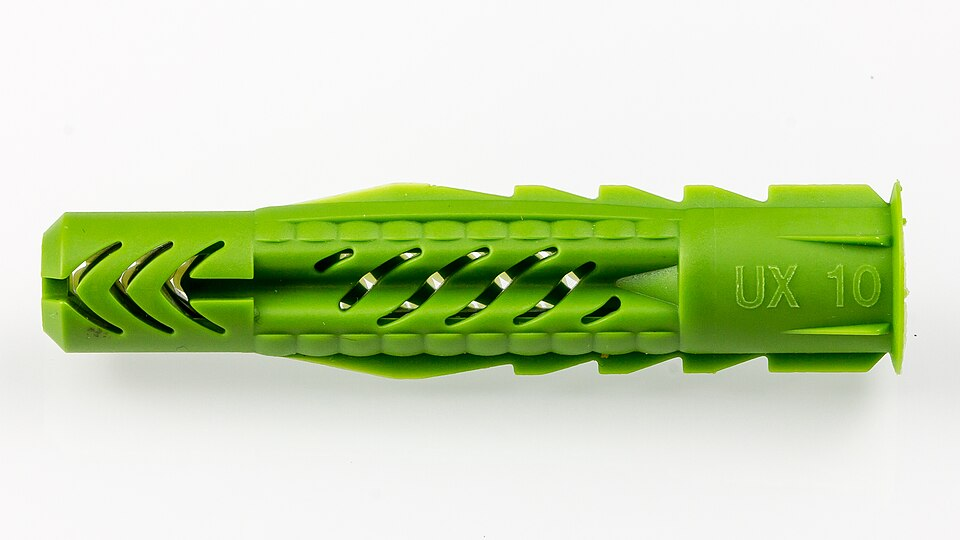
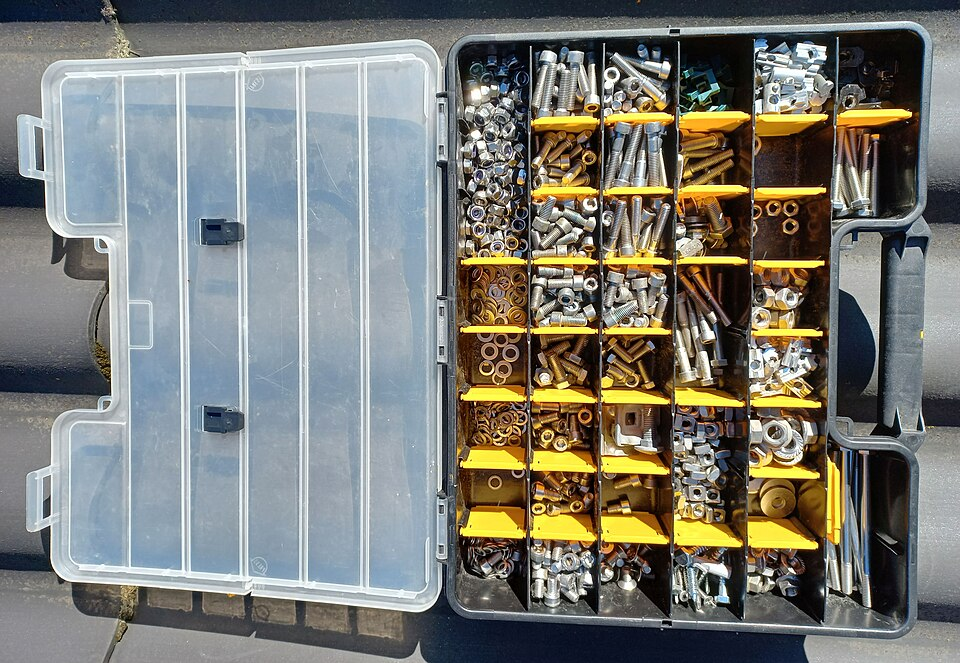
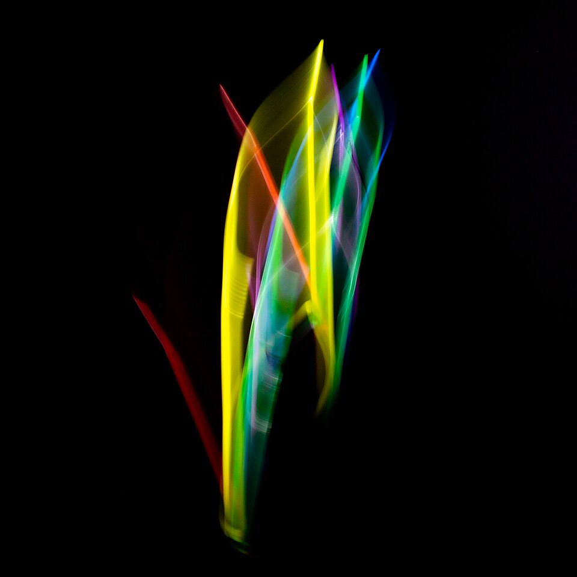
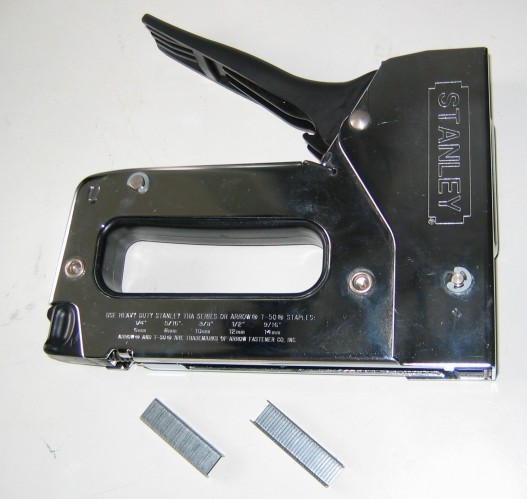
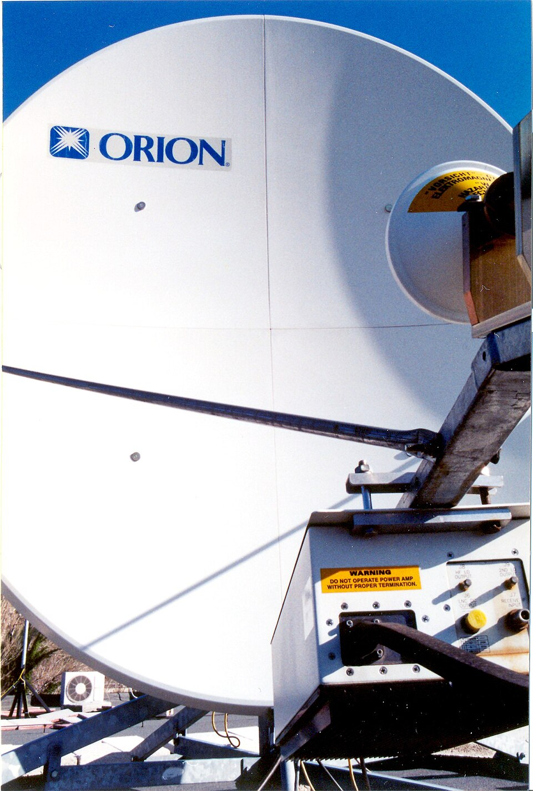

# UD5: Instalación Física — Canalizaciones, Armarios Rack, Patch Panels y Tomas de Red

Bienvenido/a a la **UD5: Instalación Física — Canalizaciones, Armarios Rack, Patch Panels y Tomas de Red** del módulo profesional de **Instalación y Mantenimiento de Redes para Transmisión de Datos (Networking Essentials)** (2º FPB · Instalación y Mantenimiento de Redes (IMX / NE)).

En esta unidad encontrarás los contenidos teóricos, ejemplos prácticos, ejercicios resueltos y actividades de evaluación curricular desarrollados por el profesor **Manuel Alonso Argente**.

---

### 📑 Índice de Apartados y Actividades de la Unidad

- [**📋 5.0 Propuesta Didáctica: Canalizaciones y sistemas de fijación**](./ut0500.html)
- [**5.1 Tipos de fijaciones: tacos, bridas, tornillos, roscas, grapas**](./ut0501.html)
- [**5.2 Relación entre las fijaciones y el elemento a sujetar**](./ut0502.html)

---

# 📖 Vista Completa de la Unidad

## 5.0 Propuesta Didáctica — Canalizaciones y sistemas de fijación

# **Canalizaciones y sistemas de fijación**

## **Propuesta didáctica**

En esta unidad finalizamos el trabajo sobre el RA1: **Selecciona els elements que configuren les xarxes per a la transmissió de veu i dades, descrivint les seues principals característiques i funcionalitat.**

## **Criterios de evaluación**

### **Respecto al RA1:**

| Código | Descripción | Peso (%) | Herramientas Evaluación |
| --- | --- | --- | --- |
| **CE1e** | Se han descrito los tipos de fijaciones (tacos, bridas, tornillos, roscas, grapas, entre otros) de canalizaciones y sistemas | 50% | ACT101 (5%) -- EXA105 (95%) |
| **CE1f** | Se han relacionado las fijaciones con el elemento a sujetar | 50% | ACT101 (5%) -- EXA105 (95%) |

## **Contenidos**

### **Tipos de fijaciones:**

- Tacos de fijación: tipos de tacos y superficies recomendadas.

- Tornillos y roscas: tipos y aplicaciones.

- Bridas: usos en el cableado.

- Grapas: sujeción de canalizaciones y cables.

- Fijaciones químicas y de expansión: aplicaciones en obra.

### **Relación entre las fijaciones y el elemento a sujetar:**

- Criterios de selección de fijaciones: peso del elemento, material de la superficie, ubicación, necesidad de acceso y normativa (REBT).

- Tabla de correspondencia entre fijación y elemento a sujetar.

- Procedimientos correctos de fijación de canalizaciones, armarios, racks y cajas.

> **📌 Cuestionario inicial**
> 

> 1. ¿Qué tipos de fijaciones se utilizan en las instalaciones de telecomunicaciones?

> 1. ¿Para qué sirven las grapas y las bridas en una instalación de red?

> 1. ¿Qué elemento se debe considerar a la hora de elegir un tipo de fijación para un cable concreto?

> 1. ¿Qué diferencia hay entre un taco de plástico y un taco de expansión?

> 1. ¿Qué normativa debe cumplirse en la fijación de canalizaciones eléctricas?

## **Programación de Aula (12 h)**

Esta unidad se imparte en la primera evaluación, con una duración estimada de **6 sesiones lectivas de 2 h** (12 h), durante los días que se indican en el calendario.

### **Distribución de horas por contenido**

| Contenido | Sesiones | Horas |
| --- | --- | --- |
| 5.1 Tipos de fijaciones: UP5.1 | 3 | 6 |
| 5.2 Relación entre las fijaciones y el elemento a sujetar: UP5.2 | 3 | 6 |
| **Total** | **6** | **12** |

### **Sesiones**

| Sesión | Contenidos | Actividades | Criterios trabajados |
| --- | --- | --- | --- |
| 1 | Tipos de fijaciones |  | CE1e |
| 2 | Tipos de fijaciones |  | CE1e |
| 3 | Tipos de fijaciones |  | CE1e |
| 4 | Relación entre las fijaciones y el elemento a sujetar | ACT101 | CE1e - CE1f |
| 5 | Relación entre las fijaciones y el elemento a sujetar |  | CE1f |
| 6 | Actividades de refuerzo y evaluación | **EXA105** | CE1e - CE1f |

---

## 5.1 Tipos de fijaciones: tacos, bridas, tornillos, roscas, grapas

# **Tipos de fijaciones: tacos, bridas, tornillos, roscas, grapas**

Las fijaciones son los elementos mecánicos utilizados para sujetar, anclar y mantener en su posición correcta los componentes de la infraestructura de red: canalizaciones, cables, armarios, cajas y equipos. Una correcta elección y aplicación de las fijaciones garantiza la seguridad, la durabilidad y el orden de la instalación.

## **Tacos de fijación**

Los tacos son elementos de anclaje que se insertan en paredes, techos o suelos de diferentes materiales (hormigón, ladrillo, yeso) para proporcionar un punto de fijación firme al que se atornillan otros elementos.

### **Tipos de tacos**

| Tipo | Material | Uso habitual | Superficie recomendada |
| --- | --- | --- | --- |
| **Taco de plástico** | Nylon o polietileno | Fijaciones ligeras en pared | Hormigón, ladrillo macizo |
| **Taco de expansion** | Nylon con expansor metálico | Fijaciones medias y pesadas | Hormigón, ladrillo hueco |
| **Taco de gutapercha** | Gutapercha o fibra | Fijaciones ligeras en hueco | Ladrillo hueco, bloques |
| **Taco mariposa** | Nylon | Paneles de yeso y placas | Yeso cartón (pladur) |
| **Taco de pegamento** | Adhesivo de alta resistencia | Fijaciones sin perforar | Superficies lisas, azulejos |
| **Taco de zinc** | Zinc fundido | Fijaciones muy pesadas | Hormigón, piedra |
| **Taco químico** | Resina epoxi o vinílica | Fijaciones de alta carga | Hormigón, piedra natural |

### **Dimensiones de tacos**

Los tacos se dimensionan según el diámetro y la longitud. Los más utilizados en instalaciones de telecomunicaciones son:
- **Taco 5 mm**: Para fijaciones ligeras (cableado, canalizaciones pequeñas).
- **Taco 6 mm**: Para fijaciones medias (cajas de registro, canalizaciones).
- **Taco 8 mm**: Para fijaciones pesadas (armarios ligeros, bandejas).
- **Taco 10 mm**: Para fijaciones muy pesadas (armarios de pie, equipos pesados).

## **Tornillos**

Los tornillos son elementos de fijación roscados que se insertan en los tacos o directamente en la superficie para sujetar otros elementos.

### **Tipos de tornillos**

| Tipo | Cabeza | Uso habitual |
| --- | --- | --- |
| **Tornillo de macho** | Cilíndrica o cónica | Fijación de cajas, canalizaciones |
| **Tornillo de cabeza chata** | Plana | Fijación de paneles y tapas |
| **Tornillo de seguridad** | Especial (torx, tri-wing) | Equipos de alta seguridad |
| **Tornillo autorroscante** | Variada | Chapa metálica, perfiles |

### **Normativa de tornillos**

Los tornillos se dimensionan según el diámetro y la longitud. Ejemplos comunes:
- **M4 x 20 mm**: Fijación ligera (tapa de caja, canalización).
- **M5 x 30 mm**: Fijación media (caja de registro, bandeja).
- **M6 x 40 mm**: Fijación pesada (armario ligero).
- **M8 x 60 mm**: Fijación muy pesada (armario de pie, rack).

## **Bridas (abrazaderas)**

Las bridas o abrazaderas son elementos de sujeción que rodean el cable o la canalización para fijarlas a una estructura de soporte.

### **Tipos de bridas**

| Tipo | Material | Uso |
| --- | --- | --- |
| **Brida de nylon (cable tie)** | Nylon | Sujetar cables entre sí o a estructuras |
| **Brida de acero inoxidable** | Acero inoxidable | Entornos exteriores, alta resistencia |
| **Brida adhesiva** | Nylon con pegamento | Fijación temporal o en superficies lisas |
| **Abrazadera metálica** | Acero galvanizado | Sujetar tuberías y canalizaciones rígidas |
| **Abrazadera en V** | Acero o aluminio | Sujetar cables pesados a estructuras |
| **Abrazadera de tubo** | Acero galvanizado | Sujetar tubos de cableado a paredes |

### **Usos principales de las bridas**

- **Agrupar cables**: Mantener el cableado organizado dentro de canalizaciones o racks.

- **Fijar cables a estructuras**: Sujetar el cableado a bandejas, tubos o paredes.

- **Sujetar canalizaciones**: Mantener las tuberías y canales en su posición.

- **Ordenar el cableado en racks**: Organizar los cables entre equipos del rack.

## **Grapas y abrazaderas de cable**

Las grapas son elementos de fijación que sujetan los cables directamente a la superficie de apoyo (pared, techo, suelo).

### **Tipos de grapas**

| Tipo | Material | Uso |
| --- | --- | --- |
| **Grapa de cobre** | Cobre o acero galvanizado | Cableado telefónico, cable plano |
| **Grapa de acero inoxidable** | Acero inoxidable | Exterior, entornos agresivos |
| **Grapa con clavo** | Acero con clavo integrado | Cableado en madera |
| **Grapa autoadhesiva** | Plástico con pegamento | Cableado en superficies lisas |
| **Grapa de sujeción (clip)** | Plástico o metal | Cableado en canalizaciones |

### **Consideraciones de uso**

- La grapa debe ser del tamaño adecuado para el diámetro del cable.

- No apretar demasiado la grapa para no dañar el aislante del cable.

- Dejar un pequeño espacio para permitir la dilatación del cable.

- Utilizar grapa de acero inoxidable en exteriores.

## **Rosca y tornillería específica**

### **Rosca metálica (tubo flexible)**

La rosca metálica es un tubo corrugado de acero galvanizado que protege los cables de daños mecánicos. Se utiliza como canalización protectora en instalaciones que requieren mayor resistencia.

**Aplicaciones:**
- Protección de cableado en suelos y techos.
- Conexión de cajas de registro con canalizaciones.
- Protección de cableado en zonas industriales.

### **Abrazaderas de tubo**

Elementos que sujetan la rosca metálica o tubos rígidos a las superficies de apoyo.

## **Otros elementos de fijación**

### **Soportes de canalización**

- **Soporte tipo L**: Elemento en forma de L que sujeta canalizaciones a pared.

- **Soporte tipo doble L**: Sujeta canalizaciones en esquinas.

- **Soporte giratorio**: Permite variar el ángulo de la canalización.

- **Caldazo**: Soporte ajustable para múltiples canalizaciones.

### **Cinta aislante y autoadhesiva**

- **Cinta aislante**: Para proteger conexiones eléctricas.

- **Cinta autoadhesiva**: Para fijar temporalmente cables o identificar circuitos.

### **Pernos de rosca continua**

Se utilizan para fijar armarios y racks al suelo o a la pared. Permiten un ajuste fino de la posición.

### **Anclajes químicos**

Se utilizan para fijaciones de alta carga en hormigón o piedra. Consisten en un社micá de resina que se inyecta en un agujero y fija el perno de forma muy resistente.

---

## 5.2 Relación entre las fijaciones y el elemento a sujetar

# **Relación entre las fijaciones y el elemento a sujetar**

La correcta elección de la fijación para cada elemento de la infraestructura de red es fundamental para garantizar la seguridad, la durabilidad y el correcto funcionamiento de la instalación. En esta unidad analizamos qué tipo de fijación se utiliza para cada elemento y los criterios que deben considerarse.

## **Criterios de selección de fijaciones**

Para elegir la fijación adecuada se deben tener en cuenta los siguientes factores:

1. **Peso del elemento a sujetar**: Elementos pesados requieren fijaciones de mayor resistencia (tacos de zinc, tacos químicos).

1. **Material de la superficie de apoyo**: Hormigón, ladrillo, yeso, madera, metal, cada material necesita un tipo de taco concreto.

1. **Ubicación del elemento**: Interior, exterior, humedad, temperatura, vibraciones.

1. **Necesidad de acceso**: Si el elemento debe poder desmontarse frecuentemente, se prefieren fijaciones reversibles.

1. **Normativa y reglamento**: Deben cumplirse las especificaciones del REBT y la normativa de telecomunicaciones.

## **Fijaciones según el elemento a sujetar**

### **Canalizaciones y tubos de cableado**

| Tipo de canalización | Fijación recomendada | Separación típica |
| --- | --- | --- |
| **Tubo corrugado de PVC** | Grapa de cable o brida de nylon | Cada 50 cm en horizontal, cada 80 cm en vertical |
| **Tubo rígido metálico** | Abrazadera de tubo + taco de expansión | Cada 1,5 m en horizontal, en cada cambio de dirección |
| **Bandeja portacables** | Perno de rosca continua + taco de zinc | En cada soporte, cada 1,5 m |
| **Canal de cableado** | Tornillo + taco de plástico | En cada punto de fijación |
| **Tubo flexible metálico (rosca)** | Abrazadera metálica + taco de expansión | Cada 1 m |

**Consideraciones:**
- Las canalizaciones horizontales se fijan a una separación máxima de 1 metro entre puntos de sujeción.
- Las canalizaciones verticales se fijan a una separación máxima de 1,5 metros.
- En cambios de dirección se debe instalar un punto de fijación adyacente al cambio.

### **Cables**

| Tipo de cable | Fijación recomendada | Comentario |
| --- | --- | --- |
| **Cable de par trenzado (UTP, FTP)** | Grapa de cable o brida de nylon | No apretar excesivamente; dejar holgura |
| **Cable coaxial** | Grapa de cable coaxial (abrazadera en V) | Mantener el radio de curvatura mínimo |
| **Cable de fibra óptica** | Grapa de fibra o brida de nylon suelta | Proteger contra aplastamiento; mantener radio de curvatura de 15x el diámetro |
| **Cable de alimentación eléctrica** | Grapa aislante o brida de nylon | Separar del cableado de datos |

**Consideraciones:**
- Mantener el cableado de datos separado del cableado eléctrico (mínimo 30 cm en paralelo).
- En cruces, atravesar perpendicularmente.
- No superar la carga máxima de la grapa o brida.

### **Cajas de registro**

| Tipo de caja | Fijación recomendada |
| --- | --- |
| **Caja empotrada** | Taco de expansión + tornillo M4 o M5, o directamente con argollas de fijación |
| **Caja de superficie** | Taco de plástico + tornillo (en pared hueca, taco mariposa) |
| **Caja de techo** | Taco de expansión + tornillo |

**Consideraciones:**
- La caja debe quedar nivelada y firmemente sujeta.
- Si la pared es de yeso cartón (pladur), usar tacos mariposa o tacos específicos para pladur.
- Si la pared es de ladrillo hueco, usar tacos de expansion o gutapercha.

### **Armarios y racks**

| Tipo de equipo | Fijación recomendada |
| --- | --- |
| **Rack de pie** | Pernos de rosca continua + taco de zinc o taco químico en suelo de hormigón |
| **Rack de pared** | Taco de zinc o taco químico (mínimo 4 puntos de fijación) |
| **Armario MDF** | Pernos de fijación al suelo con tacos químicos |
| **Armario IDF** | Tacos de zinc o químicos según peso y tipo de pared |

**Consideraciones:**
- Los racks de pie deben fijarse al suelo para evitar volcaduras.
- Los racks de pared requieren un mínimo de 4 puntos de fijación.
- En zonas de riesgo sísmico, se deben instalar fijaciones adicionales de seguridad.
- Verificar que la pared soporta el peso total del rack con equipos.

### **Antenas**

| Tipo de antena | Fijación recomendada |
| --- | --- |
| **Antena de techo** | Soporte de montaje con tacos de zinc o pernos de rosca continua |
| **Antena de pared** | Taco de expansión + tornillo |
| **Antena de mástil** | Abrazadera metálica + soporte de mástil |

**Consideraciones:**
- La fijación debe resistir cargas de viento.
- Utilizar materiales resistentes a la corrosión en exteriores.
- Asegurar una correcta orientación de la antena.

### **Panel de parcheo y organizadores de cable**

| Elemento | Fijación recomendada |
| --- | --- |
| **Panel de parcheo** | Tornillos de montaje en rack (estándar 19") |
| **Organizador de cable** | Tornillos de montaje en rack |
| **Bandeja de extracción** | Guías de montaje en rack |

**Consideraciones:**
- Todos los elementos de rack se montan utilizando el estándar de 19 pulgadas.
- Utilizar tornillos de seguridad si se requiere protección contra manipulación.

## **Relación fijación-elemento: resumen práctico**

| Elemento | Fijación principal | Fijación secundaria | Observación |
| --- | --- | --- | --- |
| Canalización PVC | Grapa | Brida nylon | Cada 50-80 cm |
| Canalización metálica | Abrazadera + taco | Perno rosca continua | Cada 1-1,5 m |
| Cable UTP | Grapa o brida | Abrazadera tipo L | Sin apretar excesivamente |
| Cable coaxial | Abrazadera en V | Grapa coaxial | Radio de curvatura mínimo |
| Cable fibra óptica | Grapa fibra | Brida nylon suelta | Radio curvatura 15x diámetro |
| Caja empotrada | Taco expansión + tornillo | — | Nivelada y firme |
| Caja superficie | Taco plástico + tornillo | Taco mariposa (pladur) | Según material de pared |
| Rack de pie | Perno rosca + taco zinc | Taco químico | Fijar al suelo |
| Rack de pared | Taco zinc (4 puntos mínimo) | Taco químico | Verificar resistencia pared |
| Antena | Soporte + tacos zinc | Abrazadera metálica | Resistir viento |
| Panel parcheo | Tornillo rack 19" | — | Estándar |

## **Buenas prácticas en fijaciones**

1. **Utilizar el material adecuado**: No sustituir un taco de zinc por uno de plástico en una fijación pesada.

1. **Respetar las cargas máximas**: Consultar la capacidad de carga de cada taco y tornillo.

1. **Mantener separaciones**: Separar cableado de datos de cableado eléctrico y de fuentes de interferencia.

1. **Dejar holgura en cables**: No apretar excesivamente las grapas y bridas sobre los cables.

1. **Identificar los circuitos**: Utilizar etiquetas o cintas de colores para identificar cada cable.

1. **Documentar la instalación**: Elaborar un plano o esquema con la ubicación de las fijaciones y los recorridos de los cables.

1. **Cumplir la normativa**: Seguir las especificaciones del REBT, ICT y normas de cableado estructurado.
