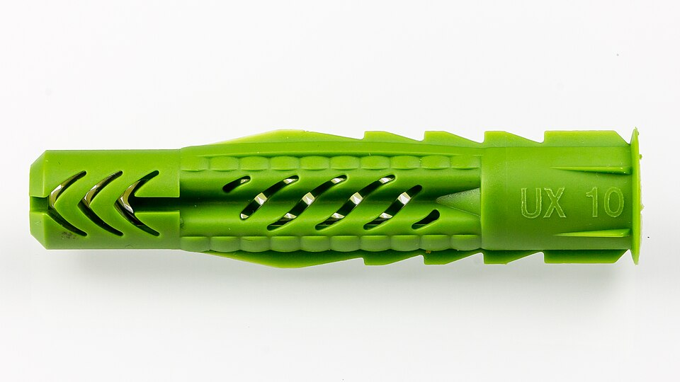
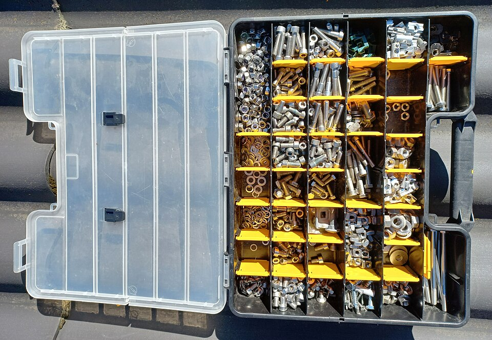
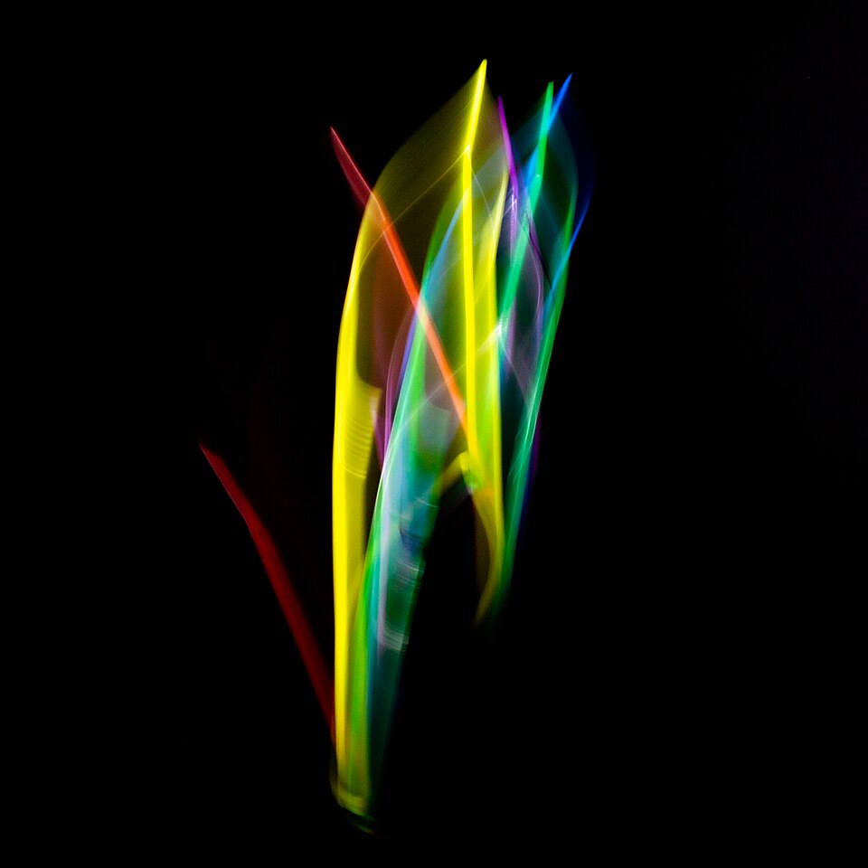
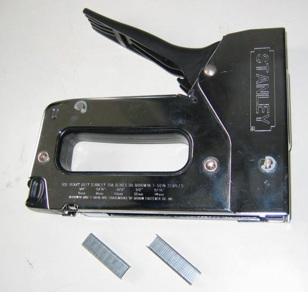

# **Tipus de fixacions: tacs, brides, caragols, roscas, grapes**

  

    🏆 <strong>Progrés d'aquesta secció:</strong> 0 de 4 superats (0%)
    ⭐ <strong>0 punts</strong>
  

  

    

  

Les fixacions són els elements mecánics utilitzats per a subjectar, anclar i mantindre en la seua posició correcta els components de la infraestructura de xarxa: canalitzacions, cables, armaris, caixes i equips. Una correcta elecció i aplicació de les fixacions garanteix la seguretat, la durabilitat i l'ordre de la instal·lació.

## **Tacs de fixació**

Els tacs són elements d'anclatge que s'insereixen en parets, sostres o sòls de diferents materials (formigó, rajola, yeso) per a proporcionar un punt de fixació firme al que es atornillan altres elements.

### **Tipus de tacs**

| Tipus | Material | Ús habitual | Superfície recomanada |
| --- | --- | --- | --- |
| **Tac de plàstic** | Nylon o polietileno | Fixacions ligeras en paret | Formigó, rajola macizo |
| **Tac d'expansion** | Nylon amb expansor metàl·lic | Fixacions mitjanes i pesades | Formigó, rajola buit |
| **Tac de gutapercha** | Gutapercha o fibra | Fixacions ligeras en buit | Rajola buit, blocs |
| **Tac mariposa** | Nylon | Panells de yeso i placas | Yeso cartón (pladur) |
| **Tac de pegamento** | Adhesivo d'alta resistència | Fixacions sense perforar | Superfícies lisas, azulejos |
| **Tac de zinc** | Zinc fundido | Fixacions molt pesades | Formigó, pedra |
| **Tac químic** | Resina epoxi o vinílica | Fixacions d'alta carrega | Formigó, pedra natural |

### **Dimensions de tacs**

Els tacs es dimensionan segons el diàmetre i la longitud. Els més utilitzats en instal·lacions de telecomunicacions són:
- **Tac 5 mm**: Per a fixacions ligeras (cablejat, canalitzacions xicotetes).
- **Tac 6 mm**: Per a fixacions mitjanes (caixes de registre, canalitzacions).
- **Tac 8 mm**: Per a fixacions pesades (armaris ligeros, bandejas).
- **Tac 10 mm**: Per a fixacions molt pesades (armaris de peu, equips pesants).

## **Caragols**

Els caragols són elements de fixació roscats que s'insereixen en els tacs o directament en la superfície per a subjectar altres elements.

### **Tipus de caragols**

| Tipus | Cabeza | Ús habitual |
| --- | --- | --- |
| **Caragol de macho** | Cilíndrica o cónica | Fixació de caixes, canalitzacions |
| **Caragol de cabeza chata** | Plana | Fixació de panells i tapas |
| **Caragol de seguretat** | Especial (torx, tri-wing) | Equips d'alta seguretat |
| **Caragol autorroscante** | Variada | Chapa metàl·lica, perfiles |

### **Normativa de caragols**

Els caragols es dimensionan segons el diàmetre i la longitud. Exemples comuns:
- **M4 x 20 mm**: Fixació lleugera (tapa de caixa, canalització).
- **M5 x 30 mm**: Fixació mitjana (caixa de registre, bandeja).
- **M6 x 40 mm**: Fixació pesada (armari lleuger).
- **M8 x 60 mm**: Fixació molt pesada (armari de peu, rack).

## **Brides (abraçadores)**

Les brides o abraçadores són elements de sujeció que rodean el cable o la canalització per a fijar-les a una estructura de suport.

### **Tipus de brides**

| Tipus | Material | Ús |
| --- | --- | --- |
| **Brida de nylon (cable tie)** | Nylon | Subjectar cables entre sí o a estructures |
| **Brida d'acer inoxidable** | Acer inoxidable | Entorns exteriors, alta resistència |
| **Brida adhesiva** | Nylon amb pegamento | Fixació temporal o en superfícies lisas |
| **Abraçadora metàl·lica** | Acer galvanitzat | Subjectar tuberías i canalitzacions rígides |
| **Abraçadora en V** | Acer o aluminio | Subjectar cables pesants a estructures |
| **Abraçadora de tub** | Acer galvanitzat | Subjectar tubs de cablejat a parets |

### **Usos principals de les brides**

- **Agrupar cables**: Mantindre el cablejat organitzat dins de canalitzacions o racks.

- **Fixar cables a estructures**: Subjectar el cablejat a bandejas, tubs o parets.

- **Subjectar canalitzacions**: Mantindre les tuberías i canals en la seua posició.

- **Ordenar el cablejat en racks**: Organitzar els cables entre equips del rack.

## **Grapes i abraçadores de cable**

Les grapes són elements de fixació que sujetan els cables directament a la superfície d'apoyo (paret, sostre, sòl).

### **Tipus de grapes**

| Tipus | Material | Ús |
| --- | --- | --- |
| **Grapa de coure** | Coure o acer galvanitzat | Cablejat telefònic, cable plànol |
| **Grapa d'acer inoxidable** | Acer inoxidable | Exterior, entorns agresivos |
| **Grapa amb clavo** | Acer amb clavo integrat | Cablejat en madera |
| **Grapa autoadhesiva** | Plàstic amb pegamento | Cablejat en superfícies lisas |
| **Grapa de sujeció (clip)** | Plàstic o metal | Cablejat en canalitzacions |

### **Consideracions d'ús**

- La grapa ha de ser del mida adequat per al diàmetre del cable.

- No apretar massa la grapa per a no dañar l'aïllant del cable.

- Deixar un xicotet espai per a permetre la dilatació del cable.

- Utilitzar grapa d'acer inoxidable en exteriors.

## **Rosca i tornillería específica**

### **Rosca metàl·lica (tub flexible)**

La rosca metàl·lica és un tub corrugado d'acer galvanitzat que protegeix els cables de danys mecánics. S'utilitza com canalització protectora en instal·lacions que requereixen major resistència.

**Aplicacions:**
- Protecció de cablejat en sòls i sostres.
- Connexió de caixes de registre amb canalitzacions.
- Protecció de cablejat en zones industrials.

### **Abraçadores de tub**

Elements que sujetan la rosca metàl·lica o tubs rígits a les superfícies d'apoyo.

## **Altres elements de fixació**

### **Suports de canalització**

- **Suport tipus L**: Element en forma de L que subjecta canalitzacions a paret.

- **Suport tipus doble L**: Subjecta canalitzacions en esquinas.

- **Suport giratorio**: Permet variar el ángulo de la canalització.

- **Caldazo**: Suport ajustable per a múltiples canalitzacions.

### **Cinta aïllant i autoadhesiva**

- **Cinta aïllant**: Per a protegir connexions eléctriques.

- **Cinta autoadhesiva**: Per a fixar temporalment cables o identificar circuitos.

### **Pernos de rosca contínua**

S'utilitzen per a fixar armaris i racks al sòl o a la paret. Permeten un ajuste fino de la posició.

### **Anclatges químics**

S'utilitzen per a fixacions d'alta carrega en formigó o pedra. Consisteixen en un社micá de resina que es inyecta en un agujero i fixa el perno de forma molt resistente.

---

## 🎮 Reptes Interactius d'Autoavaluació (+100 XP)

Comprova el teu domini sobre **5.1 Tipus de fixacions: tacs, brides, caragols, roscas, grapes** superant aquests 4 reptes gamificats (+25 punts cadascun):

  
🎯 <strong>Repte 1 (+25 pts):</strong> Quina és l'amplària estàndard internacional dels armaris rack de telecomunicacions i dels dispositius que s'hi instal·len (com switches i patch panels)?

  

    <button type="button" class="btn-mcq-opt" data-opt="A">A) 19 polzades (19").</button>
    <button type="button" class="btn-mcq-opt" data-opt="B">B) 50 polzades.</button>
    <button type="button" class="btn-mcq-opt" data-opt="C">C) 5 polzades.</button>
    <button type="button" class="btn-mcq-opt" data-opt="D">D) 100 centímetres.</button>
  

  

  
🎯 <strong>Repte 2 (+25 pts):</strong> En un armari rack, per a què serveix el panell de parcheig (<code>Patch Panel</code>)?

  

    <button type="button" class="btn-mcq-opt" data-opt="A">A) Per a donar corrent elèctric de 230 V als monitors.</button>
    <button type="button" class="btn-mcq-opt" data-opt="B">B) Per a concentrar i ordenar al seu revers tots els cables fixos de planta i connectar-los pel frontal als switches mitjançant latiguillos.</button>
    <button type="button" class="btn-mcq-opt" data-opt="C">C) Per a refredar l'habitació amb gas frigorífic.</button>
    <button type="button" class="btn-mcq-opt" data-opt="D">D) Per a fer forats en la paret de formigó.</button>
  

  

  
✅ <strong>Repte 3 (Vertader o Fals · +25 pts):</strong> L'altura útil interior d'un armari rack i dels seus equips es mesura en unitats 'U' (on 1U equival a 1,75 polzades o 44,45 mm).

  

    <button type="button" class="btn-vf" data-opt="V">Vertader (V)</button>
    <button type="button" class="btn-vf" data-opt="F">Fals (F)</button>
  

  

  
⌨️ <strong>Repte 4 (+25 pts):</strong> Quantes polzades d'amplària estàndard tenen els bastidors d'un armari rack de comunicacions?

  

    <input type="text" class="quiz-input" placeholder="Escriu la resposta..." />
    <button type="button" class="btn-quiz-check">Comprovar</button>
  

  

### 📋 Llista de Comprovació i Rúbrica d'Assoliment

Marca cada criteri a mesura que completes l'estudi o la resolució pràctica d'aquesta pàgina (**5.1 Tipus de fixacions: tacs, brides, caragols, roscas, grapes**):

- [ ] He llegit detingudament la teoria o l'enunciat d'aquesta secció i he anotat els conceptes clau.
- [ ] He revisat els esquemes, taules o blocs de codi i he verificat que sé aplicar-los a l'entorn de treball.
- [ ] He resolt correctament els **4 reptes interactius** superiors obtenint els **100 punts XP**.
- [ ] He descarregat el comprovant oficial en PDF per a adjuntar-lo a la tasca d'**Aules**.

  <h3>📤 Comprovant de Lliurament per a Aules</h3>
  
Quan hages completat els reptes interactius i la llista d'autoavaluació d'aquesta pàgina, introdueix el teu nom i descarrega el teu certificat oficial en PDF per a adjuntar-lo a la tasca d'<strong>Aules</strong>.

  

    <label for="aules-student-name">👤 Nom i Cognoms de l'Alumne/a:</label>
    <input type="text" id="aules-student-name" class="aules-student-name" placeholder="Ex: Joan Garcia Pérez" />
  

  

    0/4 reptes completats (0%) · 0 punts · 0/4 criteris d'autoavaluació
  

  

    <button type="button" class="btn-aules-dl" data-module="IMX" data-unit="UD05" data-activity="ut0501">📥 Descarregar Comprovant PDF</button>
    <button type="button" class="btn-aules-copy">📋 Copiar Resum al Porta-retalls</button>
  

  

