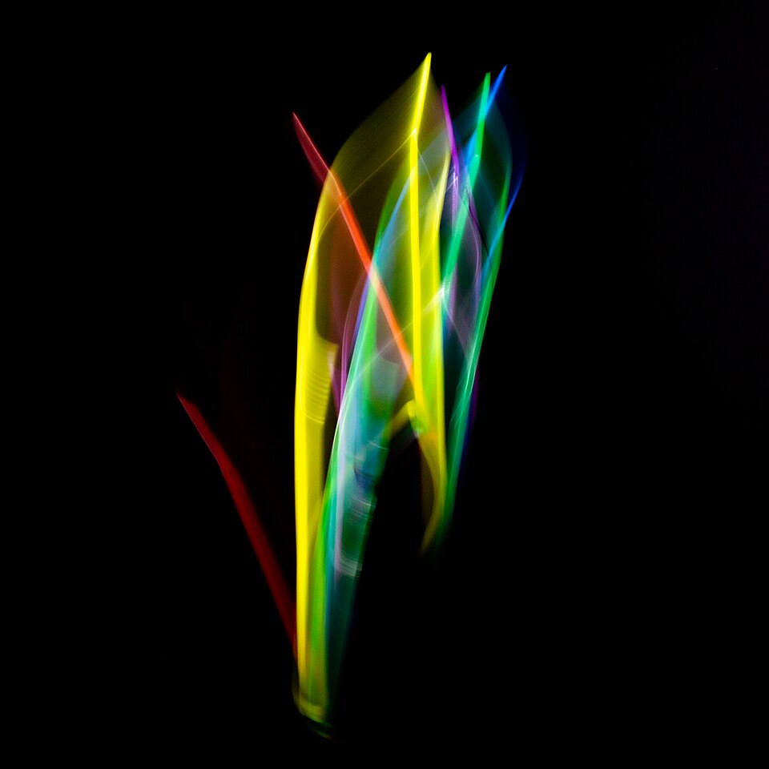
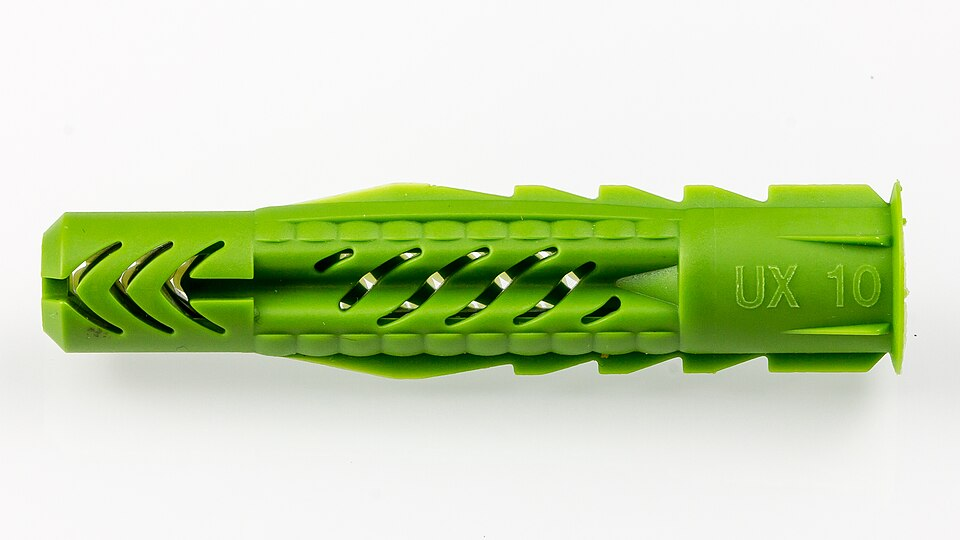
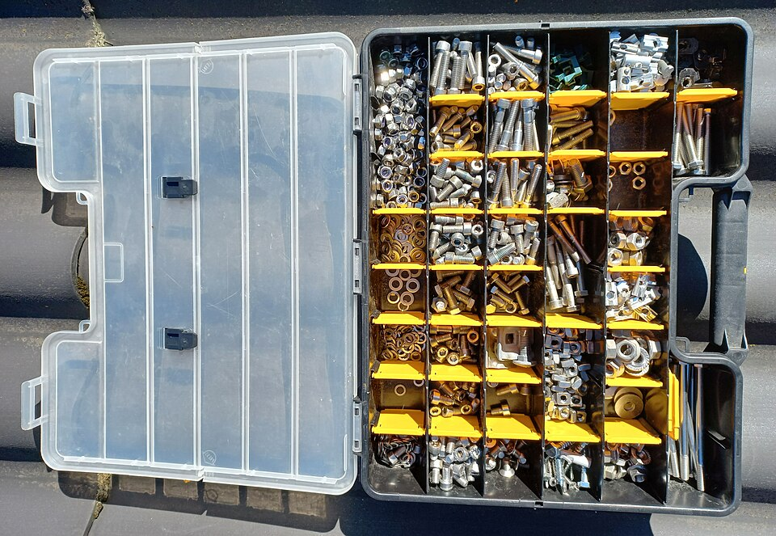
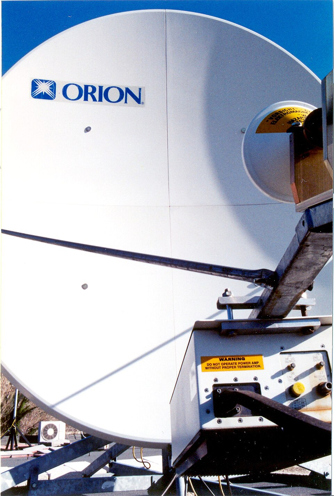

# **Relación entre las fijaciones y el elemento a sujetar**

La correcta elección de la fijación para cada elemento de la infraestructura de red es fundamental para garantizar la seguridad, la durabilidad y el correcto funcionamiento de la instalación. En esta unidad analizamos qué tipo de fijación se utiliza para cada elemento y los criterios que deben considerarse.

## **Criterios de selección de fijaciones**

Para elegir la fijación adecuada se deben tener en cuenta los siguientes factores:

1. **Peso del elemento a sujetar**: Elementos pesados requieren fijaciones de mayor resistencia (tacos de zinc, tacos químicos).

1. **Material de la superficie de apoyo**: Hormigón, ladrillo, yeso, madera, metal, cada material necesita un tipo de taco concreto.

1. **Ubicación del elemento**: Interior, exterior, humedad, temperatura, vibraciones.

1. **Necesidad de acceso**: Si el elemento debe poder desmontarse frecuentemente, se prefieren fijaciones reversibles.

1. **Normativa y reglamento**: Deben cumplirse las especificaciones del REBT y la normativa de telecomunicaciones.

## **Fijaciones según el elemento a sujetar**

### **Canalizaciones y tubos de cableado**

| Tipo de canalización | Fijación recomendada | Separación típica |
| --- | --- | --- |
| **Tubo corrugado de PVC** | Grapa de cable o brida de nylon | Cada 50 cm en horizontal, cada 80 cm en vertical |
| **Tubo rígido metálico** | Abrazadera de tubo + taco de expansión | Cada 1,5 m en horizontal, en cada cambio de dirección |
| **Bandeja portacables** | Perno de rosca continua + taco de zinc | En cada soporte, cada 1,5 m |
| **Canal de cableado** | Tornillo + taco de plástico | En cada punto de fijación |
| **Tubo flexible metálico (rosca)** | Abrazadera metálica + taco de expansión | Cada 1 m |

**Consideraciones:**
- Las canalizaciones horizontales se fijan a una separación máxima de 1 metro entre puntos de sujeción.
- Las canalizaciones verticales se fijan a una separación máxima de 1,5 metros.
- En cambios de dirección se debe instalar un punto de fijación adyacente al cambio.

### **Cables**

| Tipo de cable | Fijación recomendada | Comentario |
| --- | --- | --- |
| **Cable de par trenzado (UTP, FTP)** | Grapa de cable o brida de nylon | No apretar excesivamente; dejar holgura |
| **Cable coaxial** | Grapa de cable coaxial (abrazadera en V) | Mantener el radio de curvatura mínimo |
| **Cable de fibra óptica** | Grapa de fibra o brida de nylon suelta | Proteger contra aplastamiento; mantener radio de curvatura de 15x el diámetro |
| **Cable de alimentación eléctrica** | Grapa aislante o brida de nylon | Separar del cableado de datos |

**Consideraciones:**
- Mantener el cableado de datos separado del cableado eléctrico (mínimo 30 cm en paralelo).
- En cruces, atravesar perpendicularmente.
- No superar la carga máxima de la grapa o brida.

### **Cajas de registro**

| Tipo de caja | Fijación recomendada |
| --- | --- |
| **Caja empotrada** | Taco de expansión + tornillo M4 o M5, o directamente con argollas de fijación |
| **Caja de superficie** | Taco de plástico + tornillo (en pared hueca, taco mariposa) |
| **Caja de techo** | Taco de expansión + tornillo |

**Consideraciones:**
- La caja debe quedar nivelada y firmemente sujeta.
- Si la pared es de yeso cartón (pladur), usar tacos mariposa o tacos específicos para pladur.
- Si la pared es de ladrillo hueco, usar tacos de expansion o gutapercha.

### **Armarios y racks**

| Tipo de equipo | Fijación recomendada |
| --- | --- |
| **Rack de pie** | Pernos de rosca continua + taco de zinc o taco químico en suelo de hormigón |
| **Rack de pared** | Taco de zinc o taco químico (mínimo 4 puntos de fijación) |
| **Armario MDF** | Pernos de fijación al suelo con tacos químicos |
| **Armario IDF** | Tacos de zinc o químicos según peso y tipo de pared |

**Consideraciones:**
- Los racks de pie deben fijarse al suelo para evitar volcaduras.
- Los racks de pared requieren un mínimo de 4 puntos de fijación.
- En zonas de riesgo sísmico, se deben instalar fijaciones adicionales de seguridad.
- Verificar que la pared soporta el peso total del rack con equipos.

### **Antenas**

| Tipo de antena | Fijación recomendada |
| --- | --- |
| **Antena de techo** | Soporte de montaje con tacos de zinc o pernos de rosca continua |
| **Antena de pared** | Taco de expansión + tornillo |
| **Antena de mástil** | Abrazadera metálica + soporte de mástil |

**Consideraciones:**
- La fijación debe resistir cargas de viento.
- Utilizar materiales resistentes a la corrosión en exteriores.
- Asegurar una correcta orientación de la antena.

### **Panel de parcheo y organizadores de cable**

| Elemento | Fijación recomendada |
| --- | --- |
| **Panel de parcheo** | Tornillos de montaje en rack (estándar 19") |
| **Organizador de cable** | Tornillos de montaje en rack |
| **Bandeja de extracción** | Guías de montaje en rack |

**Consideraciones:**
- Todos los elementos de rack se montan utilizando el estándar de 19 pulgadas.
- Utilizar tornillos de seguridad si se requiere protección contra manipulación.

## **Relación fijación-elemento: resumen práctico**

| Elemento | Fijación principal | Fijación secundaria | Observación |
| --- | --- | --- | --- |
| Canalización PVC | Grapa | Brida nylon | Cada 50-80 cm |
| Canalización metálica | Abrazadera + taco | Perno rosca continua | Cada 1-1,5 m |
| Cable UTP | Grapa o brida | Abrazadera tipo L | Sin apretar excesivamente |
| Cable coaxial | Abrazadera en V | Grapa coaxial | Radio de curvatura mínimo |
| Cable fibra óptica | Grapa fibra | Brida nylon suelta | Radio curvatura 15x diámetro |
| Caja empotrada | Taco expansión + tornillo | — | Nivelada y firme |
| Caja superficie | Taco plástico + tornillo | Taco mariposa (pladur) | Según material de pared |
| Rack de pie | Perno rosca + taco zinc | Taco químico | Fijar al suelo |
| Rack de pared | Taco zinc (4 puntos mínimo) | Taco químico | Verificar resistencia pared |
| Antena | Soporte + tacos zinc | Abrazadera metálica | Resistir viento |
| Panel parcheo | Tornillo rack 19" | — | Estándar |

## **Buenas prácticas en fijaciones**

1. **Utilizar el material adecuado**: No sustituir un taco de zinc por uno de plástico en una fijación pesada.

1. **Respetar las cargas máximas**: Consultar la capacidad de carga de cada taco y tornillo.

1. **Mantener separaciones**: Separar cableado de datos de cableado eléctrico y de fuentes de interferencia.

1. **Dejar holgura en cables**: No apretar excesivamente las grapas y bridas sobre los cables.

1. **Identificar los circuitos**: Utilizar etiquetas o cintas de colores para identificar cada cable.

1. **Documentar la instalación**: Elaborar un plano o esquema con la ubicación de las fijaciones y los recorridos de los cables.

1. **Cumplir la normativa**: Seguir las especificaciones del REBT, ICT y normas de cableado estructurado.
