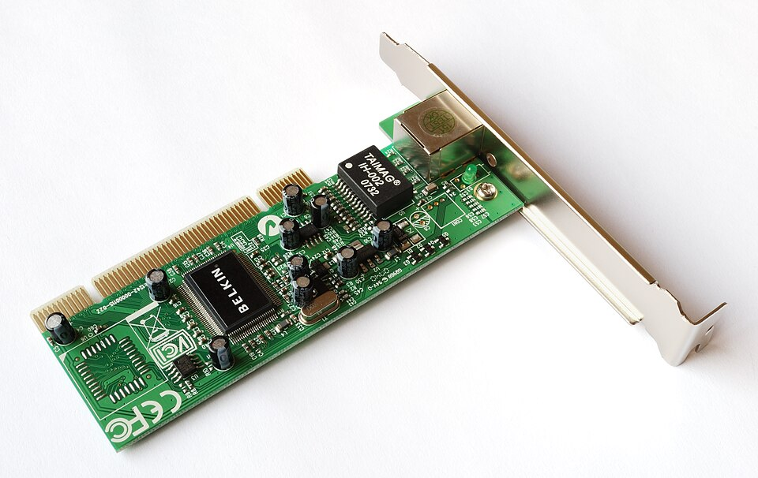
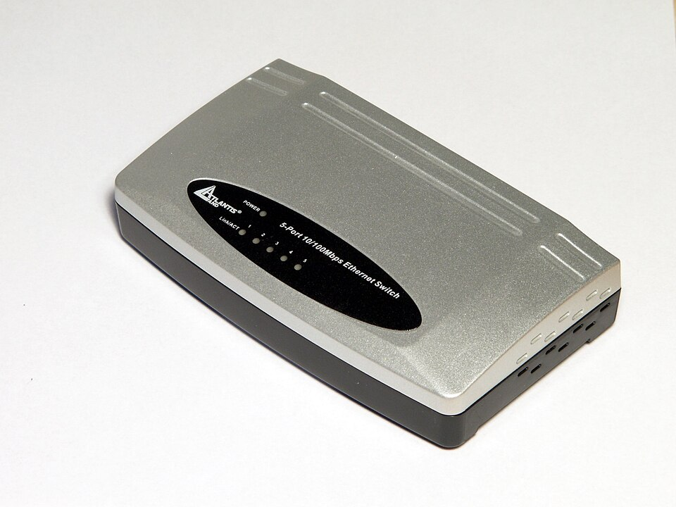
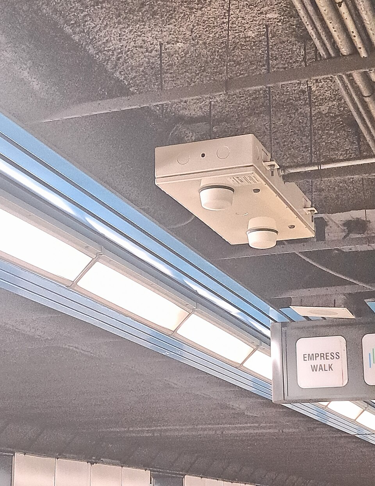
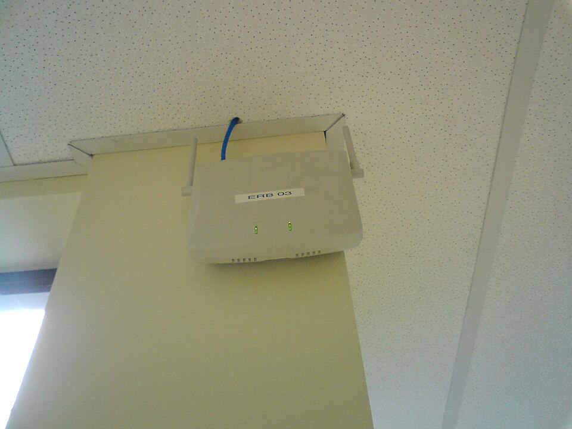
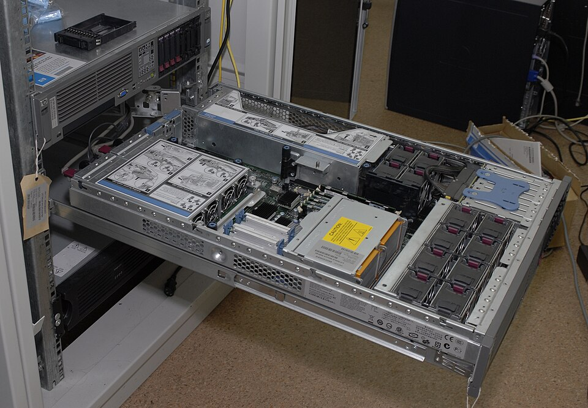
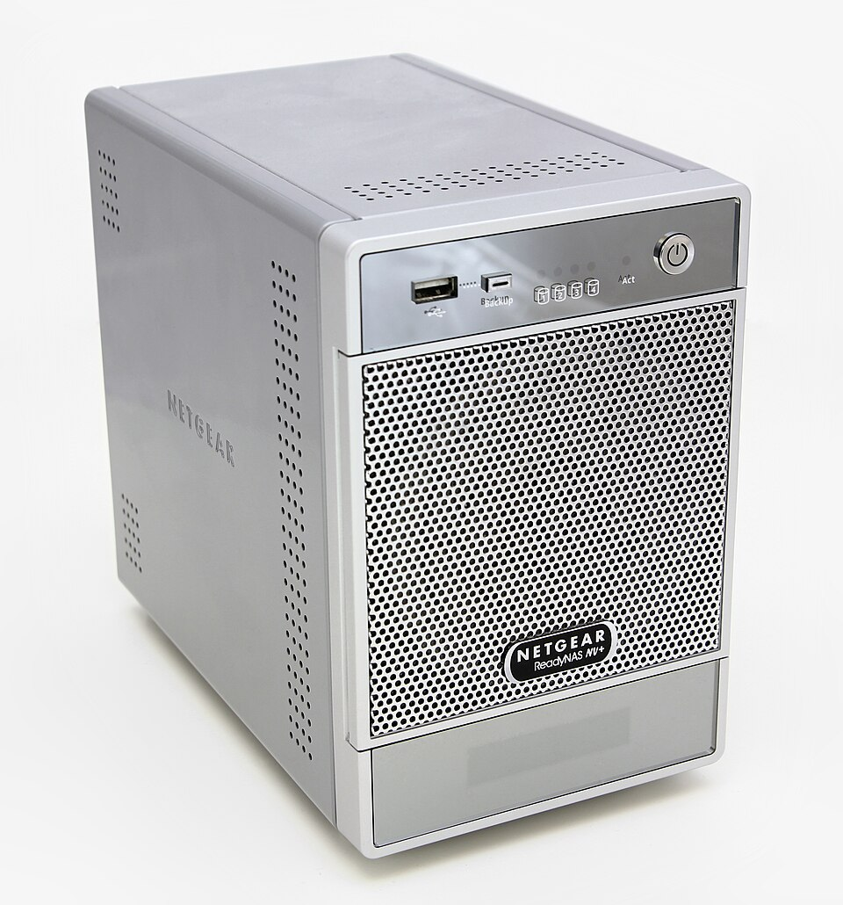
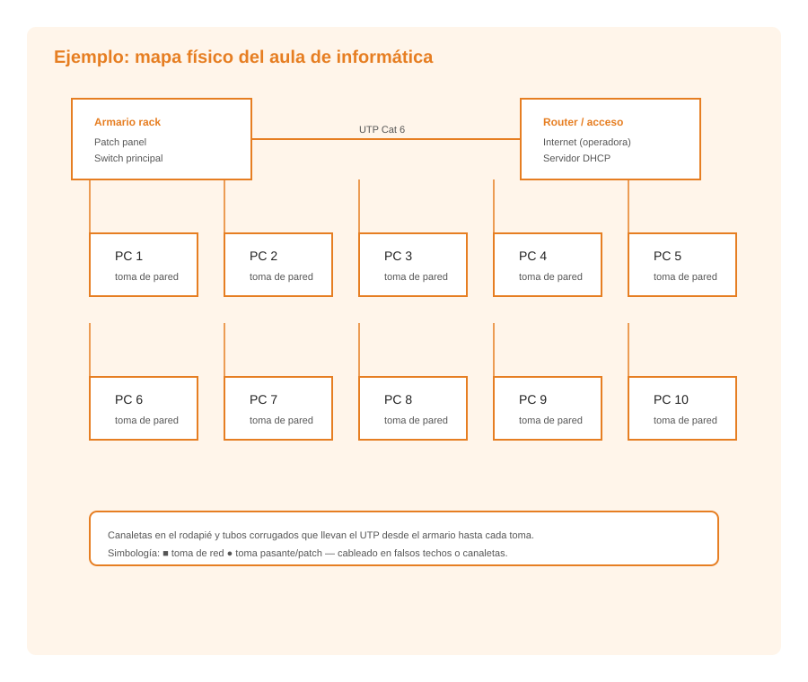

# UD6: Crimpado de Conectores RJ-45 (T568A/T568B), Latiguillos y Comprobación con Tester

Bienvenido/a a la **UD6: Crimpado de Conectores RJ-45 (T568A/T568B), Latiguillos y Comprobación con Tester** del módulo profesional de **Instalación y Mantenimiento de Redes para Transmisión de Datos (Networking Essentials)** (2º FPB · Instalación y Mantenimiento de Redes (IMX / NE)).

En esta unidad encontrarás los contenidos teóricos, ejemplos prácticos, ejercicios resueltos y actividades de evaluación curricular desarrollados por el profesor **Manuel Alonso Argente**.

---

### 📑 Índice de Apartados y Actividades de la Unidad

- [**📋 6.0 Propuesta Didáctica: Dispositivos e interpretación de redes locales**](./ut0600.html)
- [**6.1 Elementos de la red local y su función**](./ut0601.html)
- [**6.2 El mapa físico de la red local: interpretación y representación**](./ut0602.html)

---

# 📖 Vista Completa de la Unidad

## 6.0 Propuesta Didáctica — Dispositivos e interpretación de redes locales

# **Dispositivos e interpretación de redes locales**

## **Propuesta didáctica**

En esta unidad continuamos trabajando el RA5: **Realiza operaciones básicas de configuración en redes locales cableadas relacionándolas con sus aplicaciones**.

## **Criterios de evaluación**

### **Respecto al RA5:**

| Código | Descripción | Peso (%) | Herramientas Evaluación |
| --- | --- | --- | --- |
| **CE5c** | Se han reconocido los elementos de la red local identificándolos con su función | 75% | ACT101 (5%) -- EXA106 (95%) |
| **CE5e** | Se ha interpretado el mapa físico de la red local | 25% | ACT102 (5%) -- EXA106 (95%) |

## **Contenidos**

### **Elementos de la red local y su función:**

- Tarjeta de red (NIC): función y características.

- Switch (conmutador): funcionamiento, tipos de switch (capa 2 y capa 3).

- Router (enrutador): función y tabla de enrutamiento.

- Punto de acceso inalámbrico (AP).

- Servidores: ficheros, impresión, correo, web, DHCP, DNS, dominio.

- Cableado estructurado: tomas de red, paneles de parcheo, armarios, canaletas y cables de parcheo (elementos de la infraestructura, vistos en UP04).

- Medios de almacenamiento compartido: NAS y SAN.

### **El mapa físico de la red local:**

- Concepto de mapa físico. Elementos que lo componen.

- Diferencia entre mapa físico y mapa lógico.

- Simbología estándar para la representación de redes.

- Interpretación de planos de cableado estructurado: rack, paneles de parcheo, canaletas, tomas de red.

> **📌 Cuestionario inicial**
> 

> 1. ¿Qué es un switch y qué función tiene en una red local?

> 1. ¿Qué diferencia hay entre un switch y un router?

> 1. ¿Qué elementos de hardware componen una red local?

> 1. ¿Qué es un mapa físico de red y qué información contiene?

> 1. ¿Qué diferencia hay entre un mapa físico y un mapa lógico?

## **Programación de Aula (14 h)**

Esta unidad se imparte en la segunda evaluación, con una duración estimada de **7 sesiones lectivas de 2 h** (14 h), durante los días que se indican en el calendario.

### **Distribución de horas por contenido**

| Contenido | Sesiones | Horas |
| --- | --- | --- |
| 6.1 Elementos de la red local y su función: UP6.1 | 4 | 8 |
| 6.2 El mapa físico de la red local: UP6.2 | 3 | 6 |
| **Total** | **7** | **14** |

### **Sesiones**

| Sesión | Contenidos | Actividades | Criterios trabajados |
| --- | --- | --- | --- |
| 1 | Elementos de la red local y su función |  | CE5c |
| 2 | Elementos de la red local y su función |  | CE5c |
| 3 | Elementos de la red local y su función | ACT101 | CE5c |
| 4 | Elementos de la red local y su función |  | CE5c |
| 5 | El mapa físico de la red local |  | CE5e |
| 6 | El mapa físico de la red local | ACT102 | CE5e |
| 7 | Actividades de refuerzo y evaluación | **EXA106** | CE5c - CE5e |

---

## 6.1 Elementos de la red local y su función

# **Elementos de la red local y su función**

Una red local está formada por un conjunto de dispositivos y componentes que trabajan conjuntamente para permitir la comunicación y el intercambio de datos. En este tema analizaremos los elementos que componen una red local, identificando la función de cada uno.

## **Elementos de hardware de la red local**

### **Tarjeta de red (NIC - Network Interface Card)**

Es el componente hardware que permite a un ordenador conectarse a una red. Puede integrarse en la placa base (tarjeta de red integrada) o ser una tarjeta externa (PCI, PCIe, USB).

- **Función principal**: convertir los datos del ordenador en señales que se transmiten por el medio de red y viceversa.

- Cada tarjeta de red tiene una dirección MAC única asignada por el fabricante.

- Puede ser cableada (puerto Ethernet RJ-45) o inalámbrica (antena Wi-Fi).

### **Switch (conmutador)**

Es el equipo central de una red de estrella cableada. Se encarga de reenviar las tramas de datos únicamente al puerto de destino, basándose en la dirección MAC de los dispositivos conectados.

- **Función principal**: interconectar dispositivos dentro de una misma red local de forma inteligente.

- Aprende las direcciones MAC de los dispositivos conectados a cada puerto y crea una tabla de direcciones.

- Cuando recibe una trama, solo la envía al puerto donde se encuentra el destinatario, lo que reduce el tráfico innecesario.

- Puede tener entre 5 y 48 puertos (o más en entornos empresariales).

**Tipos de switch:**
- **Switch de capa 2**: opera con direcciones MAC; se utiliza en redes locales simples.
- **Switch de capa 3 (switch multiprotocolo)**: además de conmutar tramas, puede enrutar paquetes entre subredes.

### **Router (enrutador)**

Es el equipo que conecta redes diferentes entre sí. Su función principal es decidir la mejor ruta para enviar los paquetes de datos desde la red de origen hasta la red de destino.

- **Función principal**: enrutar tráfico entre redes distintas (por ejemplo, entre una LAN y Internet).

- Utiliza las direcciones IP para tomar decisiones de enrutamiento.

- Mantiene una tabla de enrutamiento con las rutas disponibles hacia distintas redes.

- En un entorno doméstico, el router proporciona acceso a Internet y actúa como punto de acceso Wi-Fi.

**Diferencia entre switch y router:**
- El **switch** conecta dispositivos dentro de una misma red (mismo segmento de red).
- El **router** conecta redes diferentes (distintos segmentos de red).

### **Punto de acceso inalámbrico (AP - Access Point)**

Es un dispositivo que permite que dispositivos con tarjeta Wi-Fi se conecten a una red cableada. Actúa como puente entre la red inalámbrica y la red cableada.

- **Función principal**: proporcionar conectividad inalámbrica a la red local.

- Emite una señal de radio que los dispositivos pueden detectar y a la que pueden asociarse.

- Se conecta al switch o router mediante cable Ethernet.

### **Servidor**

Es un ordenador potente dedicado a proporcionar servicios y recursos a los demás dispositivos de la red (clientes). Puede ser físico o virtual.

**Tipos de servidores más comunes:**
- **Servidor de ficheros**: almacena y gestiona ficheros compartidos.
- **Servidor de impresión**: gestiona las colas de impresión y los permisos de uso.
- **Servidor de correo**: gestiona el envío y recepción de correos electrónicos.
- **Servidor web**: aloja páginas web y las sirve a los navegadores.
- **Servidor DHCP**: asigna direcciones IP automáticamente a los dispositivos de la red.
- **Servidor DNS**: resuelve nombres de dominio en direcciones IP.
- **Servidor de dominio (Active Directory)**: gestiona usuarios, grupos y políticas de seguridad.

### **Cableado estructurado**

Es el conjunto de cables, conectores, tomas de red, paneles de parcheo y elementos de distribución que forman la infraestructura física de una red local: tomas de red, paneles de parcheo, armario de telecomunicaciones (rack), canaletas y cables de parcheo.

> **📌 Ampliación en UP04**
> 

> Los elementos de la infraestructura física (canalizaciones, cajas de registro, armarios, racks, tomas de usuario y paneles de parcheo) se estudian con detalle en la UP04 – Elementos de una instalación de red.

### **Medios de almacenamiento compartido**

- **NAS (Network Attached Storage)**: dispositivo de almacenamiento conectado directamente a la red que proporciona acceso centralizado a ficheros.

- **SAN (Storage Area Network)**: red de alta velocidad dedicada exclusivamente al almacenamiento.

---

## 6.2 El mapa físico de la red local: interpretación y representación

# **El mapa físico de la red local: interpretación y representación**

El mapa físico de una red local es un documento técnico que muestra la ubicación y distribución de todos los componentes físicos de la infraestructura de red: cableado, equipos, tomas de red, armarios de telecomunicaciones y cualquier elemento que forme parte de la red. Es una herramienta fundamental para la planificación, instalación y mantenimiento de la red.

## **¿Qué es un mapa físico de red?**

Un mapa físico de red es un diagrama que representa gráficamente la disposición física de los elementos de una red local dentro de un edificio o conjunto de edificios. A diferencia del mapa lógico, que muestra cómo se comunican los dispositivos (direcciones IP, subredes, protocolos), el mapa físico se centra en la ubicación y distribución espacial de los componentes.

### **Información que contiene un mapa físico**

- Ubicación de las salas de telecomunicaciones y armarios de red (racks).

- Recorrido de los cables por el edificio (canaletas, conductos, tuberías).

- Ubicación de las tomas de red en cada estancia.

- Distribución de los paneles de parcheo en los racks.

- Ubicación de los switches, routers y servidores.

- Número de puntos de red en cada zona.

- Referencia a los planos arquitectónicos del edificio.

- Codificación de cada punto de red (número de identificación).

- Distancias y longitudes de los tramos de cable.

### **Diferencia entre mapa físico y mapa lógico**

| Aspecto | Mapa físico | Mapa lógico |
| --- | --- | --- |
| Qué muestra | Ubicación de componentes físicos | Flujo de datos y configuración de red |
| Cableado | Ruta física de los cables | Segmentos de red, subredes |
| Equipos | Rack, switch, toma de red | Direcciones IP, VLAN, dominios |
| Uso principal | Instalación y mantenimiento | Configuración y resolución de problemas |
| Ejemplo | "El cable Cat 6 va desde el rack de la planta 1 hasta la toma 14 de la sala 3" | "El PC de la sala 3 tiene la IP 192.168.1.14 y pertenece a la VLAN 10" |

## **Simbología estándar para la representación de redes**

Para que los mapas físicos de red sean comprensibles por cualquier técnico, se utilizan símbolos estandarizados. Estos símbolos representan los distintos componentes de la red.

### **Símbolos principales**

| Símbolo | Elemento representado | Descripción |
| --- | --- | --- |
| Rectángulo con diagonal | Servidor | Equipo que proporciona servicios a la red |
| Rombo | Router | Equipo que enruta tráfico entre redes |
| Rectángulo con líneas horizontales | Switch | Equipo que conmuta tramas en una red local |
| Triángulo | Punto de acceso inalámbrico | Dispositivo que proporciona conectividad Wi-Fi |
| Círculo con cruz | Punto de red (toma) | Conector Ethernet en la pared |
| Línea continua | Cable de par trenzado | Cable UTP/STP de cobre |
| Línea discontinua | Cable de fibra óptica | Cable de vidrio o plástico |
| Rectángulo pequeño | Panel de parcheo | Panel con múltiples conectores Ethernet |
| Rectángulo con "R" | Rack de telecomunicaciones | Estructura metálica para equipos |
| Cuadrado con "S" | Servidor de impresión | Servidor dedicado a impresión |
| Cuadrado con "P" | Impresora compartida | Dispositivo de impresión en red |

Estos símbolos pueden variar ligeramente según la herramienta de diagramación utilizada o la normativa de la empresa, pero los conceptos fundamentales son universales.

## **Interpretación de un mapa físico de red**

Para interpretar correctamente un mapa físico de red es necesario seguir una serie de pasos y prestar atención a los siguientes aspectos:

### **1. Identificación de las salas de telecomunicaciones**

El primer paso es localizar las salas o armarios donde se alojan los equipos centrales de red (switches, routers, servidores, paneles de parcheo). Estas salas suelen estar identificadas con un código (por ejemplo, "Rack P1-01" para el primer rack de la planta 1).

### **2. Seguimiento del cableado**

Se debe trazar el recorrido del cableado desde el rack hasta cada punto de red. El mapa debe indicar:
- El tipo de cable utilizado en cada tramo (Cat 6, fibra óptica multimodo, etc.).
- La longitud del tramo.
- Las canaletas o conductos utilizados.
- Los puntos de paso (cajas de registro, bajantes).

### **3. Identificación de los puntos de red**

Cada toma de red tiene un número de identificación único. Este número se repite en el panel de parcheo correspondiente, lo que permite establecer la relación entre la toma en la pared y el puerto del switch.

### **4. Ubicación de los equipos de red**

Es fundamental identificar la ubicación exacta de cada switch, router y servidor, así como los puertos que utilizan para conectarse al cableado estructurado.

### **5. Codificación y numeración**

Los mapas físicos utilizan sistemas de codificación para identificar cada componente:
- **Planta/Punto**: por ejemplo, "P1-T05" indica planta 1, toma 05.
- **Rack/Puerto**: por ejemplo, "R01-S03-P24" indica rack 1, switch 3, puerto 24.
- **Cable**: cada cable puede tener una etiqueta con un código alfanumérico que indica sus extremos.

## **Representación del mapa físico de red**

### **Niveles de detalle**

Un mapa físico de red puede representarse con diferentes niveles de detalle:

1. **Plano general del edificio**: muestra la distribución general de las plantas, las salas de telecomunicaciones y las rutas principales de cableado.

1. **Plano de planta**: muestra la ubicación de las tomas de red, las canaletas y los equipos en una planta concreta.

1. **Detalle del rack**: muestra la distribución de los equipos (switches, paneles de parcheo, servidores) dentro de un armario de telecomunicaciones.

### **Elementos que deben incluirse**

- Plano arquitectónico del edificio como base.

- Ubicación de los racks y armarios de red.

- Ruta del cableado horizontal (desde el rack hasta las tomas).

- Ruta del cableado vertical (entre plantas, bajantes).

- Número y tipo de puntos de red en cada zona.

- Etiquetado de todos los cables y puntos de red.

- Leyenda de símbolos utilizados.

### **Ejemplo de interpretación práctica**

Supongamos un edificio de tres plantas con un rack en cada planta:

- **Planta 1**: rack P1-01 con un switch de 24 puertos, 20 tomas de red distribuidas en 4 oficinas (5 tomas por oficina).

- **Planta 2**: rack P2-01 con un switch de 24 puertos, 18 tomas de red distribuidas en 3 aulas.

- **Planta 3**: rack P3-01 con un switch de 12 puertos, 10 tomas de red en la sala de profesores.

Los racks se interconectan mediante un cable de fibra óptica multimodo que discurre por la bajante central del edificio. El router de acceso a Internet se encuentra en el rack P1-01 de la planta 1, que actúa como punto de conexión con el proveedor de servicios.

Este tipo de información permite al técnico localizar rápidamente cualquier componente, diagnosticar fallos y planificar ampliaciones de la red.
