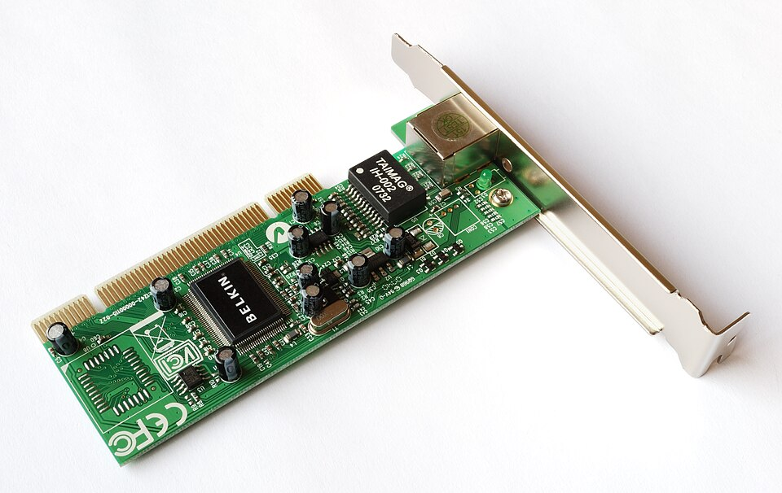
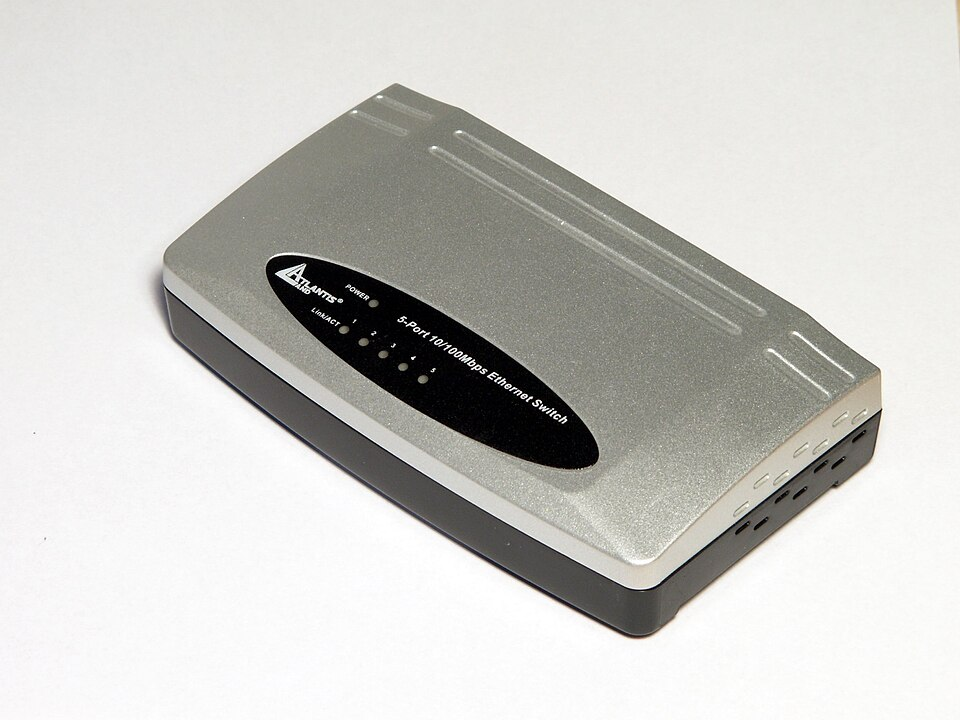
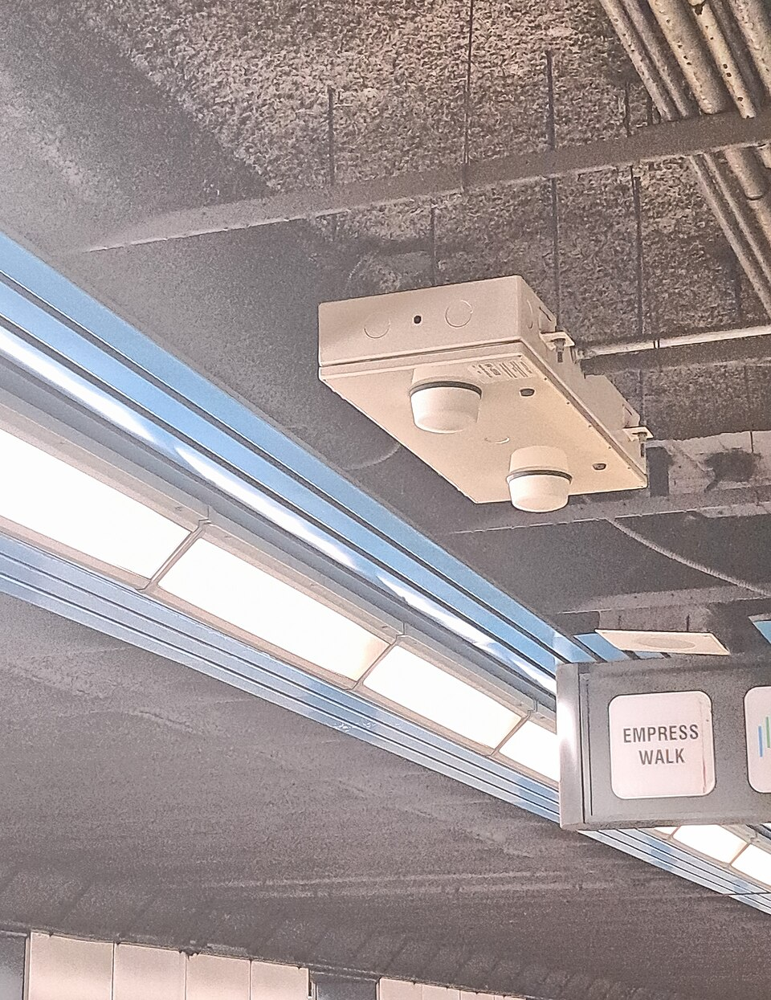
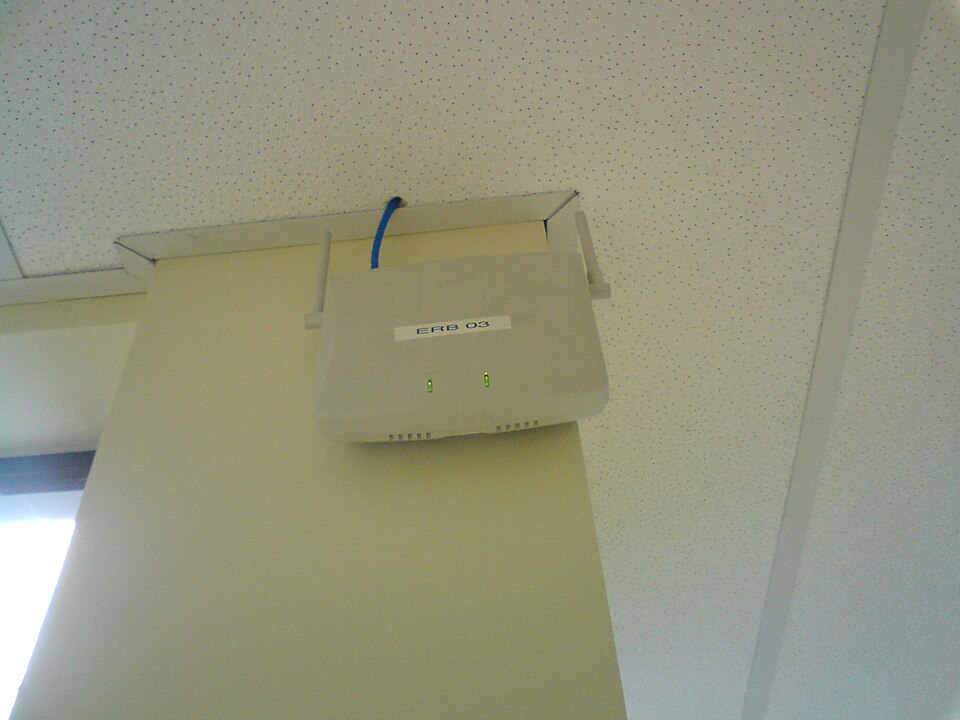
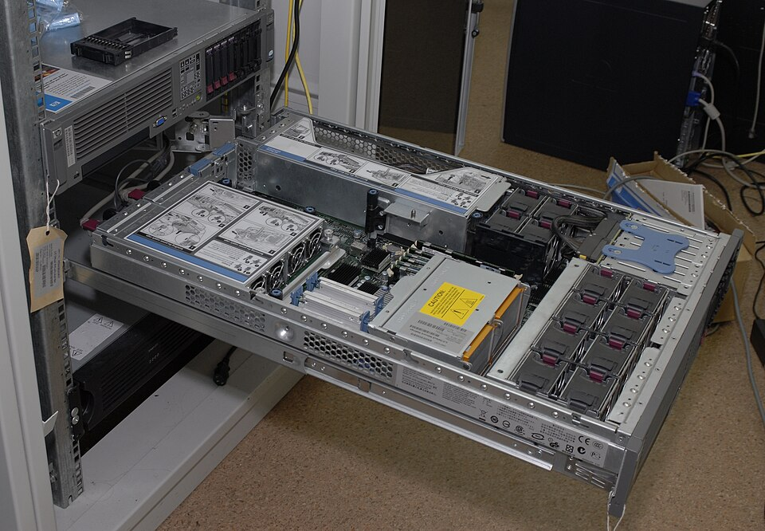
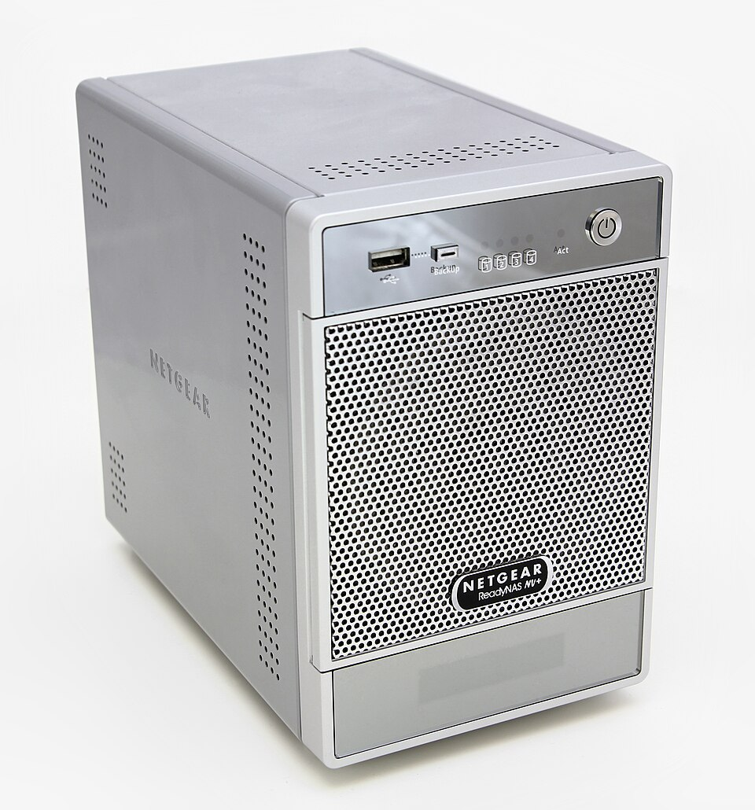

# **Elementos de la red local y su función**

Una red local está formada por un conjunto de dispositivos y componentes que trabajan conjuntamente para permitir la comunicación y el intercambio de datos. En este tema analizaremos los elementos que componen una red local, identificando la función de cada uno.

## **Elementos de hardware de la red local**

### **Tarjeta de red (NIC - Network Interface Card)**

Es el componente hardware que permite a un ordenador conectarse a una red. Puede integrarse en la placa base (tarjeta de red integrada) o ser una tarjeta externa (PCI, PCIe, USB).

- **Función principal**: convertir los datos del ordenador en señales que se transmiten por el medio de red y viceversa.

- Cada tarjeta de red tiene una dirección MAC única asignada por el fabricante.

- Puede ser cableada (puerto Ethernet RJ-45) o inalámbrica (antena Wi-Fi).

### **Switch (conmutador)**

Es el equipo central de una red de estrella cableada. Se encarga de reenviar las tramas de datos únicamente al puerto de destino, basándose en la dirección MAC de los dispositivos conectados.

- **Función principal**: interconectar dispositivos dentro de una misma red local de forma inteligente.

- Aprende las direcciones MAC de los dispositivos conectados a cada puerto y crea una tabla de direcciones.

- Cuando recibe una trama, solo la envía al puerto donde se encuentra el destinatario, lo que reduce el tráfico innecesario.

- Puede tener entre 5 y 48 puertos (o más en entornos empresariales).

**Tipos de switch:**
- **Switch de capa 2**: opera con direcciones MAC; se utiliza en redes locales simples.
- **Switch de capa 3 (switch multiprotocolo)**: además de conmutar tramas, puede enrutar paquetes entre subredes.

### **Router (enrutador)**

Es el equipo que conecta redes diferentes entre sí. Su función principal es decidir la mejor ruta para enviar los paquetes de datos desde la red de origen hasta la red de destino.

- **Función principal**: enrutar tráfico entre redes distintas (por ejemplo, entre una LAN y Internet).

- Utiliza las direcciones IP para tomar decisiones de enrutamiento.

- Mantiene una tabla de enrutamiento con las rutas disponibles hacia distintas redes.

- En un entorno doméstico, el router proporciona acceso a Internet y actúa como punto de acceso Wi-Fi.

**Diferencia entre switch y router:**
- El **switch** conecta dispositivos dentro de una misma red (mismo segmento de red).
- El **router** conecta redes diferentes (distintos segmentos de red).

### **Punto de acceso inalámbrico (AP - Access Point)**

Es un dispositivo que permite que dispositivos con tarjeta Wi-Fi se conecten a una red cableada. Actúa como puente entre la red inalámbrica y la red cableada.

- **Función principal**: proporcionar conectividad inalámbrica a la red local.

- Emite una señal de radio que los dispositivos pueden detectar y a la que pueden asociarse.

- Se conecta al switch o router mediante cable Ethernet.

### **Servidor**

Es un ordenador potente dedicado a proporcionar servicios y recursos a los demás dispositivos de la red (clientes). Puede ser físico o virtual.

**Tipos de servidores más comunes:**
- **Servidor de ficheros**: almacena y gestiona ficheros compartidos.
- **Servidor de impresión**: gestiona las colas de impresión y los permisos de uso.
- **Servidor de correo**: gestiona el envío y recepción de correos electrónicos.
- **Servidor web**: aloja páginas web y las sirve a los navegadores.
- **Servidor DHCP**: asigna direcciones IP automáticamente a los dispositivos de la red.
- **Servidor DNS**: resuelve nombres de dominio en direcciones IP.
- **Servidor de dominio (Active Directory)**: gestiona usuarios, grupos y políticas de seguridad.

### **Cableado estructurado**

Es el conjunto de cables, conectores, tomas de red, paneles de parcheo y elementos de distribución que forman la infraestructura física de una red local: tomas de red, paneles de parcheo, armario de telecomunicaciones (rack), canaletas y cables de parcheo.

> **📌 Ampliación en UP04**
> 

> Los elementos de la infraestructura física (canalizaciones, cajas de registro, armarios, racks, tomas de usuario y paneles de parcheo) se estudian con detalle en la UP04 – Elementos de una instalación de red.

### **Medios de almacenamiento compartido**

- **NAS (Network Attached Storage)**: dispositivo de almacenamiento conectado directamente a la red que proporciona acceso centralizado a ficheros.

- **SAN (Storage Area Network)**: red de alta velocidad dedicada exclusivamente al almacenamiento.

