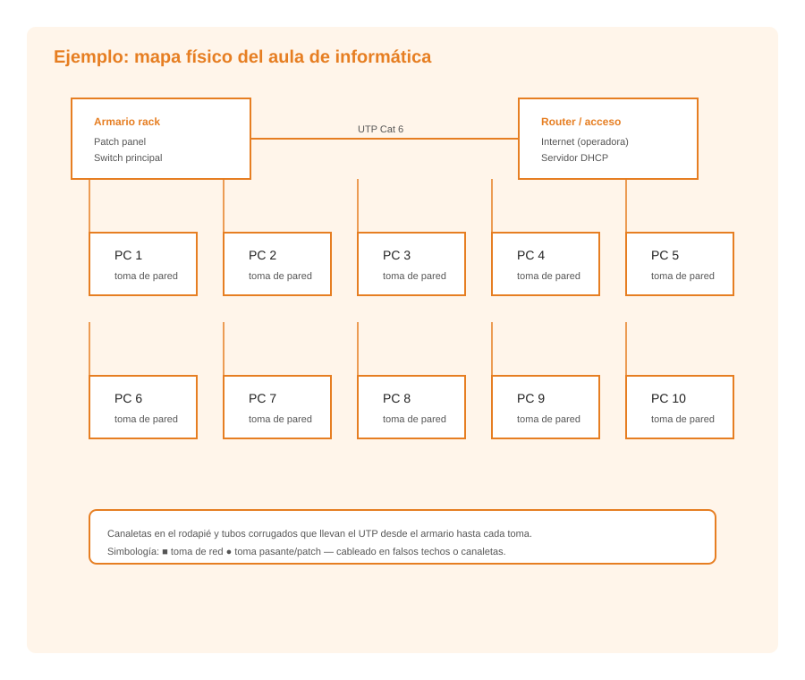

# **El mapa físico de la red local: interpretación y representación**

El mapa físico de una red local es un documento técnico que muestra la ubicación y distribución de todos los componentes físicos de la infraestructura de red: cableado, equipos, tomas de red, armarios de telecomunicaciones y cualquier elemento que forme parte de la red. Es una herramienta fundamental para la planificación, instalación y mantenimiento de la red.

## **¿Qué es un mapa físico de red?**

Un mapa físico de red es un diagrama que representa gráficamente la disposición física de los elementos de una red local dentro de un edificio o conjunto de edificios. A diferencia del mapa lógico, que muestra cómo se comunican los dispositivos (direcciones IP, subredes, protocolos), el mapa físico se centra en la ubicación y distribución espacial de los componentes.

### **Información que contiene un mapa físico**

- Ubicación de las salas de telecomunicaciones y armarios de red (racks).

- Recorrido de los cables por el edificio (canaletas, conductos, tuberías).

- Ubicación de las tomas de red en cada estancia.

- Distribución de los paneles de parcheo en los racks.

- Ubicación de los switches, routers y servidores.

- Número de puntos de red en cada zona.

- Referencia a los planos arquitectónicos del edificio.

- Codificación de cada punto de red (número de identificación).

- Distancias y longitudes de los tramos de cable.

### **Diferencia entre mapa físico y mapa lógico**

| Aspecto | Mapa físico | Mapa lógico |
| --- | --- | --- |
| Qué muestra | Ubicación de componentes físicos | Flujo de datos y configuración de red |
| Cableado | Ruta física de los cables | Segmentos de red, subredes |
| Equipos | Rack, switch, toma de red | Direcciones IP, VLAN, dominios |
| Uso principal | Instalación y mantenimiento | Configuración y resolución de problemas |
| Ejemplo | "El cable Cat 6 va desde el rack de la planta 1 hasta la toma 14 de la sala 3" | "El PC de la sala 3 tiene la IP 192.168.1.14 y pertenece a la VLAN 10" |

## **Simbología estándar para la representación de redes**

Para que los mapas físicos de red sean comprensibles por cualquier técnico, se utilizan símbolos estandarizados. Estos símbolos representan los distintos componentes de la red.

### **Símbolos principales**

| Símbolo | Elemento representado | Descripción |
| --- | --- | --- |
| Rectángulo con diagonal | Servidor | Equipo que proporciona servicios a la red |
| Rombo | Router | Equipo que enruta tráfico entre redes |
| Rectángulo con líneas horizontales | Switch | Equipo que conmuta tramas en una red local |
| Triángulo | Punto de acceso inalámbrico | Dispositivo que proporciona conectividad Wi-Fi |
| Círculo con cruz | Punto de red (toma) | Conector Ethernet en la pared |
| Línea continua | Cable de par trenzado | Cable UTP/STP de cobre |
| Línea discontinua | Cable de fibra óptica | Cable de vidrio o plástico |
| Rectángulo pequeño | Panel de parcheo | Panel con múltiples conectores Ethernet |
| Rectángulo con "R" | Rack de telecomunicaciones | Estructura metálica para equipos |
| Cuadrado con "S" | Servidor de impresión | Servidor dedicado a impresión |
| Cuadrado con "P" | Impresora compartida | Dispositivo de impresión en red |

Estos símbolos pueden variar ligeramente según la herramienta de diagramación utilizada o la normativa de la empresa, pero los conceptos fundamentales son universales.

## **Interpretación de un mapa físico de red**

Para interpretar correctamente un mapa físico de red es necesario seguir una serie de pasos y prestar atención a los siguientes aspectos:

### **1. Identificación de las salas de telecomunicaciones**

El primer paso es localizar las salas o armarios donde se alojan los equipos centrales de red (switches, routers, servidores, paneles de parcheo). Estas salas suelen estar identificadas con un código (por ejemplo, "Rack P1-01" para el primer rack de la planta 1).

### **2. Seguimiento del cableado**

Se debe trazar el recorrido del cableado desde el rack hasta cada punto de red. El mapa debe indicar:
- El tipo de cable utilizado en cada tramo (Cat 6, fibra óptica multimodo, etc.).
- La longitud del tramo.
- Las canaletas o conductos utilizados.
- Los puntos de paso (cajas de registro, bajantes).

### **3. Identificación de los puntos de red**

Cada toma de red tiene un número de identificación único. Este número se repite en el panel de parcheo correspondiente, lo que permite establecer la relación entre la toma en la pared y el puerto del switch.

### **4. Ubicación de los equipos de red**

Es fundamental identificar la ubicación exacta de cada switch, router y servidor, así como los puertos que utilizan para conectarse al cableado estructurado.

### **5. Codificación y numeración**

Los mapas físicos utilizan sistemas de codificación para identificar cada componente:
- **Planta/Punto**: por ejemplo, "P1-T05" indica planta 1, toma 05.
- **Rack/Puerto**: por ejemplo, "R01-S03-P24" indica rack 1, switch 3, puerto 24.
- **Cable**: cada cable puede tener una etiqueta con un código alfanumérico que indica sus extremos.

## **Representación del mapa físico de red**

### **Niveles de detalle**

Un mapa físico de red puede representarse con diferentes niveles de detalle:

1. **Plano general del edificio**: muestra la distribución general de las plantas, las salas de telecomunicaciones y las rutas principales de cableado.

1. **Plano de planta**: muestra la ubicación de las tomas de red, las canaletas y los equipos en una planta concreta.

1. **Detalle del rack**: muestra la distribución de los equipos (switches, paneles de parcheo, servidores) dentro de un armario de telecomunicaciones.

### **Elementos que deben incluirse**

- Plano arquitectónico del edificio como base.

- Ubicación de los racks y armarios de red.

- Ruta del cableado horizontal (desde el rack hasta las tomas).

- Ruta del cableado vertical (entre plantas, bajantes).

- Número y tipo de puntos de red en cada zona.

- Etiquetado de todos los cables y puntos de red.

- Leyenda de símbolos utilizados.

### **Ejemplo de interpretación práctica**

Supongamos un edificio de tres plantas con un rack en cada planta:

- **Planta 1**: rack P1-01 con un switch de 24 puertos, 20 tomas de red distribuidas en 4 oficinas (5 tomas por oficina).

- **Planta 2**: rack P2-01 con un switch de 24 puertos, 18 tomas de red distribuidas en 3 aulas.

- **Planta 3**: rack P3-01 con un switch de 12 puertos, 10 tomas de red en la sala de profesores.

Los racks se interconectan mediante un cable de fibra óptica multimodo que discurre por la bajante central del edificio. El router de acceso a Internet se encuentra en el rack P1-01 de la planta 1, que actúa como punto de conexión con el proveedor de servicios.

Este tipo de información permite al técnico localizar rápidamente cualquier componente, diagnosticar fallos y planificar ampliaciones de la red.
