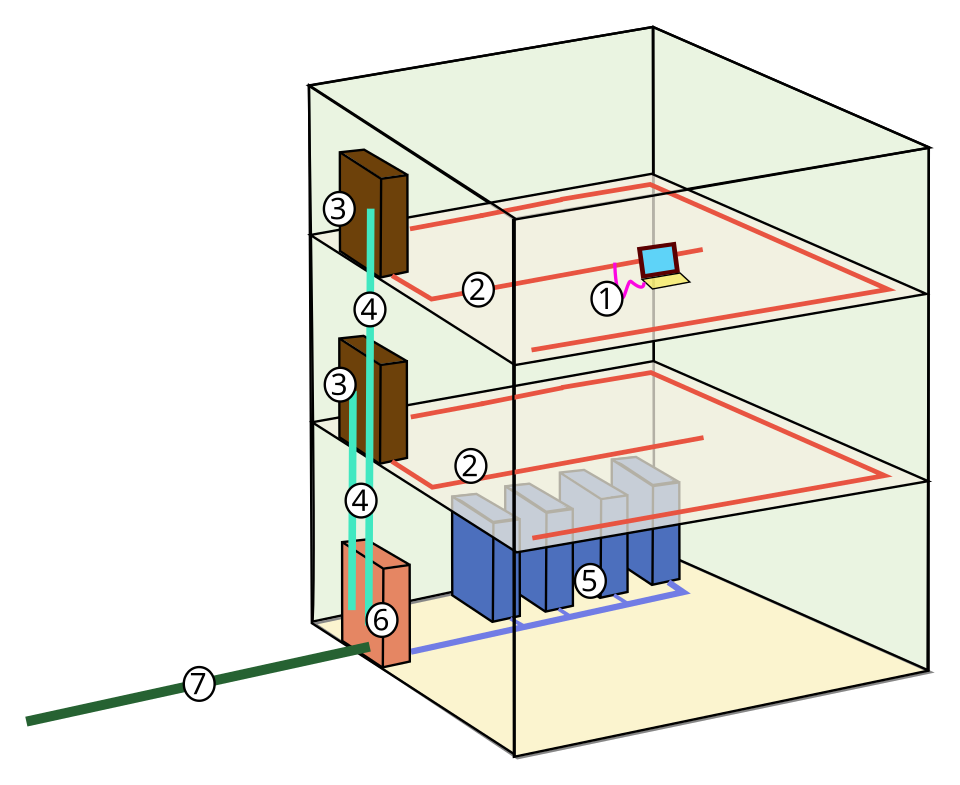
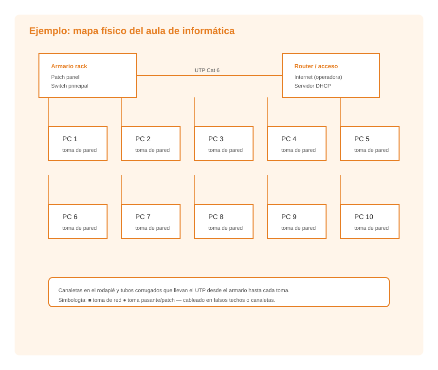

# UD7: Dispositivos de Interconexión de Redes — Switch, Router y Punto de Acceso Wi-Fi

Bienvenido/a a la **UD7: Dispositivos de Interconexión de Redes — Switch, Router y Punto de Acceso Wi-Fi** del módulo profesional de **Instalación y Mantenimiento de Redes para Transmisión de Datos (Networking Essentials)** (2º FPB · Instalación y Mantenimiento de Redes (IMX / NE)).

En esta unidad encontrarás los contenidos teóricos, ejemplos prácticos, ejercicios resueltos y actividades de evaluación curricular desarrollados por el profesor **Manuel Alonso Argente**.

---

### 📑 Índice de Apartados y Actividades de la Unidad

- [**📋 7.0 Propuesta Didáctica: Diseño y representación de redes locales**](./ut0700.html)
- [**7.1 Aplicaciones informáticas para representar el mapa físico de la red local**](./ut0701.html)

---

# 📖 Vista Completa de la Unidad

## 7.0 Propuesta Didáctica — Diseño y representación de redes locales

# **Diseño y representación de redes locales**

## **Propuesta didáctica**

En esta unidad finalizamos el trabajo sobre el RA5: **Realiza operaciones básicas de configuración en redes locales cableadas relacionándolas con sus aplicaciones**.

## **Criterios de evaluación**

### **Respecto al RA5:**

| Código | Descripción | Peso (%) | Herramientas Evaluación |
| --- | --- | --- | --- |
| **CE5f** | Se ha representado el mapa físico de la red local | 40% | ACT101 (5%) -- EXA107 (95%) |
| **CE5g** | Se han utilizado aplicaciones informáticas para representar el mapa físico de la red local | 60% | ACT101 (5%) -- EXA107 (95%) |

## **Contenidos**

### **Representación del mapa físico de la red local:**

- Concepto de mapa físico, simbología estándar y codificación de puntos de red, estudiados en la UP06.

- Protocolo de diseño de un diagrama de red paso a paso.

### **Aplicaciones informáticas para representar el mapa físico:**

- Herramientas de diagramación: Draw.io (diagrams.net), Lucidchart, Microsoft Visio.

- Características principales de cada herramienta.

- Representación de topologías y diagramas de red con software.

- Exportación de los diagramas en diferentes formatos.

> **📌 Cuestionario inicial**
> 

> 1. ¿Qué información contiene un mapa físico de red?

> 1. ¿Qué herramientas informáticas se utilizan para representar el mapa físico de una red?

> 1. ¿Qué es Draw.io y qué ventajas ofrece?

> 1. ¿Cómo se codifican los puntos de red en un plano de cableado estructurado?

> 1. ¿Qué símbolos estándar se utilizan para representar switches, routers y tomas de red?

## **Programación de Aula (12 h)**

Esta unidad se imparte en la segunda evaluación, con una duración estimada de **6 sesiones lectivas de 2 h** (12 h), durante los días que se indican en el calendario.

### **Distribución de horas por contenido**

| Contenido | Sesiones | Horas |
| --- | --- | --- |
| 7.1 Representación del mapa físico: UP7.1 | 2 | 4 |
| 7.2 Aplicaciones informáticas para representar el mapa físico: UP7.1 | 4 | 8 |
| **Total** | **6** | **12** |

### **Sesiones**

| Sesión | Contenidos | Actividades | Criterios trabajados |
| --- | --- | --- | --- |
| 1 | Representación del mapa físico |  | CE5f |
| 2 | Representación del mapa físico |  | CE5f |
| 3 | Aplicaciones informáticas |  | CE5g |
| 4 | Aplicaciones informáticas |  | CE5g |
| 5 | Aplicaciones informáticas | ACT101 | CE5f - CE5g |
| 6 | Actividades de refuerzo y evaluación | **EXA107** | CE5f - CE5g |

---

## 7.1 Aplicaciones informáticas para representar el mapa físico de la red local

# **Aplicaciones informáticas para representar el mapa físico de la red local**

La representación del mapa físico de una red local requiere herramientas de diagramación que permitan crear planos claros, precisos y estandarizados. En este tema veremos las principales aplicaciones disponibles y el proceso paso a paso para diseñar un diagrama de red.

## **Herramientas de diagramación de redes**

### **Draw.io (diagrams.net)**

Draw.io es una herramienta de diagramación gratuita y de código abierto que se utiliza como aplicación web (diagrams.net) o como aplicación de escritorio. Es una de las herramientas más populares para crear diagramas de red, diagramas de flujo y todo tipo de esquemas técnicos.

**Características principales:**
- Gratuita y sin necesidad de registro obligatorio.
- Disponible como aplicación web y como aplicación de escritorio (Windows, macOS, Linux).
- Amplia biblioteca de plantillas y símbolos específicos para redes.
- Permite exportar en múltiples formatos: PNG, SVG, PDF, XML.
- Almacena los diagramas en el navegador, en Google Drive, OneDrive o en本地 (local).
- Soporte para colaboración en tiempo real.

**Cómo acceder:**
- Versión web: https://app.diagrams.net
- Versión de escritorio: descargar desde https://www.drawio.com

**Plantillas de redes disponibles:**
- Network: contiene símbolos específicos para hardware de red (switches, routers, servidores, firewalls, access points).
- Cisco: biblioteca de símbolos compatibles con la notación de Cisco.
- AWS / Azure / Google Cloud: para diagramas de infraestructura en la nube.

### **Lucidchart**

Lucidchart es una herramienta comercial de diagramación en la nube. Ofrece una versión gratuita limitada y versiones de pago con funcionalidades avanzadas.

**Características principales:**
- Interfaz web intuitiva y fácil de usar.
- Amplia biblioteca de formas para redes, organigramas, diagramas de flujo.
- Permite la colaboración en tiempo real entre varios usuarios.
- Integración con Google Workspace, Microsoft Office y otras herramientas.
- Exporta en PNG, PDF, SVG y formato Visio (VSX).

**Limitaciones de la versión gratuita:**
- Número limitado de documentos y formas.
- Funciones de colaboración restringidas.

### **Microsoft Visio**

Visio es la herramienta profesional de Microsoft para la creación de diagramas técnicos. Es la solución más completa y utilizada en entornos empresariales.

**Características principales:**
- Amplia colección de stencils (plantillas de símbolos) para redes, infraestructura IT, planos arquitectónicos.
- Integración completa con el ecosistema Microsoft (Office 365, SharePoint).
- Funciones avanzadas de validación y reglas de diseño.
- Soporte para VBA (Visual Basic for Applications) para automatización.
- Permite vincular datos externos a los diagramas.

**Inconvenientes:**
- Es de pago (suscripción mensual o anual a través de Microsoft 365).
- Solo disponible para Windows (no versión nativa para macOS ni Linux).
- Curva de aprendizaje más pronunciada que herramientas gratuitas.

### **Otras herramientas**

| Herramienta | Tipo | Precio | Plataforma |
| --- | --- | --- | --- |
| yEd | Escritorio | Gratuito | Windows, macOS, Linux |
| NetworkNotepad | Escritorio | Gratuito (versión limitada) | Windows |
| NetProbe | Escritorio | Gratuito | Windows |
| CADE | Escritorio | Gratuito | Windows |
| ConceptDraw | Escritorio y web | De pago | Windows, macOS |

## **Proceso de diseño de un diagrama de red paso a paso**

> **📌 Contenidos previos**
> 

> La simbología estándar, la codificación y numeración de los puntos de red y los niveles de detalle de un mapa físico (plano general, plano de planta, detalle del rack) se han estudiado en la UP06 – El mapa físico de la red local.

A continuación se describe el proceso habitual para crear un diagrama de red utilizando Draw.io (diagrams.net), aunque los pasos son similares en cualquier herramienta de diagramación.

### **Paso 1: Definir el alcance del diagrama**

Antes de comenzar a dibujar, es necesario definir qué se va a representar:
- ¿Se trata de un edificio completo o de una sola planta?
- ¿Cuántos dispositivos hay que representar?
- ¿Qué nivel de detalle se necesita (general, planta, rack)?

### **Paso 2: Recopilar información**

Es imprescindible disponer de toda la información técnica antes de empezar:
- Plano arquitectónico del edificio (formato imagen o PDF).
- Número y ubicación de las tomas de red.
- Tipo y ruta del cableado.
- Equipos de red instalados (switches, routers, servidores).
- Direcciones IP y configuración de red (para el mapa lógico asociado).
- Número de plantas, salas y usuarios.

### **Paso 3: Preparar el lienzo**

1. Abrir Draw.io (https://app.diagrams.net).

1. Seleccionar "Crear un diagrama nuevo" o elegir una plantilla de red.

1. Configurar el tamaño del lienzo según el plano que se va a representar.

1. Importar el plano arquitectónico como imagen de fondo (si está disponible).

### **Paso 4: Añadir la biblioteca de símbolos de red**

1. En el panel izquierdo, hacer clic en "Más formas" (More Shapes).

1. Activar la categoría "Network" y, si se desea, "Cisco" u otras bibliotecas.

1. Esto añadirá al panel izquierdo los símbolos de switches, routers, servidores, puntos de acceso, tomas de red, etc.

### **Paso 5: Colocar los equipos principales**

1. Arrastrar los símbolos de los equipos principales al lienzo: rack, switch, router, servidor.

1. Colocarlos en su ubicación aproximada sobre el plano.

1. Añadir etiquetas con identificadores claros (por ejemplo, "Switch P1-01", "Router principal").

### **Paso 6: Dibujar el cableado**

1. Utilizar líneas para representar los cables que conectan los equipos.

1. Distinguir visualmente los tipos de cable (por ejemplo, línea continua para par trenzado, línea discontinua para fibra óptica).

1. Etiquetar cada cable con su identificador y tipo.

1. Indicar la longitud de los tramos cuando sea relevante.

### **Paso 7: Representar los puntos de red**

1. Colocar los símbolos de las tomas de red en su ubicación sobre el plano.

1. Etiquetar cada toma siguiendo la **codificación de puntos** de red vista en UP06 (por ejemplo, "P1-T05").

1. Relacionar visualmente cada toma con el puerto del switch correspondiente (mediante etiquetas o colores).

### **Paso 8: Añadir la leyenda y la información complementaria**

1. Incluir una leyenda que explique los símbolos utilizados.

1. Añadir un cuadro de información con: título del plano, fecha de elaboración, autor, escala (si aplica), revisión.

1. Incluir notas con información adicional relevante.

### **Paso 9: Revisar y validar**

1. Verificar que todos los equipos están representados y correctamente etiquetados.

1. Comprobar que el cableado está completo y bien representado.

1. Revisar la legibilidad del diagrama: colores, tamaños, etiquetas.

1. Validar que la información del mapa coincide con la realidad de la instalación.

### **Paso 10: Exportar y archivar**

1. Exportar el diagrama en formato PDF o PNG para su distribución.

1. Guardar el archivo fuente en formato nativo de la herramienta (formato .drawio para Draw.io).

1. Almacenar el documento en la carpeta correspondiente del proyecto de red.

## **Buenas prácticas en la representación de mapas físicos**

- **Utilizar los símbolos de la biblioteca de la herramienta**: representan los componentes con notación estandarizada (la simbología se estudió en UP06).

- **Mantener el mapa actualizado**: cada cambio en la infraestructura de red debe reflejarse en el mapa.

- **Usar colores de forma coherente**: por ejemplo, verde para cableado de datos, rojo para cableado de alimentación, azul para fibra óptica.

- **Etiquetar todos los puntos de red y cables** con su código de identificación.

- **Incluir la fecha y versión** del documento para facilitar el seguimiento de cambios.

- **Almacenar copias de seguridad** del mapa en formato digital y, si es necesario, en formato impreso.

- **Crear planos al nivel de detalle necesario** (general, planta, rack), tal y como se indica en UP06.
