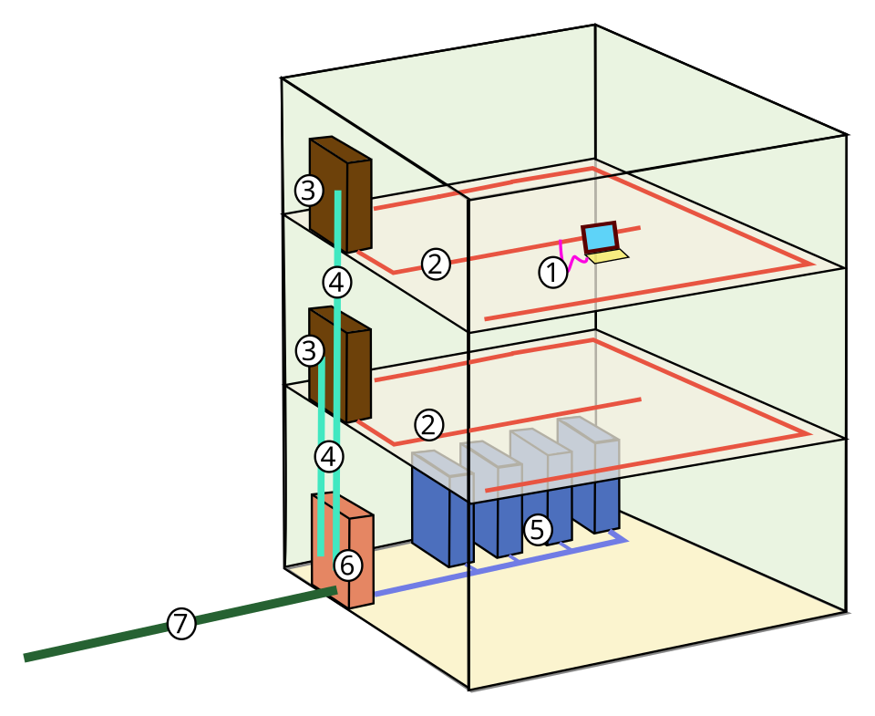
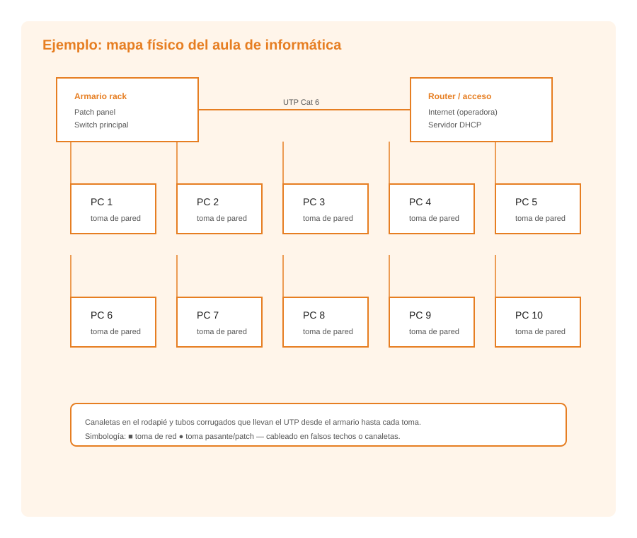

# **Aplicacions informàtiques per a representar el mapa físic de la xarxa local**

  

    🏆 <strong>Progrés d'aquesta secció:</strong> 0 de 4 superats (0%)
    ⭐ <strong>0 punts</strong>
  

  

    

  

La representació del mapa físic d'una xarxa local requereix eines de diagramació que permitan crear plànols clars, precisos i estandarditzats. En aquest tema veurem les principals aplicacions disponibles i el procés pas a pas per a dissenyar un diagrama de xarxa.

## **Eines de diagramació de xarxes**

### **Draw.io (diagrams.net)**

Draw.io és una eina de diagramació gratuïta i de codi obert que s'utilitza com aplicació web (diagrams.net) o com aplicació d'escriptori. És una de les eines més populars per a crear diagrames de xarxa, diagrames de flux i tot tipus d'esquemes tècnics.

**Característiques principals:**
- Gratuïta i sense necessitat de registre obligatori.
- Disponible com aplicació web i com aplicació d'escriptori (Windows, macOS, Linux).
- Àmplia biblioteca de plantilles i símbols específics per a xarxes.
- Permet exportar en múltiples formats: PNG, SVG, PDF, XML.
- Emmagatzema els diagrames en el navegador, en Google Drive, OneDrive o en本地 (local).
- Suport per a col·laboració en temps real.

**Com accedir:**
- Versió web: https://app.diagrams.net
- Versió d'escriptori: descarregar des de https://www.drawio.com

**Plantilles de xarxes disponibles:**
- Network: conté símbols específics per a maquinari de xarxa (switches, routers, servidors, firewalls, access points).
- Cisco: biblioteca de símbols compatibles amb la notació de Cisco.
- AWS / Azure / Google Cloud: per a diagrames d'infraestructura en la núvol.

### **Lucidchart**

Lucidchart és una eina comercial de diagramació en la núvol. Ofereix una versió gratuïta limitada i versions de pagament amb funcionalitats avançades.

**Característiques principals:**
- Interfície web intuitiva i fàcil d'usar.
- Àmplia biblioteca de formes per a xarxes, organigramas, diagrames de flux.
- Permet la col·laboració en temps real entre diversos usuaris.
- Integració amb Google Workspace, Microsoft Office i altres eines.
- Exporta en PNG, PDF, SVG i format Visio (VSX).

**Limitacions de la versió gratuïta:**
- Número limitat de documents i formes.
- Funcions de col·laboració restringides.

### **Microsoft Visio**

Visio és l'eina professional de Microsoft per a la creació de diagrames tècnics. És la solució més completa i utilitzada en entorns empresarials.

**Característiques principals:**
- Àmplia col·lecció de stencils (plantilles de símbols) per a xarxes, infraestructura IT, plànols arquitectónics.
- Integració completa amb l'ecosistema Microsoft (Office 365, SharePoint).
- Funcions avançades de validació i regles de disseny.
- Suport per a VBA (Visual Basic for Applications) per a automatització.
- Permet vincular dades externs als diagrames.

**Inconvenients:**
- És de pagament (suscripció mensual o anual a través de Microsoft 365).
- Només disponible per a Windows (no versió nativa per a macOS ni Linux).
- Curva d'aprenentatge més pronunciada que eines gratuitas.

### **Altres eines**

| Eina | Tipus | Preu | Plataforma |
| --- | --- | --- | --- |
| yEd | Escriptori | Gratuït | Windows, macOS, Linux |
| NetworkNotepad | Escriptori | Gratuït (versió limitada) | Windows |
| NetProbe | Escriptori | Gratuït | Windows |
| CADE | Escriptori | Gratuït | Windows |
| ConceptDraw | Escriptori i web | De pagament | Windows, macOS |

## **Procés de disseny d'un diagrama de xarxa pas a pas**

> **📌 Continguts previos**
> 

> La simbología estàndard, la codificació i numeració dels punts de xarxa i els nivells de detall d'un mapa físic (plànol general, plànol de planta, detall del rack) es han estudiado en la UP06 – El mapa físic de la xarxa local.

A continuació es descriu el procés habitual per a crear un diagrama de xarxa utilitzant Draw.io (diagrams.net), encara que els passos són similars en qualsevol eina de diagramació.

### **Pas 1: Definir l'abast del diagrama**

Abans de començar a dibuixar, és necessari definir què es va a representar:
- Es tracta d'un edifici complet o d'una sola planta?
- Quants dispositius cal representar?
- Quin nivell de detall es necessita (general, planta, rack)?

### **Pas 2: Recopilar informació**

És imprescindible disposar de tota la informació tècnica abans de començar:
- Plànol arquitectónic de l'edifici (format imatge o PDF).
- Número i ubicació de les preses de xarxa.
- Tipus i ruta del cablejat.
- Equips de xarxa instalats (switches, routers, servidors).
- Adreces IP i configuració de xarxa (per al mapa lògic associat).
- Número de plantes, sales i usuaris.

### **Pas 3: Preparar el llenç**

1. Obrir Draw.io (https://app.diagrams.net).

1. Seleccionar "Crear un diagrama nou" o triar una plantilla de xarxa.

1. Configurar el mida del llenç segons el plànol que es va a representar.

1. Importar el plànol arquitectónic com imatge de fons (si està disponible).

### **Pas 4: Afegir la biblioteca de símbols de xarxa**

1. En el panell esquerre, fer clic en "Més formes" (More Shapes).

1. Activar la categoria "Network" i, si es desitja, "Cisco" o altres bibliotecas.

1. Açò añadirá al panell esquerre els símbols de switches, routers, servidors, punts d'accés, preses de xarxa, etc.

### **Pas 5: Col·locar els equips principals**

1. Arrastrar els símbols dels equips principals al llenç: rack, switch, router, servidor.

1. Colocar-los en la seua ubicació aproximada sobre el plànol.

1. Afegir etiquetes amb identificadors clars (per exemple, "Switch P1-01", "Router principal").

### **Pas 6: Dibuixar el cablejat**

1. Utilitzar línies per a representar els cables que connecten els equips.

1. Distingir visualment els tipus de cable (per exemple, línia contínua per a parell trenat, línia discontinua per a fibra òptica).

1. Etiquetar cada cable amb el seu identificador i tipus.

1. Indicar la longitud dels trams quan siga relevante.

### **Pas 7: Representar els punts de xarxa**

1. Col·locar els símbols de les preses de xarxa en la seua ubicació sobre el plànol.

1. Etiquetar cada pren seguint la **codificació de punts** de xarxa vista en UP06 (per exemple, "P1-T05").

1. Relacionar visualment cada pren amb el port del switch corresponent (mitjançant etiquetes o colors).

### **Pas 8: Afegir la leyenda i la informació complementaria**

1. Incloure una leyenda que explique els símbols utilitzats.

1. Afegir un cuadro d'informació amb: títol del plànol, data d'elaboració, autor, escala (si aplica), revisió.

1. Incloure notes amb informació addicional relevante.

### **Pas 9: Revisar i validar**

1. Verificar que tots els equips estan representats i correctament etiquetats.

1. Comprovar que el cablejat està complet i bé representat.

1. Revisar la legibilitat del diagrama: colors, mides, etiquetes.

1. Validar que la informació del mapa coincideix amb la realitat de la instal·lació.

### **Pas 10: Exportar i archivar**

1. Exportar el diagrama en format PDF o PNG per a la seua distribució.

1. Guardar l'arxiu font en format natiu de l'eina (format .drawio per a Draw.io).

1. Emmagatzemar el document en la carpeta corresponent del projecte de xarxa.

## **Bones pràctiques en la representació de mapes físics**

- **Utilitzar els símbols de la biblioteca de l'eina**: representen els components amb notació estandaritzada (la simbología es estudió en UP06).

- **Mantindre el mapa actualitzat**: cada canvi en la infraestructura de xarxa ha de reflejar-se en el mapa.

- **Usar colors de forma coherent**: per exemple, verd per a cablejat de dades, roig per a cablejat d'alimentació, blau per a fibra òptica.

- **Etiquetar tots els punts de xarxa i cables** amb el seu codi d'identificació.

- **Incloure la data i versió** del document per a facilitar el seguiment de canvis.

- **Emmagatzemar còpies de seguretat** del mapa en format digital i, si és necessari, en format impreso.

- **Crear plànols al nivell de detall necessari** (general, planta, rack), tal com es indica en UP06.

---

## 🎮 Reptes Interactius d'Autoavaluació (+100 XP)

Comprova el teu domini sobre **7.1 Aplicacions informàtiques per a representar el mapa físic de la xarxa local** superant aquests 4 reptes gamificats (+25 punts cadascun):

  
🎯 <strong>Repte 1 (+25 pts):</strong> Quina diferència fonamental de funcionament hi ha entre un antic concentrador (<code>Hub</code>) i un commutador (<code>Switch</code>) de Capa 2?

  

    <button type="button" class="btn-mcq-opt" data-opt="A">A) El Hub reenvia el senyal per tots els ports provocant col·lisions, mentre que el Switch aprèn les adreces MAC i envia cada trama només al port del destinatari.</button>
    <button type="button" class="btn-mcq-opt" data-opt="B">B) El Switch no té ports RJ-45.</button>
    <button type="button" class="btn-mcq-opt" data-opt="C">C) El Hub funciona per fibra òptica interplanetària i el Switch no.</button>
    <button type="button" class="btn-mcq-opt" data-opt="D">D) Són exactament el mateix aparell.</button>
  

  

  
🎯 <strong>Repte 2 (+25 pts):</strong> Quin dispositiu d'interconnexió treballa a la Capa 3 (Capa de Xarxa) utilitzant adreces IP per a encaminar paquets entre xarxes diferents (per exemple, entre la LAN i Internet)?

  

    <button type="button" class="btn-mcq-opt" data-opt="A">A) El Router (encaminador).</button>
    <button type="button" class="btn-mcq-opt" data-opt="B">B) El Patch Panel passiu.</button>
    <button type="button" class="btn-mcq-opt" data-opt="C">C) La roseta de paret.</button>
    <button type="button" class="btn-mcq-opt" data-opt="D">D) El tester de continuïtat.</button>
  

  

  
✅ <strong>Repte 3 (Vertader o Fals · +25 pts):</strong> Un Punt d'Accés sense fil (WAP / Access Point) actua com a pont entre la xarxa cablejada Ethernet i els dispositius que es connecten per Wi-Fi.

  

    <button type="button" class="btn-vf" data-opt="V">Vertader (V)</button>
    <button type="button" class="btn-vf" data-opt="F">Fals (F)</button>
  

  

  
⌨️ <strong>Repte 4 (+25 pts):</strong> Quin dispositiu de xarxa de Capa 2 connecta tots els ordinadors d'una aula o planta en topologia d'estrela i filtra les trames per adreça MAC?

  

    <input type="text" class="quiz-input" placeholder="Escriu la resposta..." />
    <button type="button" class="btn-quiz-check">Comprovar</button>
  

  

### 📋 Llista de Comprovació i Rúbrica d'Assoliment

Marca cada criteri a mesura que completes l'estudi o la resolució pràctica d'aquesta pàgina (**7.1 Aplicacions informàtiques per a representar el mapa físic de la xarxa local**):

- [ ] He llegit detingudament la teoria o l'enunciat d'aquesta secció i he anotat els conceptes clau.
- [ ] He revisat els esquemes, taules o blocs de codi i he verificat que sé aplicar-los a l'entorn de treball.
- [ ] He resolt correctament els **4 reptes interactius** superiors obtenint els **100 punts XP**.
- [ ] He descarregat el comprovant oficial en PDF per a adjuntar-lo a la tasca d'**Aules**.

  <h3>📤 Comprovant de Lliurament per a Aules</h3>
  
Quan hages completat els reptes interactius i la llista d'autoavaluació d'aquesta pàgina, introdueix el teu nom i descarrega el teu certificat oficial en PDF per a adjuntar-lo a la tasca d'<strong>Aules</strong>.

  

    <label for="aules-student-name">👤 Nom i Cognoms de l'Alumne/a:</label>
    <input type="text" id="aules-student-name" class="aules-student-name" placeholder="Ex: Joan Garcia Pérez" />
  

  

    0/4 reptes completats (0%) · 0 punts · 0/4 criteris d'autoavaluació
  

  

    <button type="button" class="btn-aules-dl" data-module="IMX" data-unit="UD07" data-activity="ut0701">📥 Descarregar Comprovant PDF</button>
    <button type="button" class="btn-aules-copy">📋 Copiar Resum al Porta-retalls</button>
  

  

