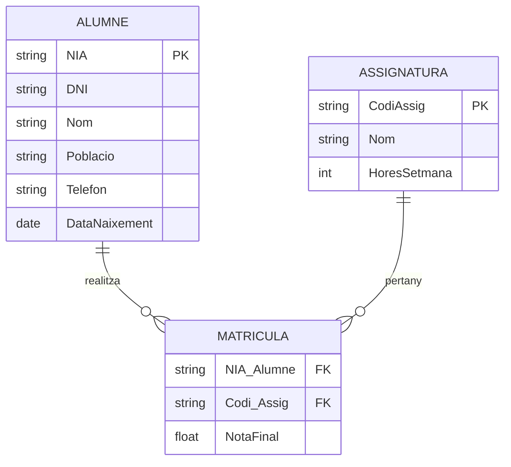

# 📘 UD6 — BDA. Model ENTITAT-RELACIÓ (E-R) (Primera part) (Unitat Completa)

> **💡 Temari Complet de la Unitat**
> Aquesta pàgina integra tots els apartats teòrics de la unitat didàctica en una sola lectura contínua.

## 🧩 Fonaments del Model Entitat-Relació (E-R)

<div style="background: linear-gradient(135deg, #0f172a 0%, #1e293b 100%); border-radius: 12px; padding: 20px; margin: 25px 0; box-shadow: 0 10px 25px -5px rgba(0, 0, 0, 0.3); border: 1px solid #334155;">
  <div style="text-align: center; margin-bottom: 15px;">
    <span style="background: #38bdf8; color: #0f172a; font-weight: 700; font-size: 0.75rem; text-transform: uppercase; letter-spacing: 0.05em; padding: 4px 10px; border-radius: 9999px;">Infografia Tècnica</span>
    <h3 style="color: #f8fafc; margin: 10px 0 5px 0; font-size: 1.25rem;">Model Conceptual Entitat-Relació: Components, Cardinalitats i Notacions</h3>
    <p style="color: #94a3b8; font-size: 0.85rem; margin: 0;">Formalització de requisits d'informació, restriccions d'integritat estructural i comparativa Chen vs Crow's Foot</p>
  </div>
  <svg viewBox="0 0 860 300" width="100%" height="100%" xmlns="http://www.w3.org/2000/svg" style="display: block; font-family: system-ui, -apple-system, sans-serif;">
    <defs>
      <linearGradient id="aofU6EntGrad" x1="0%" y1="0%" x2="100%" y2="100%">
        <stop offset="0%" stop-color="#38bdf8" stop-opacity="0.25"/>
        <stop offset="100%" stop-color="#0284c7" stop-opacity="0.1"/>
      </linearGradient>
      <linearGradient id="aofU6CardGrad" x1="0%" y1="0%" x2="100%" y2="100%">
        <stop offset="0%" stop-color="#a855f7" stop-opacity="0.25"/>
        <stop offset="100%" stop-color="#7e22ce" stop-opacity="0.1"/>
      </linearGradient>
      <linearGradient id="aofU6GrauGrad" x1="0%" y1="0%" x2="100%" y2="100%">
        <stop offset="0%" stop-color="#10b981" stop-opacity="0.25"/>
        <stop offset="100%" stop-color="#047857" stop-opacity="0.1"/>
      </linearGradient>
      <linearGradient id="aofU6NotGrad" x1="0%" y1="0%" x2="100%" y2="100%">
        <stop offset="0%" stop-color="#f59e0b" stop-opacity="0.25"/>
        <stop offset="100%" stop-color="#b45309" stop-opacity="0.1"/>
      </linearGradient>
    </defs>

    <!-- Bloc 1: Entitats i Atributs -->
    <rect x="20" y="20" width="190" height="255" rx="8" fill="url(#aofU6EntGrad)" stroke="#38bdf8" stroke-width="1.5"/>
    <text x="115" y="42" fill="#38bdf8" font-size="10.5" font-weight="bold" text-anchor="middle">📦 ENTITATS I ATRIBUTS</text>
    <text x="115" y="56" fill="#94a3b8" font-size="8.5" text-anchor="middle">Blocs de Construcció</text>
    <line x1="30" y1="63" x2="200" y2="63" stroke="#334155"/>
    <text x="32" y="80" fill="#38bdf8" font-size="8.5">• <tspan font-weight="bold">Entitat (Rectangle):</tspan></text>
    <text x="42" y="93" fill="#cbd5e1" font-size="8">- Objecte real o abstracte</text>
    <text x="42" y="105" fill="#cbd5e1" font-size="8">- Conjunt d'ocurrències</text>
    <text x="32" y="122" fill="#38bdf8" font-size="8.5">• <tspan font-weight="bold">Atributs (El·lipse):</tspan></text>
    <text x="42" y="135" fill="#cbd5e1" font-size="8">- <tspan fill="#fbbf24">Clau Primària (PK)</tspan>: Únic</text>
    <text x="42" y="147" fill="#cbd5e1" font-size="8">- <tspan font-weight="bold">Compost</tspan>: Adreça (carrer, CP)</text>
    <text x="42" y="159" fill="#cbd5e1" font-size="8">- <tspan font-weight="bold">Multivaluat</tspan>: Telèfons (doble línia)</text>
    <text x="42" y="171" fill="#cbd5e1" font-size="8">- <tspan font-weight="bold">Derivat</tspan>: Edat (línia discontínua)</text>
    <rect x="35" y="190" width="160" height="40" rx="4" fill="#0f172a" stroke="#38bdf8" stroke-width="1"/>
    <text x="115" y="206" fill="#f8fafc" font-size="8.5" font-weight="bold" text-anchor="middle">Ex: ALUMNE [NIA, Nom]</text>
    <text x="115" y="220" fill="#94a3b8" font-size="7.5" text-anchor="middle">NIA identifica unívocament</text>
    <text x="115" y="258" fill="#38bdf8" font-size="8.5" text-anchor="middle" font-weight="bold">Identificació Única</text>

    <!-- Bloc 2: Cardinalitats -->
    <rect x="230" y="20" width="190" height="255" rx="8" fill="url(#aofU6CardGrad)" stroke="#c084fc" stroke-width="1.5"/>
    <text x="325" y="42" fill="#c084fc" font-size="10.5" font-weight="bold" text-anchor="middle">🔗 CARDINALITATS</text>
    <text x="325" y="56" fill="#94a3b8" font-size="8.5" text-anchor="middle">Tipus d'Associació</text>
    <line x1="240" y1="63" x2="410" y2="63" stroke="#334155"/>
    <text x="242" y="80" fill="#c084fc" font-size="8.5">• <tspan font-weight="bold">Un a Un (1:1):</tspan></text>
    <text x="252" y="93" fill="#cbd5e1" font-size="8">- 1 Ciutadà &lt;&gt; 1 DNI</text>
    <text x="252" y="105" fill="#cbd5e1" font-size="8">- Propagació clau en qualsevol sentit</text>
    <text x="242" y="122" fill="#c084fc" font-size="8.5">• <tspan font-weight="bold">Un a Molts (1:N):</tspan></text>
    <text x="252" y="135" fill="#cbd5e1" font-size="8">- 1 Departament &lt;&gt; N Empleats</text>
    <text x="252" y="147" fill="#cbd5e1" font-size="8">- Clau de l'1 viatja com FK a l'N</text>
    <text x="242" y="164" fill="#c084fc" font-size="8.5">• <tspan font-weight="bold">Molts a Molts (M:N):</tspan></text>
    <text x="252" y="177" fill="#cbd5e1" font-size="8">- N Alumnes &lt;&gt; M Mòduls</text>
    <text x="252" y="189" fill="#cbd5e1" font-size="8">- Requereix Taula Intermèdia</text>
    <rect x="245" y="202" width="160" height="35" rx="4" fill="#0f172a" stroke="#c084fc" stroke-width="1"/>
    <text x="325" y="217" fill="#f8fafc" font-size="8" font-weight="bold" text-anchor="middle">Mínima / Màxima (min, max)</text>
    <text x="325" y="229" fill="#cbd5e1" font-size="7.5" text-anchor="middle">Participació total (1,1) o opcional (0,N)</text>
    <text x="325" y="258" fill="#c084fc" font-size="8.5" text-anchor="middle" font-weight="bold">Restriccions Estructurals</text>

    <!-- Bloc 3: Grau i Dependència -->
    <rect x="440" y="20" width="190" height="255" rx="8" fill="url(#aofU6GrauGrad)" stroke="#34d399" stroke-width="1.5"/>
    <text x="535" y="42" fill="#34d399" font-size="10.5" font-weight="bold" text-anchor="middle">📐 GRAU I DEPENDÈNCIA</text>
    <text x="535" y="56" fill="#94a3b8" font-size="8.5" text-anchor="middle">Classificació Avançada</text>
    <line x1="450" y1="63" x2="620" y2="63" stroke="#334155"/>
    <text x="452" y="80" fill="#34d399" font-size="8.5">• <tspan font-weight="bold">Grau de la Relació:</tspan></text>
    <text x="462" y="93" fill="#cbd5e1" font-size="8">- <tspan font-weight="bold">Binària (grau 2)</tspan>: La més comuna</text>
    <text x="462" y="105" fill="#cbd5e1" font-size="8">- <tspan font-weight="bold">Reflexiva (grau 1)</tspan>: Cap &gt; Empleat</text>
    <text x="462" y="117" fill="#cbd5e1" font-size="8">- <tspan font-weight="bold">Ternària (grau 3)</tspan>: Metge-Pacient-Fàrmac</text>
    <text x="452" y="134" fill="#34d399" font-size="8.5">• <tspan font-weight="bold">Entitats Dèbils:</tspan></text>
    <text x="462" y="147" fill="#cbd5e1" font-size="8">- Doble rectangle</text>
    <text x="462" y="159" fill="#cbd5e1" font-size="8">- No tenen clau primària pròpia</text>
    <text x="462" y="171" fill="#cbd5e1" font-size="8">- <tspan font-weight="bold">Dèbil per identificació</tspan>: Línia de factura</text>
    <text x="462" y="183" fill="#cbd5e1" font-size="8">- <tspan font-weight="bold">Dèbil per existència</tspan>: Fill d'empleat</text>
    <rect x="455" y="196" width="160" height="38" rx="4" fill="#0f172a" stroke="#34d399" stroke-width="1"/>
    <text x="535" y="211" fill="#f8fafc" font-size="8" font-weight="bold" text-anchor="middle">Discriminador / Clau Parcial</text>
    <text x="535" y="225" fill="#cbd5e1" font-size="7.5" text-anchor="middle">Línia puntejada sota l'atribut</text>
    <text x="535" y="258" fill="#34d399" font-size="8.5" text-anchor="middle" font-weight="bold">Integritat Referencial Forçada</text>

    <!-- Bloc 4: Chen vs Crow's Foot -->
    <rect x="650" y="20" width="190" height="255" rx="8" fill="url(#aofU6NotGrad)" stroke="#fbbf24" stroke-width="1.5"/>
    <text x="745" y="42" fill="#fbbf24" font-size="10.5" font-weight="bold" text-anchor="middle">📊 NOTACIONS GRÀFIQUES</text>
    <text x="745" y="56" fill="#94a3b8" font-size="8.5" text-anchor="middle">Chen vs Crow's Foot</text>
    <line x1="660" y1="63" x2="830" y2="63" stroke="#334155"/>
    <text x="662" y="80" fill="#fbbf24" font-size="8.5">• <tspan font-weight="bold">Notació Chen (1976):</tspan></text>
    <text x="672" y="93" fill="#cbd5e1" font-size="8">- Rombe per a relacions</text>
    <text x="672" y="105" fill="#cbd5e1" font-size="8">- El·lipses per a atributs</text>
    <text x="672" y="117" fill="#cbd5e1" font-size="8">- Cardinalitat a l'extrem oposat</text>
    <text x="662" y="134" fill="#fbbf24" font-size="8.5">• <tspan font-weight="bold">Crow's Foot (Pota de Gall):</tspan></text>
    <text x="672" y="147" fill="#cbd5e1" font-size="8">- Línies directes amb símbols:</text>
    <text x="672" y="159" fill="#cbd5e1" font-size="8">  • || : Exactament un (1,1)</text>
    <text x="672" y="171" fill="#cbd5e1" font-size="8">  • O| : Zero o un (0,1)</text>
    <text x="672" y="183" fill="#cbd5e1" font-size="8">  • |&lt; : Un o molts (1,N)</text>
    <text x="672" y="195" fill="#cbd5e1" font-size="8">  • O&lt; : Zero o molts (0,N)</text>
    <rect x="665" y="206" width="160" height="30" rx="4" fill="#0f172a" stroke="#fbbf24" stroke-width="1"/>
    <text x="745" y="224" fill="#f8fafc" font-size="8" font-weight="bold" text-anchor="middle">Mermaid &amp; CASE moderns</text>
    <text x="745" y="258" fill="#fbbf24" font-size="8.5" text-anchor="middle" font-weight="bold">Estàndard Industrial</text>
  </svg>
</div>

### 📋 Matriu Comparativa de Components i Notacions en el Model E-R

| Concepte E-R | Representació Chen Tradicional | Representació Crow's Foot (Pota de Gall) | Exemple Microinformàtic | Restricció d'Integritat Associada |
| :--- | :--- | :--- | :--- | :--- |
| **Entitat Forta** | Rectangle simple | Caixa amb capçalera i llista de camps | `CLIENT`, `ORDINADOR` | Té un identificador únic independent (`DNI`, `Num_Serie`). |
| **Entitat Dèbil** | Rectangle doble | Caixa amb vora doble o clau estrangera com a PK parcial | `LINEA_COMANDA`, `MÀQUINA_VIRTUAL` | Depèn d'una entitat forta; s'elimina en cascada si aquesta desapareix. |
| **Atribut Identificador (PK)** | El·lipse amb text subratllat | Atribut marcat amb icona de clau o etiqueta `PK` | `id_reparacio`, `adreca_mac` | Unicitat obligatòria i no nul·la (*Entity Integrity Rule*). |
| **Atribut Multivaluat** | El·lipse doble | Taula secundària 1:N o array | `telefons_contacte` | Ha de descompondre's en primera forma normal (1FN). |
| **Relació 1:N** | Rombe connectat amb etiquetes 1 i N | Línia amb barra simple a un extrem i forqueta a l'altre | `DEPARTAMENT` 1:N `TECNICS` | La clau del costat 1 es propaga al costat N com a Clau Forana (FK). |
| **Relació M:N** | Rombe amb etiquetes M i N | Dues línies 1:N cap a una entitat associativa | `ORDRE_TREBALL` M:N `PECES_RECANVI` | Requereix obligatòriament una taula intermèdia en el model relacional. |

---

## 📑 Índex d'Apartats d'aquesta Unitat

- [**6.1 Exemple Inicial del Model Entitat-Relació**](./ut0601.md)
- [**6.2 Model Entitat-Relació (Desenvolupament Teòric Complet)**](./ut0602.md)
- [**6.3 Model Entitat-Relació (Guia de Referència Ràpida)**](./ut0603.md)

---

# 6.1 Exemple Inicial del Model Entitat-Relació

> **📺 Recursos Multimèdia Recomanats**
> - [**Fonaments del Model Entitat-Relació (Vídeo Explicatiu) ↗️**](https://www.youtube.com/watch?v=MRmmPJId5-k): Exposició conceptual de les entitats, atributs i relacions bàsiques.
> - [**Construcció de Diagrames E-R Pas a Pas ↗️**](https://www.youtube.com/watch?v=G--gVr9eEcA): Resolució guiada de supòsits pràctics i anàlisi de cardinalitats.


---

## 📊 Esquema Conceptual: Diagrama Entitat-Relació (E-R)

A continuació es mostra el model conceptual d'una base de dades acadèmica (Alumnes, Matrícules i Assignatures) expressat en format gràfic interactiu:



### 🔍 Transformació al Model Relacional:
1. **Entitat ALUMNE:** Es converteix en taula `ALUMNE(NIA [PK], DNI, Nom, Poblacio, Telefon, DataNaixement)`.
2. **Entitat ASSIGNATURA:** Es converteix en taula `ASSIGNATURA(CodiAssig [PK], Nom, HoresSetmana)`.
3. **Relació N:M (Molts a Molts):** Un alumne pot matricular-se de moltes assignatures, i una assignatura pot tindre molts alumnes. En passar al Model Relacional, es genera una **nova taula intermèdia** `MATRICULA(NIA_Alumne [FK], Codi_Assig [FK], NotaFinal)`, on la clau primària composta està formada per totes dues claus foranes.

---

Volem crear una base de dades per a guardar informació dels alumnes d’un centre educatiu, i les assignatures de les quals estan matriculats els alumnes.

Dels alumnes ens interessa saber el seu NIA, el seu DNI, el seu nom, la seua adreça, la seua població, el telèfon i la data de naixement. De les assignatures, volem guardar el codi de l’assignatura, el nom i el número d’hores setmanals. També es vol guardar a la base de dades la nota final que ha tret l’alumne en cada una de les assignatures matriculades.

---

# 6.2 Tema 2. Model Entitat-Relació (COMPLET)

Tema del Model Entitat-Relació (amb exemples)

Tema 2

M o d e l o E n t i d a d - R e l a c i ó n ( E - R )

(1 parte – tema completo)

Aplicaciones Ofimáticas Base de Datos Tema 02. Entidad Relación (COMPLETO)

El modelo Entidad-Relación es un modelo conceptual de datos orientado a entidades. Se basa en una técnica de representación gráfica que incorpora información relativa a los datos y las relaciones existentes entre ellos, para darnos una visión de mundo real, eliminando los detalles irrelevantes.

Veremos dos modelos

- Modelo Entidad-Relación: es el paso previo, y en él "dibujaremos" la futura base de datos.

2 )Modelo Relacional: una vez tenemos el modelo Entidad-Relación, lo pasaremos (proceso automático), al modelo Relacional, que es el modelo que nos dará las tablas finales de la base de datos.

Siempre, el primer paso, es el Entidad-Relación, y después se pasa al modelo Relacional. En este tema, veremos el Entidad-Relación. En el siguiente, el Relacional.

Características del modelo

Refleja tan solo la existencia de los datos, no lo que se hace con ellos.  · Se incluyen todos los datos relevantes del sistema en estudio.  · No está orientado a aplicaciones específicas.  · Es independiente de los SGBD.  · No tiene en cuenta restricciones de espacio, almacenamiento, ni tiempo de ejecución.  · Está abierto a la evolución del sistema.  · Es el modelo conceptual más utilizado.

Los elementos básicos del modelo E-R original son

 ENTIDAD  ATRIBUTO  RELACION

### 1. ENTIDAD

Una entidad es cualquier objeto (real o abstracto) que existe en la realidad y acerca del cual queremos almacenar información en la BD. Normalmente las entidades son sustantivos.

Las entidades se representan gráficamente mediante rectángulos con su nombre, en mayúsculas, en el interior. En el modelo relacional, se transformarán en TABLAS

> **💡 Apunt Tècnic**
> Ejemplo: Si queremos guardar la información de todas las asignaturas que se imparten en un centro, ASIGNATURA se convierte una entidad. 'Matemáticas', ‘Filosofía’ y 'Física' son ocurrencias (valores que puede tomar) de la entidad ASIGNATURA.

Si queremos guardar toda la información de los alumnos, entonces ALUMNOS se convierte en una entidad llamada ALUMNOS. Y lo representamos mediante un rectángulo, y dentro el nombre de la entidad en mayúsculas

ASIGNATURA ALUMNOS

Aplicaciones Ofimáticas Base de Datos Tema 02. Entidad Relación (COMPLETO)

### 2. ATRIBUTO

Los atributos son cada una de las propiedades o características que tiene una entidad. Se representan mediante una elipse u óvalo con el nombre del atributo en el centro (en minúscula), que se unen a la entidad, mediante líneas rectas. En el modelo relacional, se transformarán en columnas de tabla (atributos).

> **💡 Apunt Tècnic**
> Ejemplo: Nos interesa conocer de los alumnos, su nombre, su nia (número de indentificación del alumno), su dirección y su teléfono. En este caso, ALUMNO es la entidad, y nombre, nia, dirección y teléfono son ATRIBUTOS de la entidad ALUMNOS. Se representan mediante una elipse unida a la entidad por líneas rectas.

Tenemos distintos tipos de atributos.

Atributos simples: son atributos que no están formados por otros atributos.

> **💡 Apunt Tècnic**
> Ejemplo: El atributo nia, edad, email, seria información referente a un alumno, y éstos no están formados por otros atributos.

Atributos compuestos: son atributos que están formados por otros atributos que a su vez pueden ser simples y compuestos.

ALUMNOS nombre nia dirección teléfono

Aplicaciones Ofimáticas Base de Datos Tema 02. Entidad Relación (COMPLETO)

> **💡 Apunt Tècnic**
> Ejemplo: El ejemplo más claro donde podemos ver un atributo compuesto, es el atributo nombre de un alumno. Podemos considerarlo atributo simple, si en el campo de nombre, ponemos el nombre completo. Pero también lo podemos considerar atributo compuesto, puesto que el nombre completo de un alumno, está compuesto por su nombre y sus apellidos. A su vez, el apellido de un alumno, está compuesto por el primer apellido y el segundo apellido. Asi, el nombre del alumno, también lo podemos considerar como atributo compuesto.

¿Qué opción es mejor, atributo simple, o atributo compuesto? Pues como uno lo considere. Si es atributo simple, éste será un campo de tabla (una columna), y si lo consideramos atributo compuesto, estará formado por tres campos de tabla, un campo para el nombre, otro para apellido 1 y otro para apellido 2. La opción de atributo simple o compuesto, depende del diseñador de la base de datos.

Atributos identificadores: son aquellos que identifican de forma unívoca cada ocurrencia de una entidad. Toda entidad debe tener al menos un atributo identificador. Es lo que posteriormente será la clave principal de una tabla. También lo podremos llamar CLAVE PRIMARIA, aunque en el modelo entidad-relación, lo más correcto es llamarlo Atributo Identificador (pero no hay problema con llamarlo CLAVE PRIMARIA).

Clave primaria, clave principal, identificador único, atributo identificador,... todo es lo mismo, son sinónimos en un modelo u otro, así que lo podemos llamar como queramos. 

Los atributos identificadores simples se representan subrayando el nombre del atributo.     Una entidad puede tener más de un atributo identificador, en este caso elegiremos uno como identificador primario (P), quedando el resto como identificadores alternativos (A).    Ejemplo: El nia de un alumno, es un atributo identificador, porque identifica de manera única a los alumnos, es decir, no existen dos alumnos con el mismo nia, y un nia identifica sólo a un alumno.

También podria ser un atributo identificador el DNI del alumno, pues no hay dos alumnos con el mismo DNI, y un DNI siempre identifica a un único alumno.

Sólo podemos elegir un atributo identificador primario (P), y el otro se convierte como alternativo.

El indentificador primario, lo subrayaremos en la representación del modelo Entidad - Relación y el identificador alternativo no tiene ninguna representación, y se queda como un atributo más.

¿Qué identificador elijo para un alumno, el NIA o el DNI? Pues el resultado es el mismo, pero siempre se suele elegir aquellos que identifican de mejor manera a la entidad, de manera que el nia, siempre identificará mejor a un alumno que el dni, pues nia sólo tienen los alumnos, y dni tienen todas las personas, independientemente de si son alumnos o no.

Aplicaciones Ofimáticas Base de Datos Tema 02. Entidad Relación (COMPLETO)

  · Atributos multivaluados: son aquellos que pueden almacenar varios valores simultáneamente para una misma ocurrencia de una entidad. Se representan de la siguiente forma, poniendo una "n" en la línea recta que une el atributo a la entidad. Apenas los utilizaremos.       Ejemplo: Nos puede interesar almacenar el teléfono de un alumno. ALUMNO, como hemos dicho, es la entidad, y teléfono es un atributo de la entidad ALUMNO. Si el alumno tiene varios teléfonos, este atributo es multivaluado, es decir, puede tener varios valores. Su representación es como la de un atributo normal, solo que pondremos una n, en la linea que une el atributo a la entidad

 · Atributos no nulos: aquellos que obligatoriamente deben tener valor, no pueden ser nulos (sin valor).

> **💡 Apunt Tècnic**
> Ejemplo: "Obligamos" al atributo peso, a que siempre tenga un valor, es decir, en la tabla, este campo no puede estar nulo (vacio), siempre tendrá que tener un valor.

Aplicaciones Ofimáticas Base de Datos Tema 02. Entidad Relación (COMPLETO)

### 3. RELACIÓN

Una relación es una correspondencia o asociación entre 2 o más entidades. Las relaciones en el modelo tradicional se representan gráficamente mediante rombos con el nombre de la relación debajo, o al lado. Este rombo, se une mediante líneas rectas a las entidades que relaciona.

Normalmente son verbos o formas verbales. En el modelo relacional, las relaciones serán quienes unan las tablas, de manera que en una base de datos, todas las tablas quedarán unidas a través de las relaciones (mediante el concepto de clave ajena, que veremos mas adelante).

> **💡 Apunt Tècnic**
> Ejemplo: En el ejemplo anterior, tenemos una entidad llamada ALUMNOS, pero también podemos tener una entidad llamada ASIGNATURAS.

La entidad ALUMNOS guardará toda la información de todos los alumnos que tengamos. Y la entidad ASIGNATURAS guardará toda la información de todas las asignaturas del centro.

¿Existe una relación entre las dos entidades? Pues sí, porque los alumnos se matriculan de las asignaturas. Por lo tanto existe una relación de MATRICULA entre la entidad ALUMNOS y la entidad ASIGNATURAS. La relación se representa utilizando un rombo y se une a las entidades con lineas rectas. Debajo de la relación se pone el nombre de la relación (normalmente en mayúsculas, o minúsculas con la primer letra en mayúscula), que identifique de manera clara que relación tienen las entidades. Normalmente las relaciones son verbos (o tiempos verbales), y las entidades son sustantivos.

Tipos de relaciones (cardinalidad)

1:1 REPRESENTACIÓN (da igual una representación u otra) Un rombo, y encima 1:1 Un rombo sin pintar, indica relación 1:1 1:1

1:N TIPOS DE REPRESENTACIÓN (da igual una representación u otra) Un rombo, y encima 1:N Un rombo, dividido por la mitad, y pintada la parte donde se encuentra la parte de la N 1:N

COMPRA ALUMNO ASIGNATURA MATRICULA N:M

Aplicaciones Ofimáticas Base de Datos Tema 02. Entidad Relación (COMPLETO)

N:1

TIPOS DE REPRESENTACIÓN (da igual una representación u otra) Un rombo, y encima N:1 Un rombo, dividido por la mitad, y pintada la parte donde se encuentra la parte de la N N:1

N:N

TIPOS DE REPRESENTACIÓN (da igual una representación u otra) Un rombo, y encima N:M Un rombo, dividido por la mitad, y pintadas las dos mitades, ya que se pinta la parte de la N y la M N:M

Pintamos la parte que está la N y la M

Consideraciones

- La N, puede ser también la letrea M, y se lee MUCHOS (relación 1:N es lo mismo que relación

1:M y es una relación "uno a muchos")

- La relación 1:N es la misma que la N:1, pero en otro sentido.
- Podemos pintar las relaciones en la parte del "muchos", ó no pintar el rombo, y poner encima el

tipo de relación.

Lo vemos con más detalle...

Aplicaciones Ofimáticas Base de Datos Tema 02. Entidad Relación (COMPLETO)

#### 3.1. CARDINALIDAD

La cardinalidad de una relación es el número de ocurrencias de una entidad asociadas a una ocurrencia de la otra entidad.

Existen tres tipos de correspondencias

Uno a uno (1:1). A cada ocurrencia de la entidad A le corresponde una ocurrencia de la entidad B, y viceversa.

> **💡 Apunt Tècnic**
> Ejemplo: En un matrimonio, una mujer está casada con un hombre, y un hombre está casado con una mujer (sin contar particularidades). La lectura para poder saber la cardinalidad de la relación es la siguiente.

- Siempre se lee de izquierda a derecha, y después de derecha a izquierda. SIEMPRE

en los dos sentidos!!!!!

- De izquierda a derecha: Siempre empezaremos con la frase

UNA (ocurrencia) de la entidad de la izquierda, con cuántas ocurrencias de la entidad de la derecha se relaciona?

En el ejemplo: UNA mujer se relaciona, mediante la relación CASADO/A CON, con UN hombre.

- De derecha a izquierda: Siempre empezaremos con la frase

UNA (ocurrencia) de la entidad de la derecha, con cuántas ocurrencias de la entidad de la izquierda se relaciona?

En el ejemplo: UN hombre se relaciona, mediante la relación CASADO/A CON, con UNA mujer.

Casado_con

Aplicaciones Ofimáticas Base de Datos Tema 02. Entidad Relación (COMPLETO)

Uno a muchos (1:N), ó Muchos a uno (N:1): A cada ocurrencia de la entidad A le pueden corresponder varias ocurrencias de la entidad B, pero a cada ocurrencia de la entidad B sólo le corresponde una ocurrencia de la entidad A.

La relación se lee una relación "uno a muchos", y se pinta la mitad del rombo de la relación que queda a la parte de la entidad del "muchos". También, si no queremos pintar la relación, lo podemos indicar poniendo las letras 1:N, ó N:1 encima de la relación (Las letras "N" ó "M" indican "MUCHO"), poniendo la N en el lado de la relación que tiene cardinalidad "muchos". Pero es más gráfico si pintamos las relación, ya que a nivel visual, es más fácil identificar la cardinalidad de las relaciones

> **💡 Apunt Tècnic**
> Ejemplo: En un país, nacen muchas personas, y una persona nace en un único país. La lectura para poder saber la cardinalidad de la relación es la siguiente.

Siempre se lee de izquierda a derecha, y después de derecha a izquierda. SIEMPRE TENDREMOS QUE REALIZAR LA LECTURA EN LOS DOS SENTIDOS. SIEMPRE. PARA SABER LAS CARDINALIDADES EN UN SENTIDO U OTRO.

- De izquierda a derecha: Siempre empezaremos con la frase

UNA (ocurrencia) de la entidad de la izquierda, con cuántas ocurrencias de la entidad de la derecha se relaciona?

En el ejemplo: En UN pais nacen MUCHAS personas

(UN pais, se relaciona, mediante la relación NACIDO_EN con MUCHAS ocurrencias de la entidad PERSONA)

En este caso, partimos el símbolo de la relación (es decir, el rombo), en dos partes, y pintamos la parte que está en el MUCHOS, es decir, pintamos la parte de la relación que está en PERSONA. También podremos indicarlo mediante el teto 1:N, poniendo la N en la parte del muchos, es decir en la parte de la entidad PERSONA.

- De derecha a izquierda: Siempre empezaremos con la frase

UNA (ocurrencia) de la entidad de la derecha, con cuántas ocurrencias de la entidad de la izquierda se relaciona?

En el ejemplo: UNA persona nace en UN sólo PAIS

(UNA persona se relaciona, mediante la relación NACIDO_EN con UNA única ocurrencia de la entidad PAIS)

En este caso, y una vez partido el rombo de la relación, la parte de la relación que queda al lado de la entidad PAIS, no se pinta, ya que es una relación "a uno" (solo pintamos la parte de la relación que es a "muchos")

Nacido_en

Aplicaciones Ofimáticas Base de Datos Tema 02. Entidad Relación (COMPLETO)

Muchos a muchos (N:N). A cada ocurrencia de la entidad A le pueden corresponder varias ocurrencias de la entidad B. Y a cada ocurrencia de la entidad B le pueden corresponder varias ocurrencias de la entidad A.

La relación se lee una relación "muchos a muchos", y se pintan las dos mitades del rombo de la relación, ya que SIEMPRE pintamos la parte del "muchos", al ser esta "muchos a muchos", pintamos las dos partes, y el rombo queda todo pintado.

También, si no queremos pintar la relación, lo podemos indicar poniendo las letras N:M encima de la relación (Las letras "N" ó "M" indican "MUCHO"). Pero es más gráfico si pintamos las relación, ya que a nivel visual, es más fácil identificar la cardinalidad de las relaciones.

> **💡 Apunt Tècnic**
> Ejemplo: Un profesor IMPARTE muchas asignaturas, y UNA asignatura puede ser impartida por muchos profesores. Para hacer la lectura de la CARDINALIDAD

Siempre se lee de izquierda a derecha, y después de derecha a izquierda.

- De izquierda a derecha: Siempre empezaremos con la frase

UNA (ocurrencia) de la entidad de la izquierda, con cuántas ocurrencias de la entidad de la derecha se relaciona?

En el ejemplo: UN profesor IMPARTE MUCHAS asignturas

(UN profesor, se relaciona, mediante la relación IMPARTIR con MUCHAS ocurrencias de la entidad asignautra)

En este caso, partimos el símbolo de la relación, es decir, el rombo, en dos partes, y pintamos la parte que está en el MUCHOS, es decir, pintamos la parte de la relación que está en ASIGNATURA. También podremos indicarlo mediante el teto 1:N, poniendo la N en la parte del muchos, es decir en la parte de la entidad ASGINATURA.

- De derecha a izquierda: Siempre empezaremos con la frase

UNA (ocurrencia) de la entidad de la derecha, con cuántas ocurrencias de la entidad de la izquierda se relaciona?

En el ejemplo: UNA asignatura puede ser impartida por MUCHOS profesores

(UNA asignatura ser relaciona, mediante la relación IMPARTIR con MUCHAS ocurrencias de la entidad PROFESOR)

En este caso, y una vez partido el rombo de la relación, la parte de la relación que queda al lado de la entidad PROFESOR, se pinta también, ya que es una relación "a muchos" , y por lo tanto, la relación muchos a muchos, se pinta todo el rombo. Imparte ASIGNATURA

Aplicaciones Ofimáticas Base de Datos Tema 02. Entidad Relación (COMPLETO)

#### 3.2. GRADO DE UNA RELACIÓN

Es el número de entidades que participan en la relación. Las relaciones pueden ser Reflexivas, Binarias, Ternarias,… según su grado

.

Reflexivas (grado 1): son aquellas en las que la entidad se relaciona consigo misma. SOLO VEREMOS DOS EJEMPLOS. EL RESTO DE RELACIONES REFLEXIVAS O UNARIOS, NO LAS VEREMOS.

> **💡 Apunt Tècnic**
> Ejemplo: Es una relación que se relaciona con ella misma. En el ejemplo, la relación EMPLEADOS ser relaciona con la entidad EMPLEADO mediante la relación ES_SUPERVISOR (ó ES_JEFE). Es una relación 1:N ("uno a muchos"), és decir, UN EMPLEADO ES JEFE de MUCHOS EMPLEADOS. Y UN EMPLEADO tiene UN UNICO JEFE ó SUPERVISOR (asumimos que un empleado sólo tiene un JEFE directamente superior).

La otra relación reflexiva que veremos, es la relación DELEGADO de una clase. Supongamos una clase con varios alumnos. La clase tiene un único DELEGAGO, y el ALUMNO de la clase que es delegago, ES_DELEGADO de muchos alumnos. Por qué es reflexiva? porque el Delegado de la clase, al mismo tiempo, es un alumno, por lo tanto la entidad que se relaciona és ALUMNO, y la relación és ES_DELEGAGO. La lectura es

"Un ALUMNOS ES_DELEGADO de muchos ALUMNOS Muchos ALUMNOS tienen UN único delegago."

Son un poco liosas, pero solo vamos a ver estas dos relaciones reflexivas, y las dos son relaciones reflexivas UNO a MUCHOS (1:N).

es_supervisado supervisa es_supervisor

Aplicaciones Ofimáticas Base de Datos Tema 02. Entidad Relación (COMPLETO)

Binarias (grado 2): son relaciones en las que participan 2 entidades. SON LAS MÁS COMUNES, Y SON LAS QUE VEREMOS EN TODOS LOS EJERCICIOS.

Ternarias (grado 3): son relaciones donde participan tres entidades. NO LAS VEREMOS.

Aplicaciones Ofimáticas Base de Datos Tema 02. Entidad Relación (COMPLETO)

#### 3.3. ATRIBUTOS EN RELACIONES

Es posible que haya atributos que cuelguen de las relaciones. Se representan como los atributos de las entidades, mediante una elipse y con el nombre del atributo dentro. Se unen a la relación mediante una linea recta.

Vamos a ver un ejemplo

> **💡 Apunt Tècnic**
> Ejemplo: En esta relación tenemos dos entidades, CLIENTE y PRODUCTO, y se relacionan a través de la relación COMPRA, mediante una relación "muchos a muchos" (N:M).

¿Qué significa? Un cliente, compra muchos productos, y un producto es comprado por muchos clientes.

Pero en este caso si quisiéramos saber qué cantidad de producto ha comprado cada cliente solo podríamos ponerlo en la relación, mediante un atributo, de manera que cuanto un cliente compre un producto, sabremos el número de unidades que compra.

Aplicaciones Ofimáticas Base de Datos Tema 02. Entidad Relación (COMPLETO)

DE MOMENTO, ESTE APARTADO NO VAMOS A VERLO....

#### 3.4. GENERALIZACIÓN

Proceso según el cual se crea una nueva entidad a p artir de los datos que comparten ciertos atributos. Dicho de otro modo, cuando a partir de 2 o más entidades que tienen atributos comunes se crea una nueva entidad general con esos atributos.

Aplicaciones Ofimáticas Base de Datos Tema 02. Entidad Relación (COMPLETO)

La generalización puede tener distintas propiedades de cobertura. Por un lado pueden ser

Totales o Parciales. Una generalización será total cuando no haya una ocurrencia de la entidad general que no pertenezca a ninguno de los subtipos, en otro caso será parcial.    · Disjunta o Solapada. Una generalización será disjunta cuando una ocurrencia del tipo general no puede aparecer en varios subtipos a la vez. En otro caso será solapada.

En este caso las personas solo pueden ser hombres o mujeres por lo que será Total (T). Además una persona o es hombre o es mujer, por eso es disjunta (D).

En este caso un vehículo puede ser otra cosa a parte de coche o moto, por eso es parcial (P). Además o es coche o es moto, no puede ser ambas a la vez, por eso es disjunta (D).

Imaginemos que como empleados solo hay profesores o jefes de estudio, en este caso sería total. Pero un jefe de estudios también es profesor, por eso es solapada.

---

# 6.3 Tema 2. Model Entitat-Relació (RESUMEN)

Tema del Model Entitat-Relació. RESUMEN

Tema 2

M o d e l o E n t i d a d - R e l a c i ó n ( E - R )

(1 parte – resumen)

Aplicaciones Ofimáticas Base de Datos Tema 02. Entidad Relación (RESUMEN)

El modelo Entidad-Relación es un modelo conceptual de datos orientado a entidades. Se basa en una técnica de representación gráfica que incorpora información relativa a los datos y las relaciones existentes entre ellos, para darnos una visión de mundo real, eliminando los detalles irrelevantes.

Características del modelo

Refleja tan solo la existencia de los datos, no lo que se hace con ellos.  · Se incluyen todos los datos relevantes del sistema en estudio.  · No está orientado a aplicaciones específicas.  · Es independiente de los SGBD.  · No tiene en cuenta restricciones de espacio, almacenamiento, ni tiempo de ejecución.  · Está abierto a la evolución del sistema.  · Es el modelo conceptual más utilizado.

Los elementos básicos del modelo E-R original son

 ENTIDAD  ATRIBUTO  RELACION

### 1. ENTIDAD

Una entidad es cualquier objeto (real o abstracto) que existe en la realidad y acerca del cual queremos almacenar información en la BD.

Las entidades se representan gráficamente mediante rectángulos con su nombre en el interior.

> **💡 Apunt Tècnic**
> Ejemplo: ASIGNATURA es una entidad. 'Matemáticas', ‘Filosofía’ y 'Física' son ocurrencias de la entidad ASIGNATURA.

### 2. ATRIBUTO

Los atributos son cada una de las propiedades o características que tiene una entidad. Se representan mediante un óvalo con el nombre del atributo en el centro

Aplicaciones Ofimáticas Base de Datos Tema 02. Entidad Relación (RESUMEN)

Tenemos distintos tipos de atributos.

Atributos simples: son atributos que no están formados por otros atr ibutos.

Atributos compuestos: son atributos que están formados por otros atribut os que a su vez pueden ser simples y compuestos.

Atributos identificadores: son aquellos que identifican de forma unívoca cada ocurrencia de una entidad. Toda entidad debe tener al menos un atributo identificador.   

Los atributos identificadores simples se representan subrayando el nombre del atributo.   Una entidad puede tener más de un atributo identificador, en este caso elegiremos uno como identificador primario (P), quedando el resto como identificadores alternativos (A).   · Atributos multivaluados: son aquellos que pueden almacenar varios valores simultáneamente para una misma ocurrencia de una en tidad. Se representan de la siguiente forma:       · Atributos no nulos: aquellos que obligatoriamente deben tener valor, no pueden ser nulos (sin valor).

Aplicaciones Ofimáticas Base de Datos Tema 02. Entidad Relación (RESUMEN)

### 3. RELACIÓN

Una relación es una correspondencia o asociación entre 2 o más entidades. Las relaciones en el modelo tradicional se representan gráficamente mediante rombos con el nombre de la

relación al lado. Normalmente son verbos o formas verbales.

#### 3.1. CARDINALIDAD

La cardinalidad de una relación es el número de ocurrencias de una entidad asociadas a una ocurrencia de la otra entidad.

Existen tres tipos de correspondencias

Uno a uno (1:1). A cada ocurrencia de la entidad A le corresponde una ocurrencia de la entidad B, y viceversa.

Uno a muchos (1:N). A cada ocurrencia de la entidad A le pueden corresponder varias ocurrencias de la entidad B, pero a cada ocurrencia de la entidad B sólo le corresponde una ocurrencia de la entidad A.

Muchos a muchos (N:N). A cada ocurrencia de la entidad A le pueden corresponder varias ocurrencias de la entidad B. Y a cada ocurrencia de la entidad B le pueden corresponder varias ocurrencias de la entidad A. Casado_con Nacido_en Imparte

Aplicaciones Ofimáticas Base de Datos Tema 02. Entidad Relación (RESUMEN)

3.2.GRADO DE UNA RELACIÓN

Es el número de entidades que participan en la rela ción. Las relaciones pueden ser Reflexivas, Binarias, Ternarias,… según su grado y Fuertes-Débiles según su dependencia.

Reflexivas (grado 1): son aquellas en las que la entidad se relaciona consigo misma.

Binarias (grado 2): son relaciones en las que participan 2 entidades.

Ternarias (grado 3): son relaciones donde participan tres entidades.

3.3. ATRIBUTOS EN RELACIONES

Es posible que haya atributos que cuelguen de las relaciones. Vamos a ver un ejemplo

---

## 📝 Quadern d'Activitats Pràctiques i Reptes de Laboratori

### 🎯 Bloc A: Fonaments, Dimensionament i Diagnòstic Tècnic

#### Activitat 1: Disseny Conceptual del Model E-R per a un Servei d'Assistència Tècnica (SAT)
Una empresa de reparació i manteniment microinformàtic vol informatitzar la gestió del seu taller tècnic. Després d'entrevistar els responsables de servei, s'extreuen els següents requeriments:
- Cada **Client** té un codi de client únic (`id_client`), NIF/NIE, nom complet, telèfon de contacte, adreça composta (carrer, número, codi postal i ciutat) i correu electrònic.
- Els clients porten un o diversos **Equips** informàtics per a reparar. De cada equip es registra el número de sèrie (`num_serie`, identificador únic), marca, model, tipus d'equip (Torre, Portàtil, Servidor, TPV) i contrasenya d'accés BIOS/SO si en té.
- Quan un equip entra al taller, s'obri una **Ordre de Reparació** (`id_ordre`, identificador únic), amb data d'entrada, descripció detallada de l'avaria comunicada pel client, estat actual (Pendent, En diagnòstic, Esperant peces, Reparat, Lliurat) i data de devolució.
- Al taller treballen diversos **Tècnics** (`id_tecnic`, NIF, nom, especialitat de maquinari/programari i data de contractació). Cada ordre de reparació és assignada a un únic tècnic responsable, tot i que un tècnic pot tenir assignades diverses ordres simultàniament.
- Durant la reparació es poden utilitzar diverses **Peces de Recanvi** (`codi_peca`, descripció, fabricant, preu de cost i estoc disponible). En una mateixa ordre es poden fer servir diverses peces diferents, i de cada peça emprada cal registrar la **quantitat** utilitzada i el **preu de venda** aplicat en aquell moment.

1. **Identificació d'Entitats i Atributs:** Elaboreu una taula amb les 5 entitats principals, indicant per a cadascuna:
   - Atribut identificador principal (Clau Primària conceptual).
   - Tipus de cadascun dels atributs (simple, compost, derivat, no nul).
2. **Cardinalitats Estructurals:** Determineu la cardinalitat de cada relació en format Chen ($1:1$, $1:N$, $M:N$) i en format de rangs de participació mínima i màxima $(\text{min}, \text{max})$:
   - Client - Equip
   - Equip - Ordre de Reparació
   - Ordre de Reparació - Tècnic
   - Ordre de Reparació - Peça de Recanvi
3. **Localització d'Atributs de Relació:** Justifiqueu raonadament per què els atributs `quantitat` i `preu_venda_aplicat` no poden pertànyer ni a l'entitat `Ordre de Reparació` ni a l'entitat `Peça de Recanvi`, i han d'estar associats directament a la relació $M:N$.

#### Activitat 2: Matriu de Connectivitat i Restriccions de Participació (Total vs Parcial)
Analitzeu el comportament de les instàncies en l'esquema conceptual del taller:
1. **Participació Total vs Parcial:**
   - Una ordre de reparació pot existir sense un equip associat? Quina és la seua participació $(\text{min}, \text{max})$?
   - Un equip que s'acaba de donar d'alta a la base de dades ha de tenir necessàriament una ordre de reparació immediata? Quina és la seua participació?
   - Un client pot estar registrat a la base de dades abans d'haver portat cap equip físic (per exemple, per una consulta telefònica prèvia)?
2. **Matriu de Cardinalitats:** Construïu una matriu de connectivitat en format taula creuant les 5 entitats, indicant quines es comuniquen directament entre si mitjançant relacions i amb quina cardinalitat.

#### Activitat 3: Modelització d'Entitats Dèbils i Descomposició de Jerarquies
En l'evolució del sistema del taller, es decideix que cada ordre de reparació pot tindre múltiples **Intervencions Tècniques Parcials** (per exemple: Intervenció 1 = Neteja de pols i canvi de pasta tèrmica; Intervenció 2 = Clonatge de disc SSD; Intervenció 3 = Actualització de firmware).
- Cada intervenció té un número seqüencial de línia dins de l'ordre (1, 2, 3...), data i hora d'inici, duració en minuts i comentaris del procediment.
1. Justifiqueu per què l'entitat `INTERVENCIO` és una **Entitat Dèbil per Identificació**.
2. Indiqueu quina és la seua **Clau Parcial** o discriminador i com es formarà la seua clau única quan es transforme al model relacional.
3. Dibuixeu la representació gràfica d'aquesta entitat dèbil tant en notació Chen (doble rectangle i doble rombe) com en Mermaid.

---

### 💻 Bloc B: Reptes Pràctics de Laboratori i Comandes / Taller

#### Repte 1: Sintaxi Mermaid per al Model Conceptual de Taller Microinformàtic
1. Obriu un editor de text amb previsualització Markdown o la plataforma interactiva [Mermaid Live Editor](https://mermaid.live).
2. Construïu el diagrama complet del taller microinformàtic utilitzant la sintaxi d'Entity-Relationship de Mermaid amb notació Crow's Foot:
   ```mermaid
   erDiagram
       CLIENT ||--o{ EQUIP : posseeix
       EQUIP ||--o{ ORDRE_REPARACIO : objecte_de
       TECNIC ||--o{ ORDRE_REPARACIO : atén
       ORDRE_REPARACIO ||--|{ ORDRE_PECA : utilitza
       PECA_RECANVI ||--o{ ORDRE_PECA : s'utilitza_en
       ORDRE_REPARACIO ||--o{ INTERVENCIO : desglossa

       CLIENT {
           int id_client PK
           string dni UK
           string nom
           string telefon
       }
       EQUIP {
           string num_serie PK
           string marca
           string model
       }
       ORDRE_REPARACIO {
           int id_ordre PK
           date data_entrada
           string estat
       }
       ORDRE_PECA {
           int id_ordre PK,FK
           string codi_peca PK,FK
           int quantitat
           decimal preu_venda
       }
       PECA_RECANVI {
           string codi_peca PK
           string descripcio
           int estoc
       }
       INTERVENCIO {
           int id_ordre PK,FK
           int num_linia PK
           datetime data_hora
           int duracio_min
       }
   ```
3. Valideu que les cardinalitats `||--o{` (un a zero o molts) i `||--|{` (un a un o molts) reflecteixen estrictament els requeriments definits.

#### Repte 2: Resolució de Relacions Reflexives (Jerarquia d'Equip Tècnic)
1. Al taller s'incorpora un cap de laboratori que supervisa la tasca dels altres tècnics. Cada tècnic de plantilla té un únic supervisor directe, mentre que el cap de laboratori pot supervisar diversos tècnics (o no ser supervisat per ningú).
2. Dissenyeu la relació reflexiva (grau 1) sobre l'entitat `TECNIC`:
   - Nom de la relació: `Supervisa`
   - Rols: `Supervisor` i `Supervisat`
   - Cardinalitats als extrems en Chen i Crow's Foot: $(0,1)$ per al rol supervisat i $(0,N)$ per al rol supervisor.
3. Expresseu en sintaxi Mermaid com s'afegeix aquesta auto-relació:
   ```mermaid
   erDiagram
       TECNIC ||--o{ TECNIC : supervisa
   ```

#### Repte 3: Auditoria i Detecció d'Errades en Esquemes E-R
Analitzeu el següent fragment de disseny erroni proposat per un tècnic novell:
- *"Posem l'atribut `adreca_mac` directament dins de l'entitat `CLIENT`, i creem una relació directa entre `CLIENT` i `PECA_RECANVI` anomenada `compra_directa` a més de la relació existent a través d'ordre de reparació."*
1. Identifiqueu les 2 errades conceptuals greus d'aquest plantejament:
   - Violació d'abstracció d'atribut (on ha d'anar realment l'adreça MAC?).
   - Redundància i inconsistència de camins entre entitats (cicles no desitjats).
2. Proposeu la correcció tècnica formal mantenint l'esquema net i coherent.

---

### 📋 Bloc C: Llista de Verificació i Rúbrica d'Avaluació

| Criteri d'Avaluació | Excel·lent (9-10) | Notable (7-8) | Aprovat (5-6) | No Assolit (0-4) |
| :--- | :--- | :--- | :--- | :--- |
| **Abstracció Conceptual d'Entitats i Atributs** | Identifica sense fissures totes les entitats, claus primàries i classifica atributs compostos, multivaluats i derivats amb rigor. | Defineix correctament les entitats i claus, amb lleugeres omissions en atributs multivaluats o compostos. | Identifica les entitats bàsiques però té dificultats en ubicar correctament els atributs o les claus primàries. | No distingeix entre entitat, atribut i instància en un enunciat tècnic. |
| **Determinació de Cardinalitats i Rols** | Resol amb precisió matemàtica les cardinalitats (1:1, 1:N, M:N) i els rangs de participació (min, max), justificant relacions dèbils i reflexives. | Determina correctament les cardinalitats bàsiques però dubta en la participació total/parcial o en relacions dèbils. | Assigna cardinalitats amb errades parcials (confon 1:N amb M:N en algun cas) però entén el sentit de la relació. | Incapaç de determinar cardinalitats o associar correctament entitats relacionades. |
| **Notació Gràfica i Sintaxi Mermaid/CASE** | Construeix diagrames E-R sintàcticament impecables en Mermaid i Chen, utilitzant la simbologia Crow's Foot amb màxima claredat. | Construeix el diagrama correctament amb xicotets detalls de format o simbologia secundària. | El diagrama és intel·ligible però conté errades de sintaxi o connexió entre entitats. | No sap expressar un model conceptual en diagrama gràfic ni en sintaxi estructurada. |
