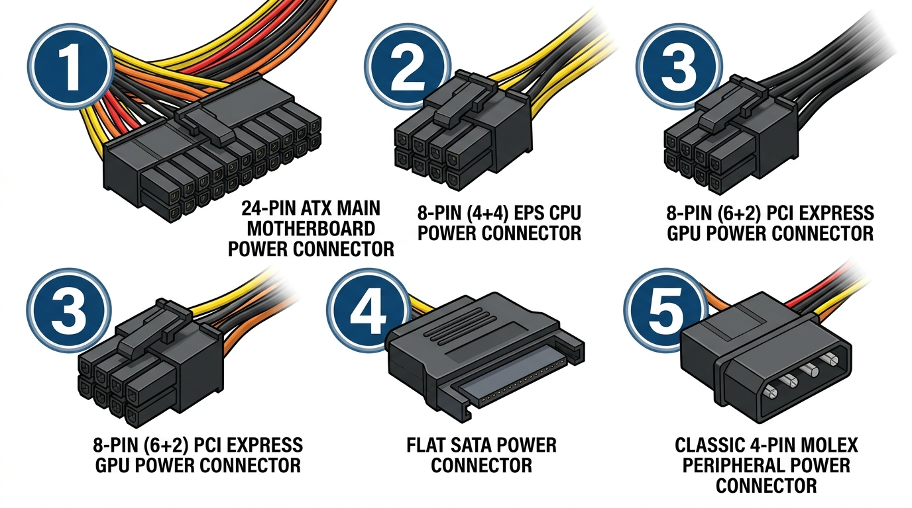

# 2.4 La Font d'Alimentació (PSU) i Connectors ATX

La **Font d'Alimentació** (coneguda internacionalment com **PSU**, *Power Supply Unit*) és el cor elèctric de l'ordinador. La seua missió principal és convertir el corrent altern d'alta tensió de la xarxa elèctrica ($230\text{ V AC}$) en diversos corrents continus de baixa tensió ($+12\text{ V}$, $+5\text{ V}$, $+3{,}3\text{ V DC}$) perfectament estabilitzats, filtrats i lliures de fluctuacions o soroll elèctric.

---

## 1. Com Funciona una Font Commutada (SMPS)?

Els ordinadors actuals utilitzen **fonts d'alimentació commutades** (*Switched-Mode Power Supply*), molt més xicotetes, lleugeres i eficients que les antigues fonts lineals amb grans transformadors. El procés de conversió consta de quatre etapes consecutives:

1. **Transformació i Rectificació Primària:** El corrent altern de la xarxa es filtra i passa per un pont de díodes que converteix l'ona alterna en polsos continus d'alta tensió (més de $300\text{ V DC}$).
2. **Commutació d'Alta Freqüència (Inversor):** Uns transistors MOSFET commuten el senyal a desenes de milers d'herzios ($50\text{ kHz} - 100\text{ kHz}$), el que permet utilitzar transformadors magnètics diminuts.
3. **Transformació Secundària:** El transformador redueix la tensió als valors baixos desitjats ($12\text{ V}$, $5\text{ V}$, $3{,}3\text{ V}$).
4. **Rectificació, Filtratge i Regulació Final:** Uns díodes Schottky i bobines amb condensadors eliminen el rínxol residual (*ripple*), lliurant un corrent continu puríssim.

---

## 2. Els Connectors Estàndard de la Font d'Alimentació

A l'interior de la caixa del PC trobem diferents tipus de cables i connectors dissenyats específicament per alimentar cada component de forma segura.

### Llegenda Tècnica dels Connectors (veure imatge):

| Número | Connector | Pins | Tensió / Línies | Destinació i Ús Principal |
| :---: | :--- | :---: | :---: | :--- |
| **1** | **ATX Principal (Motherboard)** | 24 pins (o 20+4) | $+12\text{ V}$, $+5\text{ V}$, $+3{,}3\text{ V}$, $-12\text{ V}$, $+5\text{VSB}$ | Alimenta els circuits generals de la placa base, xips i ranures PCIe integrades. |
| **2** | **EPS / ATX12V (CPU Power)** | 8 pins (separable en 4+4) | $+12\text{ V DC}$ (cables grocs) | Connexió directa a la part superior de la placa base per alimentar exclusivament el processador (VRM). |
| **3** | **PCI Express (GPU Power)** | 8 pins (separable en 6+2) | $+12\text{ V DC}$ (cables grocs) | Alimenta targetes gràfiques d'alt rendiment (un connector de 6 pins lliura fins a $75\text{ W}$; de 8 pins fins a $150\text{ W}$). |
| **4** | **SATA Power** | 15 pins | $+12\text{ V}$, $+5\text{ V}$, $+3{,}3\text{ V}$ | Dispositius d'emmagatzematge: discs durs mecànics (HDD 3.5"), SSDs SATA de 2.5" i lectors òptics. Té forma de **L** per evitar inversions. |
| **5** | **Molex Clàssic** | 4 pins | $+12\text{ V}$ (groc) i $+5\text{ V}$ (roig) | Perifèrics clàssics, bombes de refrigeració líquida senzilles, tires LED i controladors de ventiladors. |

> **IMPORTANT: Compte de no confondre el connector EPS de CPU (2) amb el connector PCIe de GPU (3)!**
> Tot i tindre 8 pins tots dos, tenen una forma geomètrica de pines (clemes) i una polaritat invertida:
> - **EPS (CPU):** Els cables de terra (negres) estan a la fila de la pestanya de subjecció.
> - **PCIe (GPU):** Els cables de $+12\text{ V}$ (grocs) estan a la fila de la pestanya.
> Forçar el connector equivocat provocaria un curtcircuit directe immediat a la placa base!

---

## 3. Codi de Colors Estàndard del Cablejat ATX

En fonts de bona qualitat amb cablejat vist, els colors dels cables indiquen directament la seua funció:

| Color del Cable | Tensió / Senyal | Funció en l'equip |
| :--- | :---: | :--- |
| 🟨 **Groc** | $+12\text{ V}$ | Motors, bombes, ventiladors, CPU i targeta gràfica. |
| 🟥 **Roig** | $+5\text{ V}$ | Circuits lògics de discs, xips auxiliars i ports USB. |
| 🟧 **Taronja** | $+3{,}3\text{ V}$ | Memòria RAM, ranures PCIe i microcontroladors. |
| ⬛ **Negre** | $\text{GND} \text{ (0 V)}$ | Terra / Massa de referència comuna. |
| 🟩 **Verd** | $\text{PS\_ON\#}$ | Senyal d'encesa: s'activa connectant-lo a terra (GND). |
| ⬜ **Gris** | $\text{PWR\_OK}$ | *Power Good*: indica a la placa base que les tensions són estables per arrencar. |
| 🟪 **Morat** | $+5\text{VSB}$ | *Standby*: tensió contínua permanent (encara que el PC estiga apagat) per a Wake-on-LAN o càrrega USB. |

---

## 4. Eficiència Energètica i Certificació 80 PLUS

L'**eficiència energètica ($\eta$)** d'una font d'alimentació mesura quin percentatge de l'energia consumida de la paret es converteix realment en potència útil per al PC, i quanta es malgasta en forma de calor:

$$\eta = \frac{P_{\text{eixida (DC)}}}{P_{\text{entrada (AC)}}} \times 100$$

El segell internacional **80 PLUS** certifica que la font manté com a mínim un **$80\%$ d'eficiència** en els seus rangs típics d'ús ($20\%$, $50\%$ i $100\%$ de càrrega):

| Nivell de Certificació | Eficiència al 20% de càrrega | Eficiència al 50% (càrrega típica) | Eficiència al 100% (màxima càrrega) |
| :--- | :---: | :---: | :---: |
| **80 PLUS Standard (White)** | $80\%$ | $80\%$ | $80\%$ |
| **80 PLUS Bronze** | $85\%$ | $88\%$ | $85\%$ |
| **80 PLUS Silver** | $87\%$ | $90\%$ | $87\%$ |
| **80 PLUS Gold** | $90\%$ | $92\%$ | $89\%$ |
| **80 PLUS Platinum** | $92\%$ | $94\%$ | $90\%$ |
| **80 PLUS Titanium** | $94\%$ | $96\%$ | $94\%$ |

Una font amb certificació **80 PLUS Gold** no només redueix la factura de la llum, sinó que es calfa molt menys, permetent que el ventilador gire més a poc a poc i el funcionament siga molt més silenciós i durador.

---

## 5. Tipus de Construcció: Modularitat del Cablejat

1. **Fonts No Modulars:** Tots els cables eixen d'un únic forat de la carcassa en un gran manoll fix. Són les més econòmiques, però els cables sobrants ocupen molt d'espai a la caixa i destorben el flux d'aire.
2. **Fonts Semimodulars:** Els cables essencials (ATX 24 pins i CPU 8 pins) són fixos, mentre que els cables PCIe, SATA i Molex es connecten només si es necessiten.
3. **Fonts 100% Modulars:** Tots els cables són desconnectables. Facilita enormement el muntatge net, la gestió de cablejat (*cable management*) i la neteja de la caixa.
