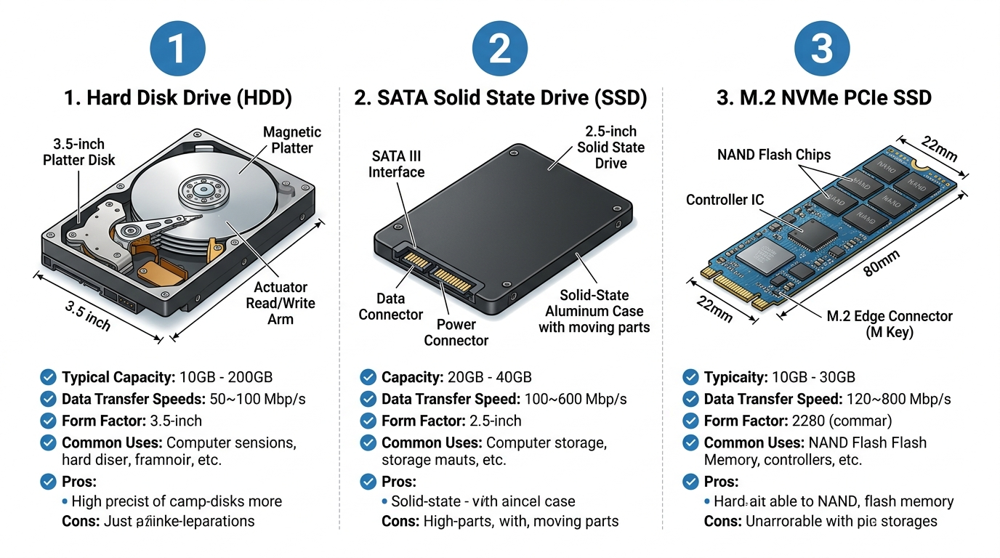

# 3.3 Dispositius d'Emmagatzematge Secundari: HDD vs SSD SATA vs SSD M.2 NVMe

L'emmagatzematge secundari és la memòria no volàtil d'un equip informàtic: s'encarrega de conservar el sistema operatiu, les aplicacions i les dades de l'usuari de manera permanent, fins i tot quan l'equip està completament desconnectat del subministrament elèctric. En els últims anys, l'evolució des dels discs magnètics tradicionals cap a les memòries d'estat sòlid basades en xips NAND Flash ha sigut el salt de rendiment més gran en la història dels ordinadors personals.

---

## 1. Comparativa Tecnològica: Tres Generacions d'Emmagatzematge

A la següent infografia tècnica es mostren els tres formats de discs més utilitzats en el taller de muntatge:

### Llegenda i Anàlisi dels Components (veure imatge):

| Número | Tecnologia | Format Físic | Interfície / Bus | Velocitat Seqüencial Típica | Latència Mitjana |
| :---: | :--- | :---: | :---: | :---: | :---: |
| **1** | **Hard Disk Drive (HDD)** | 3.5" (sobretaula) / 2.5" (portàtil) | SATA III ($6\text{ Gbps}$) | $120 - 220\text{ MB/s}$ | $\approx 12 - 15\text{ ms}$ |
| **2** | **SATA Solid State Drive (SSD)** | 2.5" (caixa metàl·lica) | SATA III ($6\text{ Gbps}$) | $500 - 550\text{ MB/s}$ | $\approx 0{,}1 - 0{,}2\text{ ms}$ |
| **3** | **M.2 NVMe PCIe SSD** | M.2 (mòdul 2280) | PCIe 3.0 / 4.0 / 5.0 ($\times 4$ línies) | $3.500 - 7.500+\text{ MB/s}$ | $\approx 0{,}02 - 0{,}05\text{ ms}$ |

---

## 2. Anàlisi Detallada de Cada Tecnologia

### 1. Hard Disk Drive (HDD Mecànic)
- **Principi de funcionament:** Utilitza un o diversos plats metàl·lics d'alumini o vidre recoberts d'una capa ferromagnètica que giren a altíssima velocitat ($5.400\text{ RPM}$ o $7.200\text{ RPM}$ en equips domèstics; $10.000 - 15.000\text{ RPM}$ en servidors empresarials). Un braç actuador (*actuator arm*) mou electromagnèticament els capçals lectors/gravadors a pocs nanòmetres de la superfície del disc.
- **Avantatges:** Cost per Gigabyte extremadament baix; ideal per a emmagatzematge massiu de còpies de seguretat, servidors NAS i arxiu d'arxius pesats (vídeos, fotos).
- **Inconvenients:** Molt lent en accessos aleatoris (cal moure físicament el capçal); sensible a colps, caigudes i vibracions; genera soroll i consumeix més energia.

---

### 2. Solid State Drive SATA de 2.5" (SSD SATA)
- **Principi de funcionament:** No conté cap peça mòbil. Emmagatzema els bits mitjançant càrregues elèctriques atrapades en milers de milions de cel·les de memòria **NAND Flash**, gestionades per un xip controlador i una memòria cau DRAM.
- **El coll d'ampolla de la interfície:** Utilitza el mateix connector i protocol que els discs mecànics (**SATA III** a un màxim teòric de $6\text{ Gbps}$, és a dir, uns $600\text{ MB/s}$ reals). Per tant, el protocol SATA limita la velocitat màxima d'aquests SSDs a uns $550\text{ MB/s}$.
- **Avantatges:** Molt més ràpid que qualsevol HDD (especialment per la seua latència quasi nul·la); totalment silenciós; resistent a colps; excel·lent per a actualitzar ordinadors vells.

---

### 3. M.2 NVMe PCIe SSD (La Màxima Velocitat Actual)
- **El factor de forma M.2:** Una xicoteta targeta de circuits que es connecta directament a una ranura de la placa base sense necessitar cables de dades ni d'alimentació. El format més comú és el **2280** ($22\text{ mm}$ d'ample per $80\text{ mm}$ de llarg).
- **El protocol NVMe (*Non-Volatile Memory Express*):** A diferència dels discs SATA que usaven l'antic protocol AHCI (dissenyat per a discs mecànics amb només 1 cua d'ordres de 32 comandaments), NVMe connecta el disc directament a les **línies PCI Express de la CPU**, suportant fins a **64.000 cues de 64.000 comandaments simultanis cadascuna**.
- **Generacions PCIe i velocitats:**
  - **PCIe 3.0 $\times 4$:** Fins a $3.500\text{ MB/s}$.
  - **PCIe 4.0 $\times 4$:** Fins a $7.500\text{ MB/s}$ (estàndard actual en equips nous).
  - **PCIe 5.0 $\times 4$:** Fins a $12.000 - 14.000\text{ MB/s}$ (requereix dissipadors tèrmics robustos per evitar *thermal throttling*).

---

## 3. Tipus de Cel·les de Memòria NAND Flash

La capacitat i durabilitat d'un SSD depén del nombre de bits emmagatzemats a cada cel·la de memòria:

| Tecnologia | Bits per Cel·la | Cost per GB | Velocitat | Durabilitat (Cicles de gravació) | Ús Habitual |
| :---: | :---: | :---: | :---: | :---: | :--- |
| **SLC** (*Single-Level Cell*) | 1 bit | Molt Alt | Màxima | $\approx 100.000$ cicles | Servidors crítics i memòria cau interna |
| **MLC** (*Multi-Level Cell*) | 2 bits | Alt | Alta | $\approx 10.000$ cicles | Equips industrials i professionals |
| **TLC** (*Triple-Level Cell*) | 3 bits | Mitjà/Baix | Molt Bona | $\approx 3.000$ cicles | **Estàndard recomanat en equips domèstics i d'oficina** |
| **QLC** (*Quad-Level Cell*) | 4 bits | Molt Baix | Moderada | $\approx 1.000$ cicles | Emmagatzematge econòmic de lectura freqüent |

---

## 4. Paràmetres de Fiabilitat: TBW i MTBF

- **TBW (*Terabytes Written*):** Indica el volum total de Terabytes que es poden escriure al disc abans que les cel·les NAND comencen a fallar per desgast físic. Per exemple, un SSD de $1\text{ TB}$ amb una garantia de $600\text{ TBW}$ permetria escriure $50\text{ GB}$ cada dia durant més de 30 anys abans d'arribar al límit de la garantia.
- **S.M.A.R.T.:** Sistema de monitoratge integrat al microprogramari (*firmware*) del disc que registra paràmetres crítics (temperatura, sectors reassignats, percentatge de vida restant). Eines de diagnòstic com **CrystalDiskInfo** permeten llegir aquests atributs per previndre pèrdues de dades.
