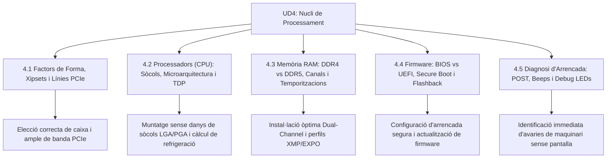

# UD4 La Placa Base, el Processador i la Memòria RAM

Benvingut a la **Unitat Didàctica 4** del mòdul professional de **Muntatge i Manteniment d'Equips (MME)**. Aquesta unitat aprofundeix en el nucli de processament i comunicació de l'ordinador: el circuit imprès principal, la unitat central de processament i la memòria de treball d'alta velocitat.

---

## Mapa d'Aprenentatge de la Unitat

---

## Sessions d'Estudi i Activitats Pràctiques

1. [**4.1 Factors de Forma, Xipsets i Línies PCIe**](ut0401.html)
   - Dimensions estàndard (ATX, Micro-ATX, Mini-ITX).
   - De Northbridge/Southbridge a PCH integrat.
   - Ample de banda i carrils del bus PCIe 4.0 i 5.0.

2. [**4.2 Microprocessadors (CPU): Sòcols, Microarquitectura i TDP**](ut0402.html)
   - Sòcols mecànics: LGA vs PGA i prevenció d'avaries.
   - Microarquitectura de nuclis (P-cores, E-cores) i fils lògics (SMT).
   - Jerarquia de memòria cau (L1, L2, L3) i dissipació tèrmica (TDP).

3. [**4.3 Memòria RAM: DDR4 vs DDR5, Canals i Temporitzacions**](ut0403.html)
   - Comparativa tècnica: voltatges, velocitats i xips PMIC.
   - Configuració del bus Dual-Channel (ranures A2/B2).
   - Latències CAS (CL) i activació de perfils XMP i EXPO a la UEFI.

4. [**4.4 Firmware del Sistema: BIOS vs UEFI, Secure Boot i CSM**](ut0404.html)
   - Evolució històrica: de la BIOS Legacy de 16 bits a la UEFI moderna de 64 bits.
   - Taules de particions: MBR vs GPT.
   - Seguretat amb Secure Boot i actualització mitjançant BIOS Flashback.

5. [**4.5 Diagnosi d'Arrencada: POST, Beeps, EZ Debug LED i Q-Code**](ut0405.html)
   - Fases de la seqüència POST.
   - Codificació acústica de l'altaveu de sistema (Beep Codes).
   - Indicadors visuals EZ Debug LEDs i codis de display hexadecimal (Q-Code).

---

## Reptes Globals d'Avaluació de la Unitat (+100 pts)

  
Repte Global 1: Selecció de Components Compatible

  
Un client et demana un pressupost per a muntar un processador Intel Core i7 de 14a generació amb memòria RAM DDR5 de 6400 MHz en una caixa compacta Mini-ITX. Quin conjunt de components és estrictament compatible?

  

    <label style="display:flex; align-items:center; gap:8px; cursor:pointer;"><input type="radio" name="mme_04_global_q1" value="a"> Placa base AMD AM4 amb xipset B550 i 4 ranures DDR4.</label>
    <label style="display:flex; align-items:center; gap:8px; cursor:pointer;"><input type="radio" name="mme_04_global_q1" value="b"> Placa base Intel LGA1700 Mini-ITX amb xipset B760/Z790 compatible amb DDR5.</label>
    <label style="display:flex; align-items:center; gap:8px; cursor:pointer;"><input type="radio" name="mme_04_global_q1" value="c"> Placa base Micro-ATX LGA1200 amb xipset H510.</label>
    <label style="display:flex; align-items:center; gap:8px; cursor:pointer;"><input type="radio" name="mme_04_global_q1" value="d"> Placa base E-ATX amb sòcol TR4 per a Threadripper.</label>
  

  <button class="btn-check" data-correct="b" data-feedback="Correcte! Els Intel Core de 14a generació utilitzen el sòcol LGA1700, la caixa Mini-ITX requereix una placa de 170x170 mm i cal triar un model amb suport natiu per a DDR5.">Comprova la resposta</button>
  

  
Repte Global 2: Protocol de Muntatge en Sòcol LGA

  
Quina és la seqüència correcta de passos per a instal·lar una CPU en un sòcol modern LGA1700 o AM5?

  

    <label style="display:flex; align-items:center; gap:8px; cursor:pointer;"><input type="radio" name="mme_04_global_q2" value="a"> Alliberar la palanca de fixació, obrir la coberta metàl·lica, alinear el triangle daurat de la CPU amb el triangle del sòcol, dipositar suaument la CPU sense pressionar, baixar la coberta i prémer la palanca fins a engrapar-la (la tapa de plàstic saltarà sola).</label>
    <label style="display:flex; align-items:center; gap:8px; cursor:pointer;"><input type="radio" name="mme_04_global_q2" value="b"> Pressionar fortament la CPU sobre els pins amb la mà per assegurar que facen contacte.</label>
    <label style="display:flex; align-items:center; gap:8px; cursor:pointer;"><input type="radio" name="mme_04_global_q2" value="c"> Retirar la coberta de plàstic amb unes alicates abans d'obrir la palanca.</label>
    <label style="display:flex; align-items:center; gap:8px; cursor:pointer;"><input type="radio" name="mme_04_global_q2" value="d"> Untar pasta tèrmica sobre els pins daurats del sòcol abans de posar la CPU.</label>
  

  <button class="btn-check" data-correct="a" data-feedback="Molt bé! La CPU ha de caure únicament pel seu propi pes (ZIF) respectant la guia del triangle. En baixar la palanca, la tapa de plàstic protectora es desprèn automàticament sense tocar els pins.">Comprova la resposta</button>
  

  
Repte Global 3: Diagnòstic d'Avaria en Arrencada

  
En prémer el botó d'encesa, els ventiladors giren, el díode EZ Debug de la CPU s'apaga, el de DRAM s'apaga, però el díode de BOOT queda de color verd fix i no apareix el sistema operatiu. Què succeeix?

  

    <label style="display:flex; align-items:center; gap:8px; cursor:pointer;"><input type="radio" name="mme_04_global_q3" value="a"> El processador està cremat.</label>
    <label style="display:flex; align-items:center; gap:8px; cursor:pointer;"><input type="radio" name="mme_04_global_q3" value="b"> Els mòduls de memòria RAM estan en curtcircuit.</label>
    <label style="display:flex; align-items:center; gap:8px; cursor:pointer;"><input type="radio" name="mme_04_global_q3" value="c"> La placa base ha superat amb èxit la comprovació de CPU, RAM i GPU, però no troba cap unitat d'emmagatzematge amb un sistema operatiu o partició EFI vàlida.</label>
    <label style="display:flex; align-items:center; gap:8px; cursor:pointer;"><input type="radio" name="mme_04_global_q3" value="d"> La targeta gràfica s'ha sobreescalfat.</label>
  

  <button class="btn-check" data-correct="c" data-feedback="Exacte! El LED verd de BOOT significa que el maquinari crític funciona, però no hi ha cap disc d'arrencada disponible (disc no detectat, buit o sense bootloader).">Comprova la resposta</button>
  

  
Repte Global 4: Resolució de Problemes UEFI / XMP

  
Un client activa el perfil XMP a la UEFI per posar la memòria a 6400 MT/s, però en reiniciar, l'ordinador s'apaga i s'encén 3 vegades seguides (*boot loop*) i finalment arrenca amb un missatge d'avís de «Memory Overclocking Failed». Què ha succeït?

  

    <label style="display:flex; align-items:center; gap:8px; cursor:pointer;"><input type="radio" name="mme_04_global_q4" value="a"> S'ha fos la placa base.</label>
    <label style="display:flex; align-items:center; gap:8px; cursor:pointer;"><input type="radio" name="mme_04_global_q4" value="b"> El controlador de memòria (IMC) de la CPU no ha pogut superar l'entrenament de memòria a eixa freqüència o voltatge, i la UEFI ha activat automàticament el perfil de seguretat per recuperar l'equip.</label>
    <label style="display:flex; align-items:center; gap:8px; cursor:pointer;"><input type="radio" name="mme_04_global_q4" value="c"> El disc SSD NVMe ha patit un error de lectura.</label>
    <label style="display:flex; align-items:center; gap:8px; cursor:pointer;"><input type="radio" name="mme_04_global_q4" value="d"> El monitor no suporta la resolució de la UEFI.</label>
  

  <button class="btn-check" data-correct="b" data-feedback="Molt bé! Quan un perfil XMP no és estable, l'algorisme d'entrenament de memòria de la UEFI falla i, després de 3 intents, restaura els valors JEDEC per defecte per permetre l'arrencada segura.">Comprova la resposta</button>
  

---

  <h3 style="color: #1e40af; margin-top: 0;">Lliurament del Projecte Global de la Unitat a Aules</h3>
  

    Envia el dossier complet de la Unitat Didàctica 4: <strong>Dossier Tècnic de Placa Base, CPU, Memòria RAM i Diagnosi d'Arrencada</strong>. Genera el PDF oficial per a Aules.
  

  

    <input type="text" class="student-name-input" placeholder="El teu nom i cognoms..." style="padding: 8px 12px; border: 1px solid #94a3b8; border-radius: 6px; flex-grow: 1; min-width: 240px;">
    <button class="btn-generate-aules-pdf btn-aules-dl" data-module="MME" data-unit="UD04" data-activity="Global" style="background: #2563eb; color: #fff; border: none; padding: 8px 16px; border-radius: 6px; cursor: pointer; font-weight: 600;">Generar PDF Aules</button>
  

