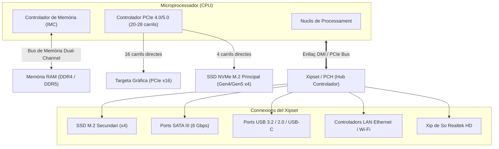

# 4.1 Factors de Forma, Xipsets i Línies PCIe

  

    Progression de la sessió: 4.1 Factors de Forma i Xipsets
    0 / 75 pts
  

  

    

  

  

    1. Dimensions i Ranures
    2. Xipsets i Busos
    3. Línies PCIe
  

La **placa base** (*motherboard*) és la placa de circuit imprès (PCB) principal que interconnecta tots els components de l'ordinador: microprocessador, memòria RAM, unitats d'emmagatzematge, targetes d'expansió i perifèrics externs. Conèixer les seues dimensions, la distribució dels ancoratges i les limitacions dels xipsets és fonamental per a qualsevol tècnic microinformàtic.

---

## 1. Factors de Forma Estàndard

El **factor de forma** defineix les dimensions físiques del PCB, la posició dels forats de fixació al xassís (*standoffs*), la distribució dels connectors d'alimentació i la quantitat de ranures d'expansió disponibles.

| Factor de Forma | Dimensions (mm) | Ranures PCIe típiques | Ranures RAM (DIMM) | Casos d'Ús Habituals |
| :--- | :--- | :--- | :--- | :--- |
| **E-ATX** (Extended) | $305 \times 330$ | 4 a 7 ranures | 4 a 8 slots | Estacions de treball, servidors i gaming extrem. |
| **ATX** (Estàndard) | $305 \times 244$ | 4 a 7 ranures | 4 slots | Equips de sobretaula convencionals d'alt rendiment. |
| **Micro-ATX** (mATX) | $244 \times 244$ | 2 a 4 ranures | 2 o 4 slots | Equips d'oficina i gaming equilibrat qualitat/preu. |
| **Mini-ITX** | $170 \times 170$ | 1 ranura (x16) | 2 slots | Equips compactes SFF (*Small Form Factor*) i HTPC. |

> [!NOTE]
> **Compatibilitat descendent de xassís:** Una caixa que admet plaques ATX sempre admetrà plaques Micro-ATX i Mini-ITX, ja que els forats d'ancoratge comparteixen el mateix patró espacial. Tanmateix, una caixa Mini-ITX no pot albergar físicament una placa Micro-ATX ni ATX.

---

## 2. L'Arquitectura del Xipset: De Northbridge/Southbridge a PCH

En arquitectures clàssiques, la placa base disposava de dos xips controladors:
1. **Northbridge:** Connectat directament a la CPU per un bus ràpid (FSB); gestionava la memòria RAM i la targeta gràfica AGP/PCIe.
2. **Southbridge:** Connectat al Northbridge; gestionava perifèrics lents (PCI, IDE, SATA, USB, àudio i xarxa).

En les arquitectures modernes (**Intel Core** i **AMD Ryzen**), el Northbridge ha desaparegut completament perquè s'ha integrat dins del propi encapsulat de la CPU: el controlador de memòria (IMC) i els carrils PCIe principals (per a la targeta gràfica i el primer SSD NVMe M.2) eixen directament dels pins del processador. 

El xip restant a la placa base rep el nom de **PCH** (*Platform Controller Hub* a Intel) o simplement **Xipset** (a AMD), i es comunica amb la CPU mitjançant un enllaç dedicat d'alta velocitat: **DMI** (*Direct Media Interface*) a Intel o carrils PCIe dedicats a AMD.

---

## 3. Línies PCIe (Peripheral Component Interconnect Express)

PCI Express és un bus sèrie punt a punt que funciona mitjançant **carrils** (*lanes*). Cada carril disposa de dos parells de fils diferencials: un parell per a transmetre dades (Tx) i un altre per a rebre (Rx) en mode *full-duplex*.

### Ample de Banda per Generació (per cada carril x1)
- **PCIe 3.0:** $\approx 985\text{ MB/s}$ per carril ($15.75\text{ GB/s}$ en un slot x16).
- **PCIe 4.0:** $\approx 1.97\text{ GB/s}$ per carril ($31.5\text{ GB/s}$ en un slot x16).
- **PCIe 5.0:** $\approx 3.94\text{ GB/s}$ per carril ($63.0\text{ GB/s}$ en un slot x16).

> [!WARNING]
> **Bifurcació i compartició de línies:** Si connectes un segon SSD M.2 o una targeta addicional en determinades ranures de la placa base, el manual tècnic pot indicar que es desactiven ports SATA concrets o que la ranura principal es redueix de x16 a x8. Això ocorre perquè el nombre total de línies del xipset és limitat.

---

## Reptes Interactius (Avalua els teus coneixements)

  
Repte 1: Identificació de Factors de Forma

  
Un client desitja muntar un equip en una caixa ultracompacta tipus cub que només disposa d'un espai per a placa de 170 x 170 mm i una única ranura d'expansió vertical. Quin factor de forma de placa base és obligatori adquirir?

  

    <label style="display:flex; align-items:center; gap:8px; cursor:pointer;"><input type="radio" name="mme_0401_q1" value="a"> Micro-ATX (mATX)</label>
    <label style="display:flex; align-items:center; gap:8px; cursor:pointer;"><input type="radio" name="mme_0401_q1" value="b"> Mini-ITX</label>
    <label style="display:flex; align-items:center; gap:8px; cursor:pointer;"><input type="radio" name="mme_0401_q1" value="c"> ATX Estàndard</label>
    <label style="display:flex; align-items:center; gap:8px; cursor:pointer;"><input type="radio" name="mme_0401_q1" value="d"> Extended ATX (E-ATX)</label>
  

  <button class="btn-check" data-correct="b" data-feedback="Correcte! L'estàndard Mini-ITX té unes mides quadrades exactes de 170 x 170 mm i inclou exclusivament una ranura d'expansió PCIe x16.">Comprova la resposta</button>
  

  
Repte 2: Arquitectura de Controladors Moderns

  
On es troba situat físicament el controlador de memòria RAM (IMC) en un ordinador modern amb processador Intel Core o AMD Ryzen?

  

    <label style="display:flex; align-items:center; gap:8px; cursor:pointer;"><input type="radio" name="mme_0401_q2" value="a"> Integrat directament a l'interior de la pròpia CPU.</label>
    <label style="display:flex; align-items:center; gap:8px; cursor:pointer;"><input type="radio" name="mme_0401_q2" value="b"> Dins del xip Southbridge a la part inferior de la placa.</label>
    <label style="display:flex; align-items:center; gap:8px; cursor:pointer;"><input type="radio" name="mme_0401_q2" value="c"> En un mòdul extern connectat al bus PCIe secundari.</label>
    <label style="display:flex; align-items:center; gap:8px; cursor:pointer;"><input type="radio" name="mme_0401_q2" value="d"> Integrat en el xip d'àudio Realtek.</label>
  

  <button class="btn-check" data-correct="a" data-feedback="Molt bé! Els processadors moderns integren el controlador de memòria (IMC) i els carrils PCIe primaris directament al die del processador, eliminant el Northbridge clàssic.">Comprova la resposta</button>
  

  
Repte 3: Ample de Banda PCIe

  
Un SSD NVMe M.2 utilitza una connexió PCIe 4.0 x4. Quin és l'ample de banda teòric màxim que pot proporcionar aquesta interfície?

  

    <label style="display:flex; align-items:center; gap:8px; cursor:pointer;"><input type="radio" name="mme_0401_q3" value="a"> 550 MB/s (límit SATA III)</label>
    <label style="display:flex; align-items:center; gap:8px; cursor:pointer;"><input type="radio" name="mme_0401_q3" value="b"> Aproximadament 3.94 GB/s</label>
    <label style="display:flex; align-items:center; gap:8px; cursor:pointer;"><input type="radio" name="mme_0401_q3" value="c"> Aproximadament 7.88 GB/s (~8 GB/s)</label>
    <label style="display:flex; align-items:center; gap:8px; cursor:pointer;"><input type="radio" name="mme_0401_q3" value="d"> 32 GB/s</label>
  

  <button class="btn-check" data-correct="c" data-feedback="Exacte! Cada carril PCIe 4.0 ofereix ~1.97 GB/s; multiplicat per 4 carrils (x4), obtenim un sostre teòric d'uns 7.88 GB/s (uns 7.500 MB/s reals en disc).">Comprova la resposta</button>
  

---

  <h3 style="color: #1e40af; margin-top: 0;">Lliurament de l'Activitat a Aules</h3>
  

    Completa la tasca pràctica: <strong>Act01 - Estudi de Factors de Forma i Xipsets</strong>. Indica el teu nom complet per generar el justificant oficial en PDF per a Aules.
  

  

    <input type="text" class="student-name-input" placeholder="El teu nom i cognoms..." style="padding: 8px 12px; border: 1px solid #94a3b8; border-radius: 6px; flex-grow: 1; min-width: 240px;">
    <button class="btn-generate-aules-pdf btn-aules-dl" data-module="MME" data-unit="UD04" data-activity="Act01" style="background: #2563eb; color: #fff; border: none; padding: 8px 16px; border-radius: 6px; cursor: pointer; font-weight: 600;">Generar PDF Aules</button>
  

