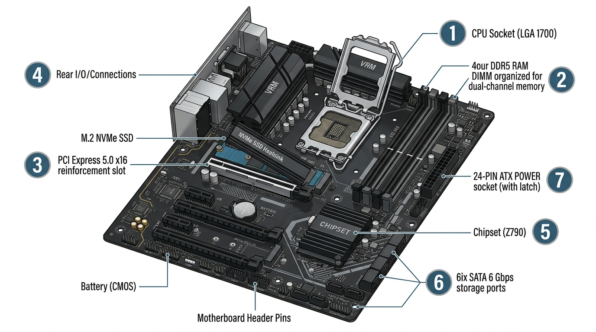

# 4.2 La Placa Base, el Processador (CPU) i la Memòria RAM

La **placa base** (*motherboard* o *mainboard*) és el circuit imprés principal (PCB) que interconnecta directament tots els components de l'ordinador: el microprocessador (CPU), la memòria RAM, les targetes d'expansió, els dispositius d'emmagatzematge i els perifèrics d'entrada i eixida.

---

## 1. Arquitectura i Components Clau d'una Placa Base Moderna

A la següent infografia tècnica es detallen els components principals d'una placa base estàndard ATX:

### Llegenda Tècnica dels Components (veure imatge):

| Número | Component | Funció Tècnica Principal | Detall per al Muntatge |
| :---: | :--- | :--- | :--- |
| **1** | **Socket CPU (LGA / AM5)** | Sòcol on s'allotja el microprocessador. Té una palanca de pressió i una tapadora metàl·lica de bloqueig. | Cal alinear el triangle daurat de la CPU amb el triangle del sòcol. No tocar mai els pins del sòcol! |
| **2** | **Ranures de Memòria RAM (DIMM)** | Slots per a mòduls de memòria DDR4 o DDR5. Suporten canal doble (*Dual Channel*). | Si s'instal·len només dos mòduls en una placa de 4 ranures, cal utilitzar habitualment els slots **2 i 4 (A2 i B2)**. |
| **3** | **Ranura PCIe $\times 16$ Principal** | Ranura d'expansió d'alta velocitat connectada directament a les línies PCIe de la CPU per a la targeta gràfica (GPU). | Compta amb blindatge metàl·lic per suportar el pes de la targeta gràfica i una pestanya de seguretat al final. |
| **4** | **Ranura M.2 NVMe amb Dissipador** | Ranura per a unitats d'estat sòlid M.2 PCIe. | Inclou un dissipador tèrmic d'alumini amb *thermal pad* per evitar que el disc s'escalfe i perda rendiment (*throttling*). |
| **5** | **Chipset de la Placa Base (PCH)** | Xip que gestiona i distribueix les comunicacions entre els ports auxiliars (SATA, USB, Ethernet, àudio) i la CPU. | Està recobert per un dissipador metàl·lic passiu. Determina les capacitats d'*overclocking* i el nombre de ports disponibles. |
| **6** | **Ports SATA 6 Gbps** | Ports de connexió per a cables de dades de discs durs tradicionals (HDD) i SSDs de 2.5". | Tenen forma de **L** xicoteta per evitar connexions invertides. |
| **7** | **Connector ATX 24 Pins** | Sòcol femella on es connecta el cable d'alimentació principal de la font d'alimentació. | Té una pestanya de retenció lateral que ha de quedar ben encaixada amb un "clic" audible. |

---

## 2. Tipus de Sòcols de Processador (Sockets)

Segons el sistema físic de contacte entre la placa i el xip, distingim tres tecnologies:

1. **LGA (*Land Grid Array*):**
   - Els pins de contacte, fins i flexibles, es troben **al sòcol de la placa base**, mentre que la part inferior del processador només té coixinets de contacte daurats plans (*pads*).
   - *Exemples:* Sockets Intel actuals (LGA 1200, LGA 1700, LGA 1851) i AMD a partir de la sèrie Ryzen 7000 (Socket AM5).
2. **PGA (*Pin Grid Array*):**
   - Els pins metàl·lics estan **a la part inferior del processador**, i el sòcol té forats microscòpics (*Zero Insertion Force* - ZIF).
   - *Exemples:* Sockets AMD clàssics (AM3+, AM4).
3. **BGA (*Ball Grid Array*):**
   - El processador està soldat permanentment a la placa base mitjançant xicotetes esferes d'estany. No es pot substituir ni actualitzar.
   - *Exemples:* Ordinadors portàtils, tauletes i consoles de videojocs.

---

## 3. Factors de Forma de Plaques Base

El factor de forma determina les dimensions físiques de la placa, la posició dels forats per als caragols de subjecció i la compatibilitat amb la caixa:

| Factor de Forma | Dimensions (mm) | Ranures PCIe Típiques | Ranures RAM | Ús Recomanat |
| :--- | :---: | :---: | :---: | :--- |
| **E-ATX** (*Extended ATX*) | $305 \times 330\text{ mm}$ | 4 a 7 | 8 | Estacions de treball professionals i servidors |
| **ATX** (*Estàndard*) | $305 \times 244\text{ mm}$ | 3 a 5 | 4 | **Ordinadors de sobretaula convencionals i gaming** |
| **Micro-ATX** (*mATX*) | $244 \times 244\text{ mm}$ | 2 a 3 | 2 o 4 | Equips d'oficina, domèstics i econòmics |
| **Mini-ITX** | $170 \times 170\text{ mm}$ | 1 | 2 | Equips ultra-compactes (*Small Form Factor* - SFF) |

---

## 4. La Memòria RAM: DDR4 vs DDR5 i Dual Channel

La memòria RAM (*Random Access Memory*) és la memòria de treball d'alta velocitat i volàtil del processador.

### Comparativa DDR4 vs DDR5:

| Característica | DDR4 | DDR5 |
| :--- | :---: | :---: |
| **Freqüències estàndard** | $2.133 - 3.600\text{ MT/s}$ | $4.800 - 7.200+\text{ MT/s}$ |
| **Tensió de funcionament** | $1{,}20\text{ V}$ | $1{,}10\text{ V}$ (Major eficiència energètica) |
| **Gestió d'energia** | Regulada per la placa base | **PMIC integrat directament al mòdul de memòria** |
| **Arquitectura de canal per mòdul** | 1 canal de 64 bits | **2 subcanals independents de 32 bits** |
| **Compatibilitat física** | Clau de bloqueig (*notch*) descentrada | Clau en posició diferent (**totalment incompatibles físicament**) |

### L'Arquitectura de Doble Canal (*Dual Channel*)
Quan s'instal·len dos mòduls de memòria als canals coincidents de la placa base (habitualment les ranures 2 i 4), el controlador de memòria duplica l'amplada del bus de dades de **64 bits a 128 bits**, duplicant teòricament l'ample de banda de transferència i millorant de manera dràstica el rendiment del sistema.

---

## 5. El Microprogramari del Sistema: BIOS i UEFI

La **UEFI** (*Unified Extensible Firmware Interface*) és el programari gravat en un xip de memòria Flash ROM a la placa base que s'executa només encendre l'ordinador per inicialitzar el maquinari (procés POST):

- **Substituta de la BIOS clàssica:** Suporta interfície gràfica d'usuari controlable amb ratolí, arrencada ràpida i discs durs amb taula de particions **GPT** de més de $2\text{ TB}$.
- **Secure Boot:** Mecanisme de seguretat criptogràfica que impedeix la càrrega de *malware* d'arrencada (*bootkits*) verificant la signatura digital dels controladors i del carregador del sistema operatiu.
- **Perfils XMP / EXPO:** Perfils d'*overclocking* de fàbrica per a la memòria RAM (Intel XMP i AMD EXPO) que permeten a la memòria funcionar a la seua velocitat màxima certificada amb un sol clic a la UEFI.
- **Reset de la configuració (Clear CMOS):** Si una configuració incorrecta impedeix que l'equip encenga, es pot restablir de fàbrica unint durant 5 segons els dos pins del jumper **CLRTC / CLEAR CMOS** o retirant la pila de botó **CR2032** durant uns minuts sense corrent.
