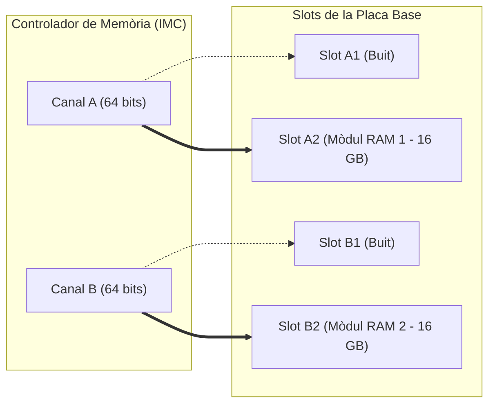

# 4.3 Memòria RAM: DDR4 vs DDR5, Canals i Temporitzacions

  

    Progression de la sessió: 4.3 Arquitectura de la Memòria RAM
    0 / 75 pts
  

  

    

  

  

    1. DDR4 vs DDR5
    2. Dual-Channel
    3. Latència i XMP
  

La memòria **RAM** (*Random Access Memory*) és la memòria principal de treball volàtil on el processador carrega els programes en execució i les estructures de dades actives. En el maquinari modern, la tecnologia dominant és **SDRAM DDR** (*Double Data Rate Synchronous Dynamic RAM*).

---

## 1. Comparativa Tecnològica: DDR4 vs DDR5

| Característica | **DDR4 SDRAM** | **DDR5 SDRAM** |
| :--- | :--- | :--- |
| **Voltatge estàndard (VDD)** | $1.2\text{ V}$ | $1.1\text{ V}$ (Major eficiència) |
| **Freqüències típiques** | $2133\text{ MT/s} - 3600\text{ MT/s}$ | $4800\text{ MT/s} - 8000+\text{ MT/s}$ |
| **Pins físics (DIMM)** | 288 pins | 288 pins (*osca en posició diferent*) |
| **Gestió d'energia** | A la placa base (VRM de la placa). | Al propi mòdul DIMM (**PMIC** dedicat). |
| **Arquitectura de canal per mòdul**| 1 canal de 64 bits de dades. | **2 subcanals independents de 32 bits**. |
| **Correcció d'errors (ECC)** | Només en mòduls especials per a servidors. | **On-Die ECC integrat** a cada xip per defecte. |

> [!WARNING]
> Tot i que ambdues tecnologies tenen 288 pins, la **posició de l'osca central és completament incompatible**. Intentar forçar un mòdul DDR5 en una ranura DDR4 (o viceversa) trencarà físicament el connector de la placa base i els contactes del mòdul.

---

## 2. Arquitectura de Canals: El Dual-Channel

Un canal de memòria convencional transmet $64\text{ bits}$ per cicle de rellotge. Quan activem la tecnologia **Dual-Channel**, el controlador de memòria (IMC) utilitza dos canals simultanis independents, ampliant l'amplada del bus de dades a $128\text{ bits}$ reals. Això duplica l'ample de banda teòric:

$$\text{Ample de Banda (Bytes/s)} = \text{Freqüència (Hz)} \times 8\text{ Bytes (64 bits)} \times N_{\text{canals}}$$

### Regles d'Instal·lació de Ranures (Slots)
La majoria de plaques base d'escriptori disposen de 4 ranures distribuïdes en dos canals (Canal A i Canal B):
- **Slots:** $A1, A2, B1, B2$.
- Per a activar el Dual-Channel amb només **2 mòduls**, s'han d'instal·lar en les ranures **$A2$ i $B2$** (generalment la segona i la quarta ranura comptant des del sòcol de la CPU).

---

## 3. Temporitzacions (*Timings*) i Perfils XMP / EXPO

La velocitat d'un mòdul RAM depèn de dos factors fonamentals: la **freqüència** (cicles per segon, MT/s) i la **latència CAS** (nombre de cicles que triga la memòria a lliurar una dada sol·licitada).

$$\text{Temps de Resposta Real (ns)} = \frac{\text{Latència CL}}{\text{Freqüència Real (MHz)}} \times 1000$$

*Exemple comparatiu:*
- Mòdul DDR4-3200 CL16: $\frac{16}{1600} \times 1000 = 10.0\text{ ns}$.
- Mòdul DDR5-6000 CL30: $\frac{30}{3000} \times 1000 = 10.0\text{ ns}$ (però amb el triple d'ample de banda sostingut!).

### Perfils d'Overclocking d'un Clic: XMP vs EXPO
Per defecte, qualsevol memòria instal·lada arrenca a la velocitat estàndard de seguretat **JEDEC** (ex. 2133 MHz a DDR4 o 4800 MHz a DDR5). Per activar la velocitat comercial anunciada a la caixa (ex. 6000 MHz), cal entrar a la UEFI i activar:
- **Intel XMP (*Extreme Memory Profile*):** Perfil preconfigurat pel fabricant per a plataformes Intel.
- **AMD EXPO (*Extended Profiles for Overclocking*):** Estàndard obert lliure de drets optimitzat per a processadors AMD Ryzen.

---

## Reptes Interactius (Avalua els teus coneixements)

  
Repte 1: Configuració Dual-Channel

  
En una placa base estàndard amb 4 ranures de memòria (A1, A2, B1, B2), quines ranures recomanen els fabricants utilitzar quan només es munta un kit de 2 mòduls per garantir la màxima estabilitat i activar el Dual-Channel?

  

    <label style="display:flex; align-items:center; gap:8px; cursor:pointer;"><input type="radio" name="mme_0403_q1" value="a"> A1 i A2 (les dues més pròximes a la CPU)</label>
    <label style="display:flex; align-items:center; gap:8px; cursor:pointer;"><input type="radio" name="mme_0403_q1" value="b"> A2 i B2 (ranures 2 i 4)</label>
    <label style="display:flex; align-items:center; gap:8px; cursor:pointer;"><input type="radio" name="mme_0403_q1" value="c"> B1 i B2 (les dues més allunyades)</label>
    <label style="display:flex; align-items:center; gap:8px; cursor:pointer;"><input type="radio" name="mme_0403_q1" value="d"> A1 i B1 únicament</label>
  

  <button class="btn-check" data-correct="b" data-feedback="Correcte! A causa de la topologia elèctrica Daisy-Chain de les pistes de la placa, les ranures A2 i B2 eviten reflexions de senyal i són les recomanades per a 2 mòduls.">Comprova la resposta</button>
  

  
Repte 2: Innovacions de la Memòria DDR5

  
Quina de les següents afirmacions descriu una novetat tecnològica exclusiva de la memòria RAM DDR5 respecte a DDR4?

  

    <label style="display:flex; align-items:center; gap:8px; cursor:pointer;"><input type="radio" name="mme_0403_q2" value="a"> Integra el xip de gestió d'energia PMIC directament al PCB del mòdul DIMM.</label>
    <label style="display:flex; align-items:center; gap:8px; cursor:pointer;"><input type="radio" name="mme_0403_q2" value="b"> Utilitza un voltatge superior de 1.65 V per aconseguir més freqüència.</label>
    <label style="display:flex; align-items:center; gap:8px; cursor:pointer;"><input type="radio" name="mme_0403_q2" value="c"> Elimina per complet la necessitat de perfils XMP/EXPO.</label>
    <label style="display:flex; align-items:center; gap:8px; cursor:pointer;"><input type="radio" name="mme_0403_q2" value="d"> Té menys pins físics que la DDR4 (només 184 pins).</label>
  

  <button class="btn-check" data-correct="a" data-feedback="Molt bé! La DDR5 trasllada el xip de regulació de voltatge (PMIC) directament al mòdul de memòria, la qual cosa ofereix un control elèctric molt més net i precís.">Comprova la resposta</button>
  

  
Repte 3: Activació de la Freqüència Comercial

  
Un usuari compra un kit de memòria RAM venut a 6000 MT/s, però en obrir l'Administrador de Tasques de Windows comprova que funciona a només 4800 MT/s. Quina acció tècnica s'ha d'efectuar?

  

    <label style="display:flex; align-items:center; gap:8px; cursor:pointer;"><input type="radio" name="mme_0403_q3" value="a"> Reinstal·lar el sistema operatiu en mode segur.</label>
    <label style="display:flex; align-items:center; gap:8px; cursor:pointer;"><input type="radio" name="mme_0403_q3" value="b"> Canviar els mòduls de ranura.</label>
    <label style="display:flex; align-items:center; gap:8px; cursor:pointer;"><input type="radio" name="mme_0403_q3" value="c"> Accedir a la UEFI/BIOS i habilitar el perfil XMP (Intel) o EXPO (AMD).</label>
    <label style="display:flex; align-items:center; gap:8px; cursor:pointer;"><input type="radio" name="mme_0403_q3" value="d"> Comprar una font d'alimentació de més potència.</label>
  

  <button class="btn-check" data-correct="c" data-feedback="Exacte! Per defecte les plaques operen sota el perfil base JEDEC per compatibilitat. Cal habilitar expressament el perfil XMP/EXPO a la UEFI per aprofitar la freqüència anunciada.">Comprova la resposta</button>
  

---

  <h3 style="color: #1e40af; margin-top: 0;">Lliurament de l'Activitat a Aules</h3>
  

    Completa la tasca pràctica: <strong>Act03 - Configuració de Memòria RAM, Latències i Dual-Channel</strong>. Genera el PDF oficial per a Aules.
  

  

    <input type="text" class="student-name-input" placeholder="El teu nom i cognoms..." style="padding: 8px 12px; border: 1px solid #94a3b8; border-radius: 6px; flex-grow: 1; min-width: 240px;">
    <button class="btn-generate-aules-pdf btn-aules-dl" data-module="MME" data-unit="UD04" data-activity="Act03" style="background: #2563eb; color: #fff; border: none; padding: 8px 16px; border-radius: 6px; cursor: pointer; font-weight: 600;">Generar PDF Aules</button>
  

