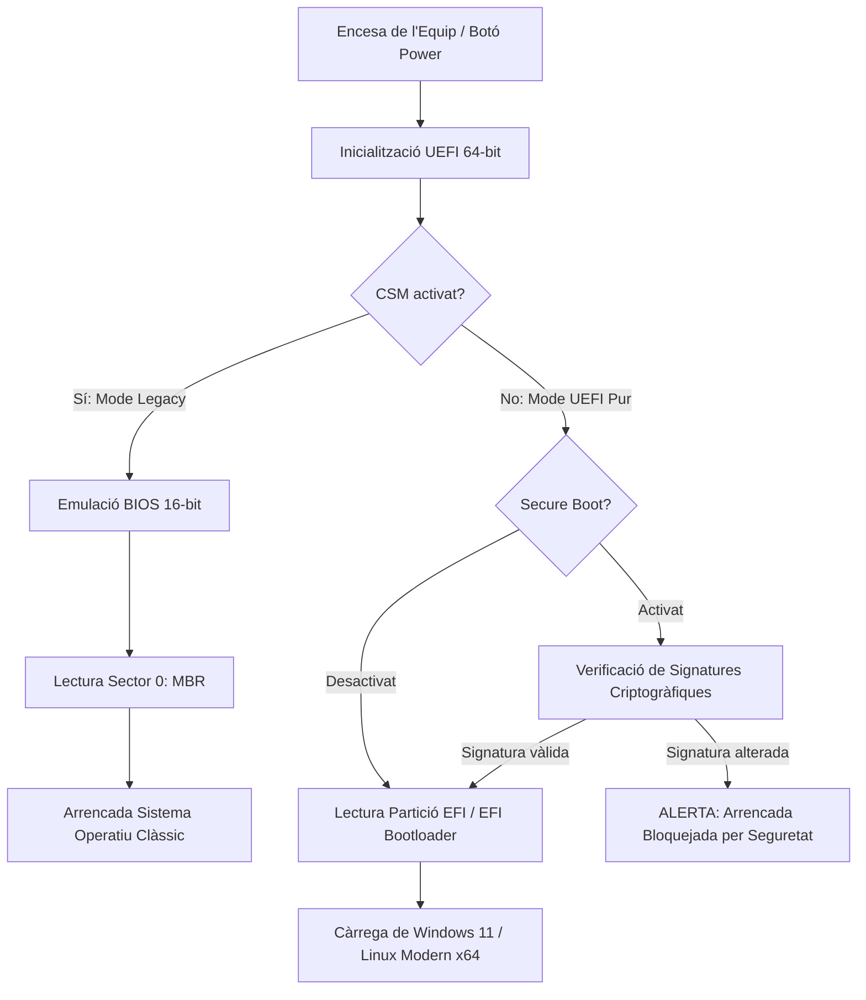

# 4.4 Firmware del Sistema: BIOS vs UEFI, Secure Boot i CSM

  

    Progression de la sessió: 4.4 Firmware i Arrencada UEFI
    0 / 75 pts
  

  

    

  

  

    1. BIOS vs UEFI
    2. Secure Boot i CSM
    3. Actualització de Firmware
  

El **firmware** és el programari de baix nivell incrustat en un xip de memòria no volàtil (EEPROM o memòria Flash SPI) de la placa base que controla la inicialització del maquinari i proporciona l'enllaç inicial entre la màquina i el sistema operatiu.

---

## 1. Evolució: De la BIOS Clàssica a la UEFI Moderna

La **BIOS** (*Basic Input/Output System*) original es va dissenyar a finals dels anys 70 per a l'arquitectura IBM PC de 16 bits. Amb l'arribada dels equips de 64 bits i unitats d'emmagatzematge de terabytes, la BIOS va quedar completament obsoleta i va ser substituïda per **UEFI** (*Unified Extensible Firmware Interface*).

| Característica | **BIOS Clàssica (Legacy)** | **UEFI Moderna** |
| :--- | :--- | :--- |
| **Mode d'execució** | Mode real de 16 bits ($1\text{ MB}$ de memòria direccionable). | Mode protegit de 32 bits o 64 bits complets. |
| **Taula de particions** | **MBR** (*Master Boot Record*). Màxim 2.2 TB i 4 particions primàries. | **GPT** (*GUID Partition Table*). Discs de fins a $9.4\text{ ZB}$ i fins a 128 particions. |
| **Interfície d'usuari** | Text pla blau, navegació exclusiva per teclat. | Gràfica d'alta resolució, suport de ratolí, animacions i múltiples idiomes. |
| **Arrencada** | Cerca el sector 0 del disc (MBR) i executa el codi d'inici. | Llegeix directament la partició **ESP** (*EFI System Partition*, FAT32) i carrega fitxers `.efi`. |
| **Xarxa i diagnosi** | Inexistent; cal carregar un SO. | Suport natiu de pila TCP/IP, diagnosi de maquinari integrada i actualització en línia. |

---

## 2. Seguretat i Compatibilitat: Secure Boot i Mòdul CSM

### Què és el Secure Boot?
El **Secure Boot** és un estàndard de seguretat de la UEFI que garanteix que l'ordinador arrenque utilitzant únicament programari de confiança verificat pel fabricant de l'equip. Quan el sistema s'engega:
1. La UEFI comprova la signatura criptogràfica de cada component del procés d'arrencada: el carregador de boot (com `bootmgfw.efi` de Windows o `shim.efi` de Linux), els controladors de maquinari (Option ROMs) i els fitxers del nucli.
2. Si la signatura és desconeguda, ha caducat o està alterada (indici de *rootkit* o *bootkit*), la UEFI bloqueja l'arrencada immediatament.

> [!IMPORTANT]
> **Requisits de Windows 11:** Windows 11 exigeix que el sistema funcione obligatòriament en mode **UEFI natiu pur**, amb **Secure Boot habilitat** i suport de **TPM 2.0** (*Trusted Platform Module*).

### Què és el mòdul CSM (*Compatibility Support Module*)?
El mòdul CSM és una capa d'emulació integrada dins de la UEFI que permet arrencar sistemes operatius antics que no suporten UEFI (com Windows 7 de 32 bits o distribucions Linux clàssiques) simulant l'entorn BIOS Legacy amb particions MBR.

---

## 3. Protocol Segur d'Actualització del Firmware (Flash BIOS)

Actualitzar la UEFI permet donar suport a nous processadors que han eixit al mercat posteriorment a la fabricació de la placa, corregir vulnerabilitats de seguretat (com fallades d'injecció de microcodi) i millorar l'estabilitat de la memòria RAM.

### Mètodes d'Actualització
1. **Des de la pròpia UEFI (Mètode recomanat):** Eines com *EZ Flash* (ASUS), *Q-Flash* (Gigabyte) o *M-Flash* (MSI). Es col·loca el fitxer binari descarregat del web oficial del fabricant en una unitat USB formatada en FAT32.
2. **Botó físic de Flashback (Sense CPU ni RAM instal·lades):** Moltes plaques modernes incorporen un botó anomenat *BIOS Flashback* o *Q-Flash Plus* al panell posterior amb un port USB marcat. Permet actualitzar la placa completament buida només connectant la font d'alimentació (vital per a fer funcionar una CPU d'última generació en una placa amb firmware de fàbrica antic).

> [!CAUTION]
> **Risc de corrupció de xip (*Bricking*):** Si l'equip es queda sense subministrament elèctric a meitat del procés d'escriptura a la memòria Flash, el firmware quedarà incomplet i la placa no tornarà a engegar-se (tret que dispose de xip Dual BIOS o botó de Flashback físic). Utilitza sempre un SAI (SAI/UPS) al taller durant aquestes operacions.

---

## Reptes Interactius (Avalua els teus coneixements)

  
Repte 1: Limitacions de la BIOS Clàssica

  
Un client connecta un disc dur de 8 TB com a unitat d'arrencada en un equip antic amb BIOS clàssica i taula MBR, però el sistema només és capaç de reconèixer aproximadament 2.2 TB. A què es deu aquesta limitació?

  

    <label style="display:flex; align-items:center; gap:8px; cursor:pointer;"><input type="radio" name="mme_0404_q1" value="a"> A una fallada física del connector SATA.</label>
    <label style="display:flex; align-items:center; gap:8px; cursor:pointer;"><input type="radio" name="mme_0404_q1" value="b"> A la limitació d'adreçament de 32 bits de la taula de particions MBR, que fa imprescindible l'ús de GPT i UEFI per a discs majors de 2.2 TB.</label>
    <label style="display:flex; align-items:center; gap:8px; cursor:pointer;"><input type="radio" name="mme_0404_q1" value="c"> A què el cable de la font d'alimentació no subministra prou amperatge.</label>
    <label style="display:flex; align-items:center; gap:8px; cursor:pointer;"><input type="radio" name="mme_0404_q1" value="d"> A una infecció per virus en el firmware.</label>
  

  <button class="btn-check" data-correct="b" data-feedback="Correcte! L'esquema MBR utilitza 32 bits per a adreçar sectors de 512 bytes, la qual cosa fixa el límit matemàtic en 2.2 TB (2^32 * 512 bytes). Per a discs superiors cal GPT.">Comprova la resposta</button>
  

  
Repte 2: Finalitat de Secure Boot

  
Quin és el propòsit fonamental del mecanisme de seguretat Secure Boot disponible en sistemes UEFI?

  

    <label style="display:flex; align-items:center; gap:8px; cursor:pointer;"><input type="radio" name="mme_0404_q2" value="a"> Xifrar la contrasenya del correu electrònic de l'usuari.</label>
    <label style="display:flex; align-items:center; gap:8px; cursor:pointer;"><input type="radio" name="mme_0404_q2" value="b"> Evitar la infecció per codi maliciós en l'arrencada (bootkits) verificant que els fitxers d'inici estiguen signats per claus criptogràfiques de confiança.</label>
    <label style="display:flex; align-items:center; gap:8px; cursor:pointer;"><input type="radio" name="mme_0404_q2" value="c"> Augmentar la velocitat d'arrencada reduint el voltatge de la memòria RAM.</label>
    <label style="display:flex; align-items:center; gap:8px; cursor:pointer;"><input type="radio" name="mme_0404_q2" value="d"> Impedir que la màquina es connecte a xarxes Wi-Fi públiques.</label>
  

  <button class="btn-check" data-correct="b" data-feedback="Molt bé! Secure Boot valida les signatures criptogràfiques de carregadors de sistemes operatius i mòduls del nucli per impedir que codi maliciós s'incruste abans de la càrrega del SO.">Comprova la resposta</button>
  

  
Repte 3: BIOS Flashback

  
Acabes de comprar una placa base amb xipset B650 i un processador AMD Ryzen acabat d'eixir al mercat. L'equip no fa POST perquè el firmware de fàbrica no reconeix la nova CPU. Quina tecnologia permet actualitzar la UEFI sense disposar d'una CPU compatible més antiga?

  

    <label style="display:flex; align-items:center; gap:8px; cursor:pointer;"><input type="radio" name="mme_0404_q3" value="a"> Desconnectar la pila de botó CR2032 durant 10 minuts.</label>
    <label style="display:flex; align-items:center; gap:8px; cursor:pointer;"><input type="radio" name="mme_0404_q3" value="b"> BIOS Flashback / Q-Flash Plus mitjançant una memòria USB i el botó físic del panell d'E/S.</label>
    <label style="display:flex; align-items:center; gap:8px; cursor:pointer;"><input type="radio" name="mme_0404_q3" value="c"> Canviar la font d'alimentació per una de 1000 W.</label>
    <label style="display:flex; align-items:center; gap:8px; cursor:pointer;"><input type="radio" name="mme_0404_q3" value="d"> Utilitzar un pont metàl·lic en el jumper de Clear CMOS.</label>
  

  <button class="btn-check" data-correct="b" data-feedback="Exacte! El botó BIOS Flashback utilitza un microcontrolador autònom que llegeix el fitxer binari d'una memòria USB i reprograma el xip SPI sense necessitat de CPU, RAM ni gràfica.">Comprova la resposta</button>
  

---

  <h3 style="color: #1e40af; margin-top: 0;">Lliurament de l'Activitat a Aules</h3>
  

    Completa la tasca pràctica: <strong>Act04 - Configuració de Paràmetres UEFI, Secure Boot i Actualització de Firmware</strong>. Genera el PDF oficial per a Aules.
  

  

    <input type="text" class="student-name-input" placeholder="El teu nom i cognoms..." style="padding: 8px 12px; border: 1px solid #94a3b8; border-radius: 6px; flex-grow: 1; min-width: 240px;">
    <button class="btn-generate-aules-pdf btn-aules-dl" data-module="MME" data-unit="UD04" data-activity="Act04" style="background: #2563eb; color: #fff; border: none; padding: 8px 16px; border-radius: 6px; cursor: pointer; font-weight: 600;">Generar PDF Aules</button>
  

