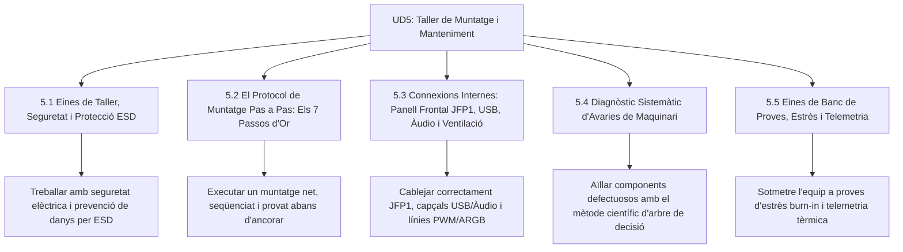

# UD5 Manteniment d'Equips i Taller de Muntatge

Benvingut a la **Unitat Didàctica 5** del mòdul professional de **Muntatge i Manteniment d'Equips (MME)**. Aquesta unitat és el cor pràctic del perfil professional del tècnic en Sistemes Microinformàtics i Xarxes: el taller, el protocol de muntatge segur, el cablejat de precisió, el diagnòstic metòdic d'avaries i la certificació de qualitat en banc de proves.

---

## Mapa d'Aprenentatge de la Unitat

---

## Sessions d'Estudi i Activitats Pràctiques

1. [**5.1 Eines de Taller, Seguretat i Protecció ESD**](ut0501.html)
   - L'amenaça invisible de les descàrregues electroestàtiques (ESD) i polseres antiestàtiques.
   - L'estoig d'eines de precisió (PH1, PH2, alicates de tall ras, pinces ESD).
   - Neteja química amb alcohol isopropílic 99.9% i seguretat amb fonts d'alimentació.

2. [**5.2 El Protocol de Muntatge Pas a Pas (Els 7 Passos d'Or)**](ut0502.html)
   - Preparació del xassís i el perill mortal dels separadors de coure (*standoffs*) sobrants.
   - Pre-muntatge a la caixa de cartó (*breadboarding* bàsic).
   - Ajust en creu de dissipadors i inserció protegida de la placa i GPU.

3. [**5.3 Connexions Internes: Panell Frontal (JFP1), USB, Àudio i Ventilació**](ut0503.html)
   - Distribució estàndard de 9 pins de la capçalera JFP1 (Power SW, Reset SW, LEDs).
   - Capçaleres HD Audio i USB interns (USB 2.0, USB 3.0 i Type-E).
   - Control de ventilació (DC vs PWM) i il·luminació segura (12V RGB vs 5V ARGB).

4. [**5.4 Diagnòstic Sistemàtic d'Avaries de Maquinari**](ut0504.html)
   - El mètode d'aïllament per substitució component a component.
   - Arbre de decisió per als 4 símptomes crítics: no encén, encén i s'apaga, reinicis i artefactes.
   - Resolució d'avaries freqüents: pantalla negra, coil whine i esgotament de pila CR2032.

5. [**5.5 Eines de Banc de Proves, Estrès i Telemetria**](ut0505.html)
   - Telemetria de sensors amb HWiNFO64 (CPU Package, Hot Spot i línia +12V).
   - Banc de proves d'estrès amb Prime95, FurMark i AIDA64.
   - Certificació d'integritat de memòria amb MemTest86 i salut de disc amb CrystalDiskInfo.

---

## Reptes Globals d'Avaluació de la Unitat (+100 pts)

  
Repte Global 1: Prevenció de Riscos al Taller

  
Un alumne del cicle vol netejar una placa base plena de pols i greix utilitzant aigua amb sabó i assecar-la amb un assecador de cabells d'aire calent. Per què aquesta pràctica és inadmissible?

  

    <label style="display:flex; align-items:center; gap:8px; cursor:pointer;"><input type="radio" name="mme_05_global_q1" value="a"> Perquè l'aigua conté sals minerals que provoquen curtcircuits i corrosió immediata en ranures i xips, i l'aire calent d'un assecador pot fondre plàstics i desoldar components SMD; s'ha d'utilitzar pinzell antiestàtic, aire comprimit sec i alcohol isopropílic 99.9%.</label>
    <label style="display:flex; align-items:center; gap:8px; cursor:pointer;"><input type="radio" name="mme_05_global_q1" value="b"> Perquè el sabó atrau els virus informàtics.</label>
    <label style="display:flex; align-items:center; gap:8px; cursor:pointer;"><input type="radio" name="mme_05_global_q1" value="c"> Perquè l'aigua esborraria el número de sèrie de la BIOS.</label>
    <label style="display:flex; align-items:center; gap:8px; cursor:pointer;"><input type="radio" name="mme_05_global_q1" value="d"> Només és inadmissible si la placa està encesa.</label>
  

  <button class="btn-check" data-correct="a" data-feedback="Correcte! La neteja d'electrònica exigeix solvència química pura sense aigua (alcohol isopropílic 99.9%) i eines que no generen electricitat estàtica per fricció d'aire calent.">Comprova la resposta</button>
  

  
Repte Global 2: Protocol de Muntatge Eficient

  
Quin és l'error més greu que pot cometre un tècnic durant la instal·lació mecànica de la placa base a la safata metàl·lica del xassís?

  

    <label style="display:flex; align-items:center; gap:8px; cursor:pointer;"><input type="radio" name="mme_05_global_q2" value="a"> Collar la placa directament sobre la safata de xapa metàl·lica sense col·locar els separadors hexagonals de coure (standoffs), o deixar un separador sobrant en una posició sense forat de cargol.</label>
    <label style="display:flex; align-items:center; gap:8px; cursor:pointer;"><input type="radio" name="mme_05_global_q2" value="b"> Utilitzar un tornavís amb punta magnètica lleugera.</label>
    <label style="display:flex; align-items:center; gap:8px; cursor:pointer;"><input type="radio" name="mme_05_global_q2" value="c"> Connectar primer la memòria RAM abans que el processador.</label>
    <label style="display:flex; align-items:center; gap:8px; cursor:pointer;"><input type="radio" name="mme_05_global_q2" value="d"> Posar la font d'alimentació al compartiment inferior.</label>
  

  <button class="btn-check" data-correct="a" data-feedback="Molt bé! Els standoffs eviten que la cara posterior del circuit imprès toque el metall de la caixa. Collar sense separadors és un curtcircuit massiu assegurat que destruirà la placa.">Comprova la resposta</button>
  

  
Repte Global 3: Resolució de Curts a la Línia de 12V

  
En prémer el botó d'encesa d'un equip, els ventiladors fan un gir de mig segon, s'escolta un 'clic' intern a la font d'alimentació i l'equip s'apaga instantàniament. En tornar a prémer el botó no fa res fins que es desconnecta de la paret durant 10 segons. Què està ocorrent?

  

    <label style="display:flex; align-items:center; gap:8px; cursor:pointer;"><input type="radio" name="mme_05_global_q3" value="a"> La font d'alimentació està detectant un curtcircuit franc en una de les línies de sortida de tensió (habitualment a la línia de 12 V de la CPU o GPU) i ha activat la seua protecció SCP (Short Circuit Protection).</label>
    <label style="display:flex; align-items:center; gap:8px; cursor:pointer;"><input type="radio" name="mme_05_global_q3" value="b"> Windows està fent una actualització silenciosa del sistema.</label>
    <label style="display:flex; align-items:center; gap:8px; cursor:pointer;"><input type="radio" name="mme_05_global_q3" value="c"> El teclat USB està mal configurat a la BIOS.</label>
    <label style="display:flex; align-items:center; gap:8px; cursor:pointer;"><input type="radio" name="mme_05_global_q3" value="d"> La memòria RAM necessita més pasta tèrmica.</label>
  

  <button class="btn-check" data-correct="a" data-feedback="Exacte! El 'clic' és el relé de protecció de la font actuant davant d'un curtcircuit directe. Per a aïllar-lo, cal desconnectar els cables EPS de la CPU i PCIe de la GPU un a un.">Comprova la resposta</button>
  

  
Repte Global 4: Control de Qualitat i Prova de Càrrega

  
Quin protocol mínim ha de superar un equip reparat o muntat abans d'emetre la factura i lliurar-lo al client amb garantia professional?

  

    <label style="display:flex; align-items:center; gap:8px; cursor:pointer;"><input type="radio" name="mme_05_global_q4" value="a"> Comprovar que arrenca l'escriptori de Windows i apagar-lo immediatament.</label>
    <label style="display:flex; align-items:center; gap:8px; cursor:pointer;"><input type="radio" name="mme_05:global_q4" value="b"> Executar un test de càrrega sostinguda (CPU/GPU) d'almenys 30 minuts verificant temperatures segures amb HWiNFO, comprovar que no hi haja errors a la RAM amb MemTest86 i verificar l'estat SMART del disc amb CrystalDiskInfo.</label>
    <label style="display:flex; align-items:center; gap:8px; cursor:pointer;"><input type="radio" name="mme_05_global_q4" value="c"> Netejar la pantalla amb un drap humit.</label>
    <label style="display:flex; align-items:center; gap:8px; cursor:pointer;"><input type="radio" name="mme_05_global_q4" value="d"> Desactivar el tallafocs de Windows.</label>
  

  <button class="btn-check" data-correct="b" data-feedback="Molt bé! La certificació de control de qualitat requereix sotmetre els subsistemes crítics a estrès controlat per garantir que l'equip no fallarà quan l'usuari final l'exigisca a casa o a l'empresa.">Comprova la resposta</button>
  

---

  <h3 style="color: #1e40af; margin-top: 0;">Lliurament del Projecte Global de la Unitat a Aules</h3>
  

    Envia el dossier complet de la Unitat Didàctica 5: <strong>Dossier de Protocol de Muntatge, Diagnosi d'Avaries de Taller i Certificació de Control de Qualitat</strong>. Genera el PDF oficial per a Aules.
  

  

    <input type="text" class="student-name-input" placeholder="El teu nom i cognoms..." style="padding: 8px 12px; border: 1px solid #94a3b8; border-radius: 6px; flex-grow: 1; min-width: 240px;">
    <button class="btn-generate-aules-pdf btn-aules-dl" data-module="MME" data-unit="UD05" data-activity="Global" style="background: #2563eb; color: #fff; border: none; padding: 8px 16px; border-radius: 6px; cursor: pointer; font-weight: 600;">Generar PDF Aules</button>
  

