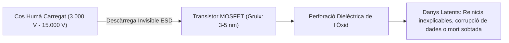

# 5.1 Eines de Taller, Seguretat i Protecció ESD

  

    Progression de la sessió: 5.1 Eines i Seguretat al Taller
    0 / 75 pts
  

  

    

  

  

    1. Perill de l'ESD
    2. Eines Essencials
    3. Protecció Laboral
  

El taller de muntatge i manteniment microinformàtic requereix un entorn de treball ordenat, eines específiques de precisió i el compliment rigorós de les normes de seguretat laboral i protecció electroestàtica.

---

## 1. Descàrregues Electroestàtiques (ESD: Electrostatic Discharge)

L'**ESD** és la transferència sobtada de càrrega elèctrica estàtica entre dos cossos amb potencials elèctrics diferents quan entren en contacte o proximitat immediata.

### Per què l'ESD és letal per a un ordinador?
- El cos humà no percep una descàrrega electroestàtica per sota d'aproximadament **$3.000\text{ V}$** (la típica xicoteta espurna en tocar el pany d'una porta).
- Els components electrònics moderns (xips de memòria RAM, controladors PCIe, xipsets) estan fabricats amb capes d'òxid de silici d'un gruix de pocs nanòmetres, i poden quedar destruïts o greument degradats amb tensions de tan sols **$30\text{ a }100\text{ V}$**.

### Protocols de Protecció Antiestàtica al Taller
1. **Polsera antiestàtica:** Polsera de tela conductora connectada mitjançant un cable amb resistència de protecció d'$1\text{ M}\Omega$ a la presa de terra del taller o a la part metàl·lica no pintada del xassís.
2. **Tapís o catifeta de banc antiestàtica:** Superfície de treball semiconductora dissipativa connectada a terra.
3. **Bosses de transport:** Conservar sempre plaques base, CPUs i targetes gràfiques dins de les seues bosses antiestàtiques metal·litzades (*faraday cage*). Mai dipositar una placa base sobre la part exterior de la seua bossa, ja que la cara externa és conductora.

---

## 2. L'Estoig d'Eines Essencials del Tècnic Microinformàtic

| Eina | Especificació Tècnica Recomanada | Ús Específic al Taller |
| :--- | :--- | :--- |
| **Tornavís Phillips (Creu)** | Mides **PH1** (cargols fins M.2) i **PH2** (cargols estàndard de caixa/font). Amb punta lleument imantada. | Fixació de la placa base, font d'alimentació, discs i targetes d'expansió. |
| **Tornavís Torx / Hexagonal** | Puntetes T8, T10 i capçals hexagonals de $5\text{ mm}$. | Cargols de xassís especials, portàtils i per a collar els separadors (*standoffs*). |
| **Pinces de precisió corbes** | Acer inoxidable antiestàtic (revestiment ESD). | Recuperació de cargols caiguts en racons estrets i col·locació de jumpers. |
| **Alicates de tall diagonal** | Tall ras (*flush cutter*). | Tall net de brides de niló sense deixar vores esmolades que puguen tallar cables. |
| **Alcohol isopropílic (99.9%)** | Puresa química sense residus ni aigua. | Neteja de restes de pasta tèrmica en IHS i bases de coure, i neteja de contactes daurats. |
| **Tovalloles de cel·lulosa** | Sense alliberament de borrissol (*lint-free*). | Neteja de la CPU abans d'aplicar pasta tèrmica nova. |

> [!CAUTION]
> **No utilitzar mai alcohol de farmàcia (96º etílic) ni acetona:** L'alcohol etílic conté un 4% d'aigua que provoca oxidació immediata en contactes elèctrics. L'acetona fon químicament els plàstics dels sòcols i connectors. Utilitza únicament **alcohol isopropílic 99.9%**.

---

## 3. Normativa de Seguretat Laboral i Prevenció de Riscos (PRL)

- **Desconnexió física:** Desendollar sempre el cable de corrent de 230 V abans d'obrir l'ordinador. Prémer el botó d'encesa durant 5 segons amb l'equip desendollat per descarregar completament els condensadors de la font i placa.
- **Risc de tall per xapa metàl·lica:** Les caixes de baixa qualitat tenen arestes de xapa estampada sense doblegar que poden causar talls profunds als dits durant el muntatge.
- **Manipulació de fonts d'alimentació:** Mai obrir la carcassa d'una font d'alimentació (PSU). Els condensadors electrolítics primaris emmagatzemen càrregues letals de fins a 400 V fins i tot hores després d'estar desconnectades.

---

## Reptes Interactius (Avalua els teus coneixements)

  
Repte 1: Prevenció de Danys per ESD

  
Per què una descàrrega electroestàtica humana pot ser fatal per a un mòdul de memòria RAM encara que el tècnic no haja notat cap calfred ni espurna física?

  

    <label style="display:flex; align-items:center; gap:8px; cursor:pointer;"><input type="radio" name="mme_0501_q1" value="a"> Perquè els components electrònics suporten un màxim de només 30 a 100 V, mentre que el cos humà només percep descàrregues a partir de 3.000 V.</label>
    <label style="display:flex; align-items:center; gap:8px; cursor:pointer;"><input type="radio" name="mme_0501_q1" value="b"> Perquè la memòria RAM està fabricada en fusta.</label>
    <label style="display:flex; align-items:center; gap:8px; cursor:pointer;"><input type="radio" name="mme_0501_q1" value="c"> Perquè l'electricitat estàtica només afecta la pintura de la caixa metàl·lica.</label>
    <label style="display:flex; align-items:center; gap:8px; cursor:pointer;"><input type="radio" name="mme_0501_q1" value="d"> Perquè l'aire condicionat inverteix la polaritat dels transistors.</label>
  

  <button class="btn-check" data-correct="a" data-feedback="Correcte! El llindar de sensibilitat tàctil humà és de ~3 kV, però els transistors microscòpics queden destruïts amb tensions molt menors, provocant danys latents silenciosos.">Comprova la resposta</button>
  

  
Repte 2: Elecció del Líquid de Neteja Tèrmic

  
Quin producte químic és l'estàndard professional i segur per a netejar la pasta tèrmica resseca de la CPU i del dissipador sense danyar els circuits?

  

    <label style="display:flex; align-items:center; gap:8px; cursor:pointer;"><input type="radio" name="mme_0501_q2" value="a"> Aigua de l'aixeta amb sabó rentavaixelles.</label>
    <label style="display:flex; align-items:center; gap:8px; cursor:pointer;"><input type="radio" name="mme_0501_q2" value="b"> Alcohol etílic de farmàcia de 96 graus.</label>
    <label style="display:flex; align-items:center; gap:8px; cursor:pointer;"><input type="radio" name="mme_0501_q2" value="c"> Alcohol isopropílic d'alta puresa (99.9%).</label>
    <label style="display:flex; align-items:center; gap:8px; cursor:pointer;"><input type="radio" name="mme_0501_q2" value="d"> Acetona industrial o dissolvent de pintura.</label>
  

  <button class="btn-check" data-correct="c" data-feedback="Molt bé! L'alcohol isopropílic al 99.9% s'evapora ràpidament sense deixar residus miners ni contenir aigua, i no reacciona químicament amb els polímers ni les pistes de coure.">Comprova la resposta</button>
  

  
Repte 3: Seguretat Elèctrica Crítica al Taller

  
Per quin motiu de seguretat està estrictament prohibit obrir la carcassa metàl·lica d'una font d'alimentació commutada (PSU), fins i tot quan està desendollada de la paret?

  

    <label style="display:flex; align-items:center; gap:8px; cursor:pointer;"><input type="radio" name="mme_0501_q3" value="a"> Perquè els seus grans condensadors primaris retenen càrregues elèctriques letals de fins a 400 V que poden provocar una descàrrega greu o mortal.</label>
    <label style="display:flex; align-items:center; gap:8px; cursor:pointer;"><input type="radio" name="mme_0501_q3" value="b"> Perquè conté gas refrigerant tòxic.</label>
    <label style="display:flex; align-items:center; gap:8px; cursor:pointer;"><input type="radio" name="mme_0501_q3" value="c"> Perquè es perdria la configuració de la BIOS.</label>
    <label style="display:flex; align-items:center; gap:8px; cursor:pointer;"><input type="radio" name="mme_0501_q3" value="d"> Perquè el ventilador començaria a girar a l'inrevés.</label>
  

  <button class="btn-check" data-correct="a" data-feedback="Exacte! Els condensadors electrolítics primaris d'alta capacitat mantenen voltatges elevats perillosos durant molt de temps. Una PSU defectuosa no es repara mai obrint-la: se substitueix directament.">Comprova la resposta</button>
  

---

  <h3 style="color: #1e40af; margin-top: 0;">Lliurament de l'Activitat a Aules</h3>
  

    Completa la tasca pràctica: <strong>Act01 - Pla de Seguretat al Taller i Banc de Treball ESD</strong>. Genera el PDF oficial per a Aules.
  

  

    <input type="text" class="student-name-input" placeholder="El teu nom i cognoms..." style="padding: 8px 12px; border: 1px solid #94a3b8; border-radius: 6px; flex-grow: 1; min-width: 240px;">
    <button class="btn-generate-aules-pdf btn-aules-dl" data-module="MME" data-unit="UD05" data-activity="Act01" style="background: #2563eb; color: #fff; border: none; padding: 8px 16px; border-radius: 6px; cursor: pointer; font-weight: 600;">Generar PDF Aules</button>
  

